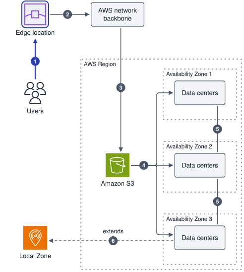

# The AWS map: global infrastructure, shared responsibility, Well-Architected

## Predict (1 min)
<!-- section: role=predict; route=fast; minutes=1 -->

**Predict 1.** An application runs on four EC2 instances in one Availability Zone. Is it highly available? <!-- gist-trap -->

**Predict 2.** Who decides whether an Amazon S3 bucket of customer recordings is public: AWS or the company?

## Look first (3 min)
<!-- section: role=task; route=fast; minutes=3 -->

List your Region's Availability Zones with their AZ IDs, then your Regions. An **AZ ID** names [the same physical location in every AWS account](../facts/global-infrastructure.md#global-infrastructure-az-id-same-physical-location-every-account).

<!-- task:start id=aws-map-t01 -->

Look

**It kills the belief.** "A Region is one data center."

> **Cost:** $0.

**Permissions.** `ec2:DescribeAvailabilityZones`, `ec2:DescribeRegions`

**No permission to create resources?** This task is read-only. It needs no alternative. If your account does not let you start AWS CloudShell, read the AZ ID table of your Region on the AWS Availability Zones page of the Regions and Availability Zones guide.

1. Open AWS CloudShell from the console. List the Availability Zones of the Region that the shell uses, with the name and the AZ ID of each zone.

   ```bash
   aws ec2 describe-availability-zones --filters Name=zone-type,Values=availability-zone --query "AvailabilityZones[].{Region:RegionName,ZoneName:ZoneName,ZoneId:ZoneId}" --output table
   ```

   Expect: One row per zone, and every row shows the same Region. Names such as us-east-1a sit next to IDs such as use1-az1.

2. List every Region, including the Regions that your account has not enabled, with the opt-in status of each one.

   ```bash
   aws ec2 describe-regions --all-regions --query "Regions[].{Region:RegionName,OptIn:OptInStatus}" --output table
   ```

   Expect: One row per Region. Some rows show opt-in-not-required. The other rows show opted-in or not-opted-in.

3. Pick one Region code from that list as <OTHER_REGION>: not your shell's Region, and with the status opt-in-not-required. List the Availability Zones of that Region.

   ```bash
   aws ec2 describe-availability-zones --region <OTHER_REGION> --filters Name=zone-type,Values=availability-zone --query "AvailabilityZones[].{Region:RegionName,ZoneName:ZoneName,ZoneId:ZoneId}" --output table
   ```

   Expect: A second set of zones with other names and other IDs. No zone appears in both tables.

**Label.** checked against docs, not run in a real account. Checked 2026-10-12.

<!-- task:end -->

## In one breath (2 min)
<!-- section: role=breath; route=fast; minutes=2 -->

> **Say it:** AWS runs Regions, each with several Availability Zones, and edge locations near users. AWS secures the cloud; you secure what you put in it.

**The problem it solves.** A workload needs a place near its users that survives a data center failure. It also needs the **shared responsibility model**: [security “of” the cloud versus security “in” the cloud](../facts/well-architected.md#well-architected-shared-responsibility-of-versus-in-the-cloud).

**Predict the picture.** Where does an edge location sit: inside a Region, or near the users?

<details>
<summary>Show the picture</summary>



**Figure.** A Region holds several isolated Availability Zones, and edge locations serve users close to where they are.

1. A user's request reaches a nearby edge location, which runs Amazon CloudFront and Amazon Route 53.
2. Uncached content comes from a Region over the AWS network backbone.
3. The Region is a separate geographic area with multiple Availability Zones.
4. A Regional service such as Amazon S3 is [built on top of multiple Availability Zones](../facts/global-infrastructure.md#global-infrastructure-regional-service-definition).
5. Each Availability Zone is one or more discrete data centers with redundant power, networking and connectivity.
6. A Local Zone extends the Region to a place close to the users.

</details>

> **Startup example:** Callvale runs everything on one instance in one Availability Zone. The founders must choose a Region and learn their own security duties.

## Words that go together (1 min)
<!-- section: role=words; route=fast; minutes=1 -->

<!-- table: words -->
| Term | Words that go with it | Plain meaning | Do not confuse with |
|---|---|---|---|
| Region | **in** a Region | A geographic area with several Availability Zones | Availability Zone |
| Availability Zone | **across** Availability Zones | One or more data centers in a Region | edge location |
| edge location | **cache** at the edge | A site near users for CloudFront | Local Zone |
| high availability (hy uh-vayl-uh-BIL-ih-tee) | **design** for high availability | Stays available when one part fails | fault tolerance |
| Multi-AZ (MUL-tee ay-ZEE) | a Multi-AZ **deployment** | Copies in more than one Availability Zone | multi-Region |

## Choose it or not (2 min)
<!-- section: role=choose; route=fast; minutes=2 -->

### One zone or several zones or a second Region

<!-- table: compare -->
| Question | One Availability Zone | Several Availability Zones | A second Region |
|---|---|---|---|
| Survives one Availability Zone failure? | No: [none of your EC2 instances would be available](../facts/global-infrastructure.md#global-infrastructure-single-az-failure-takes-all-instances) | Yes | Yes |
| Survives a Region failure? | No | No | Yes: Regional services [operate fully independently between different Regions](../facts/global-infrastructure.md#global-infrastructure-regional-services-fail-independently) |
| Synchronous copies possible? | No second zone | Yes: you can [replicate data synchronously between Availability Zones](../facts/global-infrastructure.md#global-infrastructure-az-latency-single-digit-ms) | Often not: an [asynchronously replicated datastore](../facts/global-infrastructure.md#global-infrastructure-async-cross-region-replication-may-lose-data) can lose writes |
| Typical use | Development and test | Production: [at least two Availability Zones (AZs) in a Region](../facts/global-infrastructure.md#global-infrastructure-production-at-least-two-azs) | [workloads that require extreme resilience](../facts/global-infrastructure.md#global-infrastructure-multi-region-only-for-extreme-resilience) |

**Deciding question:** Must the workload survive the loss of a whole Region, or only the loss of one Availability Zone?

## Signals and traps (2 min)
<!-- section: role=signals; route=fast; minutes=2 -->

<!-- table: signals -->
| The stem says | Think | Because | But not if |
|---|---|---|---|
| "the data must stay in one country" | a Region there | services [store customer content in the AWS region(s)](../facts/global-infrastructure.md#global-infrastructure-customer-content-stays-in-chosen-region) you use | a global service; no Region there: Local Zone |
| "if an Availability Zone fails" | two or more Availability Zones | an instance is [specific to the Availability Zone in which you create it](../facts/global-infrastructure.md#global-infrastructure-zonal-resource-deploy-in-multiple-azs) | Region failure: a second Region |
| "if the AWS Region fails" | a second Region | Regional services [operate fully independently between different Regions](../facts/global-infrastructure.md#global-infrastructure-regional-services-fail-independently) | data must stay in one Region: Multi-AZ |
| "static content for users around the world" | CloudFront at edge locations | [Amazon CloudFront](../facts/global-infrastructure.md#global-infrastructure-pop-hosts-cloudfront-route53-global-accelerator) runs there | compute in one city: a Local Zone |
| "single-digit millisecond latency for users in one city" | a Local Zone | built for [single-digit millisecond latency](../facts/global-infrastructure.md#global-infrastructure-faq-local-zones-single-digit-millisecond-latency-workloads) | a database: DynamoDB; 5G devices: Wavelength Zone |
| "patch the operating system" | the customer | the [guest operating system (including updates and security patches)](../facts/well-architected.md#well-architected-customer-responsible-for-guest-os-apps-security-groups) is yours | Amazon RDS: you pick the maintenance window |

### Traps

- **Wrong belief:** Several instances in one Availability Zone are highly available. **Truth:** If that Availability Zone fails, [none of your EC2 instances would be available](../facts/global-infrastructure.md#global-infrastructure-single-az-failure-takes-all-instances). <!-- trap: aws-map-trap-one-az-is-highly-available -->
- **Wrong belief:** On Amazon S3, AWS decides who reads the data. **Truth:** You are responsible for [using IAM tools to apply the appropriate permissions](../facts/iam.md#iam-shared-responsibility-customer-applies-permissions-with-iam). <!-- trap: aws-map-trap-managed-means-aws-secures-data -->
- **Wrong belief:** High availability needs a second Region. **Truth:** [Most customers can achieve their resilience goals in a single Region](../facts/global-infrastructure.md#global-infrastructure-most-customers-single-region-suffices). <!-- trap: aws-map-trap-multi-region-for-high-availability -->

## Changed recently (1 min)
<!-- section: role=changed; route=fast; minutes=1 -->

> **Changed recently:** (2025-11) Availability Zone names.<br>
> **Old:** in the oldest Regions, `us-east-1a` [might not be the same physical location as it is in another account](../facts/global-infrastructure.md#global-infrastructure-az-name-mapping-independent-per-account), for accounts created before November 2025.<br>
> **Now:** [accounts created starting November 2025, get the same Availability Zones mapped to codes](../facts/global-infrastructure.md#global-infrastructure-az-name-mapping-independent-per-account).<br>
> **The exam probably expects:** names that differ; match by AZ ID.<br>
> **Status:** examinable.

## Check (1 min)
<!-- section: role=check; route=fast; minutes=1 -->

**Check 1.** Two subnets behind a load balancer sit in one Availability Zone. That zone fails. Does the application keep serving?

<details>
<summary>Answer</summary>

No: both subnets sit in the failed zone.

**Predict 1:** No: [none of your EC2 instances would be available](../facts/global-infrastructure.md#global-infrastructure-single-az-failure-takes-all-instances).

</details>

**Check 2.** Who configures the security groups of a database on Amazon EC2?

<details>
<summary>Answer</summary>

The team owns the [configuration of the AWS provided security group firewall](../facts/well-architected.md#well-architected-customer-responsible-for-guest-os-apps-security-groups).

**Predict 2:** The company is responsible for [using IAM tools to apply the appropriate permissions](../facts/iam.md#iam-shared-responsibility-customer-applies-permissions-with-iam).

</details>

## Recap from memory (1 min)
<!-- section: role=recap; route=fast; minutes=1 -->

**Recap 1.** What is the one-breath definition?

<details>
<summary>Answer</summary>

AWS runs Regions, each with several Availability Zones, and edge locations near users. AWS secures the cloud; you secure what you put in it.

</details>

**Recap 2.** What is the deciding question?

<details>
<summary>Answer</summary>

Must the workload survive the loss of a whole Region, or only the loss of one Availability Zone?

</details>

**Recap 3.** Who patches the operating system on EC2, and who on Amazon S3?

<details>
<summary>Answer</summary>

The customer on EC2. AWS on Amazon S3.

</details>
