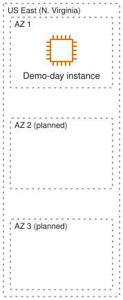

# The AWS map in depth

## How it works (31 min)
<!-- section: role=how; route=full; minutes=31 -->

### Each request goes to one Region and your resources stay there (4 min)

A **Region** is [a physical location in the world](../facts/global-infrastructure.md#global-infrastructure-region-is-separate-geographic-area) with several **Availability Zones** (AZs).

1. **Choose the Region.** Some services, such as IAM, need none: [IAM resources are global](../facts/iam.md#iam-resources-global-same-role-any-region).
2. **Call the Regional endpoint,** such as `dynamodb.us-west-2.amazonaws.com`.
3. **Create the resource there.** It is [specific to the Region in which you create it](../facts/global-infrastructure.md#global-infrastructure-regional-resource-visible-only-in-its-region).

Services come in three scopes, [zonal, Regional, and global](../facts/global-infrastructure.md#global-infrastructure-three-service-types-zonal-regional-global): an EC2 instance, an S3 bucket, an IAM role.

Why? Each Region is [designed to be isolated from the other Regions](../facts/global-infrastructure.md#global-infrastructure-region-isolated-for-fault-tolerance).

> **Exam signal:** "the resources do not appear in the console" points to the Region selector.

> **Exam trap:** Resources stay in their Region [unless you explicitly use a replication or copy feature offered by an AWS service or replicate the resource yourself](../facts/global-infrastructure.md#global-infrastructure-no-automatic-cross-region-replication). <!-- trap: aws-map-trap-region-auto-replicates -->

> **Try it:** Create a security group in one Region; look for it in another. See [3-do.md](3-do.md). <!-- task: aws-map-t03 -->

> **Say it:** The short answer is: a resource lives in its Region. The thing to watch is that AWS copies nothing to another Region for you.

**Stop and answer.** A script in us-west-2 needs an IAM role and a DynamoDB table, both created in us-east-1. Which one works without a copy?

Answer

The IAM role: [IAM resources are global](../facts/iam.md#iam-resources-global-same-role-any-region).

### The best Region is near your users and meets your data rules (4 min)

Regions differ in **latency** (LAY-ten-see), services, law and price. Check four things, data rules first and price last.

1. **Data rules.** If a law names a country, remove the Regions outside that country.
2. **Latency.** You get [lower network latency when you select a Region that is close to the majority of your users](../facts/global-infrastructure.md#global-infrastructure-region-choice-services-and-latency).
3. **Services.** [Select a Region that has the AWS services and features that you need](../facts/global-infrastructure.md#global-infrastructure-region-choice-services-and-latency).
4. **Price.** If a cheaper Region meets your rules, use it: [only deploy in Regions with higher costs to meet latency, data residency and data sovereignty requirements](../facts/well-architected.md#well-architected-region-pricing-differs-choose-by-cost).

Why? The farther the Region, the longer each request travels.

> **Exam signal:** "development and test", no data rules and "MOST cost-effective" point to a lower-priced Region.

> **Say it:** The short answer is: put the workload near its users, inside the law. The thing to watch is that a higher price needs a reason.

**Stop and answer.** Production runs in Asia Pacific (Sydney) for local users. A new test environment has no privacy, security or location obligations. Where can it run for less?

Answer

A lower-priced Region: [deploying non-critical (development and test) Amazon EC2 instances in US East (N. Virginia) (us-east-1) will cost you less](../facts/well-architected.md#well-architected-cheaper-region-for-non-critical-when-no-restrictions).

### Availability Zones fail separately so production uses at least two (5 min)
<!-- section: route=pass -->

1. **Separate sites.** After a fire or a flood, [only a single Availability Zone would be affected](../facts/global-infrastructure.md#global-infrastructure-az-definition-discrete-data-centers).
2. **Close together.** All are [within 100 km](../facts/global-infrastructure.md#global-infrastructure-az-distance-within-100-km) of each other, so you can [replicate data synchronously between Availability Zones](../facts/global-infrastructure.md#global-infrastructure-az-latency-single-digit-ms).
3. **Subnets.** [Each subnet must reside entirely within one Availability Zone and cannot span zones](../facts/vpc.md#vpc-subnet-one-az-protects-from-zone-failure).
4. **Amazon S3 spreads itself.** It is [designed to automatically recover from the failure of an Availability Zone](../facts/global-infrastructure.md#global-infrastructure-s3-regional-recovers-from-az-failure). Storage classes differ; the S3 chapter compares them. <!-- xref: 21 S3 storage classes -->

So production runs in [at least two Availability Zones (AZs) in a Region](../facts/global-infrastructure.md#global-infrastructure-production-at-least-two-azs): a **Multi-AZ** (MUL-tee ay-ZEE) design for **high availability** (hy uh-vayl-uh-BIL-ih-tee).

Why split a Region? The zones are [designed not to be simultaneously impacted by a shared fate scenario](../facts/global-infrastructure.md#global-infrastructure-az-no-shared-fate).

> **Exam signal:** "remain available if an Availability Zone fails" points to two or more Availability Zones.

Go deeper: AZ IDs

For older accounts in the oldest Regions, [we independently map Availability Zones to codes for each AWS account](../facts/global-infrastructure.md#global-infrastructure-az-name-mapping-independent-per-account). An **AZ ID**, such as use1-az2, is [the same physical location in every AWS account](../facts/global-infrastructure.md#global-infrastructure-az-id-same-physical-location-every-account). Match accounts by AZ ID.

Go deeper: static stability

After a zone fails, [deploying new instances through auto scaling relies on the EC2 control plane](../facts/global-infrastructure.md#global-infrastructure-auto-scaling-relies-on-ec2-control-plane), and that takes time. So [having that extra capacity pre-provisioned helps achieve static stability](../facts/global-infrastructure.md#global-infrastructure-pre-provision-capacity-instead-of-control-plane-recovery).

> **Say it:** The short answer is: spread production across Availability Zones. The thing to watch is that each subnet sits in one Availability Zone.

**Stop and answer.** An Auto Scaling group runs six instances in two subnets. Both subnets are in AZ 1. AZ 1 fails. How many instances keep serving?

Answer

None. Both subnets sit in AZ 1.

### A second Region protects against Region failure but replicates asynchronously (5 min)
<!-- section: route=pass -->

Availability Zones cover a data center failure. Some workloads need to survive a Regional failure too.

1. **Regions fail independently.** [A failure of an AWS Regional service is designed not to impact the service in a different Region](../facts/global-infrastructure.md#global-infrastructure-regional-services-fail-independently).
2. **Most workloads stop at Multi-AZ:** [most customers can achieve their resilience goals in a single Region](../facts/global-infrastructure.md#global-infrastructure-most-customers-single-region-suffices).
3. **An asynchronous copy runs behind.** With an [asynchronously replicated datastore](../facts/global-infrastructure.md#global-infrastructure-async-cross-region-replication-may-lose-data) across Regions, there is [the possibility of data loss or inconsistency when you fail over](../facts/global-infrastructure.md#global-infrastructure-async-cross-region-replication-may-lose-data). Services differ.
4. **Two numbers set the goal.** The **recovery point objective** ([RPO](../facts/well-architected.md#well-architected-rpo-definition)) is the data loss you accept, as time. The **recovery time objective** ([RTO](../facts/well-architected.md#well-architected-rto-definition)) is the downtime you accept.
5. **Route 53 moves the users.** It can [use the status of health checks to perform failovers between Regions](../facts/global-infrastructure.md#global-infrastructure-route53-failover-use-health-checks-not-record-changes).

<!-- table: plain -->
| Requirement | Design | Copy |
|---|---|---|
| Survive an AZ failure | Multi-AZ | Can be synchronous |
| Survive a Region failure | A second Region | Often asynchronous |

Why not always add a Region? [You must duplicate your workload's components in each Region](../facts/global-infrastructure.md#global-infrastructure-multi-region-duplicate-everything-no-cross-region-dependency).

> **Exam signal:** "survive the failure of an entire AWS Region" points to a second Region.

> **Exam trap:** An option promises no data loss after a failover to an asynchronous copy. It brings [the possibility of data loss or inconsistency when you fail over](../facts/global-infrastructure.md#global-infrastructure-async-cross-region-replication-may-lose-data). <!-- trap: aws-map-trap-sync-replication-across-regions -->

> **Say it:** The short answer is: a second Region covers a Region failure. The thing to watch is that an asynchronous copy runs behind.

**Stop and answer.** Region A copies writes asynchronously to Region B. The last write that reached Region B was 20 seconds before Region A failed. What is lost, and which number judges that loss?

Answer

The writes of those last seconds. The RPO decides.

### Edge locations serve users nearby and Local Zones run compute near them (4 min)

AWS comes closer to users in several ways.

1. **An edge location serves users nearby** with AWS services such as [Amazon CloudFront](../facts/global-infrastructure.md#global-infrastructure-pop-hosts-cloudfront-route53-global-accelerator), [Amazon Route 53](../facts/global-infrastructure.md#global-infrastructure-pop-hosts-cloudfront-route53-global-accelerator) and [AWS Global Accelerator](../facts/global-infrastructure.md#global-infrastructure-pop-hosts-cloudfront-route53-global-accelerator).
2. **A Local Zone runs your compute in a city.** It is [an extension of an AWS Region in geographic proximity to your users](../facts/global-infrastructure.md#global-infrastructure-local-zone-extension-of-region-own-internet).
3. **You opt in.** [You must first enable it](../facts/global-infrastructure.md#global-infrastructure-local-zone-must-be-enabled-then-subnet), then [create a subnet in the Local Zone](../facts/global-infrastructure.md#global-infrastructure-local-zone-must-be-enabled-then-subnet).

<!-- table: plain -->
| Need | Choose |
|---|---|
| Content near users worldwide | Edge locations |
| Your compute in one city | A Local Zone |
| [ultralow-latency applications to 5G devices](../facts/global-infrastructure.md#global-infrastructure-faq-wavelength-ultralow-latency-for-5g-devices) | A Wavelength Zone |
| The workload stays on premises | AWS Outposts |

Why two answers? An edge location serves cached content; a Local Zone runs your instances.

> **Exam signal:** "single-digit millisecond latency" for users in one city points to a Local Zone.

> **Exam trap:** An option launches EC2 instances "at an edge location". Edge locations host services such as [Amazon CloudFront](../facts/global-infrastructure.md#global-infrastructure-pop-hosts-cloudfront-route53-global-accelerator); EC2 instances near one city go into a Local Zone. <!-- trap: aws-map-trap-edge-location-runs-workloads -->

> **Say it:** The short answer is: edge locations serve content; Local Zones run compute. The thing to watch is that a Local Zone has fewer services.

**Stop and answer.** A news site serves the same images from one Region to readers on five continents. Does it need Local Zones or edge locations?

Answer

Edge locations, through Amazon CloudFront. No compute needs to move.

### AWS secures the cloud and you secure what you put in it (5 min)
<!-- section: route=pass -->

Who fixes a public bucket? The **shared responsibility model** says: it depends on the layer.

1. **Hosts and buildings: AWS.** AWS controls the [host operating system and virtualization layer](../facts/well-architected.md#well-architected-aws-controls-host-os-virtualization-and-facilities).
2. **On Amazon EC2, the guest operating system: you.** You own the [guest operating system (including updates and security patches)](../facts/well-architected.md#well-architected-customer-responsible-for-guest-os-apps-security-groups).
3. **On Amazon S3, data and access: you.** [AWS operates the infrastructure layer, the operating system, and platforms](../facts/well-architected.md#well-architected-abstracted-services-aws-runs-os-customer-manages-data), but you grant access [using IAM tools to apply the appropriate permissions](../facts/iam.md#iam-shared-responsibility-customer-applies-permissions-with-iam).

**Figure.** On Amazon EC2 you manage the guest operating system, but on Amazon S3 AWS runs it, and you still own data and permissions.

Why? [You retain control of the security you choose to implement](../facts/well-architected.md#well-architected-security-in-the-cloud-you-retain-control).

> **Exam signal:** "patch the operating system of the EC2 instances" points to the customer.

> **Exam trap:** Shared patching does not mean AWS patches your instances: [customers are responsible for patching their guest OS and applications](../facts/well-architected.md#well-architected-patch-management-is-a-shared-control). <!-- trap: aws-map-trap-ec2-guest-os-patched-by-aws -->

**Spot the bug.** A startup's notes say: "On Amazon EC2 we patch the guest operating system, and AWS configures our security groups." What is wrong?

Answer

The security groups. The customer owns the [configuration of the AWS provided security group firewall](../facts/well-architected.md#well-architected-customer-responsible-for-guest-os-apps-security-groups).

> **Say it:** The short answer is: AWS secures the hosts; you secure your data. The thing to watch is EC2: you patch its operating system.

**Stop and answer.** A team moves job records from an EC2 database to Amazon DynamoDB. Who now chooses their encryption options?

Answer

The team: [managing their data (including encryption options), classifying their assets](../facts/iam.md#iam-shared-responsibility-customer-applies-permissions-with-iam) stays with the customer.

### The Well-Architected Framework turns six pillars into review questions (4 min)

1. **Ask questions.** The **AWS Well-Architected Framework** is [a consistent set of best practices for customers and partners to evaluate architectures](../facts/well-architected.md#well-architected-framework-definition-best-practices-and-questions).
2. **Group them.** There are [six pillars](../facts/well-architected.md#well-architected-six-pillars).
3. **Talk, do not audit.** A review is [a lightweight process (hours not days)](../facts/well-architected.md#well-architected-review-is-conversation-not-audit).
4. **Sort the findings** into [a list of issues that you can prioritize based on your business context](../facts/well-architected.md#well-architected-review-outcome-prioritized-issues).

<!-- table: plain -->
| Pillar | It asks about |
|---|---|
| Operational excellence | Running and improving workloads |
| Security | Protecting data, systems and assets |
| Reliability | Working correctly and consistently |
| Performance efficiency | Using resources efficiently |
| Cost optimization | Business value at the [lowest price point](../facts/well-architected.md#well-architected-pillar-cost-optimization-definition) |
| Sustainability | [reducing energy consumption and increasing efficiency](../facts/well-architected.md#well-architected-pillar-sustainability-definition) |

Why no single answer? Business needs differ. One rule holds: [Security and operational excellence are generally not traded-off against the other pillars](../facts/well-architected.md#well-architected-security-and-operational-excellence-not-traded-off).

> **Exam signal:** "review the workload against AWS best practices" points to the AWS Well-Architected Tool. <!-- xref: 38 Well-Architected Tool -->

> **Say it:** The short answer is: the Framework is six sets of design questions. The thing to watch is that security is not traded away.

**Stop and answer.** A team wants a cheaper development copy. It proposes three cuts: one Availability Zone, no encryption at rest, no operations runbook. Which cut fits the trade-off advice?

Answer

One Availability Zone: [reduce cost at the expense of reliability in development environments](../facts/well-architected.md#well-architected-tradeoff-examples-dev-versus-mission-critical).

## Numbers that decide answers (2 min)
<!-- section: role=numbers; route=full; minutes=2 -->

### A-list

<!-- table: numbers -->
| Number | What it is | Why it decides an answer |
|---|---|---|
| [at least three Availability Zones](../facts/global-infrastructure.md#global-infrastructure-region-min-three-azs) | In every Region | Usually three; newer accounts get [two Availability Zones](../facts/global-infrastructure.md#global-infrastructure-us-west-1-newer-accounts-two-azs) in US West (N. California) |
| [at least two Availability Zones (AZs) in a Region](../facts/global-infrastructure.md#global-infrastructure-production-at-least-two-azs) | For production | One AZ is not highly available |
| [within 100 km](../facts/global-infrastructure.md#global-infrastructure-az-distance-within-100-km) | Between AZs of a Region | Near enough for synchronous copies |
| [single-digit millisecond](../facts/global-infrastructure.md#global-infrastructure-az-latency-single-digit-ms) | Latency between the zones of one Region | Synchronous copies stay in a Region |

### B-list

<!-- table: numbers -->
| Number | What it is |
|---|---|
| [a Region introduced after March 20, 2019](../facts/global-infrastructure.md#global-infrastructure-opt-in-regions-after-march-2019) | Needs opt-in |
| [99.9%](../facts/well-architected.md#well-architected-availability-99-9-percent-max-downtime) | [8 hours 45 minutes](../facts/well-architected.md#well-architected-availability-99-9-percent-max-downtime) down a year |
| [99.99%](../facts/well-architected.md#well-architected-availability-99-99-percent-max-downtime) | [52 minutes](../facts/well-architected.md#well-architected-availability-99-99-percent-max-downtime) down a year |
| [50% additional instances](../facts/global-infrastructure.md#global-infrastructure-static-stability-example-three-per-az-fifty-percent) | Static stability, three AZs |

## Decision record (3 min)
<!-- section: role=example; route=full; minutes=3 -->

**Context.** An investor asks for a technical review. The first Well-Architected review lists 12 high-risk findings. First, Callvale picks its home Region.

**Requirement.** The workload must serve the first customers, on the US East Coast, with the LOWEST latency.

**Options.**

- US West (Oregon), near the founders.
- **US East (N. Virginia), near the first customers.**
- Two Regions from the first day.

**Decision.** US East (N. Virginia), planned for three Availability Zones.

**Trade-off.** A Region failure stops the service. Callvale accepts that until a customer needs a second Region.

**Figure.** At demo day, one hand-built instance in one Availability Zone runs everything, and the review marks its high-risk findings.

**Figure.** The plan keeps `US East (N. Virginia)` and prepares three Availability Zones, so that later chapters can spread each layer across zones.

## FAQ quick-fire (2 min)
<!-- section: role=faq; route=full; minutes=2 -->

**FAQ 1.** Can a Local Zone help you meet a data residency requirement?

Answer

Yes, with local storage.

> "By leveraging local storage services, like Amazon EBS and Amazon FSx, you can ensure your data stays in specific Local Zones."
> — [AWS Local Zones FAQs](https://aws.amazon.com/about-aws/global-infrastructure/localzones/faqs/)

**FAQ 2.** Does a Local Zone offer every service of its parent Region?

Answer

No. It brings the core services.

> "Local Zones are designed to bring the core services needed for the latency-sensitive portions of your workload closer to end users, while Availability Zones provide access to the full array of AWS services."
> — [AWS Local Zones FAQs](https://aws.amazon.com/about-aws/global-infrastructure/localzones/faqs/)

**FAQ 3.** Do you pay extra for the AWS Well-Architected Tool?

Answer

No: [no additional charge](../facts/well-architected.md#well-architected-faq-tool-no-additional-charge).

> "There is no additional charge for the AWS Well-Architected Tool."
> — [AWS Well-Architected Tool FAQs](https://aws.amazon.com/well-architected-tool/faqs/)

**FAQ 4.** Can AWS CloudShell keep your files between sessions?

Answer

Yes, up to [1 GB](../facts/management-console.md#management-console-cloudshell-faq-home-directory-persists-1-gb-per-region) per Region, deleted after [120 days](../facts/management-console.md#management-console-cloudshell-storage-deleted-after-120-days-unused) without use.

> "You can store up to 1 GB of files in your home directory in each supported AWS Region."
> — [AWS CloudShell FAQs](https://aws.amazon.com/cloudshell/faqs/)

**FAQ 5.** Can AWS CloudShell do more than your console sign-in allows?

Answer

No.

> "You have the same privileges as if you were to install, configure, and use the AWS CLI on your local machine with the same credentials – no more, no less."
> — [AWS CloudShell FAQs](https://aws.amazon.com/cloudshell/faqs/)

## In the real world (1 min)
<!-- section: role=realworld; route=full; minutes=1 -->

**Vanguard, 2023.** Its domain architect says: [We started with a baseline of the AWS Well-Architected Framework](../facts/well-architected.md#well-architected-case-vanguard-well-architected-tool-resilience).

> "Learn how Vanguard uses Amazon Web Services (AWS) solutions and the AWS Well-Architected Tool to better communicate best practices internally and build more resilient applications."
> — [Vanguard Improves Resilience and Communication Using AWS Well-Architected](https://aws.amazon.com/solutions/case-studies/vanguard-video-case-study/)

**It shows:** one Framework gives teams one baseline.
