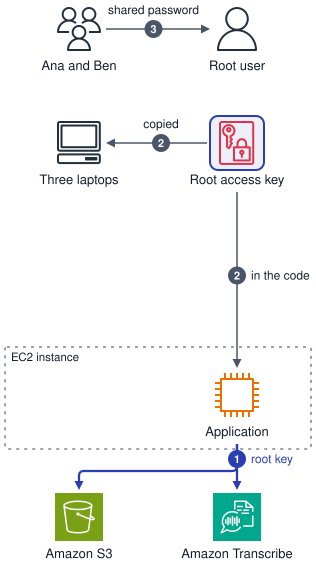

# IAM in depth

## How it works (59 min)
<!-- section: role=how; route=full; minutes=59 -->

### Every AWS call is a signed request that IAM answers (4 min)

For each call, AWS checks who sent it and what it can do.

1. **Sign.** The sender signs the request with its credentials.
2. **Authenticate.** AWS learns the sender: the **principal** (PRIN-sih-pul).
3. **Authorize.** AWS evaluates the policies against the [principal, resources, actions, and other environmental properties](../facts/iam.md#iam-request-context-contents) of the request.
4. **Answer.** The call runs, or an access denied error comes back.


**Figure.** A request passes the deny check, every ceiling and one grant, or it is denied.

An IAM change [can take some time](../facts/iam.md#iam-eventually-consistent-changes-replicate).

Why check every call? Permissions change, so they are [evaluated each time a request is made](../facts/sts.md#sts-temporary-credentials-cannot-be-revoked-permissions-can-change).

> **Exam signal:** "which security task belongs to the company" for a managed service points to IAM permissions.

> **Exam trap:** One leaked set of temporary credentials [cannot be revoked](../facts/sts.md#sts-temporary-credentials-cannot-be-revoked-permissions-can-change); revoke the role's sessions. <!-- trap: iam-trap-revoke-temporary-credentials -->

- **Wrong belief:** For Amazon S3 and DynamoDB, the customer patches the hosts. **Truth:** [AWS operates the infrastructure layer, the operating system, and platforms](../facts/iam.md#iam-shared-responsibility-customer-applies-permissions-with-iam). You are responsible for [using IAM tools to apply the appropriate permissions](../facts/iam.md#iam-shared-responsibility-customer-applies-permissions-with-iam). <!-- trap: iam-trap-customer-secures-aws-infrastructure -->

> **Say it:** The short answer is: AWS checks the policies on every call. The thing to watch is that an IAM change takes some time to replicate.

**Stop and answer.** A role session has 50 minutes left. An administrator removes s3:GetObject from the role, and the change has replicated. Does the next GetObject call succeed?

<details>
<summary>Answer</summary>

No. The credentials are valid, but the role no longer allows the call.

</details>

### A policy statement pairs an effect with actions and resources (4 min)

AWS writes a permission as a **policy**: a [JavaScript Object Notation (JSON) document](../facts/iam.md#iam-faq-policy-is-json-document) of statements.

```json
{
  "Effect": "Allow",
  "Action": "s3:GetObject",
  "Resource": "arn:aws:s3:::example-reports/*"
}
```

1. **Effect.** [The Effect element is required](../facts/iam.md#iam-policy-statement-required-elements): Allow or Deny.
2. **Action.** A statement has [either an Action or a NotAction element](../facts/iam.md#iam-policy-statement-required-elements).
3. **Resource.** It has [either a Resource or a NotResource element](../facts/iam.md#iam-policy-statement-required-elements).

<!-- table: plain -->
| Kind | Attach to many identities? |
|---|---|
| AWS managed | Yes; you [cannot change the permissions of an AWS managed policy](../facts/iam.md#iam-aws-managed-policy-cannot-be-changed) |
| Customer managed | Yes, with [up to five versions](../facts/iam.md#iam-policy-versions-five) |
| Inline | No: [a strict one-to-one relationship and is deleted with the identity](../facts/iam.md#iam-managed-vs-inline-policies) |

Why narrow an AWS managed policy? It [might not grant least-privilege permissions for your specific use cases](../facts/iam.md#iam-best-practice-aws-managed-policies-not-least-privilege).

> **Exam signal:** "broad access, but no IAM administration" points to PowerUserAccess: all services [except IAM, AWS Organizations and AWS Account Management](../facts/iam.md#iam-job-function-poweruseraccess-excludes-iam-org).

> **Exam trap:** An IAM group is not a principal: you [cannot identify a user group as a principal](../facts/iam.md#iam-principal-group-cannot-be-principal). <!-- trap: iam-trap-group-as-principal -->

> **Say it:** The short answer is: allow or deny, which actions, on which resources. The thing to watch is a broad AWS managed policy.

**Stop and answer.** A customer managed policy has five versions. An update with the AWS CLI fails. What comes first?

<details>
<summary>Answer</summary>

Delete a version that is not the default: [you must first delete one or more existing versions](../facts/iam.md#iam-policy-versions-cli-must-delete-before-sixth).

</details>

### AWS allows a request only when nothing denies and something allows (5 min)
<!-- section: route=pass -->

Many policies can apply to one request, and they can disagree.

The rule starts from No: by default, [all requests are implicitly denied](../facts/iam.md#iam-eval-implicit-deny-by-default). This is an **implicit deny**.

Now follow one request through four checks.

1. **Collect.** AWS evaluates [every applicable policy of these types](../facts/iam.md#iam-eval-policy-types-checked-in-account). They are service control policies (SCPs), resource control policies (RCPs, added on [2024-11-13](../facts/iam.md#iam-change-rcps-launched-2024-11)), resource-based and identity-based policies, permissions boundaries and session policies.
2. **Look for a deny.** AWS [first looks for a Deny statement in every policy that applies](../facts/iam.md#iam-eval-deny-checked-first). [Even one explicit deny that applies](../facts/iam.md#iam-eval-deny-checked-first) ends the evaluation: an **explicit deny**.
3. **Check every ceiling.** An SCP, an RCP, a permissions boundary and a session policy each set a ceiling. They give nothing: [an SCP never grants permissions](../facts/iam.md#iam-scp-never-grants-permissions), [an RCP never grants permissions](../facts/iam.md#iam-rcp-never-grants-limits-resources), and a boundary [does not provide permissions on its own](../facts/iam.md#iam-boundary-limits-but-never-grants). Session policies [do not grant permissions](../facts/iam.md#iam-session-policy-limits-does-not-grant) either. But in one account, a resource-based policy that [grants permissions to an IAM user ARN is not limited by an implicit deny](../facts/iam.md#iam-boundary-user-arn-grant-not-limited) in boundaries.
4. **Find a grant.** An identity-based or a resource-based policy allows the action. If none does, [the request is implicitly denied](../facts/iam.md#iam-eval-identity-policy-no-allow-is-implicit-deny).

With an SCP, a boundary and an identity-based policy, a request is [allowed only if all three policy types allow it](../facts/iam.md#iam-scp-boundary-identity-all-must-allow). One action, s3:GetObject, by a role in a member account:

<!-- table: plain -->
| Case | SCP | Identity-based policy | Bucket policy | Result |
|---|---|---|---|---|
| 1 | Allows S3 | Allows the action | Silent | Allow |
| 2 | Allows S3 | Silent | Silent | Implicit deny |
| 3 | Allows EC2, not S3 | Allows the action | Silent | Implicit deny |
| 4 | Allows S3 | Allows the action | Denies the action | Explicit deny |

Why does a deny win? A security team writes a Deny as a guardrail. If an allow could cancel it, AdministratorAccess would break the guardrail. So [an explicit deny overrides an explicit allow](../facts/iam.md#iam-eval-explicit-deny-overrides-allow), and the fix for an explicit deny is to remove it.

> **Exam signal:** "no one, including administrators" points to a Deny in an SCP on a member account. An administrator can delete a Deny inside the account, but member account principals [cannot remove or change SCPs that are applied to that account](../facts/iam.md#iam-scp-faq-member-principals-cannot-change-scps).

<details>
<summary>Go deeper: principals that SCPs do not limit</summary>

These principals escape SCPs: SCPs [do not affect users or roles in the management account](../facts/iam.md#iam-scp-no-effect-on-management-account), and [Service-linked roles cannot be restricted by SCPs](../facts/iam.md#iam-scp-no-effect-on-service-linked-roles).

</details>

> **Try it:** Give a test role an allow and a deny for the same action, and watch the policy simulator choose. See [3-do.md](3-do.md). <!-- task: iam-t02 -->

> **Say it:** The short answer is: a request needs one allow and no deny. The thing to watch is a ceiling, such as an SCP.

**Stop and answer.** A developer role has an identity-based policy that allows s3:\* on every bucket. Its permissions boundary allows s3:GetObject and nothing else. No policy has a Deny statement. Can the role upload an object with s3:PutObject?

<details>
<summary>Answer</summary>

No. The boundary is a ceiling, and it does not allow PutObject, so the result is an implicit deny.

</details>

### The root user and IAM users hold long-term credentials (4 min)

The root user and IAM users can have access keys that [remain valid until you manually revoke them](../facts/iam.md#iam-long-term-keys-valid-until-revoked-temporary-expire).

1. **Root user.** It has [full access by default](../facts/iam.md#iam-principals-have-no-permissions-by-default-root-has-full-access), so AWS says [do not create access keys for the root user](../facts/iam.md#iam-root-do-not-create-access-keys).
2. **Root MFA.** [All AWS account types (standalone, management, and member accounts)](../facts/iam.md#iam-root-mfa-required-all-account-types) require multi-factor authentication (MFA) for the root user.
3. **IAM user.** A user can have [two access keys](../facts/iam.md#iam-access-keys-max-two-per-user), so a rotation uses the second one.
4. **Group.** A policy on a group reaches every member, but [groups cannot be nested](../facts/iam.md#iam-groups-no-nesting-not-principals).

Why federate people? Federated users sign in with an identity provider and assume roles. AWS asks you to [require your human users to use temporary credentials](../facts/iam.md#iam-best-practice-human-users-federate-with-identity-center).

> **Exam signal:** "secure the root user" points to root MFA and no root access keys.

> **Exam trap:** The root user [must not be used for everyday tasks, even administrative ones](../facts/iam.md#iam-root-user-not-for-everyday-tasks-roles-instead). <!-- trap: iam-trap-root-for-daily-admin --> <!-- xref: 04 Organizations centralized root access -->

- **Wrong belief:** Employees and vendors should get IAM users. **Truth:** Use roles; for employees, IAM Identity Center is the [recommended front door into AWS](../facts/iam.md#iam-idc-recommended-front-door-for-workforce). <!-- trap: iam-trap-iam-users-for-people -->

> **Say it:** The short answer is: give the root user MFA and keep it for root tasks. The thing to watch is an old access key.

**Stop and answer.** An IAM user's password expired. A script on the user's laptop uses the user's access key. Does it still work?

<details>
<summary>Answer</summary>

Yes. The user [can continue to use their access keys](../facts/iam.md#iam-password-expired-user-keeps-access-keys).

</details>

### A role gives temporary credentials to principals that its trust policy names (5 min)
<!-- section: route=pass -->

The fix for a long-lived key is an identity that keeps no key and gets short-lived credentials on request. That identity is an **IAM role**. A role [does not have standard long-term credentials, such as a password or access keys](../facts/iam.md#iam-users-have-long-term-credentials-roles-do-not). You [attach both a trust policy and an identity-based policy to an IAM role](../facts/iam.md#iam-role-trust-policy-only-resource-based-policy-in-iam):

- The **trust policy** answers "Who can use me?" Its Principal element [names who can assume the role](../facts/iam.md#iam-role-trust-policy-names-who-can-assume).
- The **permissions policy** answers "What can the session do?" [The permissions policy of the role being assumed determines what the temporary credentials](../facts/iam.md#iam-role-permissions-policy-defines-session-permissions) can do.

Now follow one AssumeRole call.

1. A principal calls sts:AssumeRole with the Amazon Resource Name (ARN) of the role.
2. AWS Security Token Service (AWS STS) reads the trust policy. If the trust policy names neither the principal nor its account, AWS STS refuses. Across accounts, the trust policy is [only half of the cross-account trust](../facts/iam.md#iam-assume-role-two-permissions-checked): the caller's own policy must also allow sts:AssumeRole on the role ARN.
3. AWS STS returns [an access key ID, a secret access key and a session token](../facts/sts.md#sts-temporary-credentials-include-session-token), with [the date on which the current credentials expire](../facts/sts.md#sts-credentials-include-expiration).
4. The session has the role's permissions, not the caller's: [the permissions are not cumulative](../facts/iam.md#iam-assume-role-replaces-original-permissions).
5. At the end, [after they expire AWS no longer accepts any API request made with them](../facts/sts.md#sts-temporary-credentials-expire-not-stored).

On EC2, your code does not call AssumeRole itself. Code on the instance can [get automatic temporary security credentials from the instance metadata](../facts/iam.md#iam-instance-profile-one-role-and-metadata-credentials), and they are [temporary and updated automatically](../facts/iam.md#iam-ec2-role-credentials-rotate-automatically).

Why does AWS prefer a role to a key? A leaked session stops working when it expires; a leaked key works until someone acts.

> **Exam signal:** "the AssumeRole call fails" points to the trust policy, and across accounts also to the caller's own allow. "The call succeeds, but the next call fails" points to the permissions policy.

<details>
<summary>Go deeper: session length and role chaining</summary>

Role chaining [limits the session to one hour regardless of the role's maximum session duration](../facts/iam.md#iam-role-chaining-one-hour-limit-exceptions).

On EC2, role credentials are [not subject to the role's maximum session duration](../facts/iam.md#iam-ec2-role-credentials-not-limited-by-max-session).

</details>

<details>
<summary>Go deeper: leaked credentials</summary>

"Revoke active sessions" on the role adds an inline policy that [denies all permissions to all actions](../facts/iam.md#iam-revoke-role-sessions-denies-credentials-issued-before). Credentials [issued before the specified time become invalid](../facts/iam.md#iam-revoke-role-sessions-denies-credentials-issued-before).

</details>

> **Say it:** The short answer is: use a role, not a key. The thing to watch is the trust policy, which names who can use the role.

**Stop and answer.** A contractor's IAM user in account A can write to a bucket in account A. The contractor assumes a role in account B that can read one bucket in account B. During the role session, can the contractor write to the bucket in account A?

<details>
<summary>Answer</summary>

No. As in step 4, the session has the role's permissions, not the contractor's.

</details>

### Passing a role to a service needs the PassRole permission (4 min)

Without a check, a developer could give an instance a stronger role.

1. **Check PassRole.** The developer who names the role [must have the iam:PassRole permission for that role](../facts/iam.md#iam-passrole-required-to-give-role-to-service).
2. **Check trust.** The role needs [a trust policy for the role that allows the service to assume the role](../facts/iam.md#iam-passrole-required-to-give-role-to-service).
3. **Deliver.** The role reaches the instance in an instance profile.

For a service role, [an IAM administrator can create, modify and delete](../facts/iam.md#iam-service-role-vs-service-linked-role) it. A service-linked role belongs to its service: you [can view but not edit its permissions](../facts/iam.md#iam-service-linked-role-owned-by-service).

[Every Lambda function must have an execution role](../facts/iam.md#iam-lambda-resource-policy-vs-execution-role) for its own calls. When Amazon S3 invokes the function, [Lambda considers only the resource-based policy](../facts/iam.md#iam-lambda-resource-policy-vs-execution-role) on the function.

Why a separate permission? Without it, a user could pass [a role that has more permissions than you want the user to have](../facts/iam.md#iam-passrole-prevents-privilege-escalation).

> **Exam signal:** "developers must not attach unapproved roles" points to iam:PassRole on the approved role ARNs.

> **Exam trap:** Code on an EC2 instance needs no access key: [AWS delivers the temporary credentials of an IAM role to that compute resource](../facts/iam.md#iam-compute-services-receive-role-credentials-no-keys-needed). <!-- trap: iam-trap-keys-on-instance -->

> **Say it:** The short answer is: passing a role needs PassRole for that role. The thing to watch is a wildcard that passes any role.

**Stop and answer.** An auditor searches AWS CloudTrail for the PassRole event that gave an instance its role. What does the auditor find?

<details>
<summary>Answer</summary>

No such event: [PassRole is a permission, not an API call](../facts/iam.md#iam-passrole-is-a-permission-not-api-call). Read the launch event.

</details>

### Same-account access needs one allow but cross-account access needs two (5 min)
<!-- section: route=pass -->

A permission can live in two places: on the identity, or on the resource.

- An **identity-based policy** is attached to a user, group or role. You [cannot use the Principal element in an identity-based policy](../facts/iam.md#iam-principal-element-not-in-identity-policies); the principal is the identity that holds the policy.
- A **resource-based policy** is attached to a resource, for example [S3 buckets, SQS queues, VPC endpoints, KMS encryption keys, DynamoDB tables and streams](../facts/iam.md#iam-resource-based-policy-examples). It names its principal: [you must indicate the account, user, role, or AWS STS federated user principal](../facts/iam.md#iam-principal-element-resource-policy-not-identity-policy).

Now ask: who owns each side? In one account, one owner controls both policies, so one allow is enough: [the permissions of identity-based and resource-based policies are a union](../facts/iam.md#iam-eval-same-account-identity-or-resource-allow).

Across two accounts, AWS evaluates both accounts and [allows the request only if both evaluations return Allow](../facts/iam.md#iam-eval-cross-account-needs-both-policies). [The account where the principal exists is the trusted account](../facts/iam.md#iam-cross-account-trusted-vs-trusting), and [the account where the resource exists is the trusting account](../facts/iam.md#iam-cross-account-trusted-vs-trusting).

<!-- table: plain -->
| Where is the bucket? | Identity-based policy | Bucket policy | Result |
|---|---|---|---|
| Same account | Allows | Silent | Allow |
| Same account | Silent | Allows | Allow |
| Other account | Allows | Silent | Implicit deny |
| Other account | Silent | Allows | Implicit deny |
| Other account | Allows | Allows | Allow |

The table assumes that no deny and no ceiling applies. Why two allows? Account A decides what its role can do, and account B decides who can use its bucket.

There are two ways to reach a resource in another account.

1. **Resource-based policy.** The principal [does not give up its permissions](../facts/iam.md#iam-cross-account-role-vs-resource-policy), so it can copy data between its own bucket and the other bucket.
2. **Role in the other account.** The principal gives up its own permissions for the session. [A role is used as a proxy for services that do not support resource-based policies](../facts/iam.md#iam-cross-account-role-vs-resource-policy), and [Amazon EC2 does not support resource-based policies](../facts/iam.md#iam-ec2-no-resource-based-policies).

> **Exam signal:** "access the bucket from another account and keep its own permissions" points to a bucket policy.

<details>
<summary>Go deeper: account principals</summary>

Naming an account [delegates authority to that account](../facts/iam.md#iam-principal-account-delegates-to-account). An account ARN that ends in :root [does not limit the permission to the root user](../facts/iam.md#iam-principal-account-delegates-to-account).

</details>

**Spot the bug.** A team writes this statement in the bucket policy of example-reports, for the analysts in account 444455556666. What is wrong?

```json
{
  "Effect": "Allow",
  "Principal": {"AWS": "arn:aws:iam::444455556666:group/analysts"},
  "Action": "s3:GetObject",
  "Resource": "arn:aws:s3:::example-reports/*"
}
```

<details>
<summary>Answer</summary>

The principal is a group, and you [cannot identify a user group as a principal](../facts/iam.md#iam-principal-group-cannot-be-principal). Name a role of that account instead. The role also needs its own allow, because the [identity-based policy in the trusted account must allow the access](../facts/iam.md#iam-eval-cross-account-needs-both-policies).

</details>

> **Say it:** The short answer is: across accounts, both sides have to say yes. The thing to watch is a KMS key: [neither policy alone is sufficient](../facts/iam.md#iam-kms-cross-account-key-policy-and-iam-policy).

**Stop and answer.** A Lambda function in account A sends messages to an SQS queue in account B. The queue policy allows the function's role. The role's identity-based policy allows sqs:SendMessage on queues in account A. Does the call succeed?

<details>
<summary>Answer</summary>

No. The role's policy names queues in account A, not the queue in account B, so account A's side is an implicit deny.

</details>

### An external ID stops the confused deputy in third-party roles (4 min)

Another customer of a vendor could give the vendor your role ARN. This is the confused deputy problem: [an entity without permission coerces a more privileged entity to act for it](../facts/iam.md#iam-external-id-prevents-confused-deputy).

1. **ID.** The vendor gives you an external ID.
2. **Trust.** You add [an sts:ExternalId condition in the role's trust policy](../facts/iam.md#iam-external-id-prevents-confused-deputy).
3. **Call.** The vendor calls AssumeRole with your role ARN and your ID. Another ID fails.

Why is the ID not a secret? It ties a request to one customer, and [AWS does not treat the external ID as a secret](../facts/iam.md#iam-external-id-is-not-a-secret).

> **Exam signal:** "a third party needs access" with "MOST secure" points to a role with an sts:ExternalId condition.

> **Exam trap:** The external ID does not limit what the vendor can do. The trust policy names [who can assume the role](../facts/iam.md#iam-role-trust-policy-names-who-can-assume); the permissions policy decides the rest. <!-- trap: iam-trap-trust-policy-grants-actions -->

> **Say it:** The short answer is: add an external ID condition to the vendor's role. The thing to watch is that the ID is not a secret.

**Stop and answer.** A vendor lets each customer choose its external ID. Two customers choose "prod". Which risk comes back?

<details>
<summary>Answer</summary>

The confused deputy.

- **Wrong belief:** The customer picks one external ID for all vendors. **Truth:** The ID is [generated and controlled by the third party and unique per customer](../facts/iam.md#iam-external-id-prevents-confused-deputy). <!-- trap: iam-trap-external-id-chosen-by-customer -->

</details>

### IAM Identity Center gives employees one sign-in for many accounts (4 min)

An IAM user in each account means many passwords and keys to remove when an employee leaves.

1. **Sign in.** The employee signs in one time, for example with [Microsoft Active Directory, Okta Universal Directory, Microsoft Entra ID](../facts/iam.md#iam-idc-identity-sources).
2. **Assign.** An administrator gives a user or group a permission set for an account. [Permission sets are a collection of permissions](../facts/iam.md#iam-idc-permission-sets).
3. **Create roles.** Identity Center [creates and manages IAM roles in individual AWS accounts for each permission set](../facts/iam.md#iam-idc-creates-role-per-permission-set).

Why roles underneath? Identity Center is [built on top of AWS Identity and Access Management (IAM)](../facts/iam.md#iam-idc-built-on-iam-for-multi-account-access), so the policy rules of this chapter apply.

> **Exam signal:** "employees use their Active Directory credentials in many accounts" points to IAM Identity Center, after you [enable all features in your organizations](../facts/iam.md#iam-idc-accounts-need-organizations-all-features). <!-- xref: 05 IAM Identity Center identity sources -->

> **Exam trap:** A role keeps no employee password: it [does not have standard long-term credentials, such as a password or access keys](../facts/iam.md#iam-users-have-long-term-credentials-roles-do-not). <!-- trap: iam-trap-role-long-term-credentials -->

- **Wrong belief:** An on-premises Active Directory needs AWS Managed Microsoft AD first. **Truth:** You can (1) [use AD Connector, or (2) use an AWS Managed Microsoft AD trust relationship](../facts/iam.md#iam-idc-on-premises-ad-two-options). <!-- trap: iam-trap-onprem-ad-needs-aws-directory -->

> **Say it:** The short answer is: one sign-in, then a role session in each account. The thing to watch is AWS Organizations with all features.

**Stop and answer.** A company connects Okta to IAM Identity Center. A second team wants Active Directory at the same time. Is that possible?

<details>
<summary>Answer</summary>

No. Identity Center connects [only one directory or one SAML 2.0 identity provider](../facts/iam.md#iam-idc-one-identity-source-at-a-time) at a time.

</details>

### Cognito and Roles Anywhere give app users and servers temporary credentials (4 min)

App users, outside servers and pipelines should hold no long-term key either.

1. **App user.** A Cognito user pool signs the user in. Then [identity pools deliver temporary IAM credentials](../facts/iam.md#iam-federation-cognito-identity-pools-deliver-iam-credentials).
2. **Server.** A server on premises trades a certificate for role credentials in IAM Roles Anywhere, which [requires PKI, the ability to issue and manage certificates](../facts/iam.md#iam-roles-anywhere-for-on-premises-and-hybrid-workloads).
3. **Pipeline.** GitHub Actions gets a JSON Web Token (JWT) and [exchanges it for temporary AWS credentials that map to an IAM role](../facts/iam.md#iam-federation-oidc-jwt-exchanged-for-role-credentials).

<!-- table: plain -->
| Who needs credentials | Use |
|---|---|
| A user of your app | Amazon Cognito |
| A server on premises | IAM Roles Anywhere |
| A build pipeline | OpenID Connect (OIDC) federation |

Why exchange instead of store? You [do not have to distribute or embed long-term credentials in an application](../facts/sts.md#sts-temporary-credentials-advantages).

> **Exam signal:** "mobile app users upload directly to Amazon S3" points to a Cognito identity pool, not to an access key stored in the app. <!-- xref: 05 Amazon Cognito user pools and identity pools -->

- **Wrong belief:** Amazon Cognito and IAM Identity Center serve the same users. **Truth:** Cognito manages [identities for your customer facing applications](../facts/iam.md#iam-idc-cognito-not-an-identity-source). <!-- trap: iam-trap-cognito-vs-identity-center -->
- **Wrong belief:** An instance profile and IAM Roles Anywhere fit the same servers. **Truth:** IAM Roles Anywhere [extends the capabilities of IAM to on-premises and hybrid cloud workloads](../facts/iam.md#iam-roles-anywhere-for-on-premises-and-hybrid-workloads). <!-- trap: iam-trap-instance-profile-vs-roles-anywhere -->

> **Say it:** The short answer is: exchange a token or a certificate for role credentials. The thing to watch is that Roles Anywhere needs your own certificates.

**Stop and answer.** A GitHub Actions pipeline deploys with a stored IAM user access key. Which change removes the key?

<details>
<summary>Answer</summary>

OIDC federation: then [no long-term credentials are embedded in the application](../facts/iam.md#iam-federation-oidc-jwt-exchanged-for-role-credentials).

</details>

### Condition keys narrow an allow to the right organization or network (4 min)

A condition key limits an allow to the right requests.

1. **Compare.** AWS compares each condition key of the request with the value in the policy.
2. **Missing key.** If the request does not carry the key, [the condition is false](../facts/iam.md#iam-condition-missing-key-is-false-except-ifexists), but a negated operator such as NotIpAddress is true.

<!-- table: plain -->
| The stem asks for | Condition key |
|---|---|
| Accounts of our organization | [aws:PrincipalOrgID](../facts/iam.md#iam-condition-key-principalorgid) |
| Requests through our VPC endpoint | [aws:SourceVpce](../facts/iam.md#iam-condition-key-sourcevpce-sourcevpc) |
| Requests over TLS | [aws:SecureTransport](../facts/iam.md#iam-condition-key-securetransport) |
| A principal who used MFA | [the aws:MultiFactorAuthPresent condition key](../facts/iam.md#iam-mfa-condition-key-multifactorauthpresent) |
| Approved Regions | [aws:RequestedRegion](../facts/iam.md#iam-condition-key-requestedregion); a Deny for other Regions [makes IAM calls fail unless it exempts them](../facts/iam.md#iam-global-service-single-endpoint-us-east-1) |

Why a condition instead of a list of accounts? With aws:PrincipalOrgID, policies [automatically include the correct accounts](../facts/iam.md#iam-condition-key-principalorgid).

> **Exam signal:** "only accounts in the company's organization" points to aws:PrincipalOrgID in the bucket policy.

> **Exam trap:** A wildcard principal is not every account of the company. It grants access [including anonymous users (public access)](../facts/iam.md#iam-principal-wildcard-is-public). <!-- trap: iam-trap-wildcard-principal-means-account -->

**Spot the bug.** Instances reach the bucket through a VPC endpoint. What is wrong?

```json
{
  "Effect": "Deny",
  "Principal": "*",
  "Action": "s3:*",
  "Resource": ["arn:aws:s3:::example-reports", "arn:aws:s3:::example-reports/*"],
  "Condition": {"NotIpAddress": {"aws:SourceIp": "203.0.113.0/24"}}
}
```

<details>
<summary>Answer</summary>

The Deny blocks the instances: [when the request comes through a VPC endpoint the key is not available](../facts/iam.md#iam-condition-key-sourceip-public-only-not-via-vpce), so NotIpAddress is true. Exempt aws:SourceVpce too.

</details>

> **Say it:** The short answer is: add a condition key to the allow. The thing to watch is a key that the request does not carry.

**Stop and answer.** A bucket policy allows s3:DeleteObject when aws:MultiFactorAuthPresent is true. A script deletes with an IAM user's access key. The user's own policies say nothing about Amazon S3. Can it delete?

<details>
<summary>Answer</summary>

No: [long-term access keys do not include it](../facts/iam.md#iam-mfa-condition-key-multifactorauthpresent). To deny requests without MFA, use BoolIfExists with false. [Adding IfExists to an operator makes a missing key evaluate as true](../facts/iam.md#iam-condition-missing-key-is-false-except-ifexists), so access-key requests are denied too.

- **Wrong belief:** An IAM user's MFA device protects the user's API calls. **Truth:** Amazon S3 MFA Delete [cannot be applied to an IAM user](../facts/iam.md#iam-s3-mfa-delete-root-only), and MFA protection needs credentials [obtained with AssumeRole or GetSessionToken](../facts/iam.md#iam-mfa-protection-only-with-temporary-credentials). <!-- trap: iam-trap-mfa-device-protects-api-calls -->

</details>

### A permissions boundary lets developers create roles without escalating (4 min)

Developers create roles for their workloads. A developer who can create any role can create an administrator role.

1. **Set the ceiling.** An administrator writes a managed policy, the permissions boundary. It sets the [maximum permissions that an identity-based policy can grant](../facts/iam.md#iam-permissions-boundary-sets-maximum-does-not-grant).
2. **Attach.** The developers' policy allows iam:CreateRole with a condition on [iam:PermissionsBoundary](../facts/iam.md#iam-condition-key-permissions-boundary). It checks that [the specified policy is attached as permissions boundary](../facts/iam.md#iam-condition-key-permissions-boundary).
3. **Evaluate.** The role can do only what is [allowed by both its identity-based policies and its permissions boundaries](../facts/iam.md#iam-permissions-boundary-sets-maximum-does-not-grant).

<!-- table: plain -->
| Identity-based policy | Boundary | Result |
|---|---|---|
| Allows s3:GetObject | Allows S3 reads | Allow |
| Allows s3:PutObject | Allows S3 reads | Implicit deny |

Why a ceiling? One limit replaces a review of every new role.

> **Exam signal:** "developers create IAM roles but must not exceed a set maximum" points to a permissions boundary.

> **Exam trap:** A boundary does not reach the root user: you [cannot set a permissions boundary for the root user](../facts/iam.md#iam-root-user-no-identity-policies-or-boundary). In a member account, use an SCP. <!-- trap: iam-trap-boundary-limits-root -->

> **Try it:** Watch the policy simulator cap a test role with a boundary. See [3-do.md](3-do.md). <!-- task: iam-t03 -->

> **Say it:** The short answer is: a boundary caps what a role can ever do. The thing to watch is that it grants nothing by itself.

**Stop and answer.** A role's boundary allows dynamodb:\*. Its identity-based policy allows s3:GetObject and nothing else. Can the role read a DynamoDB table?

<details>
<summary>Answer</summary>

No. The boundary [does not provide permissions on its own](../facts/iam.md#iam-boundary-limits-but-never-grants).

</details>

### A KMS key policy decides whether IAM policies count for the key (4 min)

In one account, one allow is usually enough. A key in AWS Key Management Service (AWS KMS) is one exception.

1. **Key policy.** In AWS KMS, [every KMS key must have exactly one key policy](../facts/iam.md#iam-kms-key-policy-required-primary-control).
2. **IAM policies.** [IAM policies cannot allow access to a KMS key](../facts/iam.md#iam-kms-iam-policy-needs-key-policy-permission) unless the key policy allows it, and [the default key policy enables IAM policies](../facts/iam.md#iam-kms-iam-policy-needs-key-policy-permission).

<!-- table: plain -->
| Key policy | IAM policy of the role | Result |
|---|---|---|
| Enables IAM policies | Allows kms:Decrypt | Allow |
| Does not enable them or name the role | Allows kms:Decrypt | Implicit deny |
| Names the role | Silent | Allow |

Why does the key policy decide? AWS calls the key policy [the primary way to control access](../facts/iam.md#iam-kms-key-policy-required-primary-control). <!-- xref: 06 KMS key policies -->

> **Exam signal:** "kms:Decrypt in its IAM policy, but access is denied" points to the key policy.

> **Say it:** The short answer is: the key policy decides first. The thing to watch is a key in another account, which needs both policies.

**Stop and answer.** A role's IAM policy allows kms:Decrypt. The key policy does not enable IAM policies and does not name the role. Can the role read an S3 object that this key encrypts (server-side encryption with this key, SSE-KMS)?

<details>
<summary>Answer</summary>

No.

- **Wrong belief:** A bucket policy or an IAM policy alone gives access to a KMS key. **Truth:** The key policy is [the primary way to control access](../facts/iam.md#iam-kms-key-policy-required-primary-control). Amazon S3 asks AWS KMS, and [each service checks the permissions of the same IAM principal](../facts/iam.md#iam-forward-access-sessions-check-caller-permissions). <!-- trap: iam-trap-kms-without-key-policy -->

</details>

### Access Analyzer and last-accessed data find permissions to remove (4 min)

Permissions grow, and teams forget why.

1. **Generate.** IAM Access Analyzer can [analyze your CloudTrail logs](../facts/iam.md#iam-access-analyzer-policy-generation-from-cloudtrail) and [generate an IAM policy based on that activity](../facts/iam.md#iam-access-analyzer-policy-generation-from-cloudtrail).
2. **Watch.** An external access analyzer [generates a finding for resources that allow public or cross-account access](../facts/iam.md#iam-access-analyzer-continuous-public-cross-account-findings).
3. **Remove.** An unused access analyzer finds [unused roles, unused access keys and unused passwords](../facts/iam.md#iam-access-analyzer-unused-access-findings).

<!-- table: plain -->
| The question | Tool |
|---|---|
| Which permissions are not used? | Unused access analyzer, or [last accessed information](../facts/iam.md#iam-best-practice-last-accessed-remove-unused) |
| Status of each user's credentials? | Credential report |
| Would this request be allowed? | Policy simulator |

Why use evidence? An unused permission still works for an attacker.

> **Exam signal:** "identify resources that are shared with an external entity" points to IAM Access Analyzer.

- **Wrong belief:** The credential report or the policy simulator shows what a role used. **Truth:** The report [lists all users in the account and the status of their credentials](../facts/iam.md#iam-credential-report-contents); the simulator [does not make an actual AWS service request](../facts/iam.md#iam-policy-simulator-no-real-request). <!-- trap: iam-trap-audit-tool-shows-activity -->

> **Say it:** The short answer is: Access Analyzer shows what is open and what is unused. The thing to watch is that external analysis is per Region.

**Stop and answer.** A company has an external access analyzer in us-east-1. A bucket in us-west-2 allows public reads. Does the analyzer report the bucket?

<details>
<summary>Answer</summary>

No.

- **Wrong belief:** One external access analyzer covers every Region. **Truth:** Each analyzer [analyzes only policies of resources in the Region where it is enabled](../facts/iam.md#iam-access-analyzer-external-is-regional). <!-- trap: iam-trap-access-analyzer-global -->

</details>

## Numbers that decide answers (3 min)
<!-- section: role=numbers; route=full; minutes=3 -->

### A-list

<!-- table: numbers -->
| Number | What it is | Why it decides an answer |
|---|---|---|
| [one hour](../facts/sts.md#sts-assumerole-duration-default) | AssumeRole session when DurationSeconds is not set | Long jobs need a longer requested session |
| [900 seconds (15 minutes)](../facts/sts.md#sts-assumerole-duration-range) | Shortest session that AssumeRole accepts | A shorter value fails |
| [1 hour to 12 hours](../facts/iam.md#iam-role-max-session-duration-setting) | Range of a role's maximum session duration setting | A full working day fits; a longer one does not |
| [one hour](../facts/sts.md#sts-role-chaining-max-one-hour) | Session limit when one role assumes another | Role chaining caps long sessions |
| [5,000](../facts/iam.md#iam-quota-users-per-account) | IAM users in one account | More people than this need federation (IAM Identity Center), not IAM users |
| [up to eight MFA devices](../facts/iam.md#iam-mfa-devices-up-to-eight) | MFA devices for one user or the root user, changed on [2022-11-16](../facts/iam.md#iam-change-multiple-mfa-devices-2022-11) | A backup device needs no second user |
| [two access keys](../facts/iam.md#iam-access-keys-max-two-per-user) | Access keys for one IAM user | Rotation uses the second key slot |

### B-list

<!-- table: numbers -->
| Number | What it is |
|---|---|
| [10](../facts/iam.md#iam-quota-groups-per-user) | Groups that one IAM user can join |
| [up to five versions](../facts/iam.md#iam-policy-versions-five) | Stored versions of a customer managed policy |
| [6,144 characters](../facts/iam.md#iam-limit-managed-policy-size) | Maximum length of one customer managed policy |
| [2048 characters](../facts/iam.md#iam-quota-role-trust-policy-length) | Default length limit of a role trust policy |
| [up to 50 session tags](../facts/iam.md#iam-limit-session-tags) | Session tags on one role session |
| [129,600 seconds (36 hours)](../facts/sts.md#sts-getsessiontoken-duration-iam-user) | Longest GetSessionToken session of an IAM user |
| [within 35 days](../facts/iam.md#iam-root-mfa-required-all-account-types) | Time to register root MFA after the first sign-in attempt |
| [20](../facts/iam.md#iam-quota-managed-policies-per-role) | Default managed policies on one role, after the change below |

> **Changed recently:** (2026-08-19) Default quota of managed policies on one IAM role.<br>
> **Old:** [10](../facts/iam.md#iam-change-managed-policies-per-role-default-20) per role.<br>
> **Now:** [20](../facts/iam.md#iam-quota-managed-policies-per-role) managed policies per role by default.<br>
> **The exam probably expects:** the old value of 10, if any. Do not let it decide an answer.<br>
> **Status:** not examinable yet.

## Decision record (3 min)
<!-- section: role=example; route=full; minutes=3 -->

**Context.** A customer's purchase form asks who can access the recordings.



**Figure.** One root access key in the code and on three laptops opens the whole account.

1. The application signs its calls to Amazon S3 and Amazon Transcribe with the root user's access key.
2. The same access key is stored in the code and on three laptops.
3. Ana and Ben sign in as the root user with one shared password.

**Requirement.** No long-term credentials in code or on disk, and least privilege for each person and each workload. Which solution is the MOST secure?

**Options.**

- Move the access key out of the code into a configuration file on the instance.
- Create an IAM user with an access key for each workload.
- **Attach an IAM role to the instance through an instance profile.**

**Decision.** An IAM role for the workload. The role's credentials are [temporary and updated automatically](../facts/iam.md#iam-ec2-role-credentials-rotate-automatically), so no key remains to leak.


**Figure.** The application gets role credentials on the instance, people sign in with MFA, and the root user has no access key.

1. The instance profile passes the IAM role to the EC2 instance.
2. The application gets temporary credentials for the role from the instance metadata.
3. The application calls Amazon S3 and Amazon Transcribe with the temporary credentials.
4. Ana and Ben sign in as IAM users with MFA, in two groups.
5. The root user has MFA and no access key.

**Trade-off.** Each workload needs its own tested policy. For people, IAM Identity Center is the [recommended front door into AWS](../facts/iam.md#iam-idc-recommended-front-door-for-workforce). The Identity Center organization instance is [deployed in the AWS Organizations management account](../facts/iam.md#iam-idc-organization-instance-best-practice). Callvale has no organization yet, so it accepts IAM users with MFA until it creates one.

## FAQ quick-fire (5 min)
<!-- section: role=faq; route=full; minutes=5 -->

**FAQ 1.** Can an SCP give a user a permission?

<details>
<summary>Answer</summary>

No: [an SCP never grants permissions](../facts/iam.md#iam-scp-never-grants-permissions).

> "SCPs do not grant permissions."
> — [Policies and permissions in IAM](https://docs.aws.amazon.com/IAM/latest/UserGuide/access_policies.html)

</details>

**FAQ 2.** Does an empty SCP on an account allow every action?

<details>
<summary>Answer</summary>

No. It is [equivalent to attaching a policy that explicitly denies all actions](../facts/iam.md#iam-scp-faq-empty-scp-denies-all).

> "Attaching an empty SCP to an account is equivalent to attaching a policy that explicitly denies all actions."
> — [AWS Organizations FAQs](https://aws.amazon.com/organizations/faqs/)

</details>

**FAQ 3.** Can a member account's root user remove its SCP?

<details>
<summary>Answer</summary>

No. Its principals [cannot remove or change SCPs that are applied to that account](../facts/iam.md#iam-scp-faq-member-principals-cannot-change-scps).

> "Principals in a member account (including the root user for the member account) cannot remove or change SCPs that are applied to that account."
> — [AWS Organizations FAQs](https://aws.amazon.com/organizations/faqs/)

</details>

**FAQ 4.** Can any policy type hold a Deny statement?

<details>
<summary>Answer</summary>

Yes. You can [specify a Deny statement in any policy](../facts/iam.md#iam-faq-restrict-with-deny-statement).

> "To restrict access, specify a Deny statement in any policy."
> — [AWS Identity and Access Management (IAM) FAQs](https://aws.amazon.com/iam/faqs/)

</details>

**FAQ 5.** Can the IAM policy simulator test an SCP?

<details>
<summary>Answer</summary>

Yes. It tests [identity-based and resource-based policies, IAM permissions boundaries, and SCPs](../facts/iam.md#iam-faq-policy-simulator-policy-types).

> "Use the policy simulator to test and troubleshoot identity-based and resource-based policies, IAM permissions boundaries, and SCPs."
> — [AWS Identity and Access Management (IAM) FAQs](https://aws.amazon.com/iam/faqs/)

</details>

**FAQ 6.** Can an identity-based policy hold a Principal element?

<details>
<summary>Answer</summary>

No. You [cannot use the Principal element in an identity-based policy](../facts/iam.md#iam-principal-element-not-in-identity-policies).

> "You cannot use the `Principal` element in an identity-based policy."
> — [IAM JSON policy elements: Principal](https://docs.aws.amazon.com/IAM/latest/UserGuide/reference_policies_elements_principal.html)

</details>

**FAQ 7.** Can you revoke one set of temporary credentials?

<details>
<summary>Answer</summary>

No; they [cannot be revoked](../facts/sts.md#sts-temporary-credentials-cannot-be-revoked-permissions-can-change). Revoke the role's active sessions.

> "After AWS STS issues temporary security credentials, they are valid through the expiration period and cannot be revoked."
> — [Permissions for temporary security credentials](https://docs.aws.amazon.com/IAM/latest/UserGuide/id_credentials_temp_control-access.html)

</details>

**FAQ 8.** In one account, can a bucket policy alone allow a role to read?

<details>
<summary>Answer</summary>

Yes, without a deny or a ceiling: [a resource-based policy allow needs no additional identity-based policy](../facts/iam.md#iam-eval-same-account-identity-or-resource-allow).

> "If either the identity-based policy or the resource-based policy within the same account allows the request and the other doesn't, the request is still allowed."
> — [Policy evaluation for requests within a single account](https://docs.aws.amazon.com/IAM/latest/UserGuide/reference_policies_evaluation-logic_policy-eval-basics.html)

</details>

**FAQ 9.** Across accounts, can a bucket policy alone give a role access?

<details>
<summary>Answer</summary>

No. AWS [allows the request only if both evaluations return Allow](../facts/iam.md#iam-eval-cross-account-needs-both-policies).

> "The request is allowed only if both evaluations return a decision of `Allow`."
> — [Cross-account policy evaluation logic](https://docs.aws.amazon.com/IAM/latest/UserGuide/reference_policies_evaluation-logic-cross-account.html)

</details>

**FAQ 10.** Can one instance profile hold two IAM roles?

<details>
<summary>Answer</summary>

No. It [can hold only one IAM role and this limit cannot be increased](../facts/iam.md#iam-instance-profile-one-role-and-metadata-credentials).

> "An instance profile can contain only one IAM role, although a role can be included in multiple instance profiles."
> — [Use instance profiles](https://docs.aws.amazon.com/IAM/latest/UserGuide/id_roles_use_switch-role-ec2_instance-profiles.html)

</details>

## In the real world (1 min)
<!-- section: role=realworld; route=full; minutes=1 -->

**Navan, 2024.** Navan follows least privilege by [limiting developer access to AWS based on a specific list of attributes](../facts/iam.md#iam-case-navan-least-privilege-permission-sets).

> "Meanwhile, Navan has granular control over all privileges using permission sets through AWS IAM Identity Center."
> — [Navan case study](https://aws.amazon.com/solutions/case-studies/navan-case-study/)

**It shows:** permission sets put least privilege into practice.

> **Say it:** Navan manages developer access with IAM Identity Center. Its permission sets follow least privilege.
