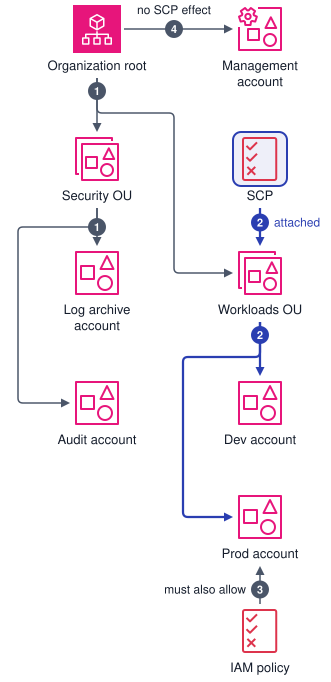

# Organizations, SCPs, Control Tower and RAM

## Predict (2 min)
<!-- section: role=predict; route=fast; minutes=2 -->

**Predict 1.** A **service control policy** (SCP) on the root of an organization denies deleting log buckets. Can an administrator in the management account (the account that pays for member accounts) delete a log bucket stored in that account? <!-- gist-trap -->

**Predict 2.** In AWS Control Tower, does a detective control stop a developer who tries to make a bucket public?

## In one breath (3 min)
<!-- section: role=breath; route=fast; minutes=3 -->

> **Say it:** AWS Organizations puts your accounts in one tree. An SCP on an organizational unit (OU) limits every member account below it.

**The problem it solves.** In one account, one mistake reaches everything.

**Predict the picture.** Which accounts does an SCP on the Workloads OU reach?

Show the picture

**Figure.** An SCP on an organizational unit limits every member account below it, but not the management account.

1. Organizational units (OUs) group the member accounts under the root of the organization.
2. An SCP attached to the Workloads OU applies to every account in that OU.
3. [An SCP never grants permissions](../facts/iam.md#iam-scp-never-grants-permissions), so the IAM policies in prod must also allow the request.
4. SCPs do not restrict [users or roles in the management account](../facts/organizations.md#organizations-scp-no-effect-on-management-account).

> **Startup example:** Callvale runs development, testing and production in one AWS account. The bank requires an isolated production environment and audit logs that operators cannot change. No workload can run outside two approved Regions. The rules must apply to every account, including future accounts.

## Words that go together (1 min)
<!-- section: role=words; route=fast; minutes=1 -->

<!-- table: words -->
| Term | Words that go with it | Plain meaning | Do not confuse with |
|---|---|---|---|
| service control policy | **attach** an SCP to an organizational unit | The outer limit of what member accounts can do | permissions boundary |
| explicit deny | an explicit deny **wins** | A Deny statement that matches the request | implicit deny |
| resource-based policy | the policy **names** a principal | Sits on a resource and names who can use it | an AWS RAM resource share |

## Choose it or not (2 min)
<!-- section: role=choose; route=fast; minutes=2 -->

### AWS Organizations alone or AWS Control Tower

AWS Control Tower builds a **landing zone**: [a well-architected, multi-account environment](../facts/control-tower.md#control-tower-landing-zone-definition).

<!-- table: compare -->
| Question | AWS Organizations alone | AWS Control Tower |
|---|---|---|
| What do you get? | OUs, policies and one bill to [centrally manage and govern your environment](../facts/organizations.md#organizations-central-manage-govern-accounts) | A landing zone with [recommended organizational units (OUs)](../facts/control-tower.md#control-tower-faq-landing-zone-sets-ous-config-cloudtrail), AWS Config and CloudTrail |
| Who builds a new account? | Your team: [programmatically creating new accounts](../facts/organizations.md#organizations-stacksets-provision-to-accounts), then a baseline with [AWS CloudFormation StackSets](../facts/organizations.md#organizations-stacksets-provision-to-accounts) | Account Factory, [a configurable account template](../facts/control-tower.md#control-tower-account-factory-template) |
| How do they relate? | [Organizations as the framework](../facts/control-tower.md#control-tower-faq-organizations-framework-control-tower-layer) | The [automation and governance layer](../facts/control-tower.md#control-tower-faq-organizations-framework-control-tower-layer) on top |
| What does it cost? | [No additional charge](../facts/organizations.md#organizations-no-additional-charge) | [No additional charge](../facts/control-tower.md#control-tower-no-additional-charge), but you pay for [AWS Service Catalog, AWS CloudTrail, AWS Config](../facts/control-tower.md#control-tower-billed-underlying-services) |

**Deciding question:** Should AWS build and govern each new account, or your team?

## Signals and traps (3 min)
<!-- section: role=signals; route=fast; minutes=3 -->

<!-- table: signals -->
| The stem says | Think | Because | But not if |
|---|---|---|---|
| "no one in member accounts, including administrators" | Deny in an SCP on the root or OU | it holds after someone [attaches the AdministratorAccess IAM policy](../facts/organizations.md#organizations-scp-admin-policy-cannot-override) | the management account: keep workloads out |
| "multi-account best practices, LEAST operational overhead" | Control Tower landing zone | it builds [a secure, compliant, multi-account AWS environment](../facts/control-tower.md#control-tower-easiest-way-secure-multi-account) | one bill only: consolidated billing |
| "one bill and shared Reserved Instance discounts" | consolidated billing | it [shares the volume pricing discounts, Reserved Instance discounts](../facts/organizations.md#organizations-consolidated-billing-combined-usage-shares-discounts) | one account keeps its discount: turn off its sharing |
| "detect and report noncompliant resources" | Control Tower detective control | [detective controls are implemented using AWS Config rules](../facts/control-tower.md#control-tower-control-types-mechanisms) | block the action: a preventive control |
| "run only in approved Regions" | Control Tower Region deny control | it denies requests [outside of the specified Regions](../facts/control-tower.md#control-tower-region-deny-blocks-unlisted-regions) | no Control Tower: an SCP on aws:RequestedRegion, [except for actions in the specified services](../facts/organizations.md#organizations-scp-notaction-region-limit-example) |
| "accounts launch into subnets of one central VPC" | AWS Resource Access Manager (AWS RAM) | it shares subnets with [only AWS accounts in its own organization](../facts/ram.md#ram-share-subnets-only-within-organization) | outside the organization: a shared transit gateway to their own VPC |

### Traps

- **Wrong belief:** An SCP on the root also limits the management account. **Truth:** SCPs [affect only member accounts](../facts/organizations.md#organizations-scp-no-effect-on-management-account). For workloads, [keep them out of the management account](../facts/organizations.md#organizations-keep-resources-out-of-management-account). <!-- trap: organizations-trap-scp-on-management-account -->
- **Wrong belief:** Tags and IAM policies in one account isolate production like a separate account. **Truth:** Separate accounts separate, [by default, the resources and data](../facts/organizations.md#organizations-separate-accounts-prod-nonprod-by-default) of each environment. <!-- trap: organizations-trap-tags-isolate-like-accounts -->
- **Wrong belief:** A Control Tower detective control stops a noncompliant action. **Truth:** It [provides alerts through the dashboard](../facts/control-tower.md#control-tower-detective-alerts-dashboard-status). [Preventive controls prevent actions from occurring](../facts/control-tower.md#control-tower-preventive-detective-proactive-defined). <!-- trap: organizations-trap-detective-blocks -->

## Changed recently (1 min)
<!-- section: role=changed; route=fast; minutes=1 -->

> **Changed recently:** (2026-05-15) More and larger SCPs per root, OU or account. 
> **Old:** [5](../facts/organizations.md#organizations-scp-max-attached-per-entity) SCPs of [5120 characters](../facts/organizations.md#organizations-scp-max-document-size). 
> **Now:** [10](../facts/organizations.md#organizations-scp-max-attached-per-entity) SCPs of [10,240 characters](../facts/organizations.md#organizations-scp-max-document-size). 
> **The exam probably expects:** older questions can assume 5; prefer an option right under both. 
> **Status:** examinable.

> **Changed recently:** (2025-11-19) Moving an account to another organization. 
> **Old:** the account had to [temporarily operate as a standalone account](../facts/organizations.md#organizations-change-direct-account-transfers-2025-11). 
> **Now:** from [2025-11-19](../facts/organizations.md#organizations-change-direct-account-transfers-2025-11), the account moves to the new organization without leaving its current one first. 
> **The exam probably expects:** older questions: the account leaves first. 
> **Status:** examinable.

## Check (2 min)
<!-- section: role=check; route=fast; minutes=2 -->

**Check 1.** An SCP on the root denies s3:DeleteBucket. Does it stop the root user of a member account?

Answer

Yes. It limits principals [including the member account's root user](../facts/iam.md#iam-scp-applies-to-member-root-user).

**Predict 1:** Yes: SCPs do not restrict [users or roles in the management account](../facts/organizations.md#organizations-scp-no-effect-on-management-account). Member accounts stay protected.

**Check 2.** A detective control reports a public bucket. Is the bucket still public?

Answer

Yes. It [provides alerts through the dashboard](../facts/control-tower.md#control-tower-detective-alerts-dashboard-status); it does not block.

**Predict 2:** No. It reports; it does not block.

## Recap from memory (3 min)
<!-- section: role=recap; route=fast; minutes=3 -->

**Recap 1.** Which account do SCPs not restrict?

Answer

The management account. SCPs [affect only member accounts](../facts/organizations.md#organizations-scp-no-effect-on-management-account).

**Recap 2.** What is the deciding question between Organizations alone and Control Tower?

Answer

Should AWS build and govern each new account, or your team?

**Recap 3.** Which service shares subnets of one VPC with other accounts?

Answer

AWS RAM. It shares subnets with [only AWS accounts in its own organization](../facts/ram.md#ram-share-subnets-only-within-organization).

