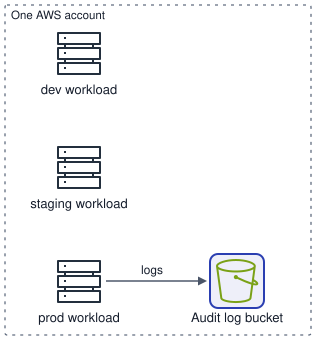
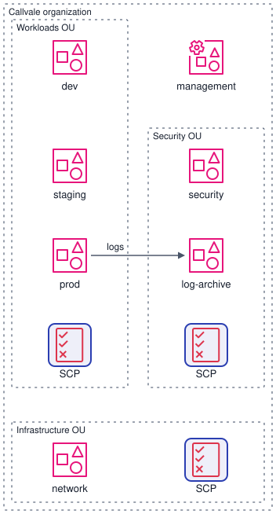

# Organizations, SCPs, Control Tower and RAM in depth

## How it works (24 min)
<!-- section: role=how; route=full; minutes=24 -->

Short forms: **service control policy** (SCP), AWS Resource Access Manager (AWS RAM).

### An organization is a tree of accounts with one root and one management account (4 min)

With development, testing and production in one account, one mistake can reach all three.

1. **Group the accounts.** An organization is [a collection of AWS accounts](../facts/organizations.md#organizations-organization-is-tree-of-accounts) in a [hierarchical, tree-like structure](../facts/organizations.md#organizations-organization-is-tree-of-accounts) with [1](../facts/organizations.md#organizations-one-root-per-organization) root.
2. **Nest OUs.** An **organizational unit** (OU) is [a group of AWS accounts within an organization](../facts/organizations.md#organizations-ou-is-group-of-accounts). OUs nest up to [Five levels of OUs deep](../facts/organizations.md#organizations-ou-max-nesting-five-levels).
3. **Add accounts.** The **management account** creates or invites member accounts; this [can be done only from the management account](../facts/organizations.md#organizations-create-invite-only-from-management-account).
4. **Turn on policies.** There are two feature sets: all features, and consolidated billing. Policies work only [when all features are enabled](../facts/organizations.md#organizations-policies-need-all-features).

A created account gets [OrganizationAccountAccessRole](../facts/organizations.md#organizations-created-account-gets-access-role) automatically. For an invited account, an administrator can [choose to create an IAM role](../facts/organizations.md#organizations-invited-account-access-role-optional).

Why accounts? An account is one of the [security, access, and billing boundaries](../facts/organizations.md#organizations-account-is-security-access-billing-boundary). A tag is not.

> **Exam signal:** "isolate production from development" points to separate accounts, which separate [by default, the resources and data](../facts/organizations.md#organizations-separate-accounts-prod-nonprod-by-default).

> **Say it:** The short answer is: accounts sit in OUs under one root. The thing to watch is the access role of invited accounts.

**Stop and answer.** The prod account is in the Workloads OU. The security team also wants it in the Security OU. Can it be in both?

Answer

No: an account is a [member of only one OU at a time](../facts/organizations.md#organizations-faq-account-one-ou-at-a-time). Attach the security policy to a parent OU above Workloads: nested OUs [inherit the policies from the parent OU](../facts/organizations.md#organizations-nested-ous-inherit-parent-policies).

### The management account pays one bill that combines the usage of every account (3 min)

With a separate bill for each account, each account reaches the price tiers on its own.

1. **One payer.** The management account is [responsible for paying all charges](../facts/organizations.md#organizations-management-account-pays-all-charges). This is **consolidated billing**.
2. **Combined tiers.** [AWS combines the usage from all accounts](../facts/organizations.md#organizations-billing-treats-accounts-as-one-for-tiers) to choose the volume pricing tier.
3. **Shared commitments.** For Reserved Instances and Savings Plans, [commitments benefit the account owner first](../facts/organizations.md#organizations-ri-sp-benefit-owner-account-first).
4. **Reports by team.** [Only the management account in an organization](../facts/organizations.md#organizations-cost-allocation-tags-management-account) activates cost allocation tags. A tag policy can [standardize the tags attached to the AWS resources](../facts/organizations.md#organizations-tag-policy-standardizes-tags). <!-- xref: 41 cost allocation tags and Savings Plans -->

Why one bill? One payer lets AWS price all of the usage as one total.

> **Exam signal:** "one bill and volume discounts across all accounts" points to consolidated billing, [offered at no additional cost](../facts/organizations.md#organizations-consolidated-billing-combined-usage-shares-discounts).

> **Say it:** The short answer is: one account pays one combined bill. The thing to watch is that a Reserved Instance helps its own account first.

**Stop and answer.** Account A bought a Reserved Instance that it uses half of the time. Account B, in the same organization, runs matching usage. Does account B get the discount?

Answer

Yes, if sharing is on for both accounts: the [remaining benefits can be shared](../facts/organizations.md#organizations-ri-sp-benefit-owner-account-first) for the hours that A does not use. The management account can [activate or deactivate sharing for individual accounts](../facts/organizations.md#organizations-management-account-controls-ri-sp-sharing).

### An action is allowed only if an SCP at every level allows it (5 min)
<!-- section: route=pass -->

A security team wants one rule for every member account, administrators included.

1. **Start from FullAWSAccess.** Organizations attaches the SCP FullAWSAccess [to every root, OU and account](../facts/organizations.md#organizations-fullawsaccess-attached-by-default).
2. **Walk down the path.** [There must be an explicit Allow statement](../facts/organizations.md#organizations-scp-allow-needed-at-every-level) [at every level from the root](../facts/organizations.md#organizations-scp-allow-needed-at-every-level) to the account. SCPs use [a deny-by-default model](../facts/organizations.md#organizations-scp-deny-by-default-model).
3. **A deny wins below it.** A Deny reaches [all the OUs and member accounts underneath it](../facts/organizations.md#organizations-scp-deny-at-any-level-applies-below).
4. **IAM still decides.** [An SCP never grants permissions](../facts/iam.md#iam-scp-never-grants-permissions), so IAM must also allow the action (see [chapter 03](../03-iam/2-deep.md#aws-allows-a-request-only-when-nothing-denies-and-something-allows-5-min)).

<!-- table: plain -->
| Case | Root | Workloads OU | prod account | Result |
|---|---|---|---|---|
| 1 | FullAWSAccess | FullAWSAccess plus Deny on ec2:TerminateInstances | FullAWSAccess | Terminate: explicit deny, also for administrators |
| 2 | FullAWSAccess | FullAWSAccess | Allows EC2, no other service | Lambda: implicit deny, no allow at the account level |

Principals in a member account [cannot remove or change SCPs that are applied to that account](../facts/iam.md#iam-scp-faq-member-principals-cannot-change-scps).

Why every level? Otherwise an account could add back what its OU removed.

> **Exam signal:** "no one, including administrators" points to an SCP Deny, which holds even when an administrator [attaches the AdministratorAccess IAM policy](../facts/organizations.md#organizations-scp-admin-policy-cannot-override).

> **Exam trap:** An Allow for Amazon Athena on the account fails if its OU allows EC2 and nothing else. SCPs need an allow [at every level from the root](../facts/organizations.md#organizations-scp-allow-needed-at-every-level). <!-- trap: organizations-trap-account-level-allow-enough -->

**Spot the bug.** An SCP on the Security OU denies cloudtrail:StopLogging. A prod administrator, in the Workloads OU, still stops logging. What is wrong?

Answer

The Deny reaches [all the OUs and member accounts underneath it](../facts/organizations.md#organizations-scp-deny-at-any-level-applies-below), and prod is not under the Security OU. Attach the SCP to the Workloads OU.

> **Say it:** The short answer is: a deny anywhere above the account wins. The thing to watch is that every level also needs an allow.

**Stop and answer.** The Workloads OU denies ec2:TerminateInstances. Prod sits in a child OU of Workloads. Can a prod administrator with AdministratorAccess terminate an instance?

Answer

No. The Deny reaches [all the OUs and member accounts underneath it](../facts/organizations.md#organizations-scp-deny-at-any-level-applies-below), the child OU too.

### SCPs do not limit the management account or principals outside the organization (4 min)
<!-- section: route=pass -->

SCPs do not reach every principal.

1. **The management account.** SCPs [affect only member accounts](../facts/organizations.md#organizations-scp-no-effect-on-management-account). For workloads, AWS says: [keep them out of the management account](../facts/organizations.md#organizations-keep-resources-out-of-management-account).
2. **Outside principals.** SCPs [do not affect users or roles from accounts outside the organization](../facts/iam.md#iam-scp-not-outside-principals-or-resource-policies). A resource control policy (RCP) can affect [principals external to your organization](../facts/organizations.md#organizations-rcp-affects-external-principals-scp-only-internal).
3. **Inside principals.** SCPs limit member principals, [including the member account's root user](../facts/iam.md#iam-scp-applies-to-member-root-user), and accounts [designated as delegated administrators](../facts/organizations.md#organizations-scp-applies-to-delegated-admin-accounts). <!-- xref: 09 detection services with a delegated administrator --> SCPs [do not affect any service-linked role](../facts/organizations.md#organizations-scp-no-effect-on-management-account).

<!-- table: plain -->
| Question | SCP | RCP |
|---|---|---|
| What does it limit? | [SCPs are principal-centric controls](../facts/organizations.md#organizations-scp-principal-centric-rcp-resource-centric) | [RCPs are resource-centric controls](../facts/organizations.md#organizations-scp-principal-centric-rcp-resource-centric) |
| Management account? | Not affected | [No effect on resources in the management account](../facts/iam.md#iam-rcp-no-effect-on-management-account) |
| Deciding question | Your people going out: [control which resources your identities can access](../facts/organizations.md#organizations-scp-controls-which-resources-identities-access) | Others coming in: [control which identities can access your resources](../facts/organizations.md#organizations-scp-controls-which-resources-identities-access) |
| Key for the organization | [aws:ResourceOrgID](../facts/iam.md#iam-condition-key-resourceorgid): [the organization that owns the requested resource](../facts/iam.md#iam-condition-key-resourceorgid) | [aws:PrincipalOrgID](../facts/iam.md#iam-condition-key-principalorgid): the organization of the caller |

> **Exam signal:** "outsiders must not access the buckets, even if a bucket policy allows them" points to an RCP, which holds even when a policy [allows full access to any user](../facts/organizations.md#organizations-rcp-resource-policy-cannot-override).

> **Exam trap:** Wrong: an SCP with aws:PrincipalOrgID keeps outsiders out of your buckets. SCPs [do not affect users or roles from accounts outside the organization](../facts/iam.md#iam-scp-not-outside-principals-or-resource-policies); this perimeter is [applied on resources with an RCP](../facts/iam.md#iam-data-perimeter-identity-rcp-principalorgid). <!-- trap: organizations-trap-scp-limits-outside-principals -->

> **Say it:** The short answer is: SCPs limit the principals of member accounts. The thing to watch is the management account.

**Stop and answer.** A developer in prod reads a bucket in another company's account. Which policy type can stop that: an SCP or an RCP?

Answer

An SCP: SCPs [control which resources your identities can access](../facts/organizations.md#organizations-scp-controls-which-resources-identities-access). The bucket is not yours, and [RCPs are resource-centric controls](../facts/organizations.md#organizations-scp-principal-centric-rcp-resource-centric) for your own resources.

### A Control Tower landing zone applies preventive and detective controls to registered OUs (4 min)
<!-- section: route=pass -->

Accounts built by hand drift apart.

1. **Build the landing zone.** A **landing zone** is [a well-architected, multi-account environment](../facts/control-tower.md#control-tower-landing-zone-definition). AWS Control Tower builds it on AWS Organizations.
2. **Create the shared accounts.** Setup can create [the log archive account, and the audit account](../facts/control-tower.md#control-tower-shared-accounts): [a repository for logs of API activities](../facts/control-tower.md#control-tower-log-archive-and-audit-roles) and [a restricted account](../facts/control-tower.md#control-tower-log-archive-and-audit-roles) for audits.
3. **Create new accounts.** Account Factory is [a configurable account template](../facts/control-tower.md#control-tower-account-factory-template) for new accounts.
4. **Put controls on an OU.** A **control** [applies to an entire organizational unit (OU)](../facts/control-tower.md#control-tower-control-applies-to-whole-ou).

<!-- table: plain -->
| Control type | Built with | A noncompliant action |
|---|---|---|
| Preventive | SCPs, [Resource Control Policies (RCPs), and declarative policies](../facts/control-tower.md#control-tower-control-types-mechanisms) | Stopped before it happens |
| Detective | [detective controls are implemented using AWS Config rules](../facts/control-tower.md#control-tower-control-types-mechanisms) | Happens; the control [provides alerts through the dashboard](../facts/control-tower.md#control-tower-detective-alerts-dashboard-status) |
| Proactive | [implemented using AWS CloudFormation hooks](../facts/control-tower.md#control-tower-control-types-mechanisms) | Checked [before the resources are provisioned](../facts/control-tower.md#control-tower-preventive-detective-proactive-defined), only [by means of CloudFormation stack operations](../facts/control-tower.md#control-tower-proactive-only-cloudformation) |

For the audit log, an organization trail logs every account. [Member accounts can see the organization trail](../facts/organizations.md#organizations-org-trail-members-cannot-modify-or-delete), but they cannot change or delete it. <!-- xref: 37 CloudTrail organization trail -->

> **Exam signal:** "new accounts must get the same controls automatically" points to Account Factory, which [automates the process of applying controls and policies](../facts/control-tower.md#control-tower-account-factory-template).

> **Exam trap:** An OU that is not registered gets no controls until you [separately register the OU or enroll the account](../facts/control-tower.md#control-tower-accounts-outside-not-bound). In a registered OU, preventive controls reach accounts [under the OU, enrolled and unenrolled](../facts/control-tower.md#control-tower-preventive-apply-unenrolled-detective-enrolled-only), but [detective controls apply to enrolled accounts only](../facts/control-tower.md#control-tower-preventive-apply-unenrolled-detective-enrolled-only). <!-- trap: organizations-trap-control-tower-governs-all-accounts -->

Go deeper: the management account and version 4.0

Like SCPs, preventive controls are [not applied to the management account](../facts/control-tower.md#control-tower-preventive-not-on-management-account). From [Landing Zone version 4.0](../facts/control-tower.md#control-tower-lz4-mandatory-not-default), [mandatory controls are no longer applied by default](../facts/control-tower.md#control-tower-lz4-mandatory-not-default); older questions assume they are on.

> **Say it:** The short answer is: Control Tower builds accounts and puts controls on OUs. The thing to watch is accounts created outside it.

**Stop and answer.** A proactive control requires encryption on new S3 buckets. A developer creates an unencrypted bucket with the AWS CLI, not with CloudFormation. Does the control stop the bucket?

Answer

No, do not count on it. A proactive control checks resources [by means of CloudFormation stack operations](../facts/control-tower.md#control-tower-proactive-only-cloudformation).

### AWS RAM shares one resource with other accounts instead of copying it (4 min)

A network team builds one virtual private cloud (VPC) that every account needs.

1. **Create a resource share.** A **resource share** lists resources and the principals that can use them. Creating it includes [choosing a managed permission](../facts/ram.md#ram-faq-resource-share-steps), which AWS RAM uses to [generate a resource-based policy](../facts/ram.md#ram-managed-permission-generates-resource-policy).
2. **Choose the principals.** Some types, such as a transit gateway, [can share with any AWS account](../facts/ram.md#ram-share-transit-gateway-any-account); others stay inside the organization (table). OUs and the organization work when [sharing within your organization is enabled](../facts/ram.md#ram-faq-share-with-any-account-ous-if-enabled).
3. **Accept from outside.** Outside the organization, [the recipient must accept the invitation](../facts/ram.md#ram-outside-org-needs-invitation).

<!-- table: plain -->
| Resource type | Share outside the organization? |
|---|---|
| Subnet | No: [only AWS accounts in its own organization](../facts/ram.md#ram-share-subnets-only-within-organization) |
| Security group | No: [only AWS accounts in its own organization](../facts/ram.md#ram-share-security-groups-only-within-organization) |
| Transit gateway | Yes: [can share with any AWS account](../facts/ram.md#ram-share-transit-gateway-any-account) |
| Route 53 Resolver rule | Yes: [can share with any AWS account](../facts/ram.md#ram-share-resolver-rules-any-account) |

Why share? AWS RAM [eliminates the need to provision duplicate resources](../facts/ram.md#ram-reduces-overhead-no-duplicate-resources), and you [share resources at no additional cost](../facts/ram.md#ram-faq-no-additional-cost).

> **Exam signal:** "every account in the organization, including future accounts" points to a share with the organization: you do not [enumerate every one of the AWS account IDs](../facts/ram.md#ram-vs-resource-policy-org-ou-without-ids).

> **Exam trap:** Wrong: a partner company can use your default subnets. A subnet goes to [only AWS accounts in its own organization](../facts/ram.md#ram-share-subnets-only-within-organization), and [Default subnets are not shareable](../facts/ram.md#ram-share-subnets-only-within-organization). <!-- trap: organizations-trap-ram-shares-outside-org-any-type -->

> **Try it:** Share a subnet and read the managed permission of the share. See [3-do.md](3-do.md). <!-- task: organizations-t01 -->

Go deeper: participants in a shared VPC

Participants are the accounts that receive the shared subnets. [Participants cannot work with route tables](../facts/ram.md#ram-vpc-participants-no-route-tables-nat), and [only the VPC owner can attach](../facts/ram.md#ram-vpc-only-owner-attaches-transit-gateway) a transit gateway. <!-- xref: 11 transit gateway --> Use the AWS RAM console, not the Organizations console: there [you must enable sharing with AWS Organizations](../facts/ram.md#ram-enable-sharing-in-ram-console-not-orgs).

> **Say it:** The short answer is: build it one time and share it. The thing to watch is types that stay inside the organization.

**Stop and answer.** A company shares a transit gateway with a partner's AWS account outside its organization. The partner still cannot use it. What is missing?

Answer

The partner's acceptance: [the recipient must accept the invitation](../facts/ram.md#ram-outside-org-needs-invitation).

## Numbers that decide answers (2 min)
<!-- section: role=numbers; route=full; minutes=2 -->

### A-list

<!-- table: numbers -->
| Number | What it is | Why it decides an answer |
|---|---|---|
| [Five levels of OUs deep](../facts/organizations.md#organizations-ou-max-nesting-five-levels) | OU nesting under the root | A deeper tree needs a flatter design |
| [10](../facts/organizations.md#organizations-scp-max-attached-per-entity) | SCPs attached directly to one root, OU or account | Inherited SCPs do not count; [all policy limits are hard limits](../facts/organizations.md#organizations-attachment-limits-direct-only-hard) |
| [15 days](../facts/organizations.md#organizations-invitation-expires-15-days) | Time to accept an invitation | After it, send a new invitation |
| [90 days](../facts/organizations.md#organizations-closed-account-reopen-within-90-days) | Time to reopen a closed account | After it, the closure is permanent |

### B-list

<!-- table: numbers -->
| Number | What it is |
|---|---|
| [10](../facts/organizations.md#organizations-max-accounts-default-10) | Accounts per organization, adjustable default |
| [2000](../facts/organizations.md#organizations-ous-per-organization) | OUs per organization |
| [10,240 characters](../facts/organizations.md#organizations-scp-max-document-size) | Size of one SCP |
| [5](../facts/organizations.md#organizations-rcp-max-attached-per-entity) | RCPs attached directly to one root, OU or account |
| [at least four days](../facts/organizations.md#organizations-remove-created-account-wait-four-days) | Wait before a created account can leave |
| [1000](../facts/control-tower.md#control-tower-ou-over-1000-accounts-cannot-register) | Largest number of accounts directly in an OU that Control Tower registers |
| [5,000](../facts/ram.md#ram-principals-per-resource-share) | Principals in one resource share |

## Decision record (2 min)
<!-- section: role=example; route=full; minutes=2 -->

**Context.** Ostell Bank's questionnaire asks how production is separated from testing. Everything is in one account.

**Figure.** Development, testing, production and the audit log share one AWS account.

**Requirement.** The rules must apply to every account, including future accounts, with the LEAST operational overhead.

**Options.**

- One account with tags and IAM policies.
- Several accounts, configured by hand.
- **AWS Control Tower with service control policies.**

**Decision.** Control Tower and service control policies, with the management account and six member accounts in three OUs.

**Figure.** The management account and six member accounts in three OUs, with SCPs on the OUs and logs in their own account.

**Trade-off.** Access between accounts needs design. Some rules block engineers at first.

## FAQ quick-fire (7 min)
<!-- section: role=faq; route=full; minutes=7 -->

**FAQ 1.** Can one AWS account belong to two OUs at the same time?

Answer

No. An account is a [member of only one OU at a time](../facts/organizations.md#organizations-faq-account-one-ou-at-a-time).

> "No. An AWS account can be a member of only one OU at a time."
> — [AWS Organizations FAQs](https://aws.amazon.com/organizations/faqs/)

**FAQ 2.** Do you choose an AWS Region when you create an organization?

Answer

No. Accounts used in China need a [separate organization for accounts used in China](../facts/organizations.md#organizations-faq-no-region-needed-china-separate-org).

> "You do not need to specify an AWS Region when you create and manage your organization, but you will need to create a separate organization for accounts used in China."
> — [AWS Organizations FAQs](https://aws.amazon.com/organizations/faqs/)

**FAQ 3.** Can an organization use only consolidated billing and enforce no SCP?

Answer

Yes. You [decide which policies that you want to enforce](../facts/organizations.md#organizations-faq-org-without-scp-consolidated-billing-only).

> "Yes. You decide which policies that you want to enforce. For example, you could create an organization that takes advantage only of the consolidated billing functionality."
> — [AWS Organizations FAQs](https://aws.amazon.com/organizations/faqs/)

**FAQ 4.** Does AWS Control Tower replace AWS Security Hub CSPM?

Answer

No. They are [complementary services](../facts/control-tower.md#control-tower-faq-complementary-to-security-hub).

> "AWS Control Tower and AWS Security Hub CSPM are complementary services."
> — [AWS Control Tower FAQs](https://aws.amazon.com/controltower/faqs/)

**FAQ 5.** Can an account limit which of its own users can use a resource shared with it?

Answer

Yes. [You can specify IAM policies](../facts/ram.md#ram-faq-control-access-with-iam-policies) for resources shared with you.

> "You can specify IAM policies to control access to resources shared with you."
> — [AWS Resource Access Manager FAQs](https://aws.amazon.com/ram/faqs/)

