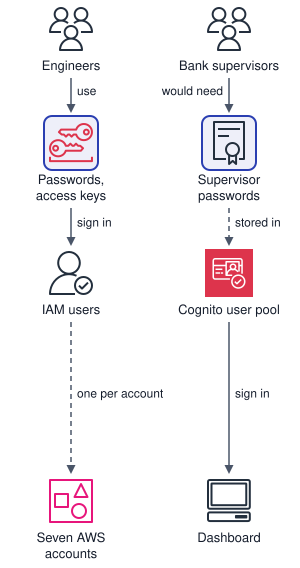
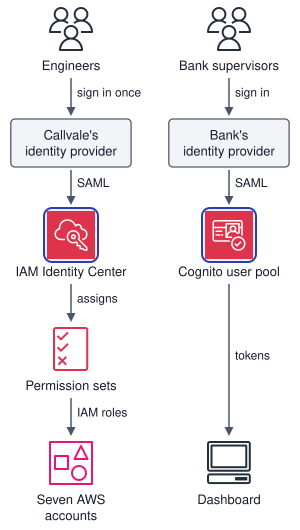

# IAM Identity Center, Directory Service and Cognito in depth

## How it works (26 min)
<!-- section: role=how; route=full; minutes=26 -->

### IAM Identity Center turns one sign-in into a role session in each account (4 min)
<!-- section: route=pass -->

With an **IAM user** in each of seven accounts, an engineer has seven passwords.

1. **Enable.** The organization instance, in the management account, is the only type that can [manage access to AWS accounts](../facts/iam-identity-center.md#iam-identity-center-org-instance-only-one-for-account-access).
2. **Assign.** You assign a user or group a **permission set** for an account: [a template that you create and maintain](../facts/iam-identity-center.md#iam-identity-center-permission-set-is-policy-template) of IAM policies.
3. **Create the role.** IAM Identity Center [creates and manages IAM roles](../facts/iam-identity-center.md#iam-identity-center-creates-roles-per-permission-set-not-iam-users) in each assigned account, one for each permission set.
4. **Sign in.** The user signs in to the AWS access portal and gets a role session in each assigned account [without additional sign ins](../facts/iam-identity-center.md#iam-identity-center-one-sign-in-all-assignments).

Why roles? [IAM users are granted long-term credentials](../facts/iam-identity-center.md#iam-identity-center-users-get-temporary-credentials), but role credentials are [generated every time you sign in](../facts/iam-identity-center.md#iam-identity-center-users-get-temporary-credentials).

> **Exam signal:** "employees sign in once to many AWS accounts" points to IAM Identity Center, which [configures all the necessary user permissions](../facts/iam-identity-center.md#iam-identity-center-configures-account-permissions-automatically) in each account.

> **Exam trap:** IAM Identity Center [does not create IAM users and groups](../facts/iam-identity-center.md#iam-identity-center-creates-roles-per-permission-set-not-iam-users). Member accounts get roles named `AWSReservedSSO_...` that [the IAM Identity Center service has created](../facts/iam-identity-center.md#iam-identity-center-roles-named-awsreservedsso). <!-- trap: identity-federation-trap-idc-creates-iam-users -->

Go deeper: sessions outlive sign-out

After sign-out, a role session can continue [up to 12 hours later](../facts/iam-identity-center.md#iam-identity-center-signout-app-sessions-end-within-30-minutes). To end open sessions, add the user's ID to a prepared Deny in a **service control policy** (SCP); SCPs [affect only member accounts](../facts/organizations.md#organizations-scp-no-effect-on-management-account). [If you wait 12 hours](../facts/iam-identity-center.md#iam-identity-center-revoke-keep-deny-12-hours), [active sessions expire](../facts/iam-identity-center.md#iam-identity-center-revoke-keep-deny-12-hours). Remove the Deny sooner, and the user [will have restored actions with the IAM role](../facts/iam-identity-center.md#iam-identity-center-revoke-keep-deny-12-hours).

> **Say it:** The short answer is: one sign-in, then a role in each account. The thing to watch is the permission set: it becomes the role.

**Stop and answer.** A permission set lets engineers read Amazon S3 in five accounts. An administrator adds DynamoDB read access. Must someone create new IAM users or roles?

Answer

No. The [corresponding IAM policies and roles are updated accordingly](../facts/iam-identity-center.md#iam-identity-center-permission-set-change-updates-roles).

### The identity source decides where users live and who checks passwords (4 min)

Your employees already exist somewhere. IAM Identity Center reads them from its **identity source**.

1. **Default.** IAM Identity Center starts with the [Identity Center directory as your default identity source](../facts/iam-identity-center.md#iam-identity-center-default-identity-source-directory).
2. **Active Directory.** You [use AD Connector](../facts/iam-identity-center.md#iam-identity-center-on-prem-ad-two-options) or an [AWS Managed Microsoft AD trust relationship](../facts/iam-identity-center.md#iam-identity-center-on-prem-ad-two-options).
3. **External identity provider.** Okta or Microsoft Entra ID signs users in with Security Assertion Markup Language (SAML) 2.0. [System for Cross-domain Identity Management (SCIM)](../facts/iam-identity-center.md#iam-identity-center-scim-automatic-sync) copies users and groups in.
4. **One source.** IAM Identity Center connects [only one directory or one SAML 2.0 identity provider](../facts/iam-identity-center.md#iam-identity-center-one-identity-source-at-a-time) at a time.

<!-- table: plain -->
| Identity source | Who checks the password |
|---|---|
| Active Directory | Your directory: [No password information is synchronized](../facts/iam-identity-center.md#iam-identity-center-ad-pass-through-no-passwords-synced) |
| External identity provider | The provider: IAM Identity Center holds [no authentication material](../facts/iam-identity-center.md#iam-identity-center-external-idp-no-passwords-stored) |

Why keep passwords at the source? One place for resets and departures.

> **Exam signal:** "users in the external identity provider must appear automatically" points to SCIM, for [automatic provisioning (synchronization) of user and group information](../facts/iam-identity-center.md#iam-identity-center-scim-automatic-provisioning).

> **Exam trap:** Moving one team to Okta moves every team, because the instance has one source. The change [might remove all user and group assignments](../facts/iam-identity-center.md#iam-identity-center-change-source-may-remove-assignments). <!-- trap: identity-federation-trap-idc-two-sources-at-once -->

> **Say it:** The short answer is: users stay in the directory you already have. The thing to watch is one source at a time.

**Stop and answer.** Okta signs users in to IAM Identity Center with SAML; SCIM is off. A new engineer exists only in Okta. What must happen before she gets a permission set?

Answer

Provisioning: identities [must be provisioned into IAM Identity Center](../facts/iam-identity-center.md#iam-identity-center-provision-before-assign) first. SCIM does it for you.

### Direct SAML federation works per account while Identity Center federates once (4 min)

Without IAM Identity Center, each account trusts the identity provider separately.

1. **Trust the provider.** In one account, you [create an identity provider entity](../facts/iam.md#iam-federation-idp-entity-oidc-or-saml) for an [OpenID Connect (OIDC) or SAML 2.0](../facts/iam.md#iam-federation-idp-entity-oidc-or-saml) provider.
2. **Map people to roles.** [Users assume IAM roles](../facts/iam-identity-center.md#iam-identity-center-decision-guide-federation-with-iam), [without an IAM user for everyone in the organization](../facts/iam.md#iam-federation-saml-console-sso-without-iam-users).
3. **Directory variant.** With AWS Directory Service, you [assign IAM roles](../facts/directory-service.md#directory-service-console-sso-iam-roles) to directory groups, and [your directory must have an access URL](../facts/directory-service.md#directory-service-console-access-iam-roles-access-url).

<!-- table: plain -->
| Approach | Where you configure it |
|---|---|
| IAM federation | [directly to each AWS account](../facts/iam-identity-center.md#iam-identity-center-wa-two-federation-approaches) |
| IAM Identity Center | [you only federate once](../facts/iam-identity-center.md#iam-identity-center-one-point-of-federation) |

Why keep it? Emergency access works [through direct federation](../facts/iam-identity-center.md#iam-identity-center-emergency-access-direct-federation) when IAM Identity Center is down.

> **Exam signal:** "console access with AD credentials and no IAM users" in one account points to IAM roles: you [assign IAM roles](../facts/directory-service.md#directory-service-console-sso-iam-roles) to AD groups. With many accounts, it points to IAM Identity Center.

> **Exam trap:** Roles in every account plus a credential broker (a sign-in program you write) is not the low-effort answer. It is still [direct federation to each AWS account](../facts/iam-identity-center.md#iam-identity-center-wa-two-federation-approaches). <!-- trap: identity-federation-trap-direct-federation-least-effort -->

> **Say it:** The short answer is: direct federation works one account at a time. The thing to watch is how many accounts you have.

**Stop and answer.** A company has one AWS account, no AWS Organizations, and AWS Managed Microsoft AD. Administrators need the console with AD credentials and no IAM users. What do you configure?

Answer

IAM roles for the AD groups, and the directory's access URL. An account instance of IAM Identity Center does not help: permission sets [need to use an Organization instance](../facts/iam-identity-center.md#iam-identity-center-permission-sets-need-organization-instance). <!-- trap: identity-federation-trap-account-instance-for-account-access -->

### The three Directory Service options differ in where the directory runs (5 min)
<!-- section: route=pass -->

Windows servers, file shares and SQL Server expect Active Directory. A **domain controller** checks its passwords. A forest is a group of domains; a trust lets one forest's users reach another's resources.

1. **AWS Managed Microsoft AD.** AWS runs at least [two domain controllers](../facts/directory-service.md#directory-service-managed-ad-minimum-two-domain-controllers) for you, [across different Availability Zones](../facts/directory-service.md#directory-service-managed-ad-minimum-two-domain-controllers).
2. **Trust.** It connects to your on-premises forest through [one and two-way external and forest trust relationships](../facts/directory-service.md#directory-service-trust-types-and-directions).
3. **AD Connector.** It [forwards sign-in requests to your on-premises Active Directory](../facts/directory-service.md#directory-service-ad-connector-is-a-proxy). It needs a virtual private network [(VPN) connection or Direct Connect](../facts/directory-service.md#directory-service-ad-connector-needs-vpn-or-direct-connect).
4. **Simple AD.** A basic directory [powered by Samba 4](../facts/directory-service.md#directory-service-simple-ad-samba-4-basic-features), [no longer open to new customers](../facts/directory-service.md#directory-service-simple-ad-closed-to-new-customers).

<!-- table: plain -->
| Workload | AWS Managed Microsoft AD | AD Connector |
|---|---|---|
| Amazon RDS for SQL Server | Yes, with [either a one-way or two-way trust](../facts/directory-service.md#directory-service-two-way-trust-for-aws-apps-one-way-for-ec2-rds-fsx) | No: [not compatible with RDS SQL Server](../facts/directory-service.md#directory-service-ad-connector-not-rds-sql-server) |
| Amazon FSx for Windows File Server | Yes; also [Using a self-managed Microsoft Active Directory](../facts/directory-service.md#directory-service-fsx-windows-needs-managed-ad-or-self-managed) | No: [Amazon FSx does not support](../facts/directory-service.md#directory-service-fsx-windows-needs-managed-ad-or-self-managed) it |
| IAM Identity Center sign-in | Yes, also to [support multiple domains or forests](../facts/iam-identity-center.md#iam-identity-center-one-ad-directory-managed-ad-for-multiple-forests) | Yes, for [the single domain to which AD Connector attaches](../facts/iam-identity-center.md#iam-identity-center-ad-connector-single-domain-no-portal-reset) |

Why a proxy? AD Connector [eliminates the need of directory synchronization](../facts/directory-service.md#directory-service-ad-connector-no-directory-sync).

> **Exam signal:** "RDS for SQL Server with Windows Authentication" points to AWS Managed Microsoft AD, not AD Connector: it is [not compatible with RDS SQL Server](../facts/directory-service.md#directory-service-ad-connector-not-rds-sql-server).

> **Exam trap:** Simple AD [does not support multi-factor authentication (MFA), trust relationships](../facts/directory-service.md#directory-service-simple-ad-unsupported-features). <!-- trap: identity-federation-trap-simple-ad-trusts -->

> **Exam trap:** A one-way trust that serves EC2 and RDS fails for IAM Identity Center: [One-way trusts do not work](../facts/iam-identity-center.md#iam-identity-center-needs-two-way-trust-not-one-way) with it. <!-- trap: identity-federation-trap-one-way-trust-for-idc -->

Go deeper: when AD Connector is enough

- **Wrong belief:** On-premises users need a directory in AWS to sign in to AWS applications. **Truth:** Choose AD Connector if you [only need to allow your on-premises users](../facts/directory-service.md#directory-service-which-to-choose-row) to sign in. <!-- trap: identity-federation-trap-managed-ad-for-every-ad-need -->

> **Say it:** The short answer is: Managed AD is a real directory. The thing to watch is RDS and FSx: AD Connector does not serve them.

**Stop and answer.** A company uses AD Connector for WorkSpaces and moves a SQL Server database to Amazon RDS with Windows Authentication. Can AD Connector serve the database?

Answer

No: AD Connector is [not compatible with RDS SQL Server](../facts/directory-service.md#directory-service-ad-connector-not-rds-sql-server); AWS Managed Microsoft AD is. <!-- trap: identity-federation-trap-ad-connector-for-rds -->

### A user pool signs users in and an identity pool hands out AWS credentials (4 min)
<!-- section: route=pass -->

A mobile app needs to know who the user is, and it calls Amazon S3. Amazon Cognito (cog-NEE-toh) has a part for each job.

1. **Sign in.** The user signs in to a **user pool**, a user directory that can [issue JSON web tokens (JWTs)](../facts/cognito.md#cognito-user-pool-vs-identity-pool).
2. **Exchange.** The app gives a token to an **identity pool**, which returns [temporary, limited-privilege AWS credentials](../facts/cognito.md#cognito-user-pool-vs-identity-pool).
3. **Pick the role.** Signed-in users get the authenticated role. Guests get the unauthenticated role, which [should be more restrictive](../facts/cognito.md#cognito-unauthenticated-role-more-restrictive).
4. **Call AWS.** A policy with the user's identity ID in the folder path gives each user [access to their own folder](../facts/cognito.md#cognito-identity-id-per-user-s3-folder).

Why two parts? [Neither component requires the other](../facts/cognito.md#cognito-pools-used-together-or-alone).

> **Exam signal:** "app users upload directly to Amazon S3" points to an identity pool. AWS says: [Whenever possible, use Amazon Cognito](../facts/cognito.md#cognito-preferred-over-direct-web-identity-federation).

> **Exam trap:** An encrypted **access key** in the app is still a key on every phone. Do not embed one, [even in encrypted storage](../facts/cognito.md#cognito-mobile-app-never-embed-access-keys). Use an identity pool. <!-- trap: identity-federation-trap-encrypted-key-in-app -->

> **Try it:** Create an identity pool and the role it hands out to signed-in users. See [3-do.md](3-do.md). <!-- task: identity-federation-t02 -->

> **Say it:** The short answer is: a user pool signs users in; an identity pool gives AWS access. The thing to watch is the guest role.

**Stop and answer.** Guests of a game read the leaderboard with identity pool credentials. Where do you stop them from saving scores?

Answer

In the unauthenticated role's policy: guests get their own role, which [should be more restrictive](../facts/cognito.md#cognito-unauthenticated-role-more-restrictive).

### A user pool federates outside providers and issues its own tokens to the app (5 min)

A business customer's staff use their company sign-in in your app. Your app should not see their passwords.

1. **Redirect.** The user picks the company's sign-in and goes to its SAML 2.0 identity provider.
2. **Assert.** The provider returns a SAML assertion. To it, [Amazon Cognito is a service provider (SP)](../facts/cognito.md#cognito-federated-user-profile-maps-idp-claims).
3. **Issue.** The user pool creates a profile and [issues JSON web tokens (JWTs)](../facts/cognito.md#cognito-saml-idp-must-support-saml-2) of its own.
4. **Call.** The app sends the token to your API. An Application Load Balancer can [offload the work of authenticating users](../facts/cognito.md#cognito-alb-authenticate-cognito-https-only) to the user pool.

Why its own tokens? You [standardize your app on one set of JWTs](../facts/cognito.md#cognito-user-pool-federated-users-get-profile-and-jwt) for every provider.

> **Exam signal:** "partner employees sign in to the web application with their corporate identity provider" points to a user pool, for [workforce identities in SAML 2.0 and OIDC IdPs](../facts/cognito.md#cognito-user-pool-workforce-sso-in-your-app).

> **Exam trap:** Checking user pool tokens needs no custom code. With a `COGNITO_USER_POOLS` authorizer, you [let Amazon API Gateway validate the token](../facts/cognito.md#cognito-api-gateway-validates-user-pool-token). <!-- trap: identity-federation-trap-custom-jwt-validation -->

**Spot the bug.** An Application Load Balancer listens on HTTP port 80. Its rule authenticates users with a Cognito user pool, then forwards to the targets. What is wrong?

Answer

The `authenticate-cognito` action is [supported only with HTTPS listeners](../facts/cognito.md#cognito-alb-authenticate-cognito-https-only). Add an HTTPS listener with a certificate. <!-- trap: identity-federation-trap-alb-auth-any-listener -->

> **Say it:** The short answer is: the customer's provider checks the password; Cognito issues tokens. The thing to watch is one token format for every provider.

**Stop and answer.** A user pool federates one partner's SAML provider. A second partner uses OIDC. Must the API's `COGNITO_USER_POOLS` authorizer change?

Answer

No. The user pool plays [a dual role as a service provider (SP)](../facts/cognito.md#cognito-user-pool-sp-and-idp-dual-role) to each provider and an identity provider to your app. The API gets the same tokens.

## Numbers that decide answers (2 min)
<!-- section: role=numbers; route=full; minutes=2 -->

### A-list

<!-- table: numbers -->
| Number | What it is | Why it decides an answer |
|---|---|---|
| [1 hour](../facts/iam-identity-center.md#iam-identity-center-permission-set-session-duration) | Default permission set session; maximum [12 hours](../facts/iam-identity-center.md#iam-identity-center-permission-set-session-duration) | Role sessions outlive sign-out |
| [8 hours](../facts/iam-identity-center.md#iam-identity-center-user-interactive-session-default-8-hours) | Default AWS access portal session | One sign-in covers all assigned accounts |
| At least [two domain controllers](../facts/directory-service.md#directory-service-managed-ad-minimum-two-domain-controllers) | Each AWS Managed Microsoft AD directory | High availability is built in |
| [valid for one hour](../facts/cognito.md#cognito-identity-pool-enhanced-flow-one-hour-credentials) | Identity pool credentials, enhanced flow | The app refreshes them; no long-term key in the app |
| [30 days](../facts/cognito.md#cognito-refresh-token-default-30-days) | Default user pool refresh token | Users stay signed in without a password |

### B-list

<!-- table: numbers -->
| Number | What it is |
|---|---|
| [7000](../facts/iam-identity-center.md#iam-identity-center-quota-accounts-or-applications) | AWS accounts, and also applications, per instance (default; adjustable) |
| [3500](../facts/iam-identity-center.md#iam-identity-center-quota-permission-sets) | Permission sets per instance (default; adjustable) |
| [up to 5,000 users](../facts/directory-service.md#directory-service-managed-ad-standard-object-capacity) | Managed AD Standard Edition, estimate |
| [up to 100,000 users](../facts/directory-service.md#directory-service-managed-ad-enterprise-object-capacity) | Managed AD Enterprise Edition, estimate |

> **Changed recently:** (2026-07-30) Simple AD and new customers. 
> **Old:** [Simple AD](../facts/directory-service.md#directory-service-change-simple-ad-closed-2026-07), open to new customers. 
> **Now:** [no longer open to new customers](../facts/directory-service.md#directory-service-change-simple-ad-closed-2026-07). 
> **The exam probably expects:** Simple AD for a [low-scale, low-cost directory with basic Active Directory compatibility](../facts/directory-service.md#directory-service-which-to-choose-row). 
> **Status:** not examinable yet.

## Decision record (2 min)
<!-- section: role=example; route=full; minutes=2 -->

**Context.** Seven accounts would mean seven IAM users for each engineer.

**Figure.** Engineers sign in with IAM users, and the bank's supervisors would need passwords stored in Callvale's user pool.

**Requirement.** Callvale's 14 engineers need one sign-in without long-term credentials. The bank's 400 supervisors use the bank's identity provider; Callvale stores none of their passwords. Which solution has the LEAST operational overhead?

**Options.**

- IAM users in every account.
- IAM users in one account, roles in the others.
- **IAM Identity Center, and Cognito federation for the bank.**

**Decision.** IAM Identity Center [creates and manages IAM roles](../facts/iam-identity-center.md#iam-identity-center-creates-roles-per-permission-set-not-iam-users) in each account; the user pool adds the bank's SAML provider.

**Figure.** Engineers use one sign-in through IAM Identity Center for seven accounts, and bank supervisors sign in through their bank's provider and Callvale's user pool.

**Trade-off.** AWS access depends on IAM Identity Center and the identity provider. For an IAM Identity Center outage, Callvale keeps a tested emergency path [through direct federation](../facts/iam-identity-center.md#iam-identity-center-emergency-access-direct-federation).

## FAQ quick-fire (3 min)
<!-- section: role=faq; route=full; minutes=3 -->

**FAQ 1.** Does enabling IAM Identity Center change your existing IAM roles?

Answer

No. It [does not modify any existing IAM roles](../facts/iam-identity-center.md#iam-identity-center-does-not-modify-existing-iam).

> "No, IAM Identity Center does not modify any existing IAM roles, users, or policies in your AWS accounts."
> — [AWS IAM Identity Center FAQs](https://aws.amazon.com/iam/identity-center/faqs/)

**FAQ 2.** Does IAM Identity Center give single sign-on to desktop applications?

Answer

No. It works [through web browsers only](../facts/iam-identity-center.md#iam-identity-center-apps-sso-browser-only).

> "IAM Identity Center supports single sign-on to business applications through web browsers only."
> — [AWS IAM Identity Center FAQs](https://aws.amazon.com/iam/identity-center/faqs/)

**FAQ 3.** Can Amazon Cognito be the identity source of IAM Identity Center?

Answer

No. It is [not a supported identity source](../facts/iam-identity-center.md#iam-identity-center-cognito-is-not-an-identity-source).

> "Amazon Cognito is a service that helps you manage identities for your customer facing applications; it is not a supported identity source in IAM Identity Center."
> — [AWS IAM Identity Center FAQs](https://aws.amazon.com/iam/identity-center/faqs/)

**FAQ 4.** Can you add attributes to the AWS Managed Microsoft AD schema?

Answer

Yes. You can [extend but not modify](../facts/directory-service.md#directory-service-managed-ad-schema-extend-not-modify) the core schema.

> "You may extend but not modify the core Active Directory schema."
> — [AWS Directory Service FAQs](https://aws.amazon.com/directoryservice/faqs/)

**FAQ 5.** Does a Cognito identity pool store user passwords?

Answer

No. It [does not receive or store user credentials](../facts/cognito.md#cognito-identity-pool-no-user-credentials-stored).

> "Cognito Identity does not receive or store user credentials."
> — [Amazon Cognito FAQs](https://aws.amazon.com/cognito/faqs/)

