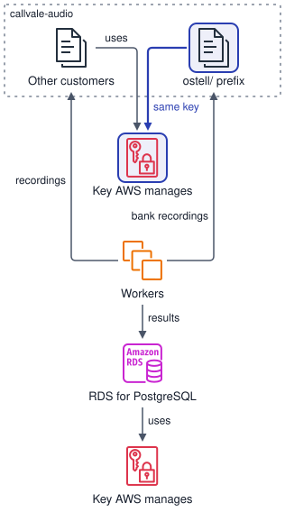
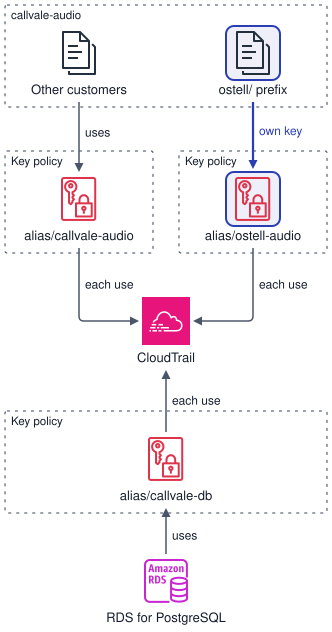

# KMS and CloudHSM in depth

## How it works (29 min)
<!-- section: role=how; route=full; minutes=29 -->

### A KMS key protects a data key and the data key encrypts your data (4 min)
<!-- section: route=pass -->

A recording is many megabytes, but Encrypt takes plaintext of up to [4 KB](../facts/kms.md#kms-encrypt-max-plaintext-4096-bytes).

1. **Ask.** The application calls GenerateDataKey with a **KMS key**.
2. **Receive two copies.** AWS KMS returns [a plaintext copy of the data key](../facts/kms.md#kms-generatedatakey-returns-plaintext-and-encrypted) and a copy [encrypted under the KMS key](../facts/kms.md#kms-generatedatakey-returns-plaintext-and-encrypted).
3. **Encrypt locally.** The plaintext **data key** encrypts the recording. [Remove it from memory as soon as possible](../facts/kms.md#kms-envelope-store-encrypted-data-key), and store the encrypted data key with the recording.
4. **Decrypt later.** The encrypted data key goes back to AWS KMS and is [decrypted by only users with permissions](../facts/kms.md#kms-faq-exported-data-key-encrypted-under-kms-key) for that KMS key.

This pattern is **envelope encryption**. Why does AWS work this way? Only the small data key crosses the network, which [reduces the network load](../facts/kms.md#kms-envelope-encryption-why). <!-- xref: 21 S3 server-side encryption options -->

> **Exam signal:** "encrypt files larger than 4 KB with a KMS key" points to GenerateDataKey and local encryption.

> **Say it:** The short answer is: a data key encrypts the file, and AWS KMS protects that key. The thing to watch is keeping the encrypted key.

**Stop and answer.** An application deletes both copies of a file's data key. Can AWS KMS decrypt the file later?

Answer

No. AWS KMS [does not store, manage, or track](../facts/kms.md#kms-does-not-store-data-keys) data keys.

### The key type decides who controls the key policy and who sees its use (4 min)

AWS services that use AWS KMS encrypt with one of three key types.

1. **AWS owned key.** It is [not in your AWS account](../facts/kms.md#kms-aws-owned-keys-not-in-account). These keys [do not provide policy controls or CloudTrail logs](../facts/kms.md#kms-faq-aws-owned-no-policy-no-logs).
2. **AWS managed key.** A service creates it in your account, such as `aws/s3`. For AWS managed keys, you can [audit their use in AWS CloudTrail logs](../facts/kms.md#kms-aws-managed-key-cannot-change).
3. **Customer managed key.** A key that [you create, own, and manage](../facts/kms.md#kms-customer-managed-key-full-control), including its key policy.

**Figure.** Before: every store uses a key that AWS manages, and the bank's recordings share a key with the recordings of Callvale's other customers.

**Figure.** After: three customer managed keys, each with its own key policy, and the bank's recordings use their own key.

Why three types? An AWS owned key fits unless you are [required to audit or control the encryption key](../facts/kms.md#kms-aws-owned-key-good-choice-unless-audit). An AWS managed key adds the audit, and a customer managed key adds control.

> **Exam signal:** "control who can use the key and audit every use" points to a customer managed key.

> **Exam trap:** A team edits the key policy of `aws/s3` for a partner account. That fails: you [cannot change any properties of AWS managed keys](../facts/kms.md#kms-aws-managed-key-cannot-change). <!-- trap: kms-trap-aws-managed-key-controllable -->

> **Say it:** The short answer is: a customer managed key gives you control and an audit trail. The thing to watch is the monthly fee.

**Stop and answer.** Can a team share an Amazon RDS snapshot encrypted with `aws/rds` with another account?

Answer

No. RDS does not share a snapshot [encrypted using the AWS managed key](../facts/kms.md#kms-rds-aws-managed-key-snapshot-no-share). You [cannot change any properties of AWS managed keys](../facts/kms.md#kms-aws-managed-key-cannot-change), such as the key policy.

### IAM policies and other accounts count only when the key policy allows them (5 min)
<!-- section: route=pass -->

Chen asks: can an engineer with full S3 permissions read the bank's recordings?

1. **Need the key.** A download also needs [kms:Decrypt permissions for the key](../facts/kms.md#kms-s3-sse-kms-put-get-permissions). An upload needs [kms:GenerateDataKey permissions on the key](../facts/kms.md#kms-s3-sse-kms-put-get-permissions).
2. **Read the key policy.** Every KMS key has [exactly one key policy](../facts/kms.md#kms-key-policy-primary-exactly-one). No principal, [including the account root user or key creator](../facts/kms.md#kms-no-principal-has-access-unless-allowed), can use the key unless a policy or a grant allows it and no policy denies it. A grant, often temporary, allows the use of [exactly one KMS key](../facts/kms.md#kms-grant-allow-only-one-key-temporary).
3. **Count IAM if the key policy allows it.** Otherwise, [IAM policies that allow permissions have no effect](../facts/kms.md#kms-iam-policy-allow-needs-key-policy). The default key policy names the account, which lets the account [use IAM policies to delegate the permissions](../facts/kms.md#kms-account-principal-delegates-to-iam). <!-- xref: 03 IAM policy evaluation -->
4. **Cross accounts.** Another account needs [permission in the key policy](../facts/kms.md#kms-cross-account-key-policy-and-iam-policy) and [an IAM policy in the external user's account](../facts/kms.md#kms-cross-account-key-policy-and-iam-policy).

Why is the key policy the gate? It is [the primary way to control access](../facts/kms.md#kms-key-policy-primary-exactly-one). Key administrators [do not have permissions to use](../facts/kms.md#kms-key-administrators-cannot-use-key) the key, but they can [change the key policy and create grants](../facts/kms.md#kms-key-administrators-cannot-use-key) for themselves.

> **Exam signal:** "users with full S3 access must not read the files" points to the key policy of a customer managed key.

> **Exam trap:** The key policy names the security role. Developers' IAM policies allow kms:Decrypt, yet their calls fail: [IAM policies that allow permissions have no effect](../facts/kms.md#kms-iam-policy-allow-needs-key-policy). <!-- trap: kms-trap-iam-policy-alone-opens-key -->

**Spot the bug.** The bank's key policy gives a pipeline role kms:Encrypt and kms:Decrypt. Its SSE-KMS uploads to the ostell/ prefix fail. Why?

Answer

An upload needs [kms:GenerateDataKey permissions on the key](../facts/kms.md#kms-s3-sse-kms-put-get-permissions).

> **Say it:** The short answer is: S3 permission alone does not open the file; the key policy decides. The thing to watch is the default key policy.

**Stop and answer.** A key policy in account A names a role of account B. The role's IAM policy has no KMS statement. Can the role decrypt?

Answer

No. Cross-account use also needs [an IAM policy in the external user's account](../facts/kms.md#kms-cross-account-key-policy-and-iam-policy).

### Automatic rotation changes only the key material and keeps the same KMS key (4 min)

The bank asks for yearly rotation. Callvale fears re-encrypting terabytes each year.

1. **Turn it on.** By default, [key rotation is disabled for customer managed keys](../facts/kms.md#kms-rotation-disabled-by-default-cmk). The period is [365 days](../facts/kms.md#kms-rotation-default-period-365-days) unless you set one [between 90 and 2560 days](../facts/kms.md#kms-rotation-period-range-90-2560-days).
2. **New material encrypts.** New requests use new **key material**, the value inside the key that encrypts. AWS KMS [keeps previous versions of keys](../facts/kms.md#kms-faq-auto-rotation-no-reencrypt) to decrypt older data.
3. **The key stays.** It is [the same logical resource](../facts/kms.md#kms-rotation-same-logical-key-transparent), with the same key ID.

<!-- table: plain -->
| Key | Rotation |
|---|---|
| Customer managed, AWS KMS key material | [Automatic rotation is optional](../facts/kms.md#kms-rotation-only-customer-managed-symmetric) |
| Symmetric, imported key material | [On-demand key rotation is supported](../facts/kms.md#kms-on-demand-rotation-imported-symmetric) |
| AWS managed | [Every year (approximately 365 days)](../facts/kms.md#kms-aws-managed-keys-rotate-every-year) |
| Asymmetric, HMAC, or in a custom key store | [Not eligible for automatic or on-demand key rotation](../facts/kms.md#kms-rotation-not-for-asymmetric-hmac-custom-store) |

Why keep the old material? Rotation [has no effect on the data](../facts/kms.md#kms-rotation-no-reencrypt-of-data), so old ciphertext still needs it. <!-- xref: 07 secret rotation and certificate renewal -->

> **Exam signal:** "rotate the key every year with the LEAST operational overhead" points to automatic rotation.

> **Try it:** Turn on rotation and see that the key ID stays the same. See [3-do.md](3-do.md). <!-- task: kms-t02 -->

> **Say it:** The short answer is: turn on automatic rotation; the key ID stays. The thing to watch is asymmetric keys.

**Stop and answer.** A team replaces an asymmetric key with a new KMS key. Its applications still call the old key ID. Do they use the new key?

Answer

No. With [manual key rotation](../facts/kms.md#kms-manual-rotation-new-key-alias), [update references to the KMS key ID](../facts/kms.md#kms-manual-rotation-new-key-alias). Next time, call an `alias/` name and move it.

### A disabled KMS key can be re-enabled but a deleted one cannot be recovered (4 min)

The bank wants access to end fast, and a mistake to stay reversible.

1. **Disable.** The key works in no cryptographic operation [until you re-enable it](../facts/kms.md#kms-disabled-key-no-crypto-until-reenabled). A service that already holds a plaintext data key keeps using it: the effect is [delayed until the KMS key is used again](../facts/kms.md#kms-unusable-key-data-keys-delayed-effect).
2. **Schedule deletion.** AWS KMS waits [7 – 30 days](../facts/kms.md#kms-deletion-waiting-period-7-to-30-days). You can [cancel key deletion before the waiting period ends](../facts/kms.md#kms-pending-deletion-no-crypto-cancel-possible).
3. **Deleted.** For data encrypted under the key, [that data becomes unrecoverable](../facts/kms.md#kms-deletion-irreversible-data-unrecoverable), unless the key is a multi-Region replica.

Why a waiting period? To find data that still needs the key. When unsure, AWS suggests [disabling the KMS key instead of deleting it](../facts/kms.md#kms-disable-instead-of-delete).

> **Exam signal:** "stop all use of the key now, but keep the option to restore access" points to disabling the key.

> **Exam trap:** "Delete the key today, recover files next month" fails twice. Deletion waits [7 – 30 days](../facts/kms.md#kms-deletion-waiting-period-7-to-30-days), and afterwards [that data becomes unrecoverable](../facts/kms.md#kms-deletion-irreversible-data-unrecoverable). <!-- trap: kms-trap-delete-key-immediately -->

> **Try it:** Disable a key, watch a decrypt call fail, then enable it again. See [3-do.md](3-do.md). <!-- task: kms-t01 -->

> **Say it:** The short answer is: disable the key to stop its use now. The thing to watch is deletion, which has no way back.

**Stop and answer.** A key waits 7 days for deletion. On day 3 the team finds files that need it. Can it keep the key?

Answer

Yes. It can [cancel key deletion before the waiting period ends](../facts/kms.md#kms-pending-deletion-no-crypto-cancel-possible).

### A KMS key stays in its Region unless you create a multi-Region key (4 min)

Later, the bank's contract needs the data, and a key that decrypts it, in a second Region. <!-- xref: 40 multi-Region disaster recovery -->

1. **One Region.** A single-Region key is [stored and used only in the Region](../facts/kms.md#kms-single-region-key-stays-in-region) where you created it.
2. **Or a multi-Region key.** Related keys share [the same key material and key ID](../facts/kms.md#kms-mrk-same-material-no-cross-region-call), so data decrypts [without re-encrypting or making a cross-Region call](../facts/kms.md#kms-mrk-same-material-no-cross-region-call).
3. **Manage each copy.** You [manage each multi-Region key independently](../facts/kms.md#kms-mrk-independent-policies-grants-aliases).

<!-- table: plain -->
| Question | Single-Region key | Multi-Region key |
|---|---|---|
| Decrypt in a second Region with no call to the first? | No: keys [decrypt sensitive data only in that Region](../facts/kms.md#kms-mrk-data-residency-harder) | Yes, with the replica |
| Replicated for you? | Not applicable | No: [Multi-Region keys are not global.](../facts/kms.md#kms-mrk-not-global-never-auto-replicated) |

Why Regional by default? AWS advises a multi-Region key [only when you need one](../facts/kms.md#kms-mrk-use-only-when-needed): it complicates [compliance with data residency mandates](../facts/kms.md#kms-mrk-data-residency-harder).

> **Exam signal:** "decrypt the data in the recovery Region during a Regional outage" points to a multi-Region key.

> **Exam trap:** In an outage of the first Region, a team decrypts replicated data with the first key's ARN. That key is [stored and used only in the Region](../facts/kms.md#kms-single-region-key-stays-in-region) of its creation, so each call fails. <!-- trap: kms-trap-key-is-global -->

> **Say it:** The short answer is: a key works in one Region unless it is multi-Region. The thing to watch is each replica's key policy.

**Stop and answer.** A team wants to turn its existing single-Region key into a multi-Region key. Can it?

Answer

No. [You cannot convert a single-Region key](../facts/kms.md#kms-mrk-cannot-convert). The team re-encrypts the data under a new multi-Region key.

### AWS CloudHSM gives you single-tenant hardware security modules that you operate (4 min)

Some rules require keys in a single-tenant **hardware security module** (HSM) under the company's control.

1. **Create a cluster.** AWS CloudHSM [must be provisioned inside an Amazon VPC](../facts/cloudhsm.md#cloudhsm-faq-requires-vpc).
2. **Sign in as an HSM user.** [You use HSM users directly on HSMs](../facts/cloudhsm.md#cloudhsm-hsm-users-not-iam), not IAM.
3. **Add a second HSM.** For availability, use [at least two HSMs](../facts/cloudhsm.md#cloudhsm-faq-ha-automatic-two-azs) in two Availability Zones.
4. **Call standard APIs.** Applications use [PKCS#11](../facts/cloudhsm.md#cloudhsm-faq-standard-apis) or [Java JCE](../facts/cloudhsm.md#cloudhsm-faq-standard-apis). AWS services reach the keys [through the KMS custom key store feature](../facts/cloudhsm.md#cloudhsm-aws-services-via-kms-custom-key-store).

AWS CloudHSM charges [an hourly fee for each HSM](../facts/cloudhsm.md#cloudhsm-price-hourly-per-hsm-no-upfront).

Why not CloudHSM for everyone? AWS suggests AWS KMS if you do not want to [operate your own HSMs](../facts/cloudhsm.md#cloudhsm-consider-kms-if-no-hsm-ops). <!-- xref: 07 AWS Private CA for TLS certificates -->

> **Exam signal:** "single-tenant HSM" or "exclusive control" points to AWS CloudHSM. "FIPS 140-3 Level 3" alone does not.

> **Say it:** The short answer is: choose CloudHSM for single-tenant HSMs that you control. The thing to watch is the work: you run the cluster.

**Stop and answer.** A company wants S3 server-side encryption with keys kept in its own CloudHSM cluster. What connects the two?

Answer

An AWS KMS custom key store, because AWS services work [through the KMS custom key store feature](../facts/cloudhsm.md#cloudhsm-aws-services-via-kms-custom-key-store).

## Numbers that decide answers (2 min)
<!-- section: role=numbers; route=full; minutes=2 -->

### A-list

<!-- table: numbers -->
| Number | What it is | Why it decides an answer |
|---|---|---|
| [7 – 30 days](../facts/kms.md#kms-deletion-waiting-period-7-to-30-days) | Waiting period before deletion; default [30 days](../facts/kms.md#kms-deletion-waiting-period-7-to-30-days) | "Delete the key today" is a wrong option |
| [4 KB](../facts/kms.md#kms-encrypt-max-plaintext-4096-bytes) | Plaintext that Encrypt takes | Larger files need a data key |
| [365 days](../facts/kms.md#kms-rotation-default-period-365-days) | Rotation period when none is set | Yearly rotation needs no custom period |
| [between 90 and 2560 days](../facts/kms.md#kms-rotation-period-range-90-2560-days) | Custom automatic rotation period | On-demand rotation is capped at [25 times](../facts/kms.md#kms-quota-on-demand-rotations-per-key) per key |
| [at least two HSMs](../facts/cloudhsm.md#cloudhsm-faq-ha-automatic-two-azs) | CloudHSM high availability | One HSM: [possible to lose keys](../facts/cloudhsm.md#cloudhsm-single-hsm-can-lose-keys) made after the last daily backup |

## Decision record (2 min)
<!-- section: role=example; route=full; minutes=2 -->

**Context.** Ostell Bank asks who controls its recording keys. Callvale uses keys that AWS manages.

**Requirement.** Control who can use the key for one customer's recordings, log every use and end access quickly, with the LEAST operational overhead.

**Options.**

- Keep the keys that AWS manages.
- **Customer managed keys in AWS KMS, with one dedicated key for the bank.**
- Keys in AWS CloudHSM.

**Decision.** Customer managed keys: [You have full control over these KMS keys](../facts/kms.md#kms-customer-managed-key-full-control). You [cannot change any properties of AWS managed keys](../facts/kms.md#kms-aws-managed-key-cannot-change). With CloudHSM, [you have more responsibility](../facts/cloudhsm.md#cloudhsm-more-responsibility-than-managed).

**Trade-off.** A wrong key policy can stop the pipeline, and [API requests](../facts/kms.md#kms-faq-billing-keys-and-requests) add cost. The database moves through a snapshot: Callvale uses the new key to [create an encrypted copy of that snapshot](../facts/kms.md#kms-rds-encrypt-only-at-create-snapshot-copy) and restores from the copy.

## FAQ quick-fire (3 min)
<!-- section: role=faq; route=full; minutes=3 -->

**FAQ 1.** Can anyone at AWS retrieve your plaintext KMS keys?

Answer

No, [no one, including AWS employees](../facts/kms.md#kms-faq-no-one-retrieves-plaintext-keys).

> "AWS KMS is designed so that no one, including AWS employees, can retrieve your plaintext KMS keys from the service."
> — [AWS KMS FAQs](https://aws.amazon.com/kms/faqs/)

**FAQ 2.** After automatic rotation, must you re-encrypt your data?

Answer

No. AWS KMS [keeps previous versions of keys](../facts/kms.md#kms-faq-auto-rotation-no-reencrypt).

> "If you choose to have AWS KMS automatically rotate keys, you don’t have to re-encrypt your data."
> — [AWS KMS FAQs](https://aws.amazon.com/kms/faqs/)

**FAQ 3.** Can you import your own key material into AWS KMS?

Answer

Yes. You can [import a copy of your key](../facts/kms.md#kms-faq-import-own-keys-byok).

> "You can import a copy of your key from your own key management infrastructure to AWS KMS and use it with any integrated AWS service or from within your own applications."
> — [AWS KMS FAQs](https://aws.amazon.com/kms/faqs/)

**FAQ 4.** Can an application use AWS KMS through JCE or OpenSSL natively?

Answer

No. There is [no native integration](../facts/kms.md#kms-faq-no-native-openssl-jce-cng).

> "There is no native integration offered by AWS KMS for any other cryptographic API providers."
> — [AWS KMS FAQs](https://aws.amazon.com/kms/faqs/)

**FAQ 5.** Can AWS recover your CloudHSM keys if you lose your HSM credentials?

Answer

No. AWS [has no way to recover your keys](../facts/cloudhsm.md#cloudhsm-aws-cannot-recover-keys).

> "Amazon does not have access to your keys or credentials and therefore has no way to recover your keys if you lose your credentials."
> — [AWS CloudHSM FAQs](https://aws.amazon.com/cloudhsm/faqs/)

## In the real world (1 min)
<!-- section: role=realworld; route=full; minutes=1 -->

**Kaia Health, 2023.** This German health company uses AWS KMS to [encrypt its data to help comply](../facts/kms.md#kms-case-kaia-health) with data protection rules.

> "By using AWS KMS, Kaia Health can encrypt its data to help comply with data protection regulations in various countries."
> — [Kaia Health case study](https://aws.amazon.com/solutions/case-studies/kaia-health)

**It shows:** encryption with AWS KMS helps a company meet data protection rules.

> **Say it:** Kaia Health encrypts its data with AWS KMS. This helps it meet data protection laws.
