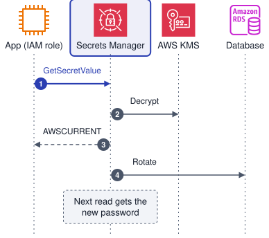

# Secrets Manager, Parameter Store and ACM

## Predict (1 min)
<!-- section: role=predict; route=fast; minutes=1 -->

**Predict 1.** Your Application Load Balancer has an ACM certificate in US West (Oregon). You add CloudFront for the same domain. Can CloudFront use that certificate? <!-- gist-trap -->

**Predict 2.** A team keeps its database password as a SecureString parameter. Can Parameter Store rotate it every 30 days by itself?

## In one breath (2 min)
<!-- section: role=breath; route=fast; minutes=2 -->

> **Say it:** Secrets Manager stores and rotates secrets. Parameter Store holds configuration. ACM issues and renews Transport Layer Security (TLS) certificates.

**The problem it solves.** AWS calls [credentials in source code or configuration files](../facts/secrets-manager.md#secrets-manager-wa-anti-patterns) and [manual steps during the certificate deployment or renewal](../facts/acm.md#acm-wa-cert-anti-patterns) anti-patterns.

**Predict the picture.** Does the application keep the password or fetch it?

Show the picture

**Figure.** The application reads the password from Secrets Manager at run time, so rotation [no longer requires updating your applications](../facts/secrets-manager.md#secrets-manager-rotation-without-redeploy).

1. The application calls Secrets Manager with its **IAM role**.
2. Secrets Manager decrypts the secret value with AWS KMS.
3. Secrets Manager returns the AWSCURRENT version over TLS.
4. Rotation changes the password in the secret and in the database.

> **Startup example:** Callvale stores the database password in a configuration file on each **instance**. The bank requires rotation every 30 days with no downtime and no new deployment. Callvale also wants TLS certificates that renew without manual work.

## Words that go together (1 min)
<!-- section: role=words; route=fast; minutes=1 -->

<!-- table: words -->
| Term | Words that go with it | Plain meaning | Do not confuse with |
|---|---|---|---|
| secret | **rotate** a secret | A credential that an application reads at run time | a parameter, which does not rotate |
| KMS key | **decrypt** with a KMS key | Encrypts a secret or a SecureString value | a TLS certificate |
| encryption in transit | **attach** a TLS certificate to a listener | The certificate proves who owns the domain name | encryption of stored data |
| resource-based policy | a resource-based policy **names** another account | Sits on the secret and says who can read it | the IAM policy of a role |

## Choose it or not (2 min)
<!-- section: role=choose; route=fast; minutes=2 -->

### Secrets Manager or Parameter Store

<!-- table: compare -->
| Question | Secrets Manager | Parameter Store |
|---|---|---|
| Does it rotate credentials? | [Automatic, with native database integrations](../facts/parameter-store.md#parameter-store-vs-secrets-manager-rotation-row) | [None](../facts/parameter-store.md#parameter-store-vs-secrets-manager-rotation-row) |
| What does it cost? | [Billed per secret per month](../facts/parameter-store.md#parameter-store-vs-secrets-manager-cost-row) and per API call | [Standard tier free](../facts/parameter-store.md#parameter-store-vs-secrets-manager-cost-row); advanced tier billed |
| Can another account read it? | Yes, with a resource-based policy and [a KMS key that you create](../facts/secrets-manager.md#secrets-manager-cross-account-no-aws-managed-key) | Advanced tier; a SecureString [must be encrypted with a customer managed key](../facts/parameter-store.md#parameter-store-share-securestring-cmk) |

**Deciding question:** Must the value rotate automatically, or does a person change it?

### Public or imported or private certificate

<!-- table: compare -->
| Question | ACM public | Imported | ACM private |
|---|---|---|---|
| When do you choose it? | For [resources on the public Internet](../facts/acm.md#acm-faq-public-internet-private-networks) | One [from a third-party certificate authority (CA)](../facts/acm.md#acm-import-reasons) | Private certificates [do the same for private networks](../facts/acm.md#acm-faq-public-internet-private-networks) |
| Who trusts it? | Browsers [trust public certificates automatically by default](../facts/acm.md#acm-faq-public-vs-private-trust) | Whoever trusts its CA | You [must explicitly configure applications to trust](../facts/acm.md#acm-faq-public-vs-private-trust) it |
| Who renews it? | ACM: [ACM managed renewal (automatic)](../facts/acm.md#acm-option-renewal-row) | You: ACM [does not manage the renewal process](../facts/acm.md#acm-faq-imported-no-managed-renewal) | ACM, if the CA [remains in the Active state](../facts/acm.md#acm-faq-private-renewal-ca-active) |

**Deciding question:** Who must trust the certificate, and who will renew it?

## Signals and traps (3 min)
<!-- section: role=signals; route=fast; minutes=3 -->

<!-- table: signals -->
| The stem says | Think | Because | But not if |
|---|---|---|---|
| "rotate the database password automatically" | Secrets Manager with rotation | [Automatic, with native database integrations](../facts/parameter-store.md#parameter-store-vs-secrets-manager-rotation-row) | no rotation, and cost decides: a SecureString standard parameter |
| "hard-coded database credentials" | move them to Secrets Manager | [then rotate them immediately](../facts/secrets-manager.md#secrets-manager-move-hardcoded-then-rotate) | an AWS **access key**: an IAM role |
| "another AWS account must read the secret" | resource-based policy and customer managed key | it needs [a KMS key that you create](../facts/secrets-manager.md#secrets-manager-cross-account-no-aws-managed-key) | same account: an IAM policy is enough |
| "HTTPS for CloudFront with a custom domain" | ACM certificate in US East (N. Virginia) | CloudFront needs [US East (N. Virginia)](../facts/acm.md#acm-cloudfront-us-east-1) | the load balancer origin: its own **Region** |
| "certificates must renew without manual work" | ACM certificate with DNS validation | ACM [automatically renews DNS-validated certificates](../facts/acm.md#acm-dns-validation-recommended) | a third-party CA issues it: import and reimport |
| "TLS between internal services that only company clients trust" | ACM private certificate | private certificates [do the same for private networks](../facts/acm.md#acm-faq-public-internet-private-networks) | a public name, and cost decides: an ACM public certificate |

### Traps

- **Wrong belief:** A SecureString parameter can rotate a database password. **Truth:** Credential rotation in Parameter Store is [None](../facts/parameter-store.md#parameter-store-vs-secrets-manager-rotation-row). <!-- trap: secrets-certificates-trap-parameter-store-rotates -->
- **Wrong belief:** CloudFront can use a certificate from its origin's Region. **Truth:** CloudFront uses certificates in [US East (N. Virginia)](../facts/acm.md#acm-cloudfront-us-east-1), and [you cannot copy a certificate between regions](../facts/acm.md#acm-certificates-regional). <!-- trap: secrets-certificates-trap-cloudfront-certificate-any-region -->
- **Wrong belief:** ACM renews every certificate that it holds. **Truth:** ACM [does not manage the renewal process](../facts/acm.md#acm-faq-imported-no-managed-renewal) of imported certificates, and email-validated ones [require an action by the domain owner](../facts/acm.md#acm-email-validation-needs-owner-action). <!-- trap: secrets-certificates-trap-acm-renews-everything -->

## Changed recently (1 min)
<!-- section: role=changed; route=fast; minutes=1 -->

> **Changed recently:** (2025-06-17) Public certificates outside AWS services. 
> **Old:** they [could only be used with integrated AWS services](../facts/acm.md#acm-change-exportable-public-certificates-2025). 
> **Now:** you can [issue public certificates that you can export](../facts/acm.md#acm-change-exportable-public-certificates-2025). 
> **The exam probably expects:** the old rule: end TLS on a load balancer or CloudFront. 
> **Status:** examinable.

> **Changed recently:** (2026-02-18) Validity of ACM public certificates. 
> **Old:** [395 days](../facts/acm.md#acm-public-certificate-validity). 
> **Now:** [198 days](../facts/acm.md#acm-public-certificate-validity). 
> **The exam probably expects:** answers that do not need the number. 
> **Status:** examinable.

## Check (1 min)
<!-- section: role=check; route=fast; minutes=1 -->

**Check 1.** A load balancer in Ireland is a CloudFront origin. Which Region holds its certificate?

Answer

Ireland: it [must be in the same Region](../facts/acm.md#acm-faq-certificate-same-region-as-resource) as the load balancer.

**Predict 1:** No: CloudFront uses [US East (N. Virginia)](../facts/acm.md#acm-cloudfront-us-east-1).

**Check 2.** A third-party API key must rotate every 90 days. Which service can rotate it?

Answer

Secrets Manager: you write the rotation function [by modifying sample AWS Lambda functions](../facts/secrets-manager.md#secrets-manager-faq-custom-rotation-lambda).

**Predict 2:** No: its credential rotation is [None](../facts/parameter-store.md#parameter-store-vs-secrets-manager-rotation-row).

## Recap from memory (1 min)
<!-- section: role=recap; route=fast; minutes=1 -->

**Recap 1.** Which Region must hold a CloudFront certificate?

Answer

[US East (N. Virginia)](../facts/acm.md#acm-cloudfront-us-east-1).

**Recap 2.** Secrets Manager or Parameter Store: which one rotates a database password?

Answer

Secrets Manager: [Automatic, with native database integrations](../facts/parameter-store.md#parameter-store-vs-secrets-manager-rotation-row).

**Recap 3.** Who renews a certificate that you imported into ACM?

Answer

You do: ACM [does not manage the renewal process](../facts/acm.md#acm-faq-imported-no-managed-renewal).

