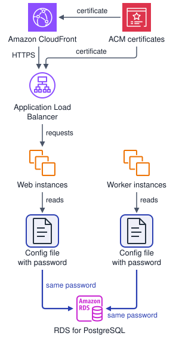

# Secrets Manager, Parameter Store and ACM in depth

## How it works (23 min)
<!-- section: role=how; route=full; minutes=23 -->

### Secrets Manager replaces a stored password with a call at run time (4 min)
<!-- section: route=pass -->

A password in a configuration file does not change, and it leaks with every copy.



**Figure.** Before: every instance keeps the same database password in a configuration file.

1. **Move.** Move the credentials into a **secret**, and [then rotate them immediately](../facts/secrets-manager.md#secrets-manager-move-hardcoded-then-rotate).
2. **Allow.** You [must write an AWS Identity and Access Management](../facts/secrets-manager.md#secrets-manager-faq-iam-policy-before-retrieval) (IAM) **policy** for the application's role.
3. **Read.** The application calls GetSecretValue, a [runtime call to the Secrets Manager service](../facts/secrets-manager.md#secrets-manager-runtime-call-replaces-hardcoded). Secrets Manager [returns that version by default](../facts/secrets-manager.md#secrets-manager-awscurrent-returned-by-default), the version with the staging label AWSCURRENT. A **cache** (KASH) helps: [using a cache can reduce your costs](../facts/secrets-manager.md#secrets-manager-cache-cost-latency).
4. **Delete.** You can restore a deleted secret in a window of [from 7 to 30](../facts/secrets-manager.md#secrets-manager-recovery-window-range) days. A forced delete leaves [no opportunity to recover the secret](../facts/secrets-manager.md#secrets-manager-force-delete-without-recovery).


**Figure.** After: the application's IAM role reads a rotated secret, and ACM certificates sit on the load balancer and CloudFront.

Why a call? The credentials are [no longer stored with the application](../facts/secrets-manager.md#secrets-manager-rotation-without-redeploy), so the next read gets the new password.

> **Exam signal:** "hard-coded database credentials" points to Secrets Manager: [move the credentials to Secrets Manager](../facts/secrets-manager.md#secrets-manager-move-hardcoded-then-rotate).

> **Say it:** The short answer is: the application asks Secrets Manager for the password at run time. The thing to watch is the role's permission.

**Stop and answer.** An IAM role has no policy for Secrets Manager, and the secret has no resource-based policy. What happens when the role calls GetSecretValue?

<details>
<summary>Answer</summary>

Access is denied: the role needs an IAM policy to [access specific secrets](../facts/secrets-manager.md#secrets-manager-faq-iam-policy-before-retrieval).

</details>

### Cross-account access to a secret needs a customer managed KMS key (4 min)

A reader in another account needs three allows.

1. **Encrypt.** Secrets Manager encrypts each value: it [requests a new data key from AWS KMS](../facts/secrets-manager.md#secrets-manager-envelope-encryption-data-key) (AWS Key Management Service).
2. **Check the caller.** In the secret's resource-based policy, [you specify who can access the secret](../facts/secrets-manager.md#secrets-manager-resource-policy-who-and-what). The caller's **identity-based policy** counts too.
3. **Decrypt.** The reader also uses the KMS key, so [the key policy must give the external account permission](../facts/iam.md#iam-kms-cross-account-key-policy-and-iam-policy). [To read the secret value](../facts/secrets-manager.md#secrets-manager-read-needs-kms-decrypt), the reader needs kms:Decrypt.

<!-- table: plain -->
| Reader | Identity-based policy | Resource-based policy | Key policy | Result |
|---|---|---|---|---|
| Same account | Allows | Not needed | Default key works | Reads |
| Other account | Allows | Allows the reader | Allows the reader | Reads |
| Other account | Allows | Silent | Allows the reader | Fails |
| Other account | Allows | Allows the reader | aws/secretsmanager | Fails |

Why a new key? The default key aws/secretsmanager [does not allow any user to use](../facts/secrets-manager.md#secrets-manager-aws-managed-key-policy-fixed) it directly, and [you cannot change the key policy](../facts/secrets-manager.md#secrets-manager-aws-managed-key-policy-fixed). <!-- xref: 06 KMS key policies and key rotation -->

> **Exam signal:** "a Lambda **function** in another AWS account must read the secret" points to a resource-based policy, an allow in the other account, and [a KMS key that you create](../facts/secrets-manager.md#secrets-manager-cross-account-no-aws-managed-key).

> **Exam trap:** A resource-based policy does not open the secret to another account by itself. If the secret uses aws/secretsmanager, you need no new secret: you can [change the encryption key for your secret](../facts/secrets-manager.md#secrets-manager-change-kms-key-reencrypts-labeled). <!-- trap: secrets-certificates-trap-resource-policy-enough-cross-account -->

**Spot the bug.** This resource-based policy limits the secret to the office network. Now every rotation fails. Why?

```json
{
  "Effect": "Deny",
  "Principal": "*",
  "Action": "secretsmanager:*",
  "Resource": "*",
  "Condition": {
    "NotIpAddress": {"aws:SourceIp": "203.0.113.0/24"}
  }
}
```

<details>
<summary>Answer</summary>

The rotation function calls [from an AWS-internal address space](../facts/secrets-manager.md#secrets-manager-ip-condition-breaks-rotation), so the Deny matches it. A Deny on [aws:SourceVpce](../facts/secrets-manager.md#secrets-manager-source-vpce-condition) has the same risk: [you can inadvertently deny access to services](../facts/secrets-manager.md#secrets-manager-vpc-condition-can-block-services).

</details>

> **Say it:** The short answer is: both accounts and the key policy have to allow the read. The thing to watch is the default key.

**Stop and answer.** The key policy names only account A; the other two policies allow account B's reader. Can it read the secret?

<details>
<summary>Answer</summary>

No. The key policy does not allow account B.

</details>

### Automatic rotation changes the password on a schedule without a new deployment (4 min)

Secrets that never change [become more likely to be compromised](../facts/secrets-manager.md#secrets-manager-not-changed-more-likely-compromised).

1. **Schedule.** A secret can rotate as often as [every four hours](../facts/secrets-manager.md#secrets-manager-rotation-shortest-and-longest), in a window of at least [one hour](../facts/secrets-manager.md#secrets-manager-rotation-window-minimum).
2. **Rotate.** [With managed rotation](../facts/secrets-manager.md#secrets-manager-managed-rotation-no-lambda), a service such as [Amazon RDS](../facts/secrets-manager.md#secrets-manager-managed-rotation-rds-master-user) rotates the secret without a Lambda function. Otherwise a Lambda rotation function runs: Secrets Manager [calls the same function several times](../facts/secrets-manager.md#secrets-manager-rotation-function-called-per-step), one call per step.

<!-- table: plain -->
| Step | What the function does |
|---|---|
| createSecret | Makes a new password, to [store it with the staging label AWSPENDING](../facts/secrets-manager.md#secrets-manager-rotation-createsecret-awspending) |
| setSecret | [changes the credential in the database or service](../facts/secrets-manager.md#secrets-manager-rotation-setsecret-changes-credential) |
| testSecret | [tests the AWSPENDING version of the secret](../facts/secrets-manager.md#secrets-manager-rotation-testsecret-tests-pending) |
| finishSecret | [moves the label AWSCURRENT](../facts/secrets-manager.md#secrets-manager-rotation-finishsecret-moves-awscurrent) to the new version |

Why steps? The new password is tested before AWSCURRENT moves to it.

> **Exam signal:** "rotate the Amazon RDS master user password with the LEAST operational overhead" points to managed rotation: [RDS generates the password](../facts/secrets-manager.md#secrets-manager-rds-generates-master-password). <!-- xref: 26 RDS master user password -->

> **Exam trap:** A rotation is not a redeploy. [Authentication happens when a connection is established](../facts/secrets-manager.md#secrets-manager-faq-rotation-open-connections), so new connections read the secret again. A value read at start is the exception: for Amazon ECS, [you must force a new deployment](../facts/secrets-manager.md#secrets-manager-ecs-redeploy-for-new-value) or launch a new task. <!-- trap: secrets-certificates-trap-rotation-needs-redeploy -->

<details>
<summary>Go deeper: strategies, private networks and replicas</summary>

Alternating-users rotation suits [applications that require high availability](../facts/secrets-manager.md#secrets-manager-alternating-users-high-availability). In a **virtual private cloud** (vee-pee-SEE), or VPC, without internet access, use [Secrets Manager service private endpoints within your VPC](../facts/secrets-manager.md#secrets-manager-rotation-private-vpc-use-endpoint). A **NAT gateway** (NAT GAYT-way) also works, but [this exposes your VPC to more risk](../facts/secrets-manager.md#secrets-manager-rotation-nat-gateway-more-risk). <!-- xref: 11 interface endpoints and PrivateLink --> The rotated value [propagates to all of the associated replica secrets](../facts/secrets-manager.md#secrets-manager-rotation-propagates-to-replicas), and you promote a replica [as a disaster recovery solution](../facts/secrets-manager.md#secrets-manager-promote-replica-for-dr).

</details>

> **Say it:** The short answer is: rotation changes the password on a schedule. The thing to watch is how the application reconnects.

**Stop and answer.** Amazon RDS manages a master user password in Secrets Manager. An old rotation Lambda function is still deployed. Does the next rotation call it?

<details>
<summary>Answer</summary>

No. [With managed rotation](../facts/secrets-manager.md#secrets-manager-managed-rotation-no-lambda), the managing service rotates the secret.

</details>

### Parameter Store stores configuration and encrypted values but does not rotate them (4 min)
<!-- section: route=pass -->

An Amazon Machine Image (AMI) ID is configuration, not a secret. Parameter Store is [a centralized configuration data store](../facts/parameter-store.md#parameter-store-what-it-is) in AWS Systems Manager. <!-- xref: 38 Systems Manager -->

1. **Name.** Paths that you [define by using forward slashes](../facts/parameter-store.md#parameter-store-hierarchy-forward-slashes) group parameters, as in /prod/db/host.
2. **Type.** There are [three types of parameters](../facts/parameter-store.md#parameter-store-three-parameter-types): String, StringList and SecureString. A sensitive value goes into a SecureString.
3. **Encrypt.** Without a named key, a SecureString uses the [AWS managed key that Systems Manager automatically creates](../facts/parameter-store.md#parameter-store-securestring-kms-keys), aws/ssm.
4. **Read.** Unless GetParameter sets WithDecryption to true, [its value is encrypted](../facts/parameter-store.md#parameter-store-with-decryption) in the response. That flag is not a permission: the reader needs kms:Decrypt [regardless of which Parameter Store operation is used](../facts/parameter-store.md#parameter-store-securestring-needs-kms-decrypt).
<!-- table: plain -->
| Question | Standard parameter | Advanced parameter |
|---|---|---|
| Storage charge | [No additional charge](../facts/parameter-store.md#parameter-store-price-advanced-parameter) | [$0.05 per advanced parameter per month](../facts/parameter-store.md#parameter-store-price-advanced-parameter) |
| Largest value | [4 KB](../facts/parameter-store.md#parameter-store-tier-max-value-size) | [8 KB](../facts/parameter-store.md#parameter-store-tier-max-value-size) |
| Parameters per account and Region | [10,000](../facts/parameter-store.md#parameter-store-tier-max-parameters) | [100,000](../facts/parameter-store.md#parameter-store-tier-max-parameters) |
| Change the tier later | To advanced | [Not downgradeable](../facts/parameter-store.md#parameter-store-standard-upgradeable-not-downgradeable) |

Why two tiers? The advanced tier offers [higher limits and extra features, at a cost](../facts/parameter-store.md#parameter-store-standard-free-with-restrictions).

> **Exam signal:** "store AMI IDs at the LOWEST cost" points to standard parameters.

> **Exam trap:** Parameter policies, such as NoChangeNotification, need you to [use the advanced parameters tier](../facts/parameter-store.md#parameter-store-policies-advanced-only). To share through AWS Resource Access Manager (AWS RAM), [it must be in the advanced parameter tier](../facts/parameter-store.md#parameter-store-sharing-advanced-ram). <!-- trap: secrets-certificates-trap-standard-tier-has-policies -->

> **Try it:** Store a SecureString parameter and read it with and without decryption. See [3-do.md](3-do.md). <!-- task: secrets-certificates-t01 -->

> **Say it:** The short answer is: Parameter Store keeps configuration and encrypted values. The thing to watch is that nothing rotates.

**Stop and answer.** PutParameter fails for a 6 KB JSON settings document as a standard parameter. What is the simplest fix that keeps one parameter?

<details>
<summary>Answer</summary>

An advanced parameter: a standard value holds at most [4 KB](../facts/parameter-store.md#parameter-store-tier-max-value-size), an advanced value [8 KB](../facts/parameter-store.md#parameter-store-tier-max-value-size).

</details>

### ACM renews a DNS-validated certificate while it is in use and its record remains (3 min)
<!-- section: route=pass -->

Every certificate expires, and people forget to renew.

1. **Validate.** ACM checks that you [own or control all of the domain names](../facts/acm.md#acm-three-validation-methods). With Domain Name System (DNS) validation, you add a canonical name (CNAME) record.
2. **Renew.** ACM [automatically renews DNS-validated certificates](../facts/acm.md#acm-dns-validation-recommended) that are [currently in use by an AWS service](../facts/acm.md#acm-dns-renewal-criteria). The [Amazon Resource Name (ARN) remains the same](../facts/acm.md#acm-renewal-keeps-arn-per-region), and [existing connections are not affected](../facts/acm.md#acm-faq-renewal-existing-connections-unaffected).
3. **Watch.** ACM sends [daily expiration events](../facts/acm.md#acm-approaching-expiration-event), for an imported certificate from [45 days](../facts/acm.md#acm-approaching-expiration-event) before expiry.

<!-- table: plain -->
| Certificate | Who renews it | Condition |
|---|---|---|
| ACM public, DNS validation | ACM | In use, and [your CNAME record remains in place](../facts/acm.md#acm-dns-cname-records) |
| ACM public, email validation | ACM, after the owner acts | Renewals [require an action by the domain owner](../facts/acm.md#acm-email-validation-needs-owner-action) |
| Imported | You, by reimport | ACM [does not manage the renewal process](../facts/acm.md#acm-faq-imported-no-managed-renewal) |

Why must the record stay? At each renewal, ACM [uses the same method that you chose earlier](../facts/acm.md#acm-renewal-uses-same-method).

> **Exam signal:** "renew certificates automatically" points to ACM with DNS validation. "A third-party certificate authority" points to reimport: [this action preserves the certificate's association](../facts/acm.md#acm-reimport-keeps-arn).

> **Say it:** The short answer is: ACM renews the certificates it issues. The thing to watch is the DNS validation record.

**Stop and answer.** A team deletes the CNAME records that ACM created. The certificate is on a load balancer. What happens at the next renewal?

<details>
<summary>Answer</summary>

ACM [cannot issue or renew certificates](../facts/acm.md#acm-faq-remove-cname-stops-renewal) with DNS validation [if you remove the CNAME record](../facts/acm.md#acm-faq-remove-cname-stops-renewal). Add the record back.

</details>

### ACM certificates are Regional and CloudFront reads them only from us-east-1 (4 min)
<!-- section: route=pass -->

A certificate works where a TLS connection ends. [Certificates in ACM are regional resources](../facts/acm.md#acm-certificates-regional), and [you cannot copy a certificate between regions](../facts/acm.md#acm-certificates-regional).

1. **Viewer to CloudFront.** The certificate is in [US East (N. Virginia)](../facts/acm.md#acm-cloudfront-us-east-1).
2. **CloudFront to the load balancer.** The origin certificate [must be in the same Region](../facts/acm.md#acm-faq-certificate-same-region-as-resource) as the load balancer. <!-- xref: 14 HTTPS listener and SNI -->
3. **Custom API domain.** For Amazon API Gateway, [you can use ACM to generate or import](../facts/acm.md#acm-api-gateway-custom-domain) the certificate. <!-- xref: 33 API Gateway custom domain names -->

<!-- table: plain -->
| Where TLS ends | Region of the certificate |
|---|---|
| CloudFront distribution | [US East (N. Virginia)](../facts/acm.md#acm-cloudfront-us-east-1) |
| Load balancer, also as an origin | Its own: it [must be in the same Region](../facts/acm.md#acm-faq-certificate-same-region-as-resource) |
| API Gateway, edge-optimized | [US East (N. Virginia) – us-east-1 Region](../facts/acm.md#acm-api-gateway-certificate-region) |
| API Gateway, Regional | Its own: [in the same Region as your API](../facts/acm.md#acm-api-gateway-certificate-region) |

Why is CloudFront different? It is not in one Region: its certificate is [distributed to all the geographic locations](../facts/acm.md#acm-cloudfront-us-east-1). <!-- xref: 15 CloudFront custom domain names -->

> **Exam signal:** "HTTPS for a CloudFront distribution with the company's domain name" points to [US East (N. Virginia)](../facts/acm.md#acm-cloudfront-us-east-1), whatever the Region of the origin.

> **Exam trap:** On an EC2 web **server**, an ACM certificate [requires a Nitro Enclave](../facts/acm.md#acm-ec2-needs-nitro-enclave). End TLS on a load balancer, or pay for an exportable certificate: [you are subject to an additional charge](../facts/acm.md#acm-exportable-charged). <!-- trap: secrets-certificates-trap-free-certificate-on-instance -->

<details>
<summary>Go deeper: exportable and private certificates</summary>

For an exportable certificate, [you must manage the deployment process](../facts/acm.md#acm-exportable-you-deploy). A private certificate is [not publicly trusted](../facts/acm.md#acm-private-ca-not-public).

</details>

> **Say it:** The short answer is: put the certificate where TLS ends, in that Region. The thing to watch is CloudFront, which uses us-east-1.

**Stop and answer.** An Application Load Balancer in US West (Oregon) sits behind CloudFront, with HTTPS on both connections. How many ACM certificates, in which Regions?

<details>
<summary>Answer</summary>

Two: one in [US East (N. Virginia)](../facts/acm.md#acm-cloudfront-us-east-1) for CloudFront, one in US West (Oregon) for the load balancer.

</details>

## Numbers that decide answers (2 min)
<!-- section: role=numbers; route=full; minutes=2 -->

### A-list

<!-- table: numbers -->
| Number | What it is | Why it decides an answer |
|---|---|---|
| [from 7 to 30](../facts/secrets-manager.md#secrets-manager-recovery-window-range) | Days of the recovery window | Restore inside the window |
| [every four hours](../facts/secrets-manager.md#secrets-manager-rotation-shortest-and-longest) | Shortest rotation interval | A faster schedule is not accepted |
| [4 KB](../facts/parameter-store.md#parameter-store-tier-max-value-size) | Largest standard parameter | Larger values need the advanced tier |
| [10,000](../facts/parameter-store.md#parameter-store-tier-max-parameters) | Standard parameters per account and Region | More need the advanced tier |
| [40 TPS](../facts/parameter-store.md#parameter-store-throughput-get-default) | Default **throughput** (THROO-put) of Get calls | Throttled reads need higher throughput |

### B-list

<!-- table: numbers -->
| Number | What it is |
|---|---|
| [65,536 Bytes](../facts/secrets-manager.md#secrets-manager-quota-secret-value-size) | Largest secret value |
| [every seven days](../facts/secrets-manager.md#secrets-manager-rds-managed-rotation-default) | Default rotation of an RDS-managed master password (changeable) |
| [198 days](../facts/acm.md#acm-public-certificate-validity) | Validity of an ACM public certificate |
| [45 days before expiration](../facts/acm.md#acm-public-certificate-renewal-window) | Start of public certificate renewal |

> **Changed recently:** (2026-08-13) Switching an existing certificate from email to DNS validation.<br>
> **Old:** [you cannot switch to validating it with DNS](../facts/acm.md#acm-change-email-to-dns-switch-2026).<br>
> **Now:** a certificate can switch, with [up to 72 hours](../facts/acm.md#acm-change-email-to-dns-switch-2026) to add the records.<br>
> **The exam probably expects:** no switch.<br>
> **Status:** not examinable yet.

## Decision record (2 min)
<!-- section: role=example; route=full; minutes=2 -->

**Context.** A bank asks Callvale how often database passwords change. The answer is never: the password sits in a file.

**Requirement.** The database password must rotate every 30 days with no downtime and no new deployment, with the LEAST operational overhead.

**Options.**

- An encrypted file in Amazon S3.
- Parameter Store for everything.
- **Secrets Manager for database credentials, Parameter Store for plain configuration.**

**Decision.** Secrets Manager with automatic rotation for database credentials, because rotation in Parameter Store is [None](../facts/parameter-store.md#parameter-store-vs-secrets-manager-rotation-row), and a file in S3 does not rotate either. Parameter Store for plain configuration.

**Trade-off.** You pay for the [number of secrets stored and API calls made](../facts/secrets-manager.md#secrets-manager-pay-per-secret-and-call). The application retries its connection after a rotation.

## FAQ quick-fire (4 min)
<!-- section: role=faq; route=full; minutes=4 -->

**FAQ 1.** Can you rotate a secret on demand?

<details>
<summary>Answer</summary>

Yes: [on a schedule or on demand](../facts/secrets-manager.md#secrets-manager-faq-rotate-schedule-or-on-demand).

> "You can rotate passwords, on a schedule or on demand, for supported database types hosted on AWS, without a risk of impacting applications."
> — [AWS Secrets Manager FAQs](https://aws.amazon.com/secrets-manager/faqs/)

</details>

**FAQ 2.** Can Secrets Manager rotate an Oracle password on Amazon EC2?

<details>
<summary>Answer</summary>

Yes, [by modifying sample AWS Lambda functions](../facts/secrets-manager.md#secrets-manager-faq-custom-rotation-lambda).

> "You can extend Secrets Manager to rotate other secrets, such as credentials for Oracle databases hosted on EC2 or custom applications generating tokens, by modifying sample AWS Lambda functions available in the Secrets Manager documentation."
> — [AWS Secrets Manager FAQs](https://aws.amazon.com/secrets-manager/faqs/)

</details>

**FAQ 3.** Do you pay for an ACM certificate on a load balancer?

<details>
<summary>Answer</summary>

No: they [are free](../facts/acm.md#acm-faq-free-with-integrated-services). For each private certificate authority (CA), [you pay a monthly fee](../facts/acm.md#acm-faq-private-ca-monthly-fee).

> "Public and private certificates provisioned through AWS Certificate Manager for use with ACM-integrated services, such as Elastic Load Balancing, Amazon CloudFront, and Amazon API Gateway services are free."
> — [AWS Certificate Manager FAQs](https://aws.amazon.com/certificate-manager/faqs/)

</details>

**FAQ 4.** Can an internal load balancer use a public ACM certificate?

<details>
<summary>Answer</summary>

Yes. A private one also works: ACM can [renew without validation](../facts/acm.md#acm-faq-public-cert-internal-load-balancer).

> "Yes, but you can also consider using AWS Private CA to issue private certificates that ACM can renew without validation."
> — [AWS Certificate Manager FAQs](https://aws.amazon.com/certificate-manager/faqs/)

</details>

**FAQ 5.** Does a www.example.com certificate cover example.com?

<details>
<summary>Answer</summary>

No: [you must request a certificate](../facts/acm.md#acm-faq-www-and-apex-need-both-names) with both names.

> "If you want your site to be referenced by both domain names (www.example.com and example.com), you must request a certificate that includes both names."
> — [AWS Certificate Manager FAQs](https://aws.amazon.com/certificate-manager/faqs/)

</details>
