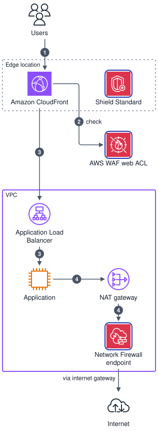

# WAF, Shield, Firewall Manager and Network Firewall

## Predict (1 min)
<!-- section: role=predict; route=fast; minutes=1 -->

**Predict 1.** A SYN flood (a flood of connection requests) hits a website with no AWS Shield subscription. Is it protected? <!-- gist-trap -->

**Predict 2.** Is a **network ACL** (NAK-ul) deny list right for sign-in attacks from 1,400 IP addresses?

## In one breath (3 min)
<!-- section: role=breath; route=fast; minutes=3 -->

> **Say it:** AWS WAF checks web requests, AWS Shield stops DDoS floods, Network Firewall filters VPC traffic, and Firewall Manager applies their rules in every account.

**The problem it solves.** Each layer of a network needs its own check. A **DDoS attack** (DEE-doss) floods a target from many machines. A **web ACL** (web AK-ul) holds the rules of AWS WAF.

**Predict the picture.** Where does each service check traffic?

Show the picture

**Figure.** Shield guards the edge, AWS WAF checks each web request, and Network Firewall checks traffic that leaves the VPC.

1. At the edge, Shield Standard protects CloudFront against [network and transport layer DDoS attacks](../facts/shield.md#shield-standard-automatic-no-charge).
2. The web ACL of AWS WAF allows or blocks each request.
3. Allowed requests reach the load balancer and the application.
4. Outbound traffic passes the NAT gateway, then Network Firewall.

> **Startup example:** Callvale's sign-in page receives 60,000 automated attempts in one hour from 1,400 IP addresses. Its bank customer, Ostell Bank, requires that production workloads connect only to approved outside domains.

## Words that go together (1 min)
<!-- section: role=words; route=fast; minutes=1 -->

<!-- table: words -->
| Term | Words that go with it | Plain meaning | Do not confuse with |
|---|---|---|---|
| network ACL (NAK-ul) | **add** a deny rule to a network ACL | Numbered firewall rules on a subnet | web ACL |
| web ACL (web AK-ul) | **associate** a web ACL with a resource | The rule set of AWS WAF | network ACL |
| rate-based rule | a rate-based rule **blocks** the address | A request limit per source | IP set |
| firewall endpoint | **route** traffic through the firewall endpoint | Where Network Firewall inspects VPC traffic | VPC endpoint |

## Choose it or not (2 min)
<!-- section: role=choose; route=fast; minutes=2 -->

### AWS WAF or AWS Shield or Network Firewall

<!-- table: compare -->
| Question | AWS WAF | AWS Shield | AWS Network Firewall |
|---|---|---|---|
| Which layer? | [Application layer (L7)](../facts/waf.md#waf-vs-shield-layer) | Standard: [layer 3 and 4](../facts/shield.md#shield-faq-standard-layer-3-4-all-customers). Advanced: [layers 3, 4, and 7](../facts/shield.md#shield-faq-advanced-layers-srt-cost-protection) | [Control and visibility to Layer 3-7 network traffic for your entire VPC](../facts/network-firewall.md#network-firewall-complements-sg-waf-marketplace) |
| What does it read? | [Request-level](../facts/waf.md#waf-vs-shield-inspection-level) | [Packet-level](../facts/waf.md#waf-vs-shield-inspection-level) | [All traffic that is routed to the endpoint](../facts/network-firewall.md#network-firewall-faq-inspects-routed-traffic) |
| How is it turned on? | A web ACL on a resource | [Shield Standard protection included for all customer accounts](../facts/waf.md#waf-vs-shield-deployment) | [You modify your Amazon VPC route tables](../facts/network-firewall.md#network-firewall-route-tables-enable-protection) |

**Deciding question:** Is the threat in web requests, a packet flood, or VPC traffic?

### Shield Standard or Shield Advanced

<!-- table: compare -->
| Question | Shield Standard | Shield Advanced |
|---|---|---|
| What does it cost? | [At no additional charge](../facts/shield.md#shield-standard-automatic-no-charge) | [$3,000 per month](../facts/shield.md#shield-advanced-monthly-fee) plus usage fees, [1-year subscription commitment](../facts/shield.md#shield-advanced-one-year-commitment) |
| Who helps in an attack? | No response team | [24/7 support from the Shield Response Team](../facts/shield.md#shield-faq-advanced-layers-srt-cost-protection), with a [Business Support plan](../facts/shield.md#shield-srt-needs-business-or-enterprise-support) or Enterprise |
| Attack scaling charges? | You pay | [request a Shield Advanced service credit](../facts/shield.md#shield-cost-protection-credit) |

**Deciding question:** Are DDoS experts and cost protection worth a monthly fee for a year?

## Signals and traps (3 min)
<!-- section: role=signals; route=fast; minutes=3 -->

<!-- table: signals -->
| The stem says | Think | Because | But not if |
|---|---|---|---|
| "block SQL injection and cross-site scripting" | AWS WAF **managed rule group** (ready-made rules) | stops [SQL injection and Cross-Site Scripting (XSS)](../facts/waf.md#waf-faq-sqli-xss-protection) | a SYN flood: Shield Standard |
| "SYN floods and UDP reflection attacks" | Shield Standard, already on | covers [layer 3 and 4](../facts/shield.md#shield-faq-standard-layer-3-4-all-customers) [for all AWS customers](../facts/shield.md#shield-faq-standard-layer-3-4-all-customers) | experts at any hour: Shield Advanced |
| "an HTTP flood from a few IP addresses" | a rate-based rule: a limit for each address | built for [web-layer DDoS attacks](../facts/waf.md#waf-faq-rate-based-web-layer-ddos) | stolen passwords from many addresses: the account takeover prevention rule group |
| "workloads must reach only approved domains" | Network Firewall domain list | reads the [Server Name Indication (SNI) extension](../facts/network-firewall.md#network-firewall-domain-sni-host-header) | only DNS lookups: Route 53 Resolver DNS Firewall |
| "the same rules in every account, also new ones" | Firewall Manager policy | [Firewall Manager automatically applies the policy](../facts/firewall-manager.md#firewall-manager-auto-applies-to-new-accounts) | one account: associate the web ACL directly |
| "inspect traffic between VPCs" | Network Firewall with a transit gateway | [control and visibility of VPC-to-VPC traffic](../facts/network-firewall.md#network-firewall-when-to-use) | third-party firewall appliances: Gateway Load Balancer |

### Traps

- **Wrong belief:** AWS WAF protects any resource, such as a Network Load Balancer. **Truth:** The list names [Amazon CloudFront, Amazon API Gateway, Application Load Balancer](../facts/waf.md#waf-protected-resource-types) and others, but no Network Load Balancer. <!-- trap: edge-protection-trap-waf-on-any-resource -->
- **Wrong belief:** Shield blocks harmful web requests, and AWS WAF stops packet floods. **Truth:** Shield [does not inspect the contents](../facts/shield.md#shield-no-http-content-inspection) of HTTP traffic. AWS WAF [protects against exploits on web applications](../facts/waf.md#waf-vs-shield-primary-purpose). <!-- trap: edge-protection-trap-shield-and-waf-swapped -->
- **Wrong belief:** Without Shield Advanced, an application has no DDoS protection. **Truth:** Shield Standard protects every customer [at no additional charge](../facts/shield.md#shield-standard-automatic-no-charge). <!-- trap: edge-protection-trap-ddos-needs-shield-advanced -->

## Changed recently (1 min)
<!-- section: role=changed; route=fast; minutes=1 -->

> **Changed recently:** (2024-08-30) Lowest request limit of a rate-based rule. 
> **Old:** [100](../facts/waf.md#waf-rate-limit-minimum). 
> **Now:** [10](../facts/waf.md#waf-rate-limit-minimum). 
> **The exam probably expects:** a key that is right with either value. 
> **Status:** examinable.

> **Changed recently:** (2024-02-28) Window of a rate-based rule. 
> **Old:** a fixed [5 minutes](../facts/waf.md#waf-rate-window-options). 
> **Now:** [1 minute](../facts/waf.md#waf-rate-window-options) to [10 minutes](../facts/waf.md#waf-rate-window-options). 
> **The exam probably expects:** a 5-minute window. 
> **Status:** examinable.

## Check (2 min)
<!-- section: role=check; route=fast; minutes=2 -->

**Check 1.** An HTTP GET flood hits a CloudFront site with no web ACL. Does Shield Standard stop it?

Answer

No. Shield [does not inspect the contents](../facts/shield.md#shield-no-http-content-inspection) of HTTP traffic. Use AWS WAF.

**Predict 1:** Yes: Shield Standard is automatic.

**Check 2.** An Application Load Balancer must block 3,000 IP addresses. Where does that list go?

Answer

In an AWS WAF IP set, which holds [10,000](../facts/waf.md#waf-ip-set-max-addresses) addresses or ranges. A network ACL has [20 rules per network ACL](../facts/vpc.md#vpc-quota-rules-per-network-acl) by default.

**Predict 2:** No: a network ACL holds too few rules.

## Recap from memory (2 min)
<!-- section: role=recap; route=fast; minutes=2 -->

**Recap 1.** Which layers do AWS WAF and AWS Shield protect?

Answer

AWS WAF: [Application layer (L7)](../facts/waf.md#waf-vs-shield-layer). Shield Standard: [layer 3 and 4](../facts/shield.md#shield-faq-standard-layer-3-4-all-customers). Shield Advanced: [layers 3, 4, and 7](../facts/shield.md#shield-faq-advanced-layers-srt-cost-protection).

**Recap 2.** What decides Shield Standard or Shield Advanced?

Answer

Are DDoS experts and cost protection worth a monthly fee for a year?

**Recap 3.** Which service fits "workloads must reach only approved domains"?

Answer

Network Firewall with a domain list.

