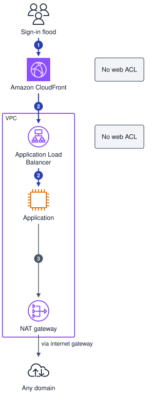
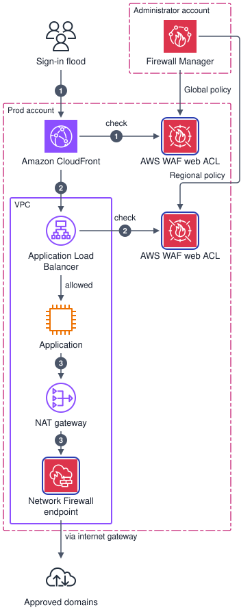

# WAF, Shield, Firewall Manager and Network Firewall in depth

## How it works (21 min)
<!-- section: role=how; route=full; minutes=21 -->

**Figure.** Ask where the threat travels, and the answer names the service that stops it.

### A web ACL checks each HTTP request against its rules in priority order (4 min)
<!-- section: route=pass -->

Good and harmful requests arrive in one stream. AWS WAF checks each one with a **web ACL** (web access control list). The console also calls it a [protection pack (web ACL)](../facts/waf.md#waf-change-protection-pack-console-2025).

1. **Forward.** Associated resources [forward incoming requests to AWS WAF](../facts/waf.md#waf-associated-resources-forward-requests).
2. **Order.** Rules run [from the lowest numeric priority setting on up](../facts/waf.md#waf-rules-evaluated-lowest-priority-first).
3. **Match.** One statement [inspects for malicious SQL code](../facts/waf.md#waf-sqli-statement-inspects-malicious-sql); others check an IP set or work [based on country and region of origin](../facts/waf.md#waf-geo-match-country-and-region). A **managed rule group** adds [collections of predefined, ready-to-use rules](../facts/waf.md#waf-managed-rule-groups-definition).
4. **Act.** Rule actions are [terminating or non-terminating](../facts/waf.md#waf-terminating-vs-non-terminating). Allow and Block end the check; Count does not.
5. **Default.** If no rule ends the check, the default action decides.

Why a default action? Every request needs a final answer. To allow most requests, set the [default action to Allow](../facts/waf.md#waf-default-allow-add-block-rules) and add rules that block.

> **Exam signal:** "block SQL injection with the LEAST operational overhead" points to an AWS managed rule group, because sellers [automatically update managed rule groups](../facts/waf.md#waf-managed-rules-auto-updated).

> **Exam trap:** Thousands of attacking addresses do not fit in a network ACL: [20 rules per network ACL](../facts/vpc.md#vpc-quota-rules-per-network-acl) by default, against [10,000](../facts/waf.md#waf-ip-set-max-addresses) in one AWS WAF IP set. <!-- trap: edge-protection-trap-nacl-for-many-attack-ips --> <!-- xref: 10 network ACLs -->

> **Try it:** Build an IP set and check the capacity of a rule. See [3-do.md](3-do.md). <!-- task: edge-protection-t01 -->

**Spot the bug.** Priority 0 allows all requests to /api. Priority 1 is the managed core rule set. What is wrong?

Answer

Allow is a terminating action (actions are [terminating or non-terminating](../facts/waf.md#waf-terminating-vs-non-terminating)), so /api requests skip the core rule set. Give the core rule set the lower number.

> **Say it:** The short answer is: the first Allow or Block decides. The thing to watch is an early Allow rule.

**Stop and answer.** A web ACL's default action is Block. Its one rule counts requests from a partner's IP set. What happens to a normal partner request?

Answer

Blocked. After Count, [AWS WAF continues processing the remaining rules](../facts/waf.md#waf-count-non-terminating-continues); none is left, so the default decides.

### Each resource has one web ACL in the same Region as the resource (3 min)

A web ACL protects the resources that it is associated with, in their Region.

1. **Choose the resource.** A web ACL can protect [Amazon CloudFront, Amazon API Gateway, Application Load Balancer](../facts/waf.md#waf-protected-resource-types) and a few more. For API Gateway, that is an [Amazon API Gateway REST API](../facts/waf.md#waf-protected-resource-types). No Network Load Balancer or EC2 instance is on the list.
2. **Pick the Region.** The web ACL must be in [the Region where the associated resource is located](../facts/waf.md#waf-web-acl-region-of-resource); for CloudFront, [US East (N. Virginia)](../facts/waf.md#waf-web-acl-region-of-resource).
3. **Associate.** Each resource takes one web ACL, and one web ACL can protect many resources: the link is [one-to-many](../facts/waf.md#waf-one-web-acl-per-resource).

Why the Region? For a load balancer or an API, [your rules run in region](../facts/waf.md#waf-regional-rules-run-in-region-internal). For CloudFront, Global (CloudFront) is [identical to choosing Region US East (N. Virginia)](../facts/waf.md#waf-global-cloudfront-equals-us-east-1).

> **Exam signal:** "protect a website in the company's own data center" points to CloudFront with a web ACL: CloudFront [supports custom origins outside of AWS](../facts/waf.md#waf-protect-sites-outside-aws-via-cloudfront). <!-- xref: 15 CloudFront custom origins -->

> **Say it:** The short answer is: attach the web ACL where the requests arrive. The thing to watch is the Region for CloudFront.

**Stop and answer.** AWS WAF must protect a CloudFront distribution and an Application Load Balancer in Europe (Ireland). How many web ACLs?

Answer

Two. A CloudFront web ACL cannot be associated [with any other AWS resource type](../facts/waf.md#waf-cloudfront-web-acl-not-other-types). The second goes in Europe (Ireland).

### A rate-based rule limits each key that sends requests too fast (4 min)
<!-- section: route=pass -->

Sign-in floods come from addresses that no list holds yet. A **rate-based rule** reacts to how fast each source sends.

1. **Group.** The rule groups requests [based on the request IP address](../facts/waf.md#waf-rate-based-default-key-ip) by default, or by other keys.
2. **Count.** It counts each group over a window of [5 minutes](../facts/waf.md#waf-rate-window-options) by default.
3. **Act.** With the Block action, an address over the limit is blocked until [the request rate falls below the configured threshold](../facts/waf.md#waf-rate-based-ip-blocked-until-rate-falls).
4. **Scope down.** To protect one page, use [a rate-based rule with a scope-down statement](../facts/waf.md#waf-rate-based-scope-down).

The account takeover prevention (ATP) managed rule group checks sign-ins [against its stolen credential database](../facts/waf.md#waf-atp-inspects-login-attempts). ATP and Bot Control [are available for additional fees](../facts/waf.md#waf-managed-paid-groups-bot-atp-acfp).

> **Exam signal:** "one IP address sends too many requests" points to a rate-based rule; use of [compromised credentials](../facts/waf.md#waf-faq-atp-login-page) points to the ATP group.

> **Exam trap:** A per-IP limit misses an attack from many slow addresses. Each is counted [based on the request IP address](../facts/waf.md#waf-rate-based-default-key-ip). Use the ATP group. <!-- trap: edge-protection-trap-per-ip-rate-limit-stops-all -->

Go deeper: what the rule counts

Rate limiting [does not guarantee an exact limit match](../facts/waf.md#waf-rate-based-not-precise). Behind CloudFront, the load balancer sees [the address of the last proxy](../facts/waf.md#waf-forwarded-ip-default-origin-ip), so a per-IP rule there counts CloudFront's addresses. Put the rule on CloudFront, or [use a forwarded IP address](../facts/waf.md#waf-forwarded-ip-statements).

> **Say it:** The short answer is: block each address that sends too fast. The thing to watch is how the rule counts.

**Stop and answer.** Each of 1,400 IP addresses sends about four sign-in attempts in five minutes. The rule allows 100 per address. Does it stop the attack?

Answer

No. Each address is counted on its own and stays under the limit. Add the ATP managed rule group.

### Shield Standard protects every account free but Shield Advanced adds paid response (3 min)

A **DDoS attack** (DEE-doss), a distributed denial of service attack, tries to make an application unavailable with packets or with normal-looking requests.

1. **Automatic.** Shield Standard protects [for all AWS customers](../facts/shield.md#shield-faq-standard-layer-3-4-all-customers) against [layer 3 and 4](../facts/shield.md#shield-faq-standard-layer-3-4-all-customers) events such as SYN floods, [at no additional charge](../facts/shield.md#shield-standard-automatic-no-charge).
2. **Web floods.** Shield [does not inspect the contents](../facts/shield.md#shield-no-http-content-inspection) of HTTP traffic, so AWS WAF handles [HTTP POST or GET floods](../facts/shield.md#shield-faq-standard-use-waf-for-layer-7).
3. **Subscribe.** Shield Advanced protects resources [explicitly specified in Shield Advanced](../facts/shield.md#shield-advanced-not-automatic-per-resource), such as [Network Load Balancers, through associations to Amazon EC2 Elastic IP addresses.](../facts/shield.md#shield-advanced-resource-types)
4. **Help and credits.** It adds [24/7 support from the Shield Response Team](../facts/shield.md#shield-faq-advanced-layers-srt-cost-protection), with a [Business Support plan](../facts/shield.md#shield-srt-needs-business-or-enterprise-support) or Enterprise Support. You can [request a Shield Advanced service credit](../facts/shield.md#shield-cost-protection-credit) for attack charges. For CloudFront and an ALB, the credit needs a rate-based rule [in the web ACL in Block mode](../facts/shield.md#shield-credit-prereqs-before-attack).

<!-- table: plain -->
| During an attack | Standard | Advanced |
|---|---|---|
| SYN flood | Protected | Plus the response team |
| Scaling charges | You pay | A credit you request, if conditions are met |

Why pay? For [rapid access to DDoS mitigation experts](../facts/shield.md#shield-advanced-when-to-subscribe) and [predictability in your cloud costs](../facts/shield.md#shield-advanced-when-to-subscribe).

> **Exam signal:** "24/7 DDoS experts" or "protection from DDoS scaling charges" points to Shield Advanced.

> **Exam trap:** Network Firewall does not absorb a UDP flood. It controls access to and from a **virtual private cloud** (VPC), [but not to mitigate volumetric attacks](../facts/network-firewall.md#network-firewall-not-for-ddos). <!-- trap: edge-protection-trap-network-firewall-stops-ddos -->

> **Say it:** The short answer is: Standard is already on; Advanced adds experts and credits. The thing to watch is the yearly commitment.

**Stop and answer.** Mid-attack, a Shield Advanced customer adds its scaling load balancer as a protected resource. Does it get a credit?

Answer

No. Resources [added during an attack are not eligible](../facts/shield.md#shield-credit-prereqs-before-attack).

### Network Firewall inspects VPC traffic only when route tables send it there (4 min)

Security groups give [traffic control at a Layer 4 level (IP address and port ranges)](../facts/well-architected.md#well-architected-sec05-finer-control-services). Limiting **egress** (EE-gress), outbound traffic, to approved domains needs a firewall that reads names. <!-- xref: 10 security groups and route tables -->

1. **Place.** A **firewall endpoint** sits in its own subnet, [on a per-Availability Zone basis](../facts/network-firewall.md#network-firewall-endpoints-per-az).
2. **Route.** [You modify your Amazon VPC route tables](../facts/network-firewall.md#network-firewall-route-tables-enable-protection); the firewall inspects [all traffic that is routed to the endpoint](../facts/network-firewall.md#network-firewall-faq-inspects-routed-traffic).
3. **Inspect.** Packets meet [the policy's stateless rule groups first](../facts/network-firewall.md#network-firewall-stateless-then-stateful), then stateful ones. A domain list reads the [Server Name Indication (SNI) extension](../facts/network-firewall.md#network-firewall-domain-sni-host-header) or the HTTP host header.
4. **Return.** The reply must pass [the Network Firewall endpoint in both directions](../facts/network-firewall.md#network-firewall-no-asymmetric-routing).

<!-- table: plain -->
| Engine | Looks at | Works like |
|---|---|---|
| Stateless | Each packet alone | [Amazon VPC network access control lists (ACLs)](../facts/network-firewall.md#network-firewall-stateless-like-nacl) |
| Stateful | The flow and domain names | A security group, but [the stateful rules engine allows traffic to pass](../facts/network-firewall.md#network-firewall-stateful-like-sg-default-pass) by default |

A domain allow list denies other domains of its protocol, [when the firewall policy uses default action order](../facts/network-firewall.md#network-firewall-domain-allow-denies-others).

Why routes? The firewall is one hop on the path, so routes decide what it sees.

> **Exam signal:** "filter outbound traffic by domain name" points to Network Firewall, a managed [intrusion detection and prevention service](../facts/network-firewall.md#network-firewall-definition).

> **Exam trap:** A security group rule names addresses and ports, not updates.example.com. Network Firewall keeps [allow lists and deny lists with domain names](../facts/network-firewall.md#network-firewall-domain-allow-deny-lists). <!-- trap: edge-protection-trap-sg-filters-domains -->

> **Try it:** Create a domain allow list for outbound traffic. See [3-do.md](3-do.md). <!-- task: edge-protection-t02 -->

> **Say it:** The short answer is: route traffic through the firewall endpoint. The thing to watch is the return path.

**Stop and answer.** A team puts the firewall endpoint in the subnet of the instances it protects. Is their traffic inspected?

Answer

No. An endpoint does not filter its own subnet, so keep firewall subnets [for the exclusive use of Network Firewall](../facts/network-firewall.md#network-firewall-endpoint-not-own-subnet).

### Firewall Manager applies the same protections to every account in an organization (3 min)

Rules copied by hand differ between accounts, and a new account starts with none.

1. **Prepare.** [Your organization must be enabled for all features](../facts/firewall-manager.md#firewall-manager-needs-org-all-features), and [you must enable AWS Config](../facts/firewall-manager.md#firewall-manager-requires-aws-config). One account becomes [the Firewall Manager administrator account](../facts/firewall-manager.md#firewall-manager-faq-prereq-administrator-account). <!-- xref: 04 Organizations all features -->
2. **Write.** Each policy is [specific to the individual policy type](../facts/firewall-manager.md#firewall-manager-policy-types): AWS WAF, security group, Network Firewall and others. A security group policy can also [Audit security group rules](../facts/firewall-manager.md#firewall-manager-sg-policy-three-uses).
3. **Scope.** Choose all accounts or [a specific list of included account numbers](../facts/firewall-manager.md#firewall-manager-scope-accounts-ous). [Resource tags can also be used](../facts/firewall-manager.md#firewall-manager-scope-resource-tags).
4. **Region.** CloudFront needs a Global policy; other resources need [separate Firewall Manager policies for each Region](../facts/firewall-manager.md#firewall-manager-waf-policy-global-for-cloudfront).
5. **Apply.** In a new account, [Firewall Manager automatically applies the policy](../facts/firewall-manager.md#firewall-manager-auto-applies-to-new-accounts).

Why first and last rule groups? The security team owns [rule groups to run first and last](../facts/firewall-manager.md#firewall-manager-waf-policy-first-last-rule-groups); account owners add [rules and rule groups to run in between](../facts/firewall-manager.md#firewall-manager-waf-policy-first-last-rule-groups).

> **Exam signal:** "manage firewall rules centrally, including in new accounts" points to Firewall Manager, built to [protect your entire organization](../facts/firewall-manager.md#firewall-manager-best-for-whole-org).

> **Say it:** The short answer is: one policy gives every account the same rules. The thing to watch is one policy per Region.

**Stop and answer.** An AWS WAF policy in US East (N. Virginia) covers all accounts. Do Application Load Balancers in US West (Oregon) get the web ACL?

Answer

No. [Security policies are region specific](../facts/firewall-manager.md#firewall-manager-policies-region-specific): create [a new policy for each region](../facts/firewall-manager.md#firewall-manager-policies-region-specific).

## Numbers that decide answers (2 min)
<!-- section: role=numbers; route=full; minutes=2 -->

### A-list

<!-- table: numbers -->
| Number | What it is | Why it decides an answer |
|---|---|---|
| [$3,000 per month](../facts/shield.md#shield-advanced-monthly-fee) | Shield Advanced fee per organization, plus usage fees | Too costly unless the stem asks for DDoS experts |
| [1-year subscription commitment](../facts/shield.md#shield-advanced-one-year-commitment) | Shield Advanced term | Rules it out when the stem says no commitment |
| [20 rules per network ACL](../facts/vpc.md#vpc-quota-rules-per-network-acl) | Default rules in one network ACL | A long block list does not fit |
| [10,000](../facts/waf.md#waf-ip-set-max-addresses) | Addresses or ranges in one AWS WAF IP set | A large block list belongs in an IP set |

### B-list

<!-- table: numbers -->
| Number | What it is |
|---|---|
| [5,000 WCUs](../facts/waf.md#waf-max-wcu-per-web-acl) | Capacity of one web ACL, in web ACL capacity units (WCUs) |
| [5 minutes](../facts/waf.md#waf-rate-window-options) | Default window of a rate-based rule |
| [10](../facts/waf.md#waf-rate-limit-minimum) | Lowest limit of a rate-based rule |

## Decision record (2 min)
<!-- section: role=example; route=full; minutes=2 -->

**Context.** In one hour, 60,000 automated sign-in attempts arrive from 1,400 IP addresses. Ostell Bank also requires that production workloads connect only to approved outside domains.

**Figure.** Without a web ACL, the sign-in flood reaches the application.

1. Sign-in requests from many addresses reach CloudFront.
2. No web ACL checks them at CloudFront or the load balancer.
3. Workloads reach any domain through the NAT gateways.

**Requirement.** In every account, block web attacks and stolen-password sign-ins, and limit outbound traffic to approved domains, at low cost.

**Options.**

- Network ACL deny rules and security group rules.
- **AWS WAF (managed rules, a rate-based rule, ATP) and Network Firewall.**
- The same, plus AWS Shield Advanced.

**Decision.** AWS WAF on CloudFront and the load balancer, applied by AWS Firewall Manager. Shield Standard stays on.

**Figure.** Web ACLs stop the flood, and Network Firewall checks the domains of outbound traffic.

1. The CloudFront web ACL blocks fast addresses, common attacks and sign-ins found [against its stolen credential database](../facts/waf.md#waf-atp-inspects-login-attempts).
2. The load balancer's web ACL comes from a second policy, because Firewall Manager needs [separate Firewall Manager policies for each Region](../facts/firewall-manager.md#firewall-manager-waf-policy-global-for-cloudfront).
3. Outbound traffic passes the NAT gateway, then a Network Firewall endpoint.

**Trade-off.** No paid DDoS support. The ATP rule group costs extra. Rate limits need tuning for shared addresses.

## FAQ quick-fire (3 min)
<!-- section: role=faq; route=full; minutes=3 -->

**FAQ 1.** Can AWS WAF protect a website that is not hosted in AWS?

Answer

Yes, through CloudFront, which [supports custom origins outside of AWS](../facts/waf.md#waf-protect-sites-outside-aws-via-cloudfront).

> "Yes, AWS WAF is integrated with Amazon CloudFront, which supports custom origins outside of AWS."
> — [AWS WAF FAQs](https://aws.amazon.com/waf/faqs/)

**FAQ 2.** Is there a limit on how many resources Shield Standard protects?

Answer

No. There is [no limit on the number of resources](../facts/shield.md#shield-faq-standard-no-resource-limit).

> "There is no limit on the number of resources subject to AWS Shield Standard protection."
> — [AWS Shield FAQs](https://aws.amazon.com/shield/faqs/)

**FAQ 3.** Can an organization pay one Shield Advanced fee for many accounts?

Answer

Yes, under one consolidated billing: [you will pay the monthly fee once](../facts/shield.md#shield-faq-advanced-multi-account-fee-once).

> "You will pay the monthly fee once as long as the AWS accounts are all under a single consolidated billing, and you own all the AWS accounts and resources in those accounts."
> — [AWS Shield FAQs](https://aws.amazon.com/shield/faqs/)

**FAQ 4.** Can Firewall Manager report noncompliant resources without changing them?

Answer

Yes. You can view them [without taking corrective action](../facts/firewall-manager.md#firewall-manager-audit-or-auto-remediate).

> "Manual remediation, which creates a new policy and the associated rules/protections in each account but does not enforce the rules on the resources in the account."
> — [AWS Firewall Manager FAQs](https://aws.amazon.com/firewall-manager/faqs/)

**FAQ 5.** Can AWS Network Firewall inspect encrypted traffic?

Answer

Yes, with TLS inspection, added on [March 30, 2023](../facts/network-firewall.md#network-firewall-change-tls-inspection-2023). You first [import or provision certificates to AWS Certificate Manager](../facts/network-firewall.md#network-firewall-tls-needs-acm-new-policy).

> "AWS Network Firewall does support deep packet inspection for encrypted traffic."
> — [AWS Network Firewall FAQs](https://aws.amazon.com/network-firewall/faqs/)

