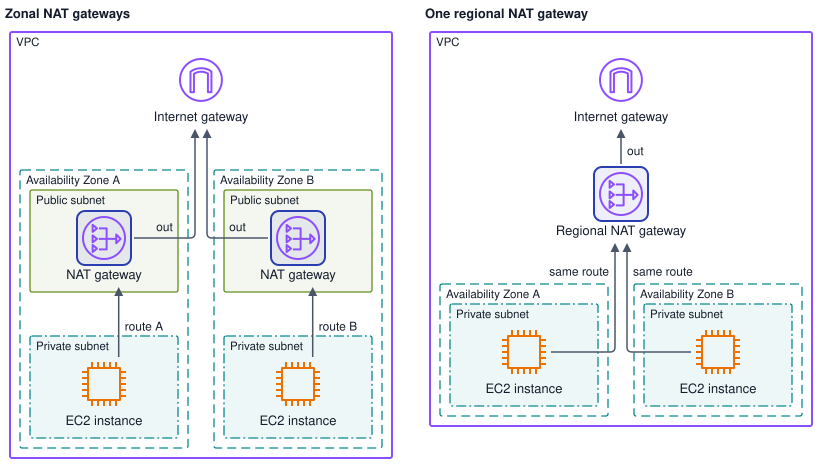
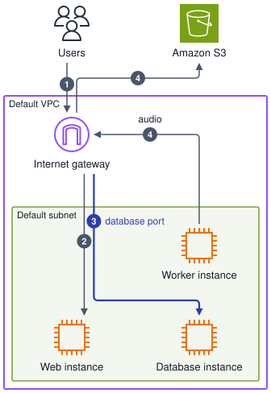
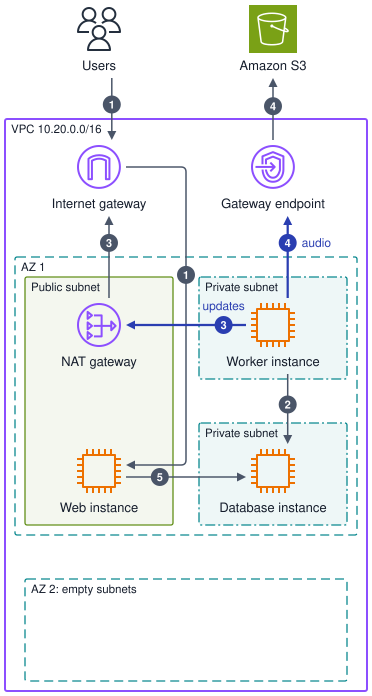

# Amazon VPC in depth

## How it works (58 min)
<!-- section: role=how; route=full; minutes=58 -->

### A VPC spans every Availability Zone but each subnet lives in one zone (4 min)

An application has to survive the loss of one data center.

1. **Create the VPC.** A **virtual private cloud** (vee-pee-SEE), or VPC, is your own isolated network in one **Region**. An **Availability Zone** (AZ) is a separate set of data centers in that Region. The VPC [spans all of the Availability Zones in a Region](../facts/vpc.md#vpc-spans-all-azs-in-region).
2. **Add subnets.** A **subnet** (SUB-net) is a range of VPC addresses that [must reside entirely within one Availability Zone](../facts/vpc.md#vpc-subnet-single-az).
3. **Spread instances.** Subnets in several zones [protect your applications from the failure of a single Availability Zone](../facts/vpc.md#vpc-subnet-one-az-protects-from-zone-failure).

<!-- table: plain -->
| Part | Lives in | Survives the loss of its zone? |
|---|---|---|
| VPC | The whole Region | Yes |
| Subnet | One Availability Zone | No |
| Instance | The zone of its subnet | No |

> **Exam signal:** "must continue to operate if an Availability Zone fails" points to subnets in [at least two Availability Zones](../facts/vpc.md#vpc-prod-at-least-two-azs).

> **Exam trap:** "Extend the subnet to a second zone" is impossible: a subnet [cannot span zones](../facts/vpc.md#vpc-subnet-single-az). <!-- trap: vpc-trap-subnet-spans-azs -->

> **Say it:** The short answer is: a VPC covers the Region, a subnet one zone. The thing to watch is one subnet: it fails with its zone.

**Stop and answer.** Six web instances run in a VPC with three Availability Zones. Four run in subnet A in AZ 1, and two run in subnet B in AZ 2. AZ 1 fails. How many instances keep serving?

Answer

Two, in subnet B. [The instance will be launched in the Availability Zone associated with the specified subnet](../facts/vpc.md#vpc-faq-instance-az-from-subnet), so the four in subnet A failed with AZ 1.

### A VPC CIDR block cannot be resized so plan it for growth (4 min)

Each instance takes an address, and a range that is too small stays too small.

1. **Choose the block.** A **CIDR block** (SY-der blok) is a range of IP addresses: a first address and a prefix length, as in 10.20.0.0/16. A VPC block is between a [/16 netmask (65,536 IP addresses)](../facts/vpc.md#vpc-ipv4-cidr-size-addresses) and a [/28 netmask (16 IP addresses)](../facts/vpc.md#vpc-ipv4-cidr-size-addresses). A smaller prefix gives a larger block: one step down doubles it.
2. **Count usable addresses.** Each subnet loses [the first four (4) IP addresses](../facts/vpc.md#vpc-faq-subnet-reserved-addresses) and [the last one (1) IP address](../facts/vpc.md#vpc-faq-subnet-reserved-addresses).
3. **Run out.** You [cannot increase or decrease the size of an existing CIDR block](../facts/vpc.md#vpc-cidr-cannot-resize), so you add a secondary block.

The first block stays: you [cannot disassociate the CIDR block with which you originally created the VPC (the primary CIDR block)](../facts/vpc.md#vpc-primary-cidr-cannot-disassociate).

Why plan large? When growth is unknown, Well-Architected says to [err on the side of larger CIDR blocks to reduce the potential for future reconfiguration](../facts/vpc.md#vpc-wa-rel02-bp03-rfc1918-and-larger-blocks).

> **Startup example:** Callvale's production VPC uses 10.20.0.0/16. Its private application subnets are /20 blocks, so the worker fleet has room to grow.

> **Exam signal:** "the VPC has no free IP addresses" points to a secondary CIDR block and new subnets.

> **Exam trap:** "Change the subnet to a shorter prefix (a larger range)" fails too: [Subnet IPv4 CIDRs cannot be changed, however IPv6 CIDRs can](../facts/vpc.md#vpc-wa-rel02-bp03-cidr-cannot-change). <!-- trap: vpc-trap-resize-cidr -->

Go deeper: which secondary blocks you can add

RFC 1918 names the private IPv4 ranges. With a primary range in 10.0.0.0/8, you cannot add [CIDR blocks from other RFC 1918 ranges (172.16.0.0/12 and 192.168.0.0/16)](../facts/vpc.md#vpc-secondary-cidr-restrictions-10-range).

> **Say it:** The short answer is: choose a large private range and leave room. The thing to watch is that the first range keeps its size.

**Stop and answer.** A /24 subnet holds 240 running instances. Do 20 more fit?

Answer

No. Five addresses are reserved, so in a /24 subnet [251 can be assigned to resources](../facts/vpc.md#vpc-subnet-24-usable-251), and 240 are in use.

### A route table sends subnet traffic and the most specific route wins (4 min)

A packet leaves an instance. Something decides where it goes.

1. **Find the table.** Each subnet uses one **route table** (ROOT TAY-bul). Without an explicit association, [the subnet is implicitly associated with the main route table](../facts/vpc.md#vpc-route-table-implicit-main-association). [When you create a VPC, it automatically has a main route table](../facts/vpc.md#vpc-main-route-table-rules), and you cannot delete it.
2. **Stay inside.** [Every route table contains a local route for communication within the VPC](../facts/vpc.md#vpc-local-route-in-every-route-table).
3. **Pick the most specific route.** AWS says: [We use the most specific route that matches the traffic (longest prefix match)](../facts/vpc.md#vpc-route-longest-prefix-match). The default route 0.0.0.0/0 matches every IPv4 address, so it is the least specific.

<!-- table: plain -->
| Packet to | Routes that match | Route used |
|---|---|---|
| 10.20.100.7 | 10.20.0.0/16 to local, 0.0.0.0/0 to a NAT gateway | Local, the longer prefix |
| 203.0.113.10 | 0.0.0.0/0 to a NAT gateway | The NAT gateway |

Routes are not read from the top. A network ACL, the subnet firewall, reads its rules that way, [starting with the lowest numbered rule](../facts/vpc.md#vpc-nacl-rule-order-first-match). <!-- trap: vpc-trap-route-order -->

> **Exam signal:** "a new subnet has internet access that nobody configured" points to the main route table, which every subnet without its own table uses. AWS suggests that you [leave the main route table in its original default state](../facts/vpc.md#vpc-custom-route-table-delete-only-without-associations).

> **Say it:** The short answer is: the route table picks the most specific route. The thing to watch is a subnet that uses the main route table.

**Stop and answer.** Routes: 10.20.0.0/16 to local, 10.20.100.0/24 (a subnet of the VPC) to a firewall's network interface, 0.0.0.0/0 to a NAT gateway. Where does a packet to 10.20.100.25 go?

Answer

To the firewall: /24 is the longest match. It is allowed because the /24 is a whole subnet: [The destination must match the entire IPv4 or IPv6 CIDR block of a subnet in your VPC](../facts/vpc.md#vpc-route-more-specific-than-local).

### A subnet is public only when its route table points to an internet gateway (4 min)
<!-- section: route=pass -->

A web instance serves users on the internet. A new VPC has no path out: [the main route table contains only a local route](../facts/vpc.md#vpc-main-route-table-rules).

1. **Attach.** An **internet gateway** is [The Amazon VPC side of a connection to the public Internet](../facts/vpc.md#vpc-faq-def-internet-gateway).
2. **Route.** The subnet's route table sends [0.0.0.0/0](../facts/vpc.md#vpc-igw-route-destination) to the gateway, so the subnet is a public subnet. [The subnet type is determined by how you configure routing for your subnets](../facts/vpc.md#vpc-isolated-subnet-definition).
3. **Address.** [Your instance must have a public IPv4 address](../facts/vpc.md#vpc-igw-requires-attach-and-route) or an Elastic IP address, a public address that stays with your account.
4. **Allow.** Its **security group**, the firewall of the instance, allows the port of the application.

<!-- table: plain -->
| The route table has | Subnet type | Internet access |
|---|---|---|
| A route to an internet gateway | Public | In and out, for instances with a public IP address |
| A route to a NAT device, none to an internet gateway | Private | Outbound connections; no inbound connections |
| No route out of the VPC | Private, also called isolated | None: [The subnet has no routes to destinations outside its VPC](../facts/vpc.md#vpc-isolated-subnet-definition) |

> **Try it:** Attach an internet gateway, then watch the subnet stay private until its own route table has one route to the gateway. See [3-do.md](3-do.md). <!-- task: vpc-t02 -->

> **Exam signal:** "an internet gateway is attached, but users cannot reach the instance" points to the route table and the public IP address.

> **Exam trap:** An Elastic IP address alone does not make an instance reachable. [You must update the subnet route table with a route to the internet gateway](../facts/vpc.md#vpc-igw-attach-not-enough). <!-- trap: vpc-trap-public-ip-is-enough -->

> **Say it:** The short answer is: a route to the internet gateway makes a subnet public. The thing to watch is the instance's public IP address.

**Stop and answer.** A subnet's route table sends 0.0.0.0/0 to a NAT gateway. An instance in it has an Elastic IP address. Can users on the internet start a connection to the instance?

Answer

No. The subnet has no route to an internet gateway. AWS says Elastic IP addresses [cannot be used on instances in subnets configured to use a NAT gateway or a NAT instance to access the Internet](../facts/vpc.md#vpc-faq-eip-not-behind-nat).

### Every default subnet is public so production tiers belong in private subnets (4 min)

The default VPC lets a team launch instances in minutes. The same settings put every instance on the internet.

1. **Default.** You have [a default VPC in each AWS Region](../facts/vpc.md#vpc-default-vpc-in-each-region), and [each default subnet is a public subnet](../facts/vpc.md#vpc-default-vpc-includes-igw).
2. **Nondefault.** By default, an instance in a nondefault subnet [has a private IPv4 address, but no public IPv4 address](../facts/vpc.md#vpc-nondefault-subnet-no-public-ip-by-default). You can assign one at launch, or change the subnet's public IP address attribute. Each tier gets its own subnet.

<!-- table: plain -->
| Tier | Subnet | Reachable from the internet? |
|---|---|---|
| Load balancer or web | Public | Yes |
| Application | Private | No |
| Database | A second private subnet | No |

Why not tighten the security groups and stay? In a default subnet, one rule that is too wide exposes the database; in a private subnet, no route leads in.

> **Exam signal:** "administrators need shell access to private instances" points to AWS Systems Manager Session Manager, not a bastion host: an instance in a public subnet that administrators log in to first. Well-Architected says: [do not permit access on port 22/tcp (SSH) or port 3389/tcp (RDP)](../facts/vpc.md#vpc-wa-sec06-no-ssh-rdp-use-session-manager). <!-- xref: 38 Session Manager -->

> **Say it:** The short answer is: every default subnet is public. The thing to watch is the database, which belongs in a private subnet.

**Stop and answer.** A database runs on an EC2 instance, launched with default settings in a nondefault subnet. The subnet routes 0.0.0.0/0 to an internet gateway. The security group allows the database port from anywhere. Can a host on the internet reach it?

Answer

No. By default, an instance in a nondefault subnet [has a private IPv4 address, but no public IPv4 address](../facts/vpc.md#vpc-nondefault-subnet-no-public-ip-by-default).

### Every public IPv4 address is billed but only an Elastic IP address stays yours (4 min)

Some public addresses change after a stop, and each one costs money.

1. **Stop the instance.** AWS says: [We release the public IP address when the instance is stopped, hibernated, or terminated](../facts/vpc.md#vpc-eni-public-ip-released-on-stop).
2. **Keep the address.** An Elastic IP address [remains allocated to your AWS account until you explicitly release it](../facts/vpc.md#vpc-eip-persistent-until-released).
3. **Pay.** [You pay an hourly rate for each public IPv4 address used by your AWS account](../facts/vpc.md#vpc-public-ipv4-hourly-in-use-or-idle).

<!-- table: plain -->
| Address | After a stop and start | Belongs to |
|---|---|---|
| Private IPv4 | The same | The network interface |
| Automatic public IPv4 | A new one, from Amazon's pool | Amazon's pool |
| Elastic IP address | The same: [a persistent public IP address allocated to your account](../facts/vpc.md#vpc-eip-persistent-until-released) | Your account, in one Region: [Elastic IP addresses are regional](../facts/vpc.md#vpc-eip-regional) |
> **Exam signal:** "the public IP address must stay the same after a stop and start" points to an Elastic IP address.

> **Exam trap:** An Elastic IP address on a running instance is not free: [The price is the same whether the public IPv4 address is in-use](../facts/vpc.md#vpc-public-ipv4-hourly-in-use-or-idle) or idle. <!-- trap: vpc-trap-public-ipv4-free -->

> **Say it:** The short answer is: every public IPv4 address costs money. The thing to watch is the automatic address that changes after a stop.

**Stop and answer.** An instance with an Elastic IP address stays stopped for a month. Is the address billed during that month?

Answer

Yes. [The price is the same whether the public IPv4 address is in-use](../facts/vpc.md#vpc-public-ipv4-hourly-in-use-or-idle) or idle.

### Security groups remember connections but network ACLs check every packet (5 min)
<!-- section: route=pass -->

A **security group** is the firewall of a resource. A **network ACL** (NAK-ul) is the firewall at the subnet edge: it [allows or denies specific inbound or outbound traffic at the subnet level](../facts/vpc.md#vpc-def-network-acl).

Follow one HTTPS request from the internet to a web instance, and its reply.

1. **The request enters the subnet.** The network ACL [evaluates rules in ascending order until a match for the traffic is found](../facts/vpc.md#vpc-sg-vs-nacl-rule-evaluation). Each rule has [a number from 1 to 32766](../facts/vpc.md#vpc-nacl-rule-order-first-match). A last rule, numbered with an asterisk (*), denies each packet that matches no other rule.
2. **The request reaches the instance.** The security group [evaluates all rules before deciding whether to allow traffic](../facts/vpc.md#vpc-sg-vs-nacl-rule-evaluation). It holds [allow rules only](../facts/vpc.md#vpc-sg-vs-nacl-rule-type), so a request that no rule allows is dropped.
3. **The reply leaves the instance.** A **stateful** (STAYT-ful) firewall remembers the connection, and [security groups are stateful](../facts/vpc.md#vpc-sg-connection-tracking-stateful). The reply needs no outbound rule.
4. **The reply leaves the subnet.** A **stateless** (STAYT-less) firewall remembers nothing, and [Network ACLs are stateless](../facts/vpc.md#vpc-nacl-stateless-needs-response-rule). The reply goes to an **ephemeral** (ih-FEM-er-ul) port, a short-lived port that the client chose. Amazon Linux uses [ports 32768-61000](../facts/vpc.md#vpc-nacl-ephemeral-linux-32768-61000); to cover every kind of client, [open ephemeral ports 1024-65535](../facts/vpc.md#vpc-nacl-ephemeral-open-1024-65535) outbound.

Network ACLs [do not filter traffic between instances in the same subnet](../facts/vpc.md#vpc-faq-network-acl-same-subnet).

When you change a security group rule, [its tracked connections are not immediately interrupted](../facts/vpc.md#vpc-sg-rule-change-tracked-connections-continue). To cut traffic immediately, [you can use a network ACL for your subnet](../facts/vpc.md#vpc-sg-rule-change-tracked-connections-continue).

> **Try it:** Read the rules of a default security group and a default network ACL side by side. See [3-do.md](3-do.md). <!-- task: vpc-t04 -->

> **Exam signal:** "block one IP address" points to a deny rule in a network ACL, because a security group has [allow rules only](../facts/vpc.md#vpc-sg-vs-nacl-rule-type).

**Spot the bug.** A web subnet's network ACL allows TCP 443 inbound and TCP 443 outbound, and nothing else. Users cannot load the page. What is wrong?

Answer

Replies leave on the client's port, not on 443, and [Network ACLs are stateless](../facts/vpc.md#vpc-nacl-stateless-needs-response-rule). Allow the reply ports outbound.

> **Say it:** The short answer is: a security group remembers connections, and a network ACL does not. The thing to watch is the reply ports.

**Stop and answer.** Inbound rule 100 allows TCP 443 from 0.0.0.0/0. Inbound rule 200 denies 198.51.100.7. Are HTTPS requests from 198.51.100.7 blocked?

Answer

No. Rule 100 matches first. To block that address, [give the deny rule a lower number than the rule that allows the wider range of port traffic](../facts/vpc.md#vpc-nacl-deny-rule-lower-number).

### A security group rule can name another security group as its source (4 min)

Web instances start and stop, and their addresses change. The database should accept connections from the web tier and from no other source.

1. **Start empty.** When you create a security group, [it has no inbound rules](../facts/vpc.md#vpc-sg-new-no-inbound-rules).
2. **Web group.** It allows HTTPS from the source [ID of the security group for the load balancer](../facts/vpc.md#vpc-sg-chain-web-allows-lb-sg).
3. **Database group.** It allows MySQL from the source [ID of the web server security group](../facts/vpc.md#vpc-sg-chain-db-allows-web-sg).

A reference copies nothing: [No rules from the referenced security group are added to the security group that references it](../facts/vpc.md#vpc-sg-reference-no-rules-copied).

> **Exam signal:** "allow traffic only from the application tier" points to an inbound rule whose source is [the ID of a security group](../facts/vpc.md#vpc-sg-rule-sources).

> **Exam trap:** A list of instance IP addresses that a team keeps current is the wrong answer. With a group as the source, [the rule affects all instances that are associated with the security groups](../facts/vpc.md#vpc-sg-reference-sg-private-ips). <!-- trap: vpc-trap-sg-source-ip-only -->

> **Say it:** The short answer is: the database trusts the web tier's security group. The thing to watch is that a reference copies no rules.

**Stop and answer.** The database group allows TCP 5432 (PostgreSQL) from the web group. A reporting instance in its own group allows all outbound traffic. Can it connect to the database?

Answer

No. [Traffic which is not explicitly allowed to or from an instance is automatically denied](../facts/vpc.md#vpc-faq-security-group-allow-only). Add a rule with the reporting group as its source.

### A NAT gateway lets private instances start connections and charges hourly and per gigabyte (5 min)
<!-- section: route=pass -->

A worker in a private subnet needs patches from the internet. No host on the internet is allowed to start a connection to it. A **NAT gateway** is [a Network Address Translation (NAT) service](../facts/vpc.md#vpc-natgw-purpose) that solves both.

1. **The worker sends the packet.** The route table of the private subnet sends internet traffic to the NAT gateway.
2. **The NAT gateway translates the address.** A zonal NAT gateway lives in one Availability Zone. For it, AWS says: [You create a public NAT gateway in a public subnet](../facts/vpc.md#vpc-natgw-public-connectivity-type). [NAT maps multiple private IPv4 addresses to a single public IPv4 address](../facts/vpc.md#vpc-nat-device-maps-many-to-one).
3. **The packet leaves the VPC.** The route table of the public subnet sends it to the internet gateway.
4. **The reply returns.** The NAT gateway lets replies to its own requests back in: [it is therefore stateful](../facts/vpc.md#vpc-natgw-stateful-allows-outbound).
5. **A stranger tries to connect.** Nothing arrives, because [connections must always be initiated from within the VPC containing the NAT gateway](../facts/vpc.md#vpc-natgw-connections-originate-inside-vpc).

The NAT path can add these charges:

- hours: [charged for each hour that your NAT gateway is available](../facts/vpc.md#vpc-natgw-pricing-dimensions);
- each gigabyte processed, [regardless of the traffic's source or destination](../facts/vpc.md#vpc-natgw-data-processing-any-destination);
- cross-zone transfer: [data transfer charges between your NAT gateway and EC2 instance if they are in a different Availability Zone](../facts/vpc.md#vpc-natgw-cross-az-transfer-charge);
- standard data transfer, which depends on where the data goes;
- the gateway's public IPv4 address, because [AWS charges for all public IPv4 addresses](../facts/vpc.md#vpc-public-ipv4-charge-2024).

A **gateway endpoint** for Amazon S3 in the same Region takes S3 traffic off the NAT path, so you [avoid the NAT Gateway Data Processing charge](../facts/vpc.md#vpc-gateway-endpoint-no-hourly-or-processing-charge). Other Regions still use the NAT gateway: [prefix lists are specific to a Region](../facts/vpc.md#vpc-gateway-endpoint-beats-igw-default-route).

A private NAT gateway sends traffic [to other VPCs or on-premises networks using Transit Gateway or a virtual private gateway](../facts/vpc.md#vpc-natgw-private-connectivity-type). It gives no internet access: [if you route traffic from the private NAT gateway to the internet gateway, the internet gateway drops the traffic](../facts/vpc.md#vpc-natgw-private-connectivity-type). <!-- trap: vpc-trap-private-natgw-internet -->

> **Exam signal:** "private instances must download updates, and the internet must not start connections to them" points to a NAT gateway: a zonal one in a public subnet, or a regional one.

> **Say it:** The short answer is: a NAT gateway lets private instances start connections out. The thing to watch is the bill for each gigabyte.

**Stop and answer.** A worker runs in AZ 2 and sends 120 GB of audio a month to an Amazon S3 bucket in the same Region. It also downloads a few patches. The one NAT gateway is in AZ 1. Which charges does the S3 traffic create, and which change removes them?

Answer

NAT data processing, and cross-zone transfer from AZ 2 to AZ 1. A gateway endpoint for Amazon S3 removes both: [there are no data processing or hourly charges for using Gateway Type VPC endpoints](../facts/vpc.md#vpc-gateway-endpoint-no-hourly-or-processing-charge). The NAT gateway stays for the patches.

### A zonal NAT gateway fails with its zone but a regional one follows workloads (4 min)

Workers in two zones download updates. When AZ 1 fails, the NAT design decides what works.

1. **One zonal NAT gateway in AZ 1.** AZ 1 fails, and [resources in the other Availability Zones lose internet access](../facts/vpc.md#vpc-natgw-shared-across-azs-loses-internet).
2. **A zonal NAT gateway in each zone.** Each zone routes to its own gateway, so AZ 2 keeps access.
3. **One regional NAT gateway.** It [automatically expands across Availability Zones based on your workload presence](../facts/vpc.md#vpc-regional-natgw-vs-zonal), and it sits in no public subnet. Expansion into a new zone can take [up to 60 minutes](../facts/vpc.md#vpc-regional-nat-expand-60-minutes). Until then, the gateway in an existing zone handles that traffic across zones. In automatic mode, [AWS automatically manages IP addresses and Availability Zone expansion](../facts/vpc.md#vpc-regional-nat-modes); in manual mode, you do.

<!-- table: plain -->
| Design, when AZ 1 fails | Hourly charge | AZ 2 keeps access? |
|---|---|---|
| One zonal NAT gateway | One gateway | No |
| A zonal NAT gateway in each zone | Each gateway | Yes |
| One regional NAT gateway | Each zone: three zones bill [three 'NAT Gateway-hours'](../facts/vpc.md#vpc-regional-natgw-billed-per-az-hour) an hour | Yes |

**Figure.** Zonal NAT gateways need one gateway and one route per Availability Zone, but one regional NAT gateway expands into each zone that has workloads.

Why not a **standby** NAT gateway in the same zone? [Each NAT gateway is created in a specific Availability Zone and implemented with redundancy in that zone](../facts/vpc.md#vpc-natgw-one-az-redundant-in-zone). A second one there fails with the zone. In production, [deploy a NAT gateway in each active AZ](../facts/vpc.md#vpc-natgw-each-active-az-in-production). <!-- trap: vpc-trap-natgw-needs-standby -->

> **Exam signal:** "highly available outbound internet access" points to a NAT gateway in each zone. AWS adds: [Consider using Regional NAT Gateways for all use cases except those that require private connectivity](../facts/vpc.md#vpc-regional-natgw-when-to-use).

Go deeper: the NAT instance

A **NAT instance** is an EC2 instance that you run and patch as the NAT device. [Each EC2 instance performs source/destination checks by default](../facts/vpc.md#vpc-nat-instance-disable-source-dest-check): it drops traffic that is not to it or from it. A NAT instance forwards other traffic, so [you must disable source/destination checks on the NAT instance](../facts/vpc.md#vpc-nat-instance-disable-source-dest-check).

Port forwarding still points to a NAT instance: on a NAT gateway it is [Not supported](../facts/vpc.md#vpc-natgw-vs-instance-port-forwarding). AWS also lists [Use as a bastion server](../facts/vpc.md#vpc-natgw-vs-instance-bastion) for a NAT instance, but for shell access, prefer Session Manager.

A NAT instance is billed as an instance; a NAT gateway also charges for [each gigabyte of data that it processes](../facts/vpc.md#vpc-natgw-pricing-dimensions).

> **Say it:** The short answer is: one NAT gateway per zone, or one regional gateway. The thing to watch is the hourly charge per zone.

**Stop and answer.** A team uses one regional NAT gateway. It launches the first workers in AZ 3, where nothing ran before. How does their outbound traffic leave at first?

Answer

Across zones, through the gateway in an existing zone, until the gateway expands into AZ 3. That can add [data transfer charges between your NAT gateway and EC2 instance if they are in a different Availability Zone](../facts/vpc.md#vpc-natgw-cross-az-transfer-charge).

### IPv6 addresses are public so outbound-only IPv6 uses an egress-only internet gateway (4 min)

IPv6 workers download updates. No host on the internet can be allowed to start a connection to them.

1. **Look at the address.** [IPv6 addresses are globally unique, and are therefore public by default](../facts/vpc.md#vpc-ipv6-addresses-public-by-default).
2. **Route it.** Traffic that leaves a network is **egress** (EE-gress). A private subnet needs its own ::/0 route (every IPv6 address) to an egress-only internet gateway: [CIDR blocks for IPv4 and IPv6 are treated separately](../facts/vpc.md#vpc-ipv6-routes-separate-from-ipv4).
3. **Let replies back.** [An egress-only internet gateway is stateful](../facts/vpc.md#vpc-eigw-stateful-no-security-group), and connections from the internet do not get in.

<!-- table: plain -->
| Traffic | Outbound-only device | Hourly charge |
|---|---|---|
| IPv4 | NAT gateway | Yes |
| IPv6 | Egress-only internet gateway | [no charge for an egress-only internet gateway](../facts/vpc.md#vpc-eigw-stateful-no-security-group) |
> **Exam signal:** "outbound-only internet access for IPv6 instances" points to an egress-only internet gateway.

> **Exam trap:** An egress-only internet gateway for IPv4 instances looks cheap. It is [for use with IPv6 traffic only](../facts/vpc.md#vpc-eigw-ipv6-outbound-only), so IPv4 still needs a NAT gateway. <!-- trap: vpc-trap-eigw-ipv4 -->

> **Say it:** The short answer is: IPv6 addresses are public, so outbound-only IPv6 uses an egress-only internet gateway. The thing to watch is the separate IPv6 route.

**Stop and answer.** A dual-stack private subnet has 0.0.0.0/0 to a NAT gateway and no other route out. Can its instances download a file from an IPv6-only server?

Answer

No. [CIDR blocks for IPv4 and IPv6 are treated separately](../facts/vpc.md#vpc-ipv6-routes-separate-from-ipv4). Add a ::/0 route to an egress-only internet gateway.

### AWS service endpoints are public but a VPC endpoint reaches them privately (4 min)

A private worker calls Amazon S3 and other AWS APIs. [The default service endpoints are public interfaces](../facts/vpc.md#vpc-default-service-endpoints-public), and the worker has no public address.

1. **Without an endpoint.** The request leaves through a NAT gateway.
2. **With an endpoint.** A **VPC endpoint** reaches the service [without requiring an Internet gateway, a NAT device, VPN, or firewall proxies](../facts/vpc.md#vpc-faq-endpoints-no-igw-nat-needed).
3. **Gateway or interface.** A gateway endpoint is a target that you add to route tables, so no code changes. An **interface endpoint** is a network interface with a private IP address in your subnet.

<!-- table: plain -->
| Question | Gateway endpoint | Interface endpoint |
|---|---|---|
| Which services? | Amazon S3 and DynamoDB | [services powered by PrivateLink, being AWS services, your own services or SaaS solutions](../facts/vpc.md#vpc-faq-interface-endpoints-privatelink) |
| What does it cost? | [There are no data processing or hourly charges for using Gateway Type VPC endpoints](../facts/vpc.md#vpc-gateway-endpoint-no-hourly-or-processing-charge) | [billed for each hour that your interface VPC endpoint is provisioned in each Availability Zone](../facts/vpc.md#vpc-interface-endpoint-billed-hour-per-az-and-gb) |
| From on premises? | No | Yes: it [supports connectivity over Direct Connect](../facts/vpc.md#vpc-faq-interface-endpoints-privatelink) |

> **Try it:** Create a gateway endpoint for Amazon S3, read the route that it adds, and try to delete that route. See [3-do.md](3-do.md). <!-- task: vpc-t03 -->

Why two kinds? A gateway endpoint works through the VPC's own route tables, so traffic from your data center does not meet it, and [prefix lists are specific to a Region](../facts/vpc.md#vpc-gateway-endpoint-beats-igw-default-route). An interface endpoint has a private IP address that a connected network can reach. <!-- xref: 11 interface endpoints, endpoint policies and PrivateLink --> <!-- trap: vpc-trap-endpoint-types-alike -->

> **Exam signal:** "privately" from an on-premises network to Amazon S3 points to an interface endpoint. The reason: [gateway endpoints do not allow access from on-premises networks, from peered VPCs in other AWS Regions, or through a transit gateway](../facts/vpc.md#vpc-gateway-endpoint-no-onprem-cross-region-tgw).

> **Say it:** The short answer is: a gateway endpoint for S3 and DynamoDB, an interface endpoint otherwise. The thing to watch is the Region, and on-premises traffic.

**Stop and answer.** Two private subnets use different route tables, and both route 0.0.0.0/0 to a NAT gateway. The gateway endpoint for Amazon S3 is associated with the first table alone. Which path does S3 traffic from the second subnet take?

Answer

The NAT gateway: instances in other subnets [use the public service endpoint, not the gateway endpoint](../facts/vpc.md#vpc-gateway-endpoint-applies-per-route-table).

### Data transfer is free inside one Availability Zone but charged across zones (4 min)

The path of a gigabyte decides its charges.

1. **Same zone, private IP addresses.** Data transfer in one zone over private IP addresses [is free irrespective of account ownership of the communicating resources](../facts/vpc.md#vpc-sharing-same-az-transfer-free).
2. **Another zone.** Between instances in different zones, you pay [$0.01 per GB](../facts/vpc.md#vpc-faq-cross-az-data-transfer-charge).
3. **Through a NAT gateway.** Processing is charged for every gigabyte, even for Amazon S3 in the same Region, where [there was no charge for the data transfer from the EC2 instance to S3](../facts/vpc.md#vpc-data-transfer-ec2-to-s3-same-region-free). <!-- xref: 15 data transfer paths -->

<!-- table: plain -->
| Path | Data transfer | NAT processing |
|---|---|---|
| Same zone, private IP addresses | Free | None |
| Other zone | Per GB | None |
| To Amazon S3 in the same Region, through a NAT gateway in the same zone | None | Per GB |
| To Amazon S3 in the same Region, through a NAT gateway in another zone | Per GB | Per GB |
| To Amazon S3 in the same Region, through a gateway endpoint | None | None |

> **Exam signal:** "data transfer charges between the instances and the NAT gateway" points to one NAT gateway per zone: [create a NAT gateway in each Availability Zone with resources](../facts/vpc.md#vpc-natgw-same-az-reduces-charges).

> **Exam trap:** "EC2 to S3 is free, so the NAT path is free" is wrong. The gateway charges for [each gigabyte of data that it processes](../facts/vpc.md#vpc-natgw-pricing-dimensions). <!-- trap: vpc-trap-natgw-s3-free -->

> **Say it:** The short answer is: keep heavy traffic in one zone, off the NAT gateway. The thing to watch is high availability across zones.

**Stop and answer.** Two tiers in AZ 1 talk over public IP addresses. Is that traffic free because both tiers are in one zone?

Answer

No. The Regional rate applies when [Public or Elastic IP addresses are used, regardless of which Availability Zone the other instance is in](../facts/vpc.md#vpc-data-transfer-public-ip-regional-rate).

### Flow logs record accepted and rejected traffic so they show where packets drop (4 min)

A ping reaches an instance, but no reply comes back. Where was the reply dropped?

1. **Create a flow log.** A flow log covers [a VPC, a subnet, or a network interface](../facts/vpc.md#vpc-flow-logs-three-levels), for [accepted traffic, rejected traffic, or all traffic](../facts/vpc.md#vpc-flow-logs-traffic-type-choice).
2. **Read the records.** You see [an ACCEPT record for the originating ping](../facts/vpc.md#vpc-flow-logs-diagnose-stateless-nacl), then a REJECT record for the reply.
3. **Conclude.** [Because network ACLs are stateless, the response ping is dropped](../facts/vpc.md#vpc-flow-logs-diagnose-stateless-nacl). Fix the outbound rule.

<!-- table: plain -->
| Tool | It shows | Use it when |
|---|---|---|
| Flow logs | Source, destination, ports, protocol, counts, and accept or reject | You look for rejects |
| Traffic Mirroring | The packets, payload included | You inspect contents |
| Reachability Analyzer | The path between two resources, or the component that blocks it | You check a configuration without sending traffic |

[Reachability Analyzer is a static configuration analysis tool](../facts/vpc.md#vpc-reachability-analyzer-static).
> **Exam signal:** "inspect the content of network packets" points to Traffic Mirroring.

> **Exam trap:** A flow log holds no payload. Traffic Mirroring lets you [analyze actual traffic content, including payload](../facts/vpc.md#vpc-faq-flow-logs-vs-traffic-mirroring). <!-- trap: vpc-trap-flow-logs-payload -->

> **Say it:** The short answer is: a flow log records accepted and rejected traffic. The thing to watch is that it stores no packet contents.

**Stop and answer.** A flow log shows one REJECT record for an inbound TCP 443 request, and nothing else for that connection. Is a missing outbound rule the cause?

Answer

No. The request was rejected on the way in. A missing outbound rule shows an ACCEPT first, then [a REJECT record for the response ping that the network ACL denied](../facts/vpc.md#vpc-flow-logs-diagnose-stateless-nacl).

## Numbers that decide answers (3 min)
<!-- section: role=numbers; route=full; minutes=3 -->

### A-list

<!-- table: numbers -->
| Number | What it is | Why it decides an answer |
|---|---|---|
| [/16 netmask (65,536 IP addresses)](../facts/vpc.md#vpc-ipv4-cidr-size-addresses) | Largest VPC IPv4 block | A larger block is not an option |
| [the first four (4) IP addresses](../facts/vpc.md#vpc-faq-subnet-reserved-addresses) | Reserved in each subnet, with the last one | Fewer usable addresses |
| [open ephemeral ports 1024-65535](../facts/vpc.md#vpc-nacl-ephemeral-open-1024-65535) | Outbound network ACL range for replies | Covers the reply ports of all client types |
| [up to 100 Gbps](../facts/vpc.md#vpc-nat-bandwidth-100-gbps) | Zonal NAT gateway bandwidth | Older questions can assume [45 Gbps](../facts/vpc.md#vpc-nat-bandwidth-100-gbps) |
| [55,000 simultaneous connections](../facts/vpc.md#vpc-nat-55000-connections-per-ip) | Per NAT gateway IP address and destination | [ErrorPortAllocation](../facts/vpc.md#vpc-natgw-metric-errorportallocation) above zero: add IP addresses |
| [5 VPCs per Region](../facts/vpc.md#vpc-quota-vpcs-per-region) | Default quota, adjustable | A sixth VPC needs an increase |
| [only one internet gateway to a VPC at a time](../facts/vpc.md#vpc-quota-internet-gateways-per-region) | Attachment limit | A second one is a wrong option |

### B-list

<!-- table: numbers -->
| Number | What it is | Why it decides an answer |
|---|---|---|
| [5 Elastic IP addresses per Region](../facts/vpc.md#vpc-quota-elastic-ips-per-region) | Default quota, adjustable | An error when the team allocates one more |
| [60 inbound rules and 60 outbound rules](../facts/vpc.md#vpc-quota-rules-per-security-group) | Per security group, adjustable | Long IP lists: use a group reference |
| [20 rules per network ACL](../facts/vpc.md#vpc-quota-rules-per-network-acl) | Per direction, adjustable | A long deny list does not fit |
| [2 Elastic IP addresses](../facts/vpc.md#vpc-quota-eips-per-public-nat-gateway) | Default quota per zonal public NAT gateway; [up to 8](../facts/vpc.md#vpc-quota-eips-per-public-nat-gateway) on request | More addresses give more connections |

## Decision record (3 min)
<!-- section: role=example; route=full; minutes=3 -->

**Context.** A customer's security form asks if the database is reachable from the internet. It is.

**Figure.** In the default VPC, every instance has a public IP address and a route to the internet.

1. Users reach the instances through the internet gateway.
2. Each instance has a public IP address.
3. The database port is open to the internet.
4. The worker sends audio to Amazon S3 over the internet.

**Requirement.** The database must not be reachable from the internet. The worker downloads updates, but its Amazon S3 transfers must avoid any NAT device. Which design is the MOST cost-effective?

**Options.**

- The default VPC with tighter security groups.
- **A custom VPC with one NAT gateway and a gateway endpoint for Amazon S3.**
- A custom VPC with a NAT gateway in each Availability Zone.

**Decision.** One NAT gateway and a gateway endpoint. The default VPC fails: [each default subnet is a public subnet](../facts/vpc.md#vpc-default-vpc-includes-igw). The third option sends S3 transfers through a NAT device and costs more.

**Figure.** The web instance is public; the worker and the database are private.

1. Users reach the web instance through the internet gateway.
2. The worker and the database have no public IP addresses.
3. The worker downloads updates through the NAT gateway in AZ 1.
4. The worker sends audio to Amazon S3 through the gateway endpoint.
5. The database's security group allows the web and worker security groups.

**Trade-off.** If AZ 1 fails, the private subnets lose outbound internet access. Callvale accepts this until its next growth stage.

## FAQ quick-fire (5 min)
<!-- section: role=faq; route=full; minutes=5 -->

**FAQ 1.** Does a network ACL filter traffic between two instances in the same subnet?

Answer

No.

> "Network ACLs do not filter traffic between instances in the same subnet."
> — [Amazon VPC FAQs](https://aws.amazon.com/vpc/faqs/)

**FAQ 2.** Can you assign every IP address of a subnet to your instances?

Answer

No.

> "Amazon reserves the first four (4) IP addresses and the last one (1) IP address of every subnet for IP networking purposes."
> — [Amazon VPC FAQs](https://aws.amazon.com/vpc/faqs/)

**FAQ 3.** Is traffic that no security group rule allows denied?

Answer

Yes.

> "Traffic which is not explicitly allowed to or from an instance is automatically denied."
> — [Amazon VPC FAQs](https://aws.amazon.com/vpc/faqs/)

**FAQ 4.** Can a host on the internet start a connection to an instance behind a NAT gateway?

Answer

No.

> "The NAT gateway or NAT instance allows outbound communication but doesn’t allow machines on the Internet to initiate a connection to the privately addressed instances."
> — [Amazon VPC FAQs](https://aws.amazon.com/vpc/faqs/)

**FAQ 5.** Does an Elastic IP address give internet access to an instance in a subnet that routes through a NAT gateway?

Answer

No.

> "EIPs cannot be used on instances in subnets configured to use a NAT gateway or a NAT instance to access the Internet."
> — [Amazon VPC FAQs](https://aws.amazon.com/vpc/faqs/)

**FAQ 6.** Do instances pay data transfer to reach Amazon S3 in the same Region through the internet gateway?

Answer

No.

> "Data transfer charges are not incurred when accessing Amazon Web Services, such as Amazon S3, via your VPC’s Internet gateway."
> — [Amazon VPC FAQs](https://aws.amazon.com/vpc/faqs/)

**FAQ 7.** Do network ACLs and security groups both remember connections?

Answer

No. A security group does; a network ACL does not.

> "In addition, network ACLs perform stateless filtering while security groups perform stateful filtering."
> — [Amazon VPC FAQs](https://aws.amazon.com/vpc/faqs/)

**FAQ 8.** Can a network interface move to an instance in another Availability Zone?

Answer

No.

> "Network interfaces can only be attached to instances residing in the same Availability Zone."
> — [Amazon VPC FAQs](https://aws.amazon.com/vpc/faqs/)

**FAQ 9.** Which gateway gives IPv6 traffic outbound-only access to the internet?

Answer

An egress-only internet gateway.

> "Egress-only Internet Gateway: A stateful gateway to provide egress only access for IPv6 traffic from the VPC to the Internet."
> — [Amazon VPC FAQs](https://aws.amazon.com/vpc/faqs/)

**FAQ 10.** Does creating or deleting a flow log slow down the network?

Answer

No.

> "You can create or delete flow logs without any risk of impact to network performance."
> — [Amazon VPC FAQs](https://aws.amazon.com/vpc/faqs/)

