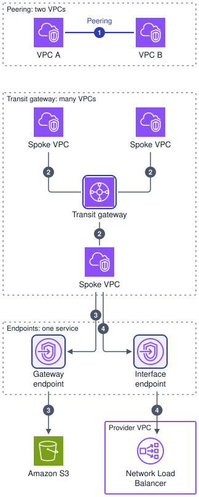

# Connecting VPCs: peering, Transit Gateway, endpoints and PrivateLink

## Predict (1 min)
<!-- section: role=predict; route=fast; minutes=1 -->

**Predict 1.** VPC A is peered with VPC B, and VPC B with VPC C. Can VPC A reach VPC C? <!-- gist-trap -->

**Predict 2.** Two VPCs use 10.20.0.0/16. Can one call an API in the other privately?

## Look first (3 min)
<!-- section: role=task; route=fast; minutes=3 -->

Many [AWS services integrate with AWS PrivateLink](../facts/vpc-endpoints.md#vpc-endpoints-aws-services-integrating-list). List them.

<!-- task:start id=vpc-connectivity-t01 -->
<!-- task:end -->

## In one breath (2 min)
<!-- section: role=breath; route=fast; minutes=2 -->

> **Say it:** A peering connection joins two VPCs, a **transit gateway** (TRAN-zit) can [connect thousands of VPCs](../facts/transit-gateway.md#transit-gateway-regional-resource-thousands-of-vpcs), and PrivateLink reaches one service [using private IP addresses](../facts/privatelink.md#privatelink-concepts-private-ip-as-if-hosted).

**The problem it solves.** Separate VPCs and data centers need private paths, without the internet.

**Predict the picture.** Do five VPCs connect directly, or through one hub?

Show the picture

**Figure.** A peering connection joins two VPCs, a transit gateway joins many, and endpoints reach one service privately.

1. VPC A and VPC B talk over one peering connection, [as if they are within the same network](../facts/vpc-peering.md#vpc-peering-def-private-ipv4-ipv6).
2. [Each spoke VPC only needs to connect](../facts/transit-gateway.md#transit-gateway-vs-peering-wp-hub-and-spoke-thousands-of-vpcs-one-gateway) to the transit gateway to reach the other attached VPCs.
3. A gateway endpoint will [add an entry to your route table you selected](../facts/vpc.md#vpc-faq-endpoint-types-gateway-interface) for Amazon S3.
4. An interface endpoint reaches one endpoint service, and [it is a one-way service](../facts/privatelink.md#privatelink-faq-consumer-initiates-allowlisted-customers).

> **Startup example:** The bank's application, in the bank's VPC, must call Callvale's API without using the internet. Both VPCs use the CIDR block 10.20.0.0/16. The bank must not reach anything else in Callvale's VPC. Callvale's workloads must also call AWS services privately.

## Words that go together (1 min)
<!-- section: role=words; route=fast; minutes=1 -->

<!-- table: words -->
| Term | Words that go with it | Plain meaning | Do not confuse with |
|---|---|---|---|
| VPC peering connection (PEER-ing) | **accept** a peering connection | A private connection between two VPCs | transit gateway |
| transit gateway | **attach** a VPC to a transit gateway | A Regional hub between networks | VPC peering connection |
| interface endpoint | **create** an interface endpoint in a subnet | A private IP address for one service | gateway endpoint |
| endpoint service | **create** an endpoint service | Your service, offered to other VPCs | interface endpoint |

## Choose it or not (2 min)
<!-- section: role=choose; route=fast; minutes=2 -->

### Peering or transit gateway or PrivateLink

<!-- table: compare -->
| Question | VPC peering | Transit gateway | PrivateLink |
|---|---|---|---|
| Through a third network? | No: [transitive peering relationships are not supported](../facts/vpc-peering.md#vpc-peering-faq-not-transitive) | Yes: [all attachments can route packets to each other](../facts/transit-gateway.md#transit-gateway-centralized-router-scenario) | No |
| Same CIDR block? | No: you [cannot create a VPC peering connection](../facts/vpc-peering.md#vpc-peering-no-overlap-ipv4-ipv6) | No: it does not route [identical CIDRs](../facts/transit-gateway.md#transit-gateway-faq-identical-cidr-not-routed) | Yes: VPCs [can have overlapping IP address ranges](../facts/privatelink.md#privatelink-wp-consumer-and-provider-may-overlap) |
| What you pay | [Data transfer across peering connections is charged](../facts/vpc-peering.md#vpc-peering-faq-no-creation-charge) | Hourly: the [connections that you make to the Transit Gateway](../facts/transit-gateway.md#transit-gateway-pricing-hourly-attachment-and-data-processing), plus traffic | Endpoint hours [provisioned in each Availability Zone](../facts/privatelink.md#privatelink-faq-billing-interface-gwlb-hourly-per-az) |

**Deciding question:** Must many networks reach each other, or must one consumer reach one service?

### Which endpoint type

<!-- table: compare -->
| Question | Gateway endpoint | Interface endpoint | Gateway Load Balancer endpoint |
|---|---|---|---|
| What it reaches | [Amazon S3 and Amazon DynamoDB](../facts/vpc-endpoints.md#vpc-endpoints-faq-gateway-endpoint-s3-ddb-route) | AWS services, your services, [software as a service (SaaS) solutions](../facts/vpc-endpoints.md#vpc-endpoints-faq-interface-endpoint-privatelink-services) | A [fleet of network virtual appliances](../facts/vpc-endpoints.md#vpc-endpoints-gwlb-fleet-of-appliances-service) |
| Charge | [Gateway VPC endpoints have no hourly charges](../facts/vpc-endpoints.md#vpc-endpoints-wa-cost08-gateway-free-interface-hourly) | An [hourly fee and per-GB usage cost](../facts/vpc-endpoints.md#vpc-endpoints-wa-cost08-gateway-free-interface-hourly) | Hours [provisioned in each Availability Zone](../facts/privatelink.md#privatelink-faq-billing-interface-gwlb-hourly-per-az) |

**Deciding question:** S3 or DynamoDB from this VPC, another service API, or an inline appliance?

## Signals and traps (2 min)
<!-- section: role=signals; route=fast; minutes=2 -->

<!-- table: signals -->
| The stem says | Think | Because | But not if |
|---|---|---|---|
| "connect two VPCs at the lowest cost" | peering | [lowest overall cost and highest aggregate performance](../facts/vpc-peering.md#vpc-peering-wp-lowest-cost-highest-performance) | same CIDR block: an endpoint service |
| "hundreds of VPCs communicate" | a transit gateway | it can [connect thousands of VPCs](../facts/transit-gateway.md#transit-gateway-regional-resource-thousands-of-vpcs) | two VPCs exchange heavy traffic: peering |
| "one service for VPCs with the same CIDR" | an endpoint service | VPCs [can have overlapping IP address ranges](../facts/privatelink.md#privatelink-wp-consumer-and-provider-may-overlap) | both sides start connections: renumber, then peering |
| "heavy S3 traffic through a NAT gateway" | a gateway endpoint | [Gateway VPC endpoints have no hourly charges](../facts/vpc-endpoints.md#vpc-endpoints-wa-cost08-gateway-free-interface-hourly) | the data center sends it: an interface endpoint |
| "private AWS API calls from the data center" | an interface endpoint | [connectivity over AWS Direct Connect and VPN](../facts/vpc-endpoints.md#vpc-endpoints-faq-interface-endpoint-privatelink-services) | S3 from inside the VPC: a gateway endpoint |
| "isolate VPC groups on one transit gateway" | separate route tables | you segment by [creating multiple route tables](../facts/transit-gateway.md#transit-gateway-faq-route-tables-segment) | traffic needs inspection: an inspection VPC |

### Traps

- **Wrong belief:** VPC A reaches VPC C through peered VPC B. **Truth:** [Transitive peering relationships are not supported](../facts/vpc-peering.md#vpc-peering-faq-not-transitive). <!-- trap: vpc-connectivity-trap-peering-transitive -->
- **Wrong belief:** A peered VPC can use its peer's NAT gateway. **Truth:** [Resources in VPC B](../facts/vpc-peering.md#vpc-peering-edge-no-igw) cannot use the internet gateway or NAT device of VPC A [to access the internet](../facts/vpc-peering.md#vpc-peering-edge-no-nat). <!-- trap: vpc-connectivity-trap-peering-shares-gateways -->
- **Wrong belief:** Peering or a transit gateway can join two VPCs with the same CIDR block. **Truth:** You [cannot create a VPC peering connection](../facts/vpc-peering.md#vpc-peering-no-overlap-ipv4-ipv6), and a transit gateway does not route [identical CIDRs](../facts/transit-gateway.md#transit-gateway-faq-identical-cidr-not-routed). <!-- trap: vpc-connectivity-trap-overlap-peer-or-tgw -->

## Changed recently (1 min)
<!-- section: role=changed; route=fast; minutes=1 -->

> **Changed recently:** (2025-11-19) Cross-Region interface endpoints. 
> **Old:** only [connectivity to AWS services in the same Region](../facts/privatelink.md#privatelink-change-cross-region-aws-services-2025). 
> **Now:** from [November 19, 2025](../facts/privatelink.md#privatelink-change-cross-region-aws-services-2025), select AWS services in other Regions too. 
> **The exam probably expects:** same-Region endpoints; prefer an option right under both. 
> **Status:** examinable.

## Check (1 min)
<!-- section: role=check; route=fast; minutes=1 -->

**Check 1.** A hub VPC is peered with five other VPCs. Can two of them talk through the hub?

Answer

No. VPC peering [does not support transitive peering relationships](../facts/vpc-peering.md#vpc-peering-no-transitive-example).

**Predict 1:** No, for the same reason.

**Check 2.** Two VPCs with 10.20.0.0/16 attach to one transit gateway. Can they reach each other?

Answer

No. A transit gateway does not route between VPCs with [identical CIDRs](../facts/transit-gateway.md#transit-gateway-faq-identical-cidr-not-routed).

**Predict 2:** Yes, through PrivateLink: the VPCs [can have overlapping IP address ranges](../facts/privatelink.md#privatelink-wp-consumer-and-provider-may-overlap).

## Recap from memory (1 min)
<!-- section: role=recap; route=fast; minutes=1 -->

**Recap 1.** Deciding question for peering, transit gateway or PrivateLink?

Answer

Must many networks reach each other, or must one consumer reach one service?

**Recap 2.** "But not if" for heavy S3 traffic through a NAT gateway?

Answer

The data center sends it: an interface endpoint.

**Recap 3.** Truth of the trap about a peer's NAT gateway?

Answer

[Resources in VPC B](../facts/vpc-peering.md#vpc-peering-edge-no-igw) cannot use the internet gateway or NAT device of VPC A [to access the internet](../facts/vpc-peering.md#vpc-peering-edge-no-nat).

