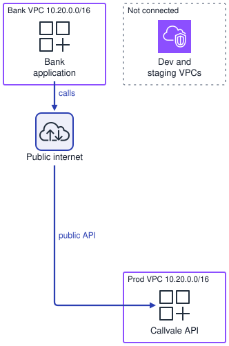

# Connecting VPCs in depth

## How it works (28 min)
<!-- section: role=how; route=full; minutes=28 -->

Follow one packet: between VPCs, through a hub, to AWS services and to another company's service.

### A peering connection works only after both owners add routes (4 min)

Two teams in different accounts need their VPCs to talk privately.

A **VPC peering connection** (PEER-ing) joins two VPCs [as if they are within the same network](../facts/vpc-peering.md#vpc-peering-def-private-ipv4-ipv6).

1. **Request.** The owner of the **requester VPC** [sends a request to the owner](../facts/vpc-peering.md#vpc-peering-step-request) of the **accepter VPC**.
2. **Accept.** The [owner of the accepter VPC accepts](../facts/vpc-peering.md#vpc-peering-step-accept). Before that, a route [has no effect until](../facts/vpc-peering.md#vpc-peering-route-pending-blackhole) the connection is active.
3. **Route.** Each owner [must manually add a route](../facts/vpc-peering.md#vpc-peering-step-routes-manual) to the [IP address range of the other VPC](../facts/vpc-peering.md#vpc-peering-step-routes-manual).
4. **Allow.** If required, the owners [update the security group rules](../facts/vpc-peering.md#vpc-peering-step-security-groups).

> **Exam signal:** "instances in two peered VPCs cannot connect" points to the routes: check that each [route table for its subnet contains a route](../facts/vpc-peering.md#vpc-peering-troubleshoot-routes) to the peer.

> **Try it:** Peer two VPCs and watch a route wait for the accept. See [3-do.md](3-do.md). <!-- task: vpc-connectivity-t02 -->

> **Say it:** The short answer is: request, accept, then add routes on both sides. The thing to watch is overlapping CIDR blocks.

**Stop and answer.** VPC A has 10.0.0.0/16 and 172.31.0.0/16. VPC B has 172.31.0.0/16. Can they peer if the team routes 10.0.0.0/16 alone?

Answer

No. Peering fails [if any of the CIDR blocks overlap](../facts/vpc-peering.md#vpc-peering-no-overlap-even-if-unused-cidr), even to [use only the non-overlapping CIDR blocks](../facts/vpc-peering.md#vpc-peering-no-overlap-even-if-unused-cidr).

### Peering is not transitive so many VPCs need a full mesh (4 min)
<!-- section: route=pass -->

Application VPCs such as VPC B peer with a shared VPC A. They now need each other and VPC A's NAT gateway.

1. **One hop.** Passing through one VPC to reach a third is **transitive routing**. Peering [does not support transitive peering relationships](../facts/vpc-peering.md#vpc-peering-no-transitive-example).
2. **No borrowed exits.** Using a peer's gateway to reach beyond it is **edge-to-edge routing**. [Resources in VPC B](../facts/vpc-peering.md#vpc-peering-edge-no-igw) cannot use the internet gateway of VPC A, or its NAT device [to access the internet](../facts/vpc-peering.md#vpc-peering-edge-no-nat).
3. **Count.** In a **full mesh**, every VPC peers with every other. That takes [n(n-1)/2](../facts/vpc-peering.md#vpc-peering-wp-full-mesh-4950-connections) links.
4. **Pay.** There is [no charge for creating VPC peering connections](../facts/vpc-peering.md#vpc-peering-faq-no-creation-charge), but [data transfer across peering connections is charged](../facts/vpc-peering.md#vpc-peering-faq-no-creation-charge).

> **Exam signal:** "a few VPCs, the lowest latency and cost" points to peering, with the [lowest overall cost and highest aggregate performance](../facts/vpc-peering.md#vpc-peering-wp-lowest-cost-highest-performance).

> **Say it:** The short answer is: peering links two VPCs and nothing beyond them. The thing to watch is the number of pairs.

**Stop and answer.** VPC A has an **interface endpoint** for an AWS service. VPC B is peered with VPC A. Can VPC B use that endpoint?

Answer

Yes. Unlike a **gateway endpoint**, you can [access AWS PrivateLink endpoints over VPC peering](../facts/privatelink.md#privatelink-wp-endpoints-reachable-over-peering-tgw-dx).

### A transit gateway routes between attachments with its own route tables (4 min)
<!-- section: route=pass -->

VPCs in seven accounts, and later the data center, need one hub.

A **transit gateway** (TRAN-zit) is a **hub-and-spoke** design that can [interconnect virtual private clouds (VPCs) and on-premises networks](../facts/transit-gateway.md#transit-gateway-def-network-transit-hub).

1. **Attach.** A **transit gateway attachment** joins one VPC: you [specify one subnet from each Availability Zone](../facts/transit-gateway.md#transit-gateway-vpc-attachment-one-subnet-per-az-entry-exit) (AZ).
2. **Leave the VPC.** The VPC owner [needs to create a static route](../facts/transit-gateway.md#transit-gateway-faq-no-propagation-to-vpc-route-table) to the transit gateway.
3. **Look up.** The attachment's **association** names [a single route table](../facts/transit-gateway.md#transit-gateway-attachment-one-route-table-association), a **transit gateway route table**. It picks [the most specific route for the destination address](../facts/transit-gateway.md#transit-gateway-route-evaluation-most-specific-first).
4. **Learn.** With **route propagation**, an attachment can [propagate its routes](../facts/transit-gateway.md#transit-gateway-propagate-to-multiple-route-tables) to [one or more route tables](../facts/transit-gateway.md#transit-gateway-propagate-to-multiple-route-tables).

> **Exam signal:** "hundreds of VPCs and on-premises networks through one hub" points to a transit gateway, which can [connect thousands of VPCs](../facts/transit-gateway.md#transit-gateway-regional-resource-thousands-of-vpcs).

> **Exam trap:** Many think that the attachment adds the hub's routes to the subnet route tables. Instead, you [add a route to your subnet route table](../facts/transit-gateway.md#transit-gateway-vpc-route-to-tgw-required). <!-- trap: vpc-connectivity-trap-tgw-propagates-to-vpc -->

**Spot the bug.** A VPC has subnets in AZ 1, 2 and 3. Its attachment names subnets in AZ 1 and 2. Instances in AZ 3 cannot reach other VPCs. What is wrong?

Answer

[Only resources that reside in Availability Zones](../facts/transit-gateway.md#transit-gateway-az-without-attachment-cannot-reach) with an attachment subnet reach the hub.

> **Say it:** The short answer is: the hub's route table picks the attachment. The thing to watch is the route in the VPC.

**Stop and answer.** A dev attachment propagates 10.40.0.0/16. A static route for 10.40.0.0/16 in the same table points to a VPN attachment. Where does traffic for 10.40.0.5 go?

Answer

To the VPN attachment: [the static route has the higher priority](../facts/transit-gateway.md#transit-gateway-static-route-beats-propagated).

### Separate route tables let one transit gateway isolate groups of VPCs (4 min)

Production, development and shared-services VPCs share one transit gateway. Production and development stay apart.

1. **Default.** With one default route table, [all attachments can route packets to each other](../facts/transit-gateway.md#transit-gateway-centralized-router-scenario).
2. **Split.** You segment by [creating multiple route tables](../facts/transit-gateway.md#transit-gateway-faq-route-tables-segment): one for production, one for development.
3. **Propagate.** Each group's table learns the shared routes, and the shared table learns both groups. Both can [route packets to or receive packets from](../facts/transit-gateway.md#transit-gateway-isolated-shared-services-scenario) shared services.
4. **Drop.** Traffic to the other group is [blocked because there is no route](../facts/transit-gateway.md#transit-gateway-isolated-vpcs-blocked-no-route). A **blackhole route** [drops traffic that matches the route](../facts/transit-gateway.md#transit-gateway-blackhole-route-drops).

<!-- table: plain -->
| From | To | Route in the source's table? | Result |
|---|---|---|---|
| Production | Shared services | Yes | Delivered |
| Shared services | Development | Yes, propagated | Delivered |
| Production | Development | No | Blocked |

Why one gateway? Tables give [routing domains](../facts/transit-gateway.md#transit-gateway-wp-segment-routing-domains), and a transit gateway is [highly available by design](../facts/transit-gateway.md#transit-gateway-ha-by-design-single-per-region).

> **Exam signal:** "share one transit gateway with the other accounts of the organization" points to [AWS Resource Access Manager (RAM) to share](../facts/transit-gateway.md#transit-gateway-share-with-ram-accounts-or-org) it.

> **Exam trap:** Many think that isolation needs a second transit gateway. Instead, [each isolated router has a single route table](../facts/transit-gateway.md#transit-gateway-isolated-vpcs-scenario), and its attachments [cannot route packets to or receive packets](../facts/transit-gateway.md#transit-gateway-isolated-vpcs-scenario) from another group. <!-- trap: vpc-connectivity-trap-tgw-one-table-all-talk -->

> **Say it:** The short answer is: one transit gateway, one route table for each group. The thing to watch is what each table learns.

**Stop and answer.** The production table has a propagated route for 10.60.0.0/16. An engineer adds a blackhole route for 10.60.5.0/24. Where does a packet to 10.60.5.10 go?

Answer

Nowhere. [The most specific route for the destination address](../facts/transit-gateway.md#transit-gateway-route-evaluation-most-specific-first) wins: the [blackhole route](../facts/transit-gateway.md#transit-gateway-blackhole-route-drops).

### An interface endpoint gives the service a private IP address in your subnet (4 min)

Private instances and the data center call AWS service APIs without the internet.

1. **Create.** An interface endpoint puts an **endpoint network interface** in [one subnet per Availability Zone](../facts/vpc-endpoints.md#vpc-endpoints-interface-one-subnet-per-az).
2. **Resolve.** With **private DNS**, applications reach the endpoint [without requiring that you make any changes](../facts/vpc-endpoints.md#vpc-endpoints-interface-private-dns-no-app-change).
3. **Filter.** [VPC security groups can be used to manage](../facts/privatelink.md#privatelink-wp-security-groups-manage-endpoint-access) access to the endpoint.
4. **Reach from outside.** The endpoint is [accessible from on-premises networks over VPN](../facts/vpc-endpoints.md#vpc-endpoints-wp-interface-endpoints-reachable-from-onprem) and Direct Connect.

<!-- table: plain -->
| Question | Gateway endpoint | Interface endpoint |
|---|---|---|
| Reach from a peered VPC or the data center | No: it [cannot be extended out of a VPC](../facts/vpc-endpoints.md#vpc-endpoints-gateway-not-extended-past-vpc) | Yes |
| Charge | [Gateway VPC endpoints have no hourly charges](../facts/vpc-endpoints.md#vpc-endpoints-wa-cost08-gateway-free-interface-hourly) | [Hourly fee and per-GB usage cost](../facts/vpc-endpoints.md#vpc-endpoints-wa-cost08-gateway-free-interface-hourly) |

> **Exam signal:** "access Amazon S3 privately from the data center" points to an interface endpoint. "From the same Region, at the lowest cost" points to a gateway endpoint: AWS recommends [gateway VPC endpoints as they are not billed](../facts/s3.md#s3-faq-vpce-choose).

> **Say it:** The short answer is: an interface endpoint is a private address for the service in your subnet. The thing to watch is its hourly charge.

**Stop and answer.** An interface endpoint for Amazon CloudWatch sits in AZ 1 alone. AZ 1 fails. Can instances in AZ 2 reach CloudWatch through it?

Answer

No. They [lose access to Amazon CloudWatch](../facts/vpc-endpoints.md#vpc-endpoints-interface-single-az-impairment). Use [at least two Availability Zones per VPC endpoint](../facts/vpc-endpoints.md#vpc-endpoints-interface-two-azs-for-production).

### An endpoint policy can narrow access through an endpoint but never grant it (4 min)
<!-- section: route=pass -->

A security team wants instances to reach the company's own S3 buckets through the endpoint, and no others.

1. **Default.** An **endpoint policy** is a resource-based policy on the endpoint. The [default VPC endpoint policy allows all actions](../facts/vpc-endpoints.md#vpc-endpoints-policy-default-allows-all-concepts).
2. **Narrow.** You [attach a single endpoint policy to the endpoint](../facts/vpc-endpoints.md#vpc-endpoints-policy-single-policy-default-if-none) that names the buckets. It [must contain a Principal element](../facts/vpc-endpoints.md#vpc-endpoints-policy-json-iam-language-principal-required).
3. **Combine.** The role's IAM policy and the bucket still decide.
4. **Lock the bucket.** A bucket policy with [aws:SourceVpce](../facts/s3.md#s3-bucket-policy-source-vpce-condition) refuses other paths, and [disables console access to the specified bucket](../facts/s3.md#s3-bucket-policy-source-vpce-condition).

<!-- table: plain -->
| Endpoint policy | The role's IAM policy | Result |
|---|---|---|
| Allows the bucket | Allows the read | Allowed |
| Allows the bucket | Allows nothing | Denied: [the request is implicitly denied](../facts/iam.md#iam-eval-identity-policy-no-allow-is-implicit-deny) |
| Leaves the bucket out | Allows the read | Denied |

The table assumes no bucket policy. Why a separate policy? It limits [specific users, actions, and/or resources](../facts/vpc-endpoints.md#vpc-endpoints-faq-benefit-restrict-users-actions-resources) on one path.

> **Exam signal:** "the bucket must accept requests only from one VPC endpoint" points to a bucket policy whose aws:SourceVpce condition takes [only the VPC endpoint ID](../facts/s3.md#s3-bucket-policy-source-vpce-condition).

> **Exam trap:** Many think that an endpoint policy that allows s3:GetObject lets every instance read the bucket. It [does not override or replace IAM user policies](../facts/vpc-endpoints.md#vpc-endpoints-wp-one-policy-per-endpoint-no-override), so the role needs its own allow. <!-- trap: vpc-connectivity-trap-endpoint-policy-grants -->

> **Try it:** Limit a gateway endpoint to one bucket and watch other buckets refuse. See [3-do.md](3-do.md). <!-- task: vpc-connectivity-t03 -->

> **Say it:** The short answer is: the endpoint policy is a filter, not a grant. The thing to watch is the role's own permissions.

**Stop and answer.** A bucket policy allows requests whose aws:SourceIp is the VPC's private CIDR block. Instances use a gateway endpoint. Do their requests succeed?

Answer

No. Through an endpoint, [use the aws:VpcSourceIp condition](../facts/vpc-endpoints.md#vpc-endpoints-gateway-s3-no-sourceip-use-vpcsourceip).

### PrivateLink lets consumers reach one service and only consumers start connections (4 min)
<!-- section: route=pass -->

A company offers one API to VPCs in other accounts. Some share its CIDR block and should reach nothing else.

1. **Front the service.** The **service provider** creates an **endpoint service** and [must specify a load balancer](../facts/privatelink.md#privatelink-endpoint-service-needs-load-balancer): a [Network Load Balancer or a Gateway Load Balancer](../facts/privatelink.md#privatelink-endpoint-service-needs-load-balancer).
2. **Allow.** The service is [not available to service consumers](../facts/privatelink.md#privatelink-endpoint-service-not-available-by-default) until you [add permissions that allow specific AWS principals](../facts/privatelink.md#privatelink-endpoint-service-not-available-by-default).
3. **Connect.** The **service consumer** [creates an interface endpoint to your service](../facts/privatelink.md#privatelink-wp-provider-nlb-consumer-endpoint-steps) in its own VPC.
4. **Send.** Here, [only consumer VPCs initiate connections](../facts/privatelink.md#privatelink-wp-only-consumer-initiates).

<!-- table: plain -->
| Question | VPC peering | PrivateLink |
|---|---|---|
| What the other VPC reaches | [Full bidirectional connectivity between the VPCs](../facts/vpc-peering.md#vpc-peering-wp-full-bidirectional-point-to-point) | One service |
| The same CIDR block | You [cannot create a VPC peering connection](../facts/vpc-peering.md#vpc-peering-no-overlap-ipv4-ipv6) | The VPCs [can have overlapping IP address ranges](../facts/privatelink.md#privatelink-wp-consumer-and-provider-may-overlap) |

Why do overlapping ranges work? The endpoint sits in the consumer's VPC, so there are [no IP conflicts with the service provider](../facts/privatelink.md#privatelink-wp-unidirectional-overlapping-ips).

> **Exam signal:** "expose an application to hundreds of VPCs in other accounts" points to an endpoint service.

> **Exam trap:** Many think that the provider can open connections back into the consumer's VPC, as with peering. The consumer always starts the connection: [it is a one-way service](../facts/privatelink.md#privatelink-faq-consumer-initiates-allowlisted-customers). <!-- trap: vpc-connectivity-trap-privatelink-two-way -->

> **Say it:** The short answer is: the consumer gets a private door to one service. The thing to watch is the direction of each connection.

**Stop and answer.** A provider removes an accepted consumer from the allowed principals. Does that consumer's traffic stop?

Answer

No. Removing permissions [does not affect existing connections](../facts/privatelink.md#privatelink-remove-permission-keeps-existing-connections).

## Numbers that decide answers (2 min)
<!-- section: role=numbers; route=full; minutes=2 -->

### A-list

<!-- table: numbers -->
| Number | What it is | Why it decides an answer |
|---|---|---|
| [up to 125](../facts/vpc-peering.md#vpc-peering-quota-active-connections-per-vpc) | Active peering connections of one VPC (default [50](../facts/vpc-peering.md#vpc-peering-quota-active-connections-per-vpc)) | More peers need a transit gateway |
| [4,950 peering connections](../facts/vpc-peering.md#vpc-peering-wp-full-mesh-4950-connections) | A full mesh when n is 100 | The count grows with the square of n |
| [up to 100 Gbps](../facts/transit-gateway.md#transit-gateway-quota-vpc-attachment-bandwidth) | One VPC attachment in one zone, each direction | More zones carry more traffic |
| [up to 10 Gbps per Availability Zone](../facts/vpc-endpoints.md#vpc-endpoints-bandwidth-10-gbps-per-az-scales-to-100) | Default endpoint bandwidth | It [automatically scales up to 100 Gbps](../facts/vpc-endpoints.md#vpc-endpoints-bandwidth-10-gbps-per-az-scales-to-100) |
| [$0.01/GB in both "In" and "Out" direction](../facts/vpc-peering.md#vpc-peering-cross-az-data-transfer-price) | Peering traffic between zones | Busy peers belong in one zone |

### B-list

<!-- table: numbers -->
| Number | What it is |
|---|---|
| [1 week (168 hours)](../facts/vpc-peering.md#vpc-peering-quota-request-expiry) | Life of an unaccepted peering request |
| [5](../facts/transit-gateway.md#transit-gateway-quota-gateways-per-account) | Transit gateways per account (default) |
| [5,000](../facts/transit-gateway.md#transit-gateway-quota-attachments-per-gateway) | Attachments per transit gateway (default) |
| [20](../facts/transit-gateway.md#transit-gateway-quota-route-tables-per-gateway) | Route tables per transit gateway (default) |
| [50](../facts/vpc-endpoints.md#vpc-endpoints-quota-interface-gwlb-per-vpc) | Interface endpoints per VPC (default) |

## Decision record (2 min)
<!-- section: role=example; route=full; minutes=2 -->

**Context.** Ostell Bank's application calls Callvale's public API. Both VPCs use 10.20.0.0/16.

**Figure.** The bank's application calls Callvale's public API over the internet, and both VPCs use 10.20.0.0/16.

**Requirement.** The bank's application must call one API privately and reach nothing else. Which design is the MOST secure?

**Options.**

- A VPC peering connection with the bank.
- A transit gateway shared with the bank.
- **An endpoint service; the bank creates an interface endpoint.**

**Decision.** An endpoint service behind a Network Load Balancer. Peering fails: you [cannot create a VPC peering connection](../facts/vpc-peering.md#vpc-peering-no-overlap-ipv4-ipv6) between overlapping blocks. A transit gateway does not route between [identical CIDRs](../facts/transit-gateway.md#transit-gateway-faq-identical-cidr-not-routed).

**Figure.** The bank's interface endpoint reaches Callvale's API through an endpoint service, and Callvale's VPCs meet at a transit gateway.

**Trade-off.** One service, one direction. The Network Load Balancer is billed for [each hour or partial hour](../facts/privatelink.md#privatelink-provider-nlb-billed-hourly-full-hour).

## FAQ quick-fire (3 min)
<!-- section: role=faq; route=full; minutes=3 -->

**FAQ 1.** If A peers with B and B peers with C, can A reach C?

Answer

No. [Transitive peering relationships are not supported](../facts/vpc-peering.md#vpc-peering-faq-not-transitive).

> "Transitive peering relationships are not supported."
> — [Amazon VPC FAQs](https://aws.amazon.com/vpc/faqs/)

**FAQ 2.** Can a rule reference a security group across an inter-Region peering connection?

Answer

No. [Security groups cannot be referenced](../facts/vpc-peering.md#vpc-peering-faq-inter-region-no-sg-reference) there.

> "Security groups cannot be referenced across an Inter-Region VPC Peering connection."
> — [Amazon VPC FAQs](https://aws.amazon.com/vpc/faqs/)

**FAQ 3.** Can a transit gateway route between VPCs with identical CIDR blocks?

Answer

No, not between [identical CIDRs](../facts/transit-gateway.md#transit-gateway-faq-identical-cidr-not-routed).

> "AWS Transit Gateway doesn’t support routing between Amazon VPCs with identical CIDRs."
> — [AWS Transit Gateway FAQs](https://aws.amazon.com/transit-gateway/faqs/)

**FAQ 4.** Does PrivateLink encrypt data in transit for you?

Answer

No. It [does not provide any encryption by default](../facts/privatelink.md#privatelink-faq-no-encryption-by-default); use TLS.

> "PrivateLink does not provide any encryption by default for data in transit."
> — [AWS PrivateLink FAQs](https://aws.amazon.com/privatelink/faqs/)

**FAQ 5.** Can an on-premises application reach an interface endpoint through Direct Connect?

Answer

Yes, the [endpoints in Amazon VPC over AWS Direct Connect](../facts/privatelink.md#privatelink-faq-over-direct-connect).

> "The application in your on-premises can connect to the service endpoints in Amazon VPC over AWS Direct Connect."
> — [Amazon VPC FAQs](https://aws.amazon.com/vpc/faqs/)

## In the real world (1 min)
<!-- section: role=realworld; route=full; minutes=1 -->

**Resilience, 2023.** Resilience transfers its lab data [using AWS PrivateLink](../facts/privatelink.md#privatelink-case-resilience-datasync-no-internet).

> "This data is transferred securely using AWS PrivateLink, which establishes connectivity between virtual private clouds and AWS services without exposing data to the internet."
> — [Resilience case study](https://aws.amazon.com/solutions/case-studies/resilience-case-study/)

**It shows:** private paths to AWS services keep regulated data off the internet.

> **Say it:** Resilience sends its lab data to AWS over PrivateLink. The data stays off the internet.
