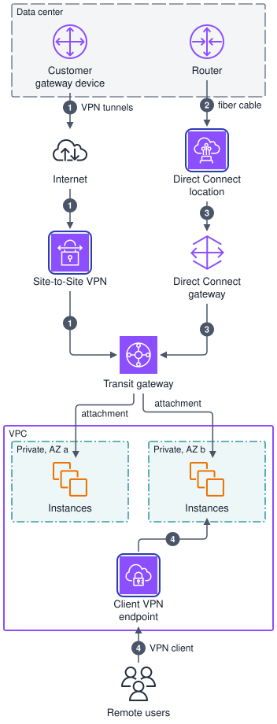

# Site-to-Site VPN, Direct Connect and Client VPN

## Predict (1 min)
<!-- section: role=predict; route=fast; minutes=1 -->

**Predict 1.** A company sends data over a Direct Connect connection, which bypasses the internet. Is the traffic encrypted? <!-- gist-trap -->

**Predict 2.** A company adds a second VPN connection to the same virtual private gateway. Does the bandwidth go up?

## Look first (2 min)
<!-- section: role=task; route=fast; minutes=2 -->

A **Direct Connect location** is a building where your network meets AWS. List the locations of one Region.

<!-- task:start id=hybrid-networking-t01 -->

Look

**It kills the belief.** "AWS brings the Direct Connect line into your building."

> **Cost:** $0.

**Permissions.** `directconnect:DescribeLocations`

**No permission to create resources?** This task is read-only. It needs no alternative.

1. Open AWS CloudShell. List the Direct Connect locations of the Region that CloudShell uses: the code, the name and the Region of each location.

   ```bash
   aws directconnect describe-locations --query "locations[].[locationCode,locationName,region]" --output table
   ```

   Expect: One row for each location. Each name holds a colocation partner and a building in a city. The Region column shows the Region of CloudShell in every row. None of these buildings is yours: your local service provider carries the line from your building to the location.

2. Pick a Region other than the one CloudShell uses as <OTHER_REGION>, for example us-west-2 or eu-west-1. Run the same list for that Region.

   ```bash
   aws directconnect describe-locations --region <OTHER_REGION> --query "locations[].[locationCode,locationName,region]" --output table
   ```

   Expect: A different list of buildings, each with the Region that you chose. A location gives access to AWS in the Region with which it is associated, so you choose a location near your data center. A Direct Connect gateway then reaches VPCs in other Regions.

3. Back in the Region of CloudShell, read the port speeds of each location and the port speeds that support MACsec.

   ```bash
   aws directconnect describe-locations --query "locations[].[locationCode,availablePortSpeeds,availableMacSecPortSpeeds]"
   ```

   Expect: For each location code: a list of port speeds, then the list of MACsec port speeds, which can be empty. A dedicated connection comes at 1 Gbps, 10 Gbps, 100 Gbps or 400 Gbps, and the MACsec list holds no 1 Gbps speed.

**Label.** checked against docs, not run in a real account. Checked 2026-10-15.

<!-- task:end -->

## In one breath (2 min)
<!-- section: role=breath; route=fast; minutes=2 -->

> **Say it:** Site-to-Site VPN joins networks with [Internet Protocol security (IPsec) VPN connections](../facts/site-to-site-vpn.md#site-to-site-vpn-definition-ipsec-vpc-to-on-premises); Direct Connect uses [dedicated, private network connections](../facts/direct-connect.md#direct-connect-faq-bypasses-internet-dedicated-private); Client VPN joins people.

**The problem it solves.** Data centers and remote workers need private resources in a **virtual private cloud** (VPC).

**Predict the picture.** Do the VPN and Direct Connect end at one AWS gateway?

<details>
<summary>Show the picture</summary>



**Figure.** A data center reaches a VPC through VPN tunnels or a Direct Connect connection, and remote users reach it through Client VPN.

1. The customer gateway device sends traffic through two VPN tunnels, [each terminating in a different Availability Zone](../facts/site-to-site-vpn.md#site-to-site-vpn-two-tunnels-different-availability-zones).
2. Direct Connect runs [over a standard Ethernet fiber-optic cable](../facts/direct-connect.md#direct-connect-definition-fiber-cable-bypass-isp) from the router to a Direct Connect location.
3. The transit virtual interface is [attached to an AWS Direct Connect gateway](../facts/direct-connect.md#direct-connect-transit-vif-attaches-only-to-dxgw), which reaches the transit gateway.
4. Remote users connect to the Client VPN endpoint [using an OpenVPN-based VPN client](../facts/client-vpn.md#client-vpn-definition-managed-client-based-vpn-openvpn).

</details>

> **Startup example:** Each night the bank sends recordings to Callvale's VPC: encrypted in 3 weeks, private in 6 months. Engineers need admin access.

## Words that go together (1 min)
<!-- section: role=words; route=fast; minutes=1 -->

<!-- table: words -->
| Term | Words that go with it | Plain meaning | Do not confuse with |
|---|---|---|---|
| customer gateway | **create** a customer gateway | The AWS record of your VPN router | customer gateway device |
| virtual interface | **create** a virtual interface on a connection | A path to public services, a VPC or a transit gateway | the connection itself |
| Direct Connect gateway | **associate** a Direct Connect gateway with a transit gateway | [A globally available resource](../facts/direct-connect.md#direct-connect-dxgw-global-resource-any-region-not-china) for virtual interfaces | virtual private gateway |
## Choose it or not (2 min)
<!-- section: role=choose; route=fast; minutes=2 -->

### Site-to-Site VPN or Direct Connect or Client VPN

<!-- table: compare -->
| Question | Site-to-Site VPN | Direct Connect | Client VPN |
|---|---|---|---|
| Who connects? | A **Site-to-Site VPN connection** joins [an entire on-premises network](../facts/site-to-site-vpn.md#site-to-site-vpn-decision-guide-connect-entire-network-to-vpcs) | A network | [Remote users](../facts/client-vpn.md#client-vpn-vs-site-to-site-decision-guide-remote-users) |
| How soon? | It [can be configured in minutes](../facts/direct-connect.md#direct-connect-faq-vpn-ipsec-over-internet-quick-low-bandwidth) | New dedicated connection: [from several weeks to a few months](../facts/direct-connect.md#direct-connect-vs-vpn-time-dedicated-weeks-to-months) | Not the deciding question |
| Encrypted? | Yes: **IPsec** (EYE-pee-sek) | Not by default: it [does not encrypt your traffic](../facts/direct-connect.md#direct-connect-not-encrypted-by-default-use-service-encryption) | Yes: [a secure TLS connection](../facts/client-vpn.md#client-vpn-whitepaper-managed-secure-software-remote-access) |

**Deciding question:** Who connects, and must the link be ready this week or consistent for years?

### Virtual private gateway or transit gateway for a VPN

A **transit gateway** can [interconnect virtual private clouds (VPCs) and on-premises networks](../facts/transit-gateway.md#transit-gateway-def-network-transit-hub). <!-- xref: 11 transit gateway -->

<!-- table: compare -->
| Question | Virtual private gateway | Transit gateway |
|---|---|---|
| Which VPCs? | One: you attach [one virtual private gateway to a VPC](../facts/site-to-site-vpn.md#site-to-site-vpn-vgw-attaches-to-single-vpc) at a time | Many in the same Region, through [an AWS-managed VPN endpoint](../facts/site-to-site-vpn.md#site-to-site-vpn-tgw-vpn-many-vpcs-without-multiple-vpn-connections) |
| **Equal-cost multi-path routing** (ECMP)? | No: [ECMP is not supported for Site-to-Site VPN connections](../facts/site-to-site-vpn.md#site-to-site-vpn-ecmp-not-on-vgw-supported-on-tgw) | Yes, with **Border Gateway Protocol** (BGP) |
**Deciding question:** One VPC, or many VPCs or more than one tunnel's bandwidth?

## Signals and traps (2 min)
<!-- section: role=signals; route=fast; minutes=2 -->

<!-- table: signals -->
| The stem says | Think | Because | But not if |
|---|---|---|---|
| "an encrypted connection within a few days" | Site-to-Site VPN | it [can be configured in minutes](../facts/direct-connect.md#direct-connect-faq-vpn-ipsec-over-internet-quick-low-bandwidth) | years of steady use: a VPN over Direct Connect |
| "consistent network performance" | AWS Direct Connect | [more consistent performance than the internet can provide](../facts/direct-connect.md#direct-connect-decision-guide-more-consistent-performance-than-internet) | this week: a VPN; soon and small: a hosted connection |
| "encrypt traffic on the Direct Connect connection" | IPsec VPN over Direct Connect, or MACsec (MAK-sek) | it [does not encrypt your traffic](../facts/direct-connect.md#direct-connect-not-encrypted-by-default-use-service-encryption) by default | MACsec is [not supported on 1 Gbps dedicated connections](../facts/direct-connect.md#direct-connect-macsec-not-on-1gbps-or-hosted): the VPN |
| "remote employees on laptops" | AWS Client VPN | it is for [remote users](../facts/client-vpn.md#client-vpn-vs-site-to-site-decision-guide-remote-users) | a branch office: Site-to-Site VPN |
| "more VPN bandwidth than one tunnel" | transit gateway with BGP and ECMP | on a virtual private gateway, [ECMP is not supported for Site-to-Site VPN connections](../facts/site-to-site-vpn.md#site-to-site-vpn-ecmp-not-on-vgw-supported-on-tgw) | a steady, large load: Direct Connect |
| "the MOST resilient connectivity" | Direct Connect in two or more locations | [separate devices in more than one location](../facts/direct-connect.md#direct-connect-resiliency-maximum-separate-devices-more-than-one-location) | cost wins on a slow link: a VPN backup |

### Traps

- **Wrong belief:** Private means encrypted. **Truth:** Direct Connect [does not encrypt your traffic](../facts/direct-connect.md#direct-connect-not-encrypted-by-default-use-service-encryption) by default; [establish a VPN over Direct Connect](../facts/direct-connect.md#direct-connect-encrypt-private-connection-vpn-over-dx-or-macsec) or use MACsec. <!-- trap: hybrid-networking-trap-private-means-encrypted -->
- **Wrong belief:** Direct Connect is ready in a few days. **Truth:** A new dedicated connection takes [from several weeks to a few months](../facts/direct-connect.md#direct-connect-vs-vpn-time-dedicated-weeks-to-months). <!-- trap: hybrid-networking-trap-direct-connect-in-days -->
- **Wrong belief:** Laptops use Site-to-Site VPN. **Truth:** Client VPN is for [remote users](../facts/client-vpn.md#client-vpn-vs-site-to-site-decision-guide-remote-users). <!-- trap: hybrid-networking-trap-site-to-site-for-remote-users -->

## Changed recently (1 min)
<!-- section: role=changed; route=fast; minutes=1 -->

> **Changed recently:** (2025-11-12) Large bandwidth tunnels.<br>
> **Old:** [1.25 Gbps](../facts/site-to-site-vpn.md#site-to-site-vpn-change-large-bandwidth-tunnels) per tunnel.<br>
> **Now:** [up to 5 Gbps bandwidth per tunnel](../facts/site-to-site-vpn.md#site-to-site-vpn-change-large-bandwidth-tunnels), for connections attached to [a transit gateway or to Cloud WAN](../facts/site-to-site-vpn.md#site-to-site-vpn-restriction-lbt-gateways).<br>
> **The exam probably expects:** ECMP across standard tunnels; still right.<br>
> **Status:** examinable.

## Check (1 min)
<!-- section: role=check; route=fast; minutes=1 -->

**Check 1.** A hosted Direct Connect connection must be encrypted. IPsec VPN or MACsec?

<details>
<summary>Answer</summary>

IPsec: [establish a VPN over Direct Connect](../facts/direct-connect.md#direct-connect-encrypt-private-connection-vpn-over-dx-or-macsec). MACsec does not run on [any hosted connections](../facts/direct-connect.md#direct-connect-macsec-not-on-1gbps-or-hosted).

**Predict 1:** No. Direct Connect [does not encrypt your traffic](../facts/direct-connect.md#direct-connect-not-encrypted-by-default-use-service-encryption) by default.

</details>

**Check 2.** A static-route VPN on a virtual private gateway is at its tunnel limit. Which two changes help?

<details>
<summary>Answer</summary>

ECMP on [Site-to-Site VPN connections on a transit gateway](../facts/site-to-site-vpn.md#site-to-site-vpn-ecmp-not-on-vgw-supported-on-tgw), and BGP: they [must be configured for dynamic routing](../facts/site-to-site-vpn.md#site-to-site-vpn-ecmp-needs-dynamic-routing-not-static).

**Predict 2:** No. On a virtual private gateway, [ECMP is not supported for Site-to-Site VPN connections](../facts/site-to-site-vpn.md#site-to-site-vpn-ecmp-not-on-vgw-supported-on-tgw).

</details>

## Recap from memory (1 min)
<!-- section: role=recap; route=fast; minutes=1 -->

**Recap 1.** What is the deciding question for Site-to-Site VPN, Direct Connect or Client VPN?

<details>
<summary>Answer</summary>

Who connects, and must the link be ready this week or consistent for years?

</details>

**Recap 2.** What do you think for "remote employees on laptops", and when not?

<details>
<summary>Answer</summary>

AWS Client VPN. Not for a branch office: then Site-to-Site VPN.

</details>

**Recap 3.** How soon can a Site-to-Site VPN be ready?

<details>
<summary>Answer</summary>

It [can be configured in minutes](../facts/direct-connect.md#direct-connect-faq-vpn-ipsec-over-internet-quick-low-bandwidth).

</details>
