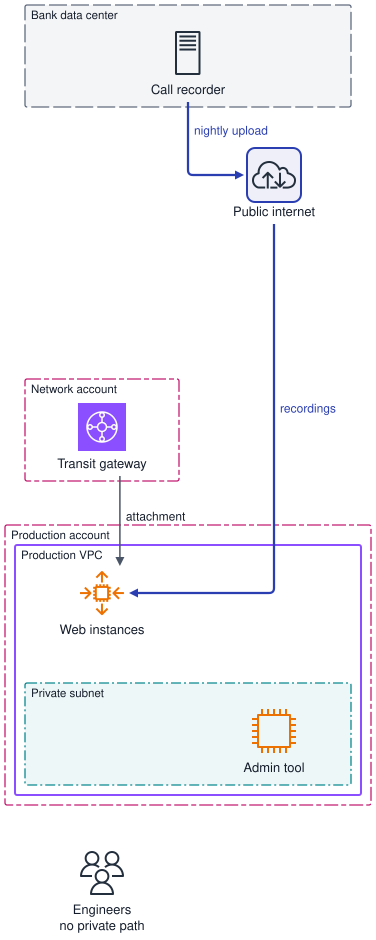
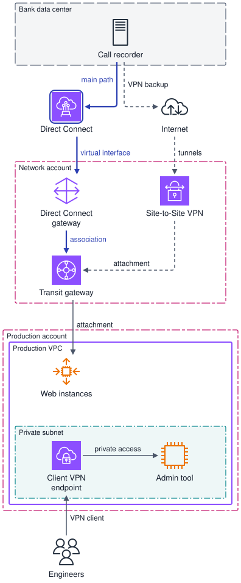

# Site-to-Site VPN, Direct Connect and Client VPN in depth

## How it works (28 min)
<!-- section: role=how; route=full; minutes=28 -->

Follow traffic into a virtual private cloud (VPC): from a data center over the internet, then privately, then from one laptop. DNS over these links: [chapter 13](../13-route53/2-deep.md#resolver-endpoints-carry-dns-queries-between-a-vpc-and-an-on-premises-network-4-min).

### A Site-to-Site VPN joins your network to AWS through two IPsec tunnels (4 min)
<!-- section: route=pass -->

A data center needs an encrypted link to a VPC this month.

1. **Describe your side.** A **customer gateway** is [an AWS resource which provides information to AWS](../facts/site-to-site-vpn.md#site-to-site-vpn-concept-customer-gateway-is-aws-resource) about your router, the **customer gateway device**. Creating it does [not configure or create the customer gateway device](../facts/site-to-site-vpn.md#site-to-site-vpn-cgw-resource-does-not-configure-device).
2. **Pick the AWS side.** The **target gateway** is a **virtual private gateway** or a **transit gateway** (chapter 11). <!-- xref: 11 transit gateway -->
3. **Build two tunnels.** A **Site-to-Site VPN connection** has two **IPsec** (EYE-pee-sek) tunnels, [each terminating in a different Availability Zone](../facts/site-to-site-vpn.md#site-to-site-vpn-two-tunnels-different-availability-zones).
4. **Bring them up.** By default, the [customer gateway device must bring up the tunnels](../facts/site-to-site-vpn.md#site-to-site-vpn-cgw-initiates-ike-by-default). A **pre-shared key** is [the default authentication option](../facts/site-to-site-vpn.md#site-to-site-vpn-psk-default-authentication).

> **Exam signal:** "an encrypted connection over the internet this week" points to Site-to-Site VPN: [Internet Protocol security (IPsec) VPN connections](../facts/site-to-site-vpn.md#site-to-site-vpn-definition-ipsec-vpc-to-on-premises).

> **Exam trap:** Many think that one tunnel is enough. AWS says to [configure both tunnels for redundancy](../facts/site-to-site-vpn.md#site-to-site-vpn-two-tunnels-unique-public-ip-configure-both): in a replacement, [connectivity over the tunnel might be interrupted](../facts/site-to-site-vpn.md#site-to-site-vpn-endpoint-replacement-interrupts-tunnel). <!-- trap: hybrid-networking-trap-one-tunnel-is-enough -->

> **Try it:** Attach a second gateway to one VPC in [3-do.md](3-do.md). <!-- task: hybrid-networking-t02 -->

> **Say it:** The short answer is: two IPsec tunnels over the internet. The thing to watch is configuring both tunnels.

**Stop and answer.** A second partner needs a VPN to a VPC that already has a virtual private gateway. Do you add a gateway?

Answer

No. You attach [one virtual private gateway to a VPC](../facts/site-to-site-vpn.md#site-to-site-vpn-vgw-attaches-to-single-vpc) at a time: add a second VPN connection to it.

### BGP moves traffic between tunnels and prefers Direct Connect routes over VPN routes (4 min)

A VPC gets a VPN, then Direct Connect, to one data center. Which path carries traffic?

1. **Choose the routing type.** With **static routing**, you [select static routing and enter the routes](../facts/site-to-site-vpn.md#site-to-site-vpn-static-routes-device-without-bgp-enter-prefixes). With **dynamic routing**, the **Border Gateway Protocol** (BGP) advertises routes and detects a dead tunnel: [use BGP-capable devices, when available](../facts/site-to-site-vpn.md#site-to-site-vpn-bgp-recommended-liveness-failover).
2. **Reach the subnets.** On a virtual private gateway, [enable route propagation for your route table](../facts/site-to-site-vpn.md#site-to-site-vpn-vpc-route-table-route-to-vgw-and-propagation): VPN routes then enter the **route table** on their own.
3. **Pick a path.** The VPC uses [the most specific route in your route table](../facts/site-to-site-vpn.md#site-to-site-vpn-longest-prefix-match-most-specific-route). For equal prefixes, the virtual private gateway uses this order:

<!-- table: plain -->
| Order | Equal prefixes on a virtual private gateway |
|---|---|
| 1 | [BGP propagated routes from an Direct Connect connection](../facts/site-to-site-vpn.md#site-to-site-vpn-route-priority-dx-bgp-before-vpn-static-before-vpn-bgp) |
| 2 | [Manually added static routes](../facts/site-to-site-vpn.md#site-to-site-vpn-route-priority-dx-bgp-before-vpn-static-before-vpn-bgp) of a VPN |
| 3 | [BGP propagated routes from a Site-to-Site VPN connection](../facts/site-to-site-vpn.md#site-to-site-vpn-route-priority-dx-bgp-before-vpn-static-before-vpn-bgp) |

> **Exam signal:** "use the VPN only if Direct Connect fails" points to the same routes on both paths: the Direct Connect path [will always be preferred, when established](../facts/direct-connect.md#direct-connect-vpn-same-vpc-failover-only-dx-path-preferred).

> **Exam trap:** Many think that **AS path prepending**, which makes a route look longer, moves traffic to the VPN. Direct Connect wins [regardless of AS path prepending](../facts/direct-connect.md#direct-connect-vpn-same-vpc-failover-only-dx-path-preferred). <!-- trap: hybrid-networking-trap-vpn-backup-shares-load -->

> **Say it:** The short answer is: Direct Connect routes win. The thing to watch is that a static VPN route beats a BGP VPN route.

**Stop and answer.** In a subnet route table, a **static route** you added and a propagated route both name 172.16.0.0/16. Which wins?

Answer

The static route, for [the same destination CIDR block](../facts/site-to-site-vpn.md#site-to-site-vpn-static-route-beats-propagated-same-cidr). The table above is another level: the virtual private gateway's own choice.

### Each VPN tunnel has a bandwidth limit and a transit gateway combines tunnels (4 min)

Nightly transfers need several gigabits per second, without Direct Connect.

1. **One tunnel.** A standard tunnel supports [up to 1.25 Gbps](../facts/site-to-site-vpn.md#site-to-site-vpn-limit-bandwidth-standard-tunnel).
2. **One virtual private gateway.** **Equal-cost multi-path routing** (ECMP) uses several paths together, but here [ECMP is not supported for Site-to-Site VPN connections](../facts/site-to-site-vpn.md#site-to-site-vpn-ecmp-not-on-vgw-supported-on-tgw).
3. **Many tunnels.** On a transit gateway, ECMP spreads traffic over connections that [must be configured for dynamic routing](../facts/site-to-site-vpn.md#site-to-site-vpn-ecmp-needs-dynamic-routing-not-static).
4. **Bigger tunnels.** A large bandwidth tunnel supports [up to 5 Gbps](../facts/site-to-site-vpn.md#site-to-site-vpn-limit-bandwidth-large-tunnel) on connections to [a transit gateway or to Cloud WAN](../facts/site-to-site-vpn.md#site-to-site-vpn-restriction-lbt-gateways).

Why a transit gateway? It adds paths: two VPN connections, four large tunnels and ECMP reach [20 Gbps](../facts/site-to-site-vpn.md#site-to-site-vpn-limit-ecmp-20-gbps-example).

> **Exam signal:** "consistent VPN performance from a distant office" points to an **accelerated Site-to-Site VPN** on a transit gateway, which [uses AWS Global Accelerator to route traffic](../facts/site-to-site-vpn.md#site-to-site-vpn-accelerated-uses-global-accelerator-nearest-edge).

> **Exam trap:** Many think that more VPN connections on one virtual private gateway add bandwidth. Toward the data center, they share [up to 1.25 Gbps](../facts/site-to-site-vpn.md#site-to-site-vpn-faq-vgw-aggregate-throughput). Use a transit gateway with ECMP. <!-- trap: hybrid-networking-trap-more-vpns-on-a-vgw-add-bandwidth -->

Go deeper: acceleration

With large bandwidth tunnels, [Accelerated VPN is not supported](../facts/site-to-site-vpn.md#site-to-site-vpn-restriction-lbt-no-accelerated).

> **Say it:** The short answer is: a transit gateway adds tunnels. The thing to watch is static routing: ECMP needs BGP.

**Stop and answer.** Four static-route VPN connections on a transit gateway use one tunnel. Why?

Answer

[ECMP is not supported using static routing](../facts/site-to-site-vpn.md#site-to-site-vpn-tgw-vpn-ecmp-requires-dynamic-routing-whitepaper). Use BGP.

### A Direct Connect connection is a port and its virtual interfaces choose the destination (4 min)
<!-- section: route=pass -->

A bank wants to reach Amazon S3 and VPCs in two Regions without the internet.

1. **Order a port.** A **dedicated connection** runs at [1 Gbps, 10 Gbps, 100 Gbps, and 400 Gbps](../facts/direct-connect.md#direct-connect-limit-dedicated-port-speeds). A **hosted connection** comes from a **Direct Connect Partner** and [can often be provisioned faster than Dedicated Connections](../facts/direct-connect.md#direct-connect-vs-vpn-time-hosted-faster-than-dedicated).
2. **Reach the location.** The port is in a **Direct Connect location**. You reach it through [local service providers used at your on-premises locations](../facts/direct-connect.md#direct-connect-aws-is-not-first-or-last-mile-provider).
3. **Add virtual interfaces.** Each **virtual interface** is public, private or transit.
4. **Reach many Regions.** A **Direct Connect gateway** is [a globally available resource](../facts/direct-connect.md#direct-connect-dxgw-global-resource-any-region-not-china).

<!-- table: plain -->
| Interface | Reaches | Attaches to |
|---|---|---|
| Public | [All AWS public services](../facts/direct-connect.md#direct-connect-vif-public-access-aws-public-services) | The AWS public network |
| Private | [Access an Amazon VPC](../facts/direct-connect.md#direct-connect-vif-private-access-vpc-private-ips) | A virtual private gateway or a Direct Connect gateway |
| Transit | [One or more Amazon VPC Transit Gateways](../facts/direct-connect.md#direct-connect-vif-transit-access-transit-gateways-any-speed) | Only [attached to an AWS Direct Connect gateway](../facts/direct-connect.md#direct-connect-transit-vif-attaches-only-to-dxgw) |

Why so slow? A new port takes [from several weeks to a few months](../facts/direct-connect.md#direct-connect-vs-vpn-time-dedicated-weeks-to-months), [depending on the service provider](../facts/direct-connect.md#direct-connect-vs-vpn-time-dedicated-weeks-to-months) and your site.

> **Exam signal:** "a private connection that does not use the internet" points to Direct Connect: [AWS Direct Connect bypasses the internet](../facts/direct-connect.md#direct-connect-faq-bypasses-internet-dedicated-private).

> **Say it:** The short answer is: Direct Connect is a private port, and virtual interfaces choose the destination. The thing to watch is delivery time.

**Stop and answer.** A private virtual interface on a virtual private gateway in us-east-1 must reach a VPC in eu-west-1. What do you add?

Answer

A Direct Connect gateway, with a new private virtual interface and both virtual private gateways associated. Without it, the interface [reaches a VPC in the associated Region only](../facts/direct-connect.md#direct-connect-private-vif-without-dxgw-reaches-associated-region-only).

### Direct Connect traffic is private but not encrypted unless you add encryption (4 min)
<!-- section: route=pass -->

An auditor asks whether recordings are encrypted on Direct Connect.

1. **Private path.** Traffic [remains on the AWS global network backbone](../facts/direct-connect.md#direct-connect-traffic-stays-on-aws-global-network-backbone).
2. **Not encrypted.** Direct Connect [does not encrypt your traffic](../facts/direct-connect.md#direct-connect-not-encrypted-by-default-use-service-encryption) in transit by default.
3. **Add IPsec.** [Establish a VPN over Direct Connect](../facts/direct-connect.md#direct-connect-encrypt-private-connection-vpn-over-dx-or-macsec): over a public virtual interface, or as a private IP VPN [over Direct Connect transit VIFs](../facts/site-to-site-vpn.md#site-to-site-vpn-private-ip-vpn-transit-vif-instead-of-public-vif).
4. **Or add MACsec.** **MACsec** (MAK-sek) works on [10 Gbps, 100 Gbps, and 400 Gbps dedicated AWS Direct Connect connections](../facts/direct-connect.md#direct-connect-macsec-supported-dedicated-10-100-400-gbps) [at selected points of presence](../facts/direct-connect.md#direct-connect-macsec-supported-dedicated-10-100-400-gbps).

<!-- table: plain -->
| Question | IPsec VPN | MACsec |
|---|---|---|
| Encrypts | [End-to-end IPsec-encrypted connections](../facts/direct-connect.md#direct-connect-plus-vpn-tgw-ipsec-encrypted-over-dedicated-connection) | [Corporate data center to the Direct Connect location](../facts/direct-connect.md#direct-connect-macsec-encrypts-to-direct-connect-location) |
| Runs on | A transit virtual interface, on a [dedicated or hosted connection of any speed](../facts/direct-connect.md#direct-connect-vif-transit-access-transit-gateways-any-speed) | Dedicated connections: [not supported on 1 Gbps dedicated connections](../facts/direct-connect.md#direct-connect-macsec-not-on-1gbps-or-hosted) or [any hosted connections](../facts/direct-connect.md#direct-connect-macsec-not-on-1gbps-or-hosted) |

> **Exam signal:** "IPsec over Direct Connect without public IP addresses" points to a private IP VPN: [you need a Transit gateway](../facts/site-to-site-vpn.md#site-to-site-vpn-private-ip-vpn-needs-transit-gateway-and-dx-attachment).

> **Say it:** The short answer is: Direct Connect is private, not encrypted. The thing to watch is where each option encrypts.

**Stop and answer.** MACsec negotiation fails in the default mode. Does traffic stop?

Answer

No. [New MACsec-enabled connections are set to "should_encrypt" mode](../facts/direct-connect.md#direct-connect-macsec-new-connections-default-should-encrypt), which can [fall back to unencrypted communication](../facts/direct-connect.md#direct-connect-macsec-new-connections-default-should-encrypt). The `must_encrypt` mode stops that traffic.

### Direct Connect resilience comes from a second location and not from more links (4 min)
<!-- section: route=pass -->

Production depends on one connection. Which service level agreement (SLA) is possible?

1. **One connection fails.** With [a non-resilient network setup or a single connection](../facts/direct-connect.md#direct-connect-maintenance-types-planned-and-emergency), maintenance interrupts traffic.
2. **Add a location.** [Two single connections to multiple locations](../facts/direct-connect.md#direct-connect-resiliency-high-two-connections-multiple-locations) can reach [an SLA of 99.9%](../facts/direct-connect.md#direct-connect-resiliency-high-sla-99-9) when you meet the SLA requirements.
3. **Add devices.** [Separate devices in more than one location](../facts/direct-connect.md#direct-connect-resiliency-maximum-separate-devices-more-than-one-location) can reach [an SLA of 99.99%](../facts/direct-connect.md#direct-connect-resiliency-maximum-sla-99-99) on the same terms.

Why not a VPN backup? On a virtual private gateway, one tunnel carries [up to 1.25 Gbps throughput per VPN tunnel](../facts/direct-connect.md#direct-connect-backup-vpn-bandwidth-limit-not-above-1-gbps). A transit gateway with ECMP allows a [throughput of up to 50Gbps](../facts/direct-connect.md#direct-connect-backup-vpn-on-tgw-ecmp-up-to-50-gbps).

> **Exam signal:** "the MOST resilient connectivity" points to [separate devices in more than one location](../facts/direct-connect.md#direct-connect-resiliency-maximum-separate-devices-more-than-one-location).

> **Exam trap:** Many think that a **link aggregation group** at one location is resilient. It bundles connections so you [treat them as a single, managed connection](../facts/direct-connect.md#direct-connect-lag-definition-lacp-single-managed-connection), but it [will not protect against a single device failure](../facts/direct-connect.md#direct-connect-lag-not-more-resilient-against-device-failure). <!-- trap: hybrid-networking-trap-lag-is-resilient -->

> **Say it:** The short answer is: resilience comes from a second location. The thing to watch is links that share one location.

**Stop and answer.** A 10 Gbps Direct Connect connection needs a backup. Is a VPN a good choice?

Answer

No. AWS says [we do not recommend customers use AWS Site to Site VPN as a backup for AWS Direct Connect connections with speeds greater than 1 Gbps](../facts/direct-connect.md#direct-connect-backup-vpn-bandwidth-limit-not-above-1-gbps). Add a second Direct Connect connection in another location.

### Client VPN connects people to a VPC through an endpoint in a subnet (4 min)

Engineers at home need a private admin tool.

1. **Create the endpoint.** The **Client VPN endpoint** gives users addresses from the **client CIDR range**. The block is [at least /22](../facts/client-vpn.md#client-vpn-client-cidr-between-slash-22-and-slash-12), the smallest, and [must not be greater than /12](../facts/client-vpn.md#client-vpn-client-cidr-between-slash-22-and-slash-12).
2. **Associate subnets.** AWS says to [associate at least two subnets](../facts/client-vpn.md#client-vpn-high-availability-multiple-subnets-different-azs).
3. **Authenticate.** Users sign in with [authentication with Active Directory using AWS Directory Services](../facts/client-vpn.md#client-vpn-authentication-methods-ad-certificate-saml), [certificate-based authentication](../facts/client-vpn.md#client-vpn-authentication-methods-ad-certificate-saml) (**mutual authentication**), or [federated authentication using SAML-2.0](../facts/client-vpn.md#client-vpn-authentication-methods-ad-certificate-saml).
4. **Authorize.** An **authorization rule** opens a network; [the default behavior is to deny access](../facts/client-vpn.md#client-vpn-authorization-rules-default-deny-no-restrict-rules).

Why does internet traffic reach AWS? By default, [all traffic from clients is routed](../facts/client-vpn.md#client-vpn-split-tunnel-default-off-all-traffic-through-tunnel) through the tunnel. **Split tunnel** changes it, [reducing the data transfer cost](../facts/client-vpn.md#client-vpn-split-tunnel-benefit-lower-data-transfer-cost).

> **Exam signal:** "sign in with the company's SAML identity provider" points to federated authentication, where users [must use the AWS provided client to connect](../facts/client-vpn.md#client-vpn-saml-requires-aws-provided-client).

**Spot the bug.** Users reach the VPC but not a peered VPC, 10.40.0.0/16, although the endpoint route table has a route to it. What is wrong?

Answer

No authorization rule. Besides the route, you [add authorization rule enabling access](../facts/client-vpn.md#client-vpn-other-networks-need-route-and-authorization-rule).

> **Say it:** The short answer is: Client VPN connects people, not networks. The thing to watch is the authorization rule.

**Stop and answer.** A team picks the client CIDR range 10.20.0.0/22 in a VPC with 10.20.0.0/16. Will it work?

Answer

No: it cannot [overlap with the local CIDR of the VPC](../facts/client-vpn.md#client-vpn-client-cidr-no-overlap-with-vpc-or-routes), and [the client CIDR range cannot be changed](../facts/client-vpn.md#client-vpn-client-cidr-cannot-change-after-creation). Create a new endpoint.

## Numbers that decide answers (2 min)
<!-- section: role=numbers; route=full; minutes=2 -->

### A-list

<!-- table: numbers -->
| Number | What it is | Why it decides an answer |
|---|---|---|
| [up to 1.25 Gbps](../facts/site-to-site-vpn.md#site-to-site-vpn-limit-bandwidth-standard-tunnel) | One standard VPN tunnel | More needs ECMP or Direct Connect |
| [up to 5 Gbps](../facts/site-to-site-vpn.md#site-to-site-vpn-limit-bandwidth-large-tunnel) | One large bandwidth tunnel | Older questions do not know it |
| [1 Gbps, 10 Gbps, 100 Gbps, and 400 Gbps](../facts/direct-connect.md#direct-connect-limit-dedicated-port-speeds) | Dedicated connection speeds | Smaller speeds: a hosted connection (B-list) |
| [an SLA of 99.99%](../facts/direct-connect.md#direct-connect-resiliency-maximum-sla-99-99) | Maximum resiliency | Separate devices, two or more locations |
| [up to 20 VPCs](../facts/direct-connect.md#direct-connect-faq-dxgw-share-private-vif-up-to-20-vpcs) | One private virtual interface, through a gateway | More: a transit virtual interface |

### B-list

<!-- table: numbers -->
| Number | What it is |
|---|---|
| [50 Mbps](../facts/direct-connect.md#direct-connect-limit-hosted-port-speeds) | Smallest hosted connection speed |
| [100 each for IPv4 and IPv6](../facts/direct-connect.md#direct-connect-quota-routes-per-bgp-session-private-transit) | Default routes per BGP session from on-premises, private or transit |

> **Changed recently:** (2026-08-20) Inbound prefix controls. 
> **Old:** the default was also the maximum. 
> **Now:** you can allocate [up to 1,000 prefixes each for IPv4 and IPv6](../facts/direct-connect.md#direct-connect-change-prefix-controls); the default stays [100 each for IPv4 and IPv6](../facts/direct-connect.md#direct-connect-quota-routes-per-bgp-session-private-transit). 
> **The exam probably expects:** the default of 100. 
> **Status:** not examinable yet.

## Decision record (2 min)
<!-- section: role=example; route=full; minutes=2 -->

**Context.** The bank starts in 3 weeks.

**Figure.** The bank's data center sends recordings over the public internet, and engineers have no private path to the admin tool.

**Requirement.** Encrypted in 3 weeks; private, with consistent throughput, in 6 months.

**Options.**

- VPN only.
- Wait for Direct Connect.
- **VPN now, Direct Connect later, VPN as backup.**

**Decision.** A VPN to the transit gateway in 5 days. Direct Connect after 10 weeks, with a private IP VPN over it for encryption; the internet VPN route stays, [which is the backup route](../facts/site-to-site-vpn.md#site-to-site-vpn-tgw-prefers-dx-gateway-route-over-vpn). Engineers use Client VPN.

**Figure.** Direct Connect is the main path and Site-to-Site VPN the backup, both to the transit gateway, and engineers use Client VPN.

**Trade-off.** Two connections to run and a fixed monthly port cost.

## FAQ quick-fire (3 min)
<!-- section: role=faq; route=full; minutes=3 -->

**FAQ 1.** Can two VPCs on one Direct Connect gateway reach each other through it?

Answer

No.

> "No, AWS Direct Connect gateway's only support routing traffic from AWS Direct Connect VIFs to VGW (associated with VPC)."
> — [AWS Direct Connect FAQs](https://aws.amazon.com/directconnect/faqs/)

**FAQ 2.** Can a virtual private gateway use Accelerated Site-to-Site VPN?

Answer

No.

> "Only Transit Gateway supports Accelerated Site-to-Site VPN."
> — [AWS VPN FAQs](https://aws.amazon.com/vpn/faqs/)

**FAQ 3.** Can an instance in the VPC start a connection to a Client VPN user?

Answer

No.

> "No, a resource cannot initiate any traffic or connection towards a user's device using Client VPN."
> — [AWS VPN FAQs](https://aws.amazon.com/vpn/faqs/)

**FAQ 4.** Can Client VPN send only AWS traffic through the tunnel?

Answer

Yes, with split tunnel.

> "If split tunnel is enabled, traffic destined for routes configured on the endpoint will be routed via the VPN tunnel."
> — [AWS VPN FAQs](https://aws.amazon.com/vpn/faqs/)

**FAQ 5.** Can a Site-to-Site VPN back up Direct Connect to a Local Zone?

Answer

No.

> "Unlike connectivity to a Region, you cannot use an AWS Site-to-Site VPN as a backup to your AWS Direct Connect connection to an AWS Local Zone."
> — [AWS Direct Connect FAQs](https://aws.amazon.com/directconnect/faqs/)

## In the real world (1 min)
<!-- section: role=realworld; route=full; minutes=1 -->

**Discover Financial Services, 2022.** Discover [migrates transactions into Amazon S3](../facts/direct-connect.md#direct-connect-case-discover-transactions-into-s3) over Direct Connect.

> "Using AWS Direct Connect, a cloud service that links user networks directly to AWS, Discover migrates transactions into Amazon S3 for pricing and settlement."
> — [Discover case study](https://aws.amazon.com/solutions/case-studies/discover-case-study/)

**It shows:** steady business data on a private connection.
