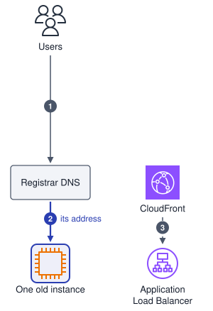

# Amazon Route 53 in depth

## How it works (54 min)
<!-- section: role=how; route=full; minutes=54 -->

Follow one Domain Name System (DNS) query to Route 53, then add routing, health and private names.

### A resolver follows the delegation to the name servers of your hosted zone (4 min)

A browser needs the IP address of www.example.com, and no single server knows every name.

1. **Ask the resolver.** The browser asks a DNS resolver, [also known as a recursive name server](../facts/route53.md#route53-dns-resolver-is-recursive-name-server).
2. **Follow the delegation.** The top-level domain (TLD) name server for .com returns the [names of the four Route 53 name servers](../facts/route53.md#route53-tld-returns-four-name-servers).
3. **Ask the hosted zone.** A Route 53 name server reads the hosted zone and [returns the IP address to the DNS resolver](../facts/route53.md#route53-name-server-returns-value-from-hosted-zone).
4. **Cache.** The resolver keeps the answer. It also keeps the name server list, typically [cached for two days](../facts/route53.md#route53-resolver-caches-ns-two-days).

Why a chain of delegation? Each level names the name servers of the next, so each zone owner controls its own records.

> **Exam signal:** "DNS answers that do not depend on one Region" points to Route 53: its [data planes are globally distributed](../facts/route53.md#route53-control-plane-us-east-1).

> **Say it:** The short answer is: the TLD sends the resolver to Route 53. The thing to watch is the registrar's name server list.

**Stop and answer.** A company fills a new Route 53 hosted zone, but the registrar still lists the old name servers. Who answers?

Answer

The old provider: Route 53 [will not be authoritative for queries](../facts/route53.md#route53-faq-registrar-must-use-hosted-zone-name-servers) yet. [Update the name servers for your domain](../facts/route53.md#route53-faq-external-registrar-must-update-name-servers) at the registrar. A transfer is optional: [you can transfer the domain registration to Route 53](../facts/route53.md#route53-domain-transfer-not-required-for-other-features) later. <!-- trap: route53-trap-transfer-domain-to-use-dns -->

### The record type decides what kind of value a name returns (4 min)

One domain needs a web server address and a mail server name.

1. **Type.** The [record type usually determines the type of resource](../facts/route53.md#route53-record-type-determines-resource-type) behind a name.
2. **Addresses.** An A record routes traffic [using an IPv4 address](../facts/route53.md#route53-a-record-ipv4); an AAAA record, [using an IPv6 address](../facts/route53.md#route53-aaaa-record-ipv6).
3. **Names.** A CNAME record maps a name [to another domain](../facts/route53.md#route53-cname-record-maps-name-to-name).
4. **Policy and TTL.** Each record has a **routing policy** and a time to live (TTL): how long resolvers can cache it. A non-alias record [must have a TTL](../facts/route53.md#route53-ttl-required-on-all-records). For an alias record to an AWS resource, [Route 53 uses the default TTL for the resource](../facts/route53.md#route53-alias-to-aws-resource-ttl-not-settable).

Why types? A resolver asks for one name and one type, so each client gets the value that it needs.

> **Exam signal:** "an EC2 instance whose address must not change" points to an A record with an **Elastic IP address**, which [will never change](../facts/route53.md#route53-ec2-elastic-ip-recommended).

> **Say it:** The short answer is: the type decides what comes back. The thing to watch is the address behind an A record.

**Stop and answer.** A team releases the Elastic IP address of a retired server but keeps its A record. What is the risk?

Answer

A [dangling DNS record that can be taken over](../facts/route53.md#route53-released-elastic-ip-delete-dns-record-dangling).

### An alias record can answer at the zone apex where a CNAME record cannot (4 min)
<!-- section: route=pass -->

example.com, with no www, has to open a site behind a load balancer.

1. **Name the apex.** example.com is the zone apex, [the top node of a DNS namespace](../facts/route53.md#route53-alias-allowed-at-zone-apex).
2. **Try a CNAME record.** The [DNS protocol does not allow you to create](../facts/route53.md#route53-cname-dns-protocol-forbids-zone-apex) a CNAME record there.
3. **Use an alias record.** An **alias record** (AY-lee-us) is an [Amazon Route 53-specific extension to DNS](../facts/route53.md#route53-faq-alias-is-route53-extension), and [you can create an alias record](../facts/route53.md#route53-alias-allowed-at-zone-apex) at the apex. Its type is still A or AAAA: for CloudFront with IPv6, [create two records](../facts/route53.md#route53-alias-cloudfront-ipv6-two-records).

Why an alias record? A CNAME record makes the resolver ask again, which [increases latency and costs](../facts/route53.md#route53-best-practice-alias-cheaper-faster-than-cname).

> **Exam signal:** "the zone apex to a load balancer or CloudFront" points to [an alias record both for the root domain](../facts/route53.md#route53-cname-only-for-subdomains) and for subdomains.

> **Try it:** Try a CNAME record at a lab zone apex, then an alias record. See [3-do.md](3-do.md). <!-- task: route53-t02 -->

> **Say it:** The short answer is: at the bare domain, use an alias record. The thing to watch is a target outside AWS.

**Stop and answer.** blog.example.com has to open blog.hostingco.net, outside AWS. Which record fits?

Answer

A CNAME record. An alias record [can only redirect queries to selected AWS resources](../facts/route53.md#route53-alias-targets-only-selected-aws-resources).

### An alias record follows the changing addresses of the AWS resource it names (4 min)

A record that copies today's IP addresses of an Application Load Balancer (ALB) breaks later.

1. **The resource changes.** Elastic Load Balancing scales the [load balancer and updates the DNS entry](../facts/route53.md#route53-elb-dns-entry-updated-ttl-60).
2. **The record names the resource.** The alias record holds [an Elastic Load Balancing load balancer](../facts/route53.md#route53-alias-target-elb-answer), not its addresses.
3. **Route 53 follows.** [Route 53 detects changes in the resource on its own](../facts/route53.md#route53-alias-follows-resource-ip-changes).

<!-- table: plain -->
| Target | What must be true |
|---|---|
| S3 website | [The bucket must have the same name](../facts/route53.md#route53-s3-website-bucket-name-must-match) as the record, such as www.example.com |
> **Exam signal:** "an S3 static website over HTTPS" points to CloudFront in front: [use the S3 bucket as the origin for the distribution](../facts/route53.md#route53-s3-website-endpoint-no-https).

> **Exam trap:** Many think that an A record with the load balancer's IP addresses works as well. The copy goes stale: the DNS entry has a [time-to-live (TTL) of 60 seconds](../facts/route53.md#route53-elb-dns-entry-updated-ttl-60) because addresses move. <!-- trap: route53-trap-a-record-to-lb-ip -->

> **Say it:** The short answer is: an alias record names the load balancer, and Route 53 follows it. The thing to watch is any copied address.

**Stop and answer.** An alias record now points to a CloudFront distribution, and requests fail at CloudFront. What is missing?

Answer

The distribution [must include an alternate domain name](../facts/route53.md#route53-cloudfront-needs-matching-alternate-domain-name) that matches the record name.

### Resolvers cache each answer for its TTL before they ask Route 53 again (4 min)
<!-- section: route=pass -->

A team changes an address at noon, and some users still reach the old server in the afternoon.

1. **Change.** [Changes generally propagate to all Route 53 servers](../facts/route53.md#route53-changes-propagate-within-60-seconds) [within 60 seconds](../facts/route53.md#route53-changes-propagate-within-60-seconds).
2. **Cached answers stay.** Caching resolvers keep records [according to their time to live (TTL)](../facts/route53.md#route53-faq-resolver-caches-by-ttl-outside-control), outside the control of Route 53.
3. **Plan.** Before critical changes, [temporarily shorten the TTLs](../facts/route53.md#route53-best-practice-shorten-ttl-before-critical-change).

<!-- table: plain -->
| TTL | Effect |
|---|---|
| Long | [A longer TTL reduces your Route 53 charges](../facts/route53.md#route53-ttl-longer-cheaper-shorter-faster-change) |
| Short | [A shorter TTL reduces the time](../facts/route53.md#route53-ttl-longer-cheaper-shorter-faster-change) that old values stay |
| With a **health check** | AWS recommends [60 seconds or less](../facts/route53.md#route53-ttl-health-check-60-seconds-or-less) |

Why cache? The resolver can [respond more quickly the next time](../facts/route53.md#route53-resolver-caches-answer-for-ttl-you-set).

> **Startup example:** Before the move to Route 53, Ben lowers the TTL of Callvale's NS record at the registrar, so the switch reaches users soon.

> **Exam signal:** "users still reach the old server after a DNS change" points to the TTL of the old record.

Go deeper: moving a live domain

Set the NS record TTL to [a value between 60 seconds and 900 seconds](../facts/route53.md#route53-migrate-lower-ns-ttl-60-to-900-wait-two-days) and wait [two days after you lowered the TTL](../facts/route53.md#route53-migrate-lower-ns-ttl-60-to-900-wait-two-days).

> **Say it:** The short answer is: a change reaches users when their resolver cache expires. The thing to watch is the old TTL.

**Stop and answer.** A resolver cached a record with a TTL of 86400 seconds at 09:00. At 10:00 the team lowers the TTL and changes the address. When does the resolver see it?

Answer

At 09:00 the next day, a full old TTL after it cached the record. Resolvers cache records [according to their time to live (TTL)](../facts/route53.md#route53-faq-resolver-caches-by-ttl-outside-control), so a later change of the TTL does not shorten a cached copy.

### Weighted records give each resource its share of the total weight (4 min)

A team wants a small share of users to reach a new version first.

1. **Create a group.** You create [records with the same name and type](../facts/route53.md#route53-weighted-routing-share-of-total-weight), each with a weight [between 0 and 255](../facts/route53.md#route53-weighted-weight-range-0-255).
2. **Add up.** Route 53 answers in the [ratio of a resource's weight to the total](../facts/route53.md#route53-weighted-ratio-of-weight-to-total).
3. **Answer.** With weights 3 and 1, the first record comes back [75% of the time](../facts/route53.md#route53-faq-wrr-weight-3-and-1-gives-75-25).
4. **Stop one.** To stop traffic to a resource, [change the weight for that record to 0](../facts/route53.md#route53-weighted-routing-weight-zero-stops-traffic).

<!-- table: plain -->
| Policy | What Route 53 returns |
|---|---|
| Simple | All values of one record, [to the recursive resolver in random order](../facts/route53.md#route53-simple-routing-multiple-values-random-order-no-health-check) |
| Multivalue answer | [Up to eight healthy records](../facts/route53.md#route53-multivalue-up-to-eight-healthy) |

Why weights? You set the share, which helps with [testing new versions of software](../facts/route53.md#route53-choose-weighted-routing-proportions).

> **Exam signal:** "[A/B testing](../facts/route53.md#route53-faq-wrr-weights-set-frequency)" points to weighted records.

> **Exam trap:** Many think that multivalue answer records replace a load balancer. Route 53 [returns only values for healthy resources](../facts/route53.md#route53-multivalue-purpose-not-lb-substitute), and AWS says that this is not a substitute for a load balancer. <!-- trap: route53-trap-multivalue-is-load-balancer -->

> **Say it:** The short answer is: weights set each resource's share. The thing to watch is a zero weight, which can still get users.

**Stop and answer.** Records A and B have weights 4 and 0, both with health checks. A becomes unhealthy. Does B get users?

Answer

Yes: Route 53 [considers the zero-weighted records](../facts/route53.md#route53-weighted-zero-weight-used-when-all-unhealthy).

### Latency records follow measured latency and geolocation records follow user location (5 min)
<!-- section: route=pass -->

An application runs in two Regions. Most users want speed, but users of one market have to stay in one Region. <!-- no-fact: requirement -->

1. **Locate the user.** Route 53 uses [a shortened version of the user's IP address](../facts/route53.md#route53-edns0-with-support-uses-user-subnet) if the resolver sends one, otherwise [the source IP address of the DNS resolver](../facts/route53.md#route53-edns0-without-support-uses-resolver-ip).
2. **Latency records.** Route 53 finds which [Region gives the user the lowest latency](../facts/route53.md#route53-latency-routing-lowest-latency-region).
3. **Geolocation records.** Route 53 matches [by continent, by country, or by state](../facts/route53.md#route53-geolocation-location-levels) in the United States; [priority goes to the smallest geographic region](../facts/route53.md#route53-geolocation-smallest-region-wins).
4. **No match.** Without a default record, Route 53 [returns a "no answer" response](../facts/route53.md#route53-geolocation-no-default-no-answer).

**Figure.** The requirement in the stem decides the routing policy of the records.

Why not location for speed? Geolocation uses the [geographic location of the requests](../facts/route53.md#route53-faq-geo-vs-latency-geography-not-latency), not latency.

> **Exam signal:** "the lowest latency" points to latency records; "distribution rights" points to geolocation, for [only the locations where you have distribution rights](../facts/route53.md#route53-geolocation-use-cases).

> **Exam trap:** Many think that records for all continents answer every user, or that an unlisted place gets the nearest record. [Geolocation works by mapping IP addresses to locations](../facts/route53.md#route53-geolocation-maps-ip-addresses-some-unmapped), and some addresses map to none. A default record [handles both queries from unmapped IP addresses](../facts/route53.md#route53-geolocation-default-record-handles-unmapped) and unlisted places. <!-- trap: route53-trap-geolocation-no-default --> <!-- trap: route53-trap-all-continents-cover-everyone -->

Go deeper: mixed policies and geoproximity bias

To combine policies for one name, such as latency and weighted, use alias records to [build a decision tree](../facts/route53.md#route53-complex-config-latency-alias-weighted-tree). <!-- trap: route53-trap-mix-routing-policies-same-name -->

A geoproximity bias [from 1 to 99](../facts/route53.md#route53-geoproximity-bias-positive-range) expands the area of a resource; [-1 to -99](../facts/route53.md#route53-geoproximity-bias-negative-range) shrinks it.

> **Say it:** The short answer is: latency records follow speed, and geolocation records follow place. The thing to watch is the default record.

**Stop and answer.** A Lisbon user with latency records reached one Region last week and the other this week. Is something broken?

Answer

No. Latency changes, and Route 53 uses [latency data taken over a period of time](../facts/route53.md#route53-latency-changes-over-time).

### Health checkers around the world decide whether an endpoint is healthy (4 min)

One web server stops answering. One failed request is not enough evidence.

1. **Send requests.** Route 53 sends [automated requests over the internet](../facts/route53.md#route53-hc-endpoint-automated-requests-over-internet), by default every [30 seconds](../facts/route53.md#route53-hc-request-interval-default-30).
2. **Judge one response.** An HTTP check [waits for an HTTP status code of 2xx or 3xx](../facts/route53.md#route53-hc-http-https-status-2xx-3xx).
3. **Count failures.** The default failure threshold is [three health checks](../facts/route53.md#route53-hc-failure-threshold-default-3) in a row.
4. **Combine the checkers.** The endpoint is healthy if [more than 18%](../facts/route53.md#route53-hc-healthy-above-18-percent) of the checkers say so.

<!-- table: plain -->
| Kind | Watches |
|---|---|
| Endpoint | An IP address or a domain name |
| Calculated | [Health of one or more other health checks](../facts/route53.md#route53-health-check-can-monitor-other-health-checks-two-of-five) |
| CloudWatch alarm | The data stream of the alarm |

Why a low bar? The [18% value was chosen](../facts/route53.md#route53-hc-18-percent-why-chosen) so that trouble near a few checkers does not fail a working endpoint.

> **Exam signal:** "notify the team" points to an alarm: [CloudWatch uses Amazon SNS to notify users](../facts/route53.md#route53-health-check-notification-uses-cloudwatch-and-sns).

> **Exam trap:** Many think that a health check can test a private IP address. The [health checkers are outside the VPC](../facts/route53.md#route53-hc-checkers-outside-vpc-need-public-ip). For a private address, create a [CloudWatch metric, associate an alarm with the metric](../facts/route53.md#route53-hc-private-endpoint-cloudwatch-alarm-health-check), and create a health check [based on the data stream for the alarm](../facts/route53.md#route53-hc-private-endpoint-cloudwatch-alarm-health-check). <!-- trap: route53-trap-health-check-private-ip -->

**Spot the bug.** A failover health check uses www.example.com, the name of the failover records. What is wrong?

Answer

Use each server's name, or [health check results will be unpredictable](../facts/route53.md#route53-hc-domain-name-not-record-name).

> **Say it:** The short answer is: checkers in many places test the endpoint and vote. The thing to watch is a firewall that blocks the checkers.

**Stop and answer.** One fifth of the checkers report an endpoint healthy. Is it healthy?

Answer

Yes: [more than 18%](../facts/route53.md#route53-hc-healthy-above-18-percent) is enough.

### Route 53 leaves unhealthy records out of answers until every record is unhealthy (4 min)

One of three weighted servers fails. Route 53 should skip it but still answer.

1. **Choose among records.** A health check is [useful only when Route 53 is choosing between two or more records](../facts/route53.md#route53-health-check-useful-only-when-choosing-between-records).
2. **Skip the unhealthy.** [Route 53 routes traffic away from the associated record](../facts/route53.md#route53-dns-failover-routes-traffic-away-from-unhealthy-record).
3. **No check.** A record without a health check: Route 53 [always considers it healthy](../facts/route53.md#route53-record-without-health-check-always-healthy).
4. **Last resort.** If no record is healthy, Route 53 [considers all the records in the group](../facts/route53.md#route53-no-record-healthy-all-records-considered-healthy) healthy.

<!-- table: plain -->
| Records | Unhealthy | Route 53 answers with |
|---|---|---|
| A, B, C, all checked | A | B or C |
| A, B checked, C not | A and B | C |
| A, B, C, all checked | All | Any, by the routing policy |

> **Exam signal:** "skip a load balancer whose targets all fail" points to **Evaluate Target Health**, a Yes or No setting of an alias record: the record takes its health from [the resource that the alias record refers to](../facts/route53.md#route53-evaluate-target-health-other-policies-checks-resource).

> **Exam trap:** Many think that a record without a health check drops out of answers. Route 53 [always includes it among possible responses](../facts/route53.md#route53-record-without-health-check-always-healthy), even when its server is down. <!-- trap: route53-trap-record-without-health-check-skipped -->

> **Say it:** The short answer is: Route 53 skips unhealthy records but still answers. The thing to watch is a record with no health check.

**Stop and answer.** Two weighted alias records point to two ALBs, with Evaluate Target Health set to Yes. All targets of one ALB fail. Where do users go?

Answer

To the other ALB: Route 53 can [route traffic away from unhealthy resources](../facts/route53.md#route53-evaluate-target-health-benefit-for-elb-beanstalk).

### Failover records answer with the secondary only while the primary is unhealthy (5 min)
<!-- section: route=pass -->

A static S3 copy of the site should take over when the application fails, not before.

1. **Two records.** You create [one primary and one secondary failover record](../facts/route53.md#route53-failover-needs-one-primary-one-secondary).
2. **Watch the primary.** For a load balancer, set the [“Evaluate Target Health” parameter to true](../facts/route53.md#route53-faq-elb-failover-alias-evaluate-target-health).
3. **Fail over.** When the primary is unhealthy, Route 53 [responds to DNS queries using the secondary record](../facts/route53.md#route53-failover-one-primary-one-secondary-responds-secondary-when-unhealthy).
4. **Fail back.** Recovery needs [no action required on your part](../facts/route53.md#route53-faq-failback-automatic-after-threshold).

<!-- table: plain -->
| Primary | Secondary | Route 53 answers with |
|---|---|---|
| Healthy | Any state | Primary |
| Unhealthy | Healthy, or no health check ([adding a health check is optional](../facts/route53.md#route53-failover-secondary-health-check-optional)) | Secondary |
| Unhealthy | Unhealthy, checked | [Route 53 returns the primary record](../facts/route53.md#route53-failover-both-unhealthy-returns-primary) |

Why a policy? The secondary is a [group of resources to be on standby](../facts/route53.md#route53-active-passive-failover-definition), out of the answers until the primary fails. So the primary needs a health signal (see the Exam trap). <!-- trap: route53-trap-secondary-health-check-triggers-failover -->

> **Exam signal:** "a static maintenance page" points to failover records: you can [maintain a backup site](../facts/route53.md#route53-faq-failover-backup-site-s3).

> **Exam trap:** Many think that an alias record to a load balancer needs a health check, or that Evaluate Target Health fits any record. For an alias record to an AWS resource, [set Evaluate Target Health to Yes](../facts/route53.md#route53-alias-to-aws-use-evaluate-target-health-not-health-check) instead. An EC2 instance cannot be the target of an alias record, so it needs a [record and a health check for each resource](../facts/route53.md#route53-simple-config-alias-targets-no-health-check-needed). <!-- trap: route53-trap-separate-health-check-for-alias --> <!-- trap: route53-trap-evaluate-target-health-any-record -->

> **Try it:** Fail both health checks, then only the primary, and read the answer each time. See [3-do.md](3-do.md). <!-- task: route53-t03 -->

> **Say it:** The short answer is: failover records send users to the standby when the main site fails. The thing to watch is the primary's health check.

**Stop and answer.** The primary failover record is an alias record for three weighted records, each with a health check, and Evaluate Target Health is set to Yes. Two servers fail. Does Route 53 switch?

Answer

No. The primary is healthy with [at least one of the associated resources](../facts/route53.md#route53-failover-multiple-primary-healthy-if-one-healthy) healthy.

### A private hosted zone answers only through the VPC Resolver of its associated VPCs (4 min)

A company wants names such as db.corp.internal in its virtual private clouds (VPCs) only. <!-- no-fact: requirement -->

1. **Associate.** A private hosted zone answers DNS queries [within one or more VPCs](../facts/route53.md#route53-private-hosted-zone-defined).
2. **Turn on DNS.** The VPC [must set both the enableDnsHostnames and enableDnsSupport attributes to true](../facts/vpc.md#vpc-dns-attributes-required-for-private-hosted-zones).
3. **Query.** An instance asks Route 53 VPC Resolver, which [is available by default in all VPCs](../facts/route53.md#route53-vpc-resolver-recursive-by-default-in-all-vpcs).
4. **Match.** With no matching private zone, it [forwards the request to a public DNS resolver](../facts/route53.md#route53-no-matching-phz-goes-public).

<!-- table: plain -->
| The instance asks for | Private zones | Answer |
|---|---|---|
| db.corp.internal | corp.internal has it | The private record |
| www.example.com | None matches | The public answer |
| api.example.com | example.com, without api | NXDOMAIN, from VPC Resolver |

Why private? Route 53 will [only return these records when queried from within](../facts/route53.md#route53-faq-private-zone-answers-only-from-associated-vpcs) the associated VPCs. Users on the internet need a public hosted zone. <!-- trap: route53-trap-private-zone-answers-internet -->

In a private zone, [you cannot use IP-based routing policy](../facts/route53.md#route53-ip-based-routing-not-in-private-hosted-zone) for records.

> **Exam signal:** "internal addresses inside the VPC, public ones outside" points to split-view DNS: public and [private hosted zones that have the same name](../facts/route53.md#route53-split-view-dns-definition).

> **Exam trap:** Many think that VPC Resolver asks public DNS when a matching private zone lacks the record. A [parent of the domain name in the request](../facts/route53.md#route53-phz-parent-zone-counts-as-match) also matches, so with a private zone example.com that has no api record, api.example.com gets NXDOMAIN. <!-- trap: route53-trap-private-zone-falls-back-to-public -->

Go deeper: other accounts

A zone can serve [VPCs belonging to different accounts](../facts/route53.md#route53-faq-phz-cross-account-vpcs), but [you first must authorize the association](../facts/route53.md#route53-cross-account-association-needs-authorization-no-console).

> **Say it:** The short answer is: a private zone answers inside its associated VPCs. The thing to watch is a matching zone without the record.

**Stop and answer.** A data center server asks the private zone's name servers over the internet. Does it get the record?

Answer

No, not if you [directly query the name servers over the internet](../facts/route53.md#route53-phz-reserved-ns-not-reachable-from-internet). Forward it to an inbound Resolver endpoint instead.

### Resolver endpoints carry DNS queries between a VPC and an on-premises network (4 min)

In a **hybrid** network, data center servers need private zone names, and VPC instances need data center names.

1. **Connect.** Inbound endpoints use private addresses, so you need a [Direct Connect connection or a VPN connection](../facts/route53.md#route53-resolver-inbound-ips-not-public-need-private-link).
2. **Inbound.** Queries come in [from your on-premises network or another VPC](../facts/route53.md#route53-resolver-inbound-endpoint-definition).
3. **Outbound.** Queries go out [from your VPC to your on-premises network](../facts/route53.md#route53-resolver-outbound-endpoint-definition) when a forwarding rule matches.
4. **Most specific wins.** VPC Resolver [chooses the rule with the most specific match](../facts/route53.md#route53-resolver-rule-most-specific-match-wins).

**Figure.** Inbound endpoints bring data center queries to VPC Resolver; outbound endpoints carry VPC queries to the data center when a forwarding rule matches.

1. The data center DNS servers forward queries for the private zone's domain to the inbound endpoint.
2. VPC Resolver answers them from the private hosted zone.
3. An instance asks VPC Resolver for a name that the data center hosts.
4. A forwarding rule matches the name, and the outbound endpoint sends the query to the data center DNS servers.

Why endpoints? They forward [without having to deploy additional DNS servers](../facts/route53.md#route53-hybrid-resolver-endpoints-no-extra-dns-servers).

> **Exam signal:** "on-premises servers resolve private zone names" points to an inbound endpoint.

> **Exam trap:** Many think that one endpoint carries queries both ways. Each endpoint has one direction. Forwarding data center queries to the VPC CIDR+2 address [is not supported, and can cause unstable results](../facts/route53.md#route53-resolver-cidr-plus-two-forwarding-unsupported). <!-- trap: route53-trap-inbound-outbound-direction --> <!-- trap: route53-trap-forward-to-vpc-plus-two -->

> **Say it:** The short answer is: inbound brings data center questions in, and outbound sends VPC questions out. The thing to watch is the forwarding rule.

**Stop and answer.** A VPC has a private zone and a forwarding rule, both for corp.example. Where do its queries go?

Answer

To the data center: [the VPC Resolver rule takes precedence](../facts/route53.md#route53-resolver-rule-beats-phz-same-name).

### DNS answers and health check failover keep working when the control plane is impaired (4 min)

A recovery plan says: if us-east-1 fails, edit the DNS records to point to us-west-2.

1. **Two planes.** The control plane changes records; the data plane answers queries and runs health checks. The [control plane is located in the us-east-1 AWS Region](../facts/route53.md#route53-control-plane-us-east-1); the [data planes are globally distributed](../facts/route53.md#route53-control-plane-us-east-1).
2. **Impairment.** Edits can fail, but DNS answers and health checks [will continue to work](../facts/route53.md#route53-fi-impairment-dns-and-health-checks-keep-working).
3. **Prepare.** Create failover records and health checks in advance, and fail over on the [status of health checks to perform failovers](../facts/route53.md#route53-fi-no-control-plane-in-recovery-path).

<!-- table: plain -->
| Action | Works in the impairment |
|---|---|
| Failover records switch | Yes: a [highly reliable operation done on the data plane](../facts/route53.md#route53-dr-health-check-failover-data-plane) |
| Change weights | Maybe not: [this is a control plane operation](../facts/route53.md#route53-dr-weight-change-is-control-plane) |

Why? The data plane is [optimized for availability](../facts/route53.md#route53-control-vs-data-plane-design).

> **Exam signal:** "fail over even if the Route 53 API is unavailable" points to [use only data plane operations](../facts/route53.md#route53-dr-failover-use-data-plane-only).

> **Exam trap:** Many think that a runbook can create records during the outage. Statically stable means recovery needs no new change, and record edits need the control plane: [a non-statically-stable design](../facts/route53.md#route53-fi-record-edits-depend-on-control-plane). <!-- trap: route53-trap-control-plane-failover -->

> **Say it:** The short answer is: build failover records and health checks before the outage. The thing to watch is any step that edits records.

**Stop and answer.** Failover to us-west-2 worked during the impairment. Can the team count on adding records now?

Answer

No. Adding records is a control plane call, which can fail during the impairment; DNS answers and health checks [will continue to work](../facts/route53.md#route53-fi-impairment-dns-and-health-checks-keep-working).

## Numbers that decide answers (3 min)
<!-- section: role=numbers; route=full; minutes=3 -->

### A-list

<!-- table: numbers -->
| Number | What it is | Why it decides an answer |
|---|---|---|
| [a unique set of four name servers](../facts/route53.md#route53-default-unique-delegation-set-per-zone) | Default name servers of a new zone | The registrar lists them |
| [60 seconds or less](../facts/route53.md#route53-ttl-health-check-60-seconds-or-less) | TTL with a health check | A long TTL delays failover |
| [30 seconds](../facts/route53.md#route53-hc-request-interval-default-30) | Default health check interval | For the optional [fast interval of 10 seconds](../facts/route53.md#route53-faq-health-check-fast-interval-10-seconds), an [additional charge applies](../facts/route53.md#route53-hc-fast-interval-extra-charge) |
| [three health checks](../facts/route53.md#route53-hc-failure-threshold-default-3) | Default failure threshold | How fast failure is found |
| [more than 18%](../facts/route53.md#route53-hc-healthy-above-18-percent) | Share of checkers that report healthy | A few checkers do not decide |
| [up to eight healthy records](../facts/route53.md#route53-multivalue-up-to-eight-healthy) | Multivalue answer, per query | Several addresses, no load balancer |
| [between 0 and 255](../facts/route53.md#route53-weighted-weight-range-0-255) | Weight of a record | Route 53 [considers the zero-weighted records](../facts/route53.md#route53-weighted-zero-weight-used-when-all-unhealthy) only when all others are unhealthy |
| [within 60 seconds](../facts/route53.md#route53-changes-propagate-within-60-seconds) | Change reaches Route 53 servers | Resolvers still cache |

### B-list

<!-- table: numbers -->
| Number | What it is |
|---|---|
| [500 per AWS account](../facts/route53.md#route53-quota-hosted-zones-per-account) | Hosted zones, initial quota |
| [10,000 records](../facts/route53.md#route53-quota-records-per-hosted-zone) | Records per hosted zone, initial quota |
| [200 active health checks](../facts/route53.md#route53-quota-health-checks-per-account) | Health checks per account |
| [300 Amazon VPCs](../facts/route53.md#route53-quota-vpcs-per-private-zone) | VPCs for one private zone |
| [between 1 and 10 consecutive checks](../facts/route53.md#route53-hc-failure-threshold-range-1-10) | Failure threshold range |
| [minimum of two IP addresses](../facts/route53.md#route53-resolver-endpoint-minimum-two-ips-inbound) | Per inbound endpoint |
| [10,000 UDP DNS queries per second](../facts/route53.md#route53-quota-resolver-endpoint-ip-udp-qps) | Per endpoint IP address |

## Decision record (3 min)
<!-- section: role=example; route=full; minutes=3 -->

**Context.** Before launch, callvale.example points to one old instance.

**Figure.** The registrar's DNS answers callvale.example with the address of one old instance, so users do not reach CloudFront or the load balancer.

1. Users ask for callvale.example.
2. The registrar's DNS answers with the address of one old instance.
3. CloudFront and the load balancer are ready, but no name points to them.

**Requirement.** Point both names to AWS resources by name, with the LEAST operational overhead.

**Options.**

- Registrar DNS with CNAME records.
- An Elastic IP address on one instance.
- **A Route 53 hosted zone with alias records.**

**Decision.** Alias records. At the apex the [DNS protocol does not allow you to create](../facts/route53.md#route53-cname-dns-protocol-forbids-zone-apex) a CNAME record.

**Figure.** The registrar points the domain to the Route 53 hosted zone, whose alias records send both names to CloudFront.

1. The registrar lists the name servers of the Route 53 hosted zone.
2. Alias records for callvale.example and app.callvale.example answer with CloudFront addresses.
3. CloudFront sends requests to the Application Load Balancer.
4. A health check watches the site, and its alarm notifies the team through Amazon SNS.

**Trade-off.** Resolvers cache answers, so changes need planning, and Route 53 is one more service.

## FAQ quick-fire (5 min)
<!-- section: role=faq; route=full; minutes=5 -->

**FAQ 1.** Does Route 53 host websites?

Answer

No.

> "Amazon Route 53 is an authoritative DNS service and does not provide website hosting."
> — [Amazon Route 53 FAQs](https://aws.amazon.com/route53/faqs/)

**FAQ 2.** Can you create more than one hosted zone for the same domain name?

Answer

Yes.

> "Creating multiple hosted zones allows you to verify your DNS setting in a “test” environment, and then replicate those settings on a “production” hosted zone."
> — [Amazon Route 53 FAQs](https://aws.amazon.com/route53/faqs/)

**FAQ 3.** Does Route 53 support wildcard records?

Answer

Yes, except for NS records.

> "To make it even easier for you to configure DNS settings for your domain, Amazon Route 53 supports wildcard entries for all record types, except NS records."
> — [Amazon Route 53 FAQs](https://aws.amazon.com/route53/faqs/)

**FAQ 4.** What TTL does a record get if you set none?

Answer

There is no default TTL: you set it on each non-alias record.

> "Amazon Route 53 does not have a default TTL for any record type."
> — [Amazon Route 53 FAQs](https://aws.amazon.com/route53/faqs/)

**FAQ 5.** Are changes to records transactional?

Answer

Yes, on each DNS server.

> "Amazon Route 53 has been designed so that changes complete entirely on any individual DNS server, or not at all."
> — [Amazon Route 53 FAQs](https://aws.amazon.com/route53/faqs/)

**FAQ 6.** Do Route 53 health checks follow HTTP redirects?

Answer

No.

> "Route 53 health checks consider an HTTP 3xx code to be a successful response, so they don’t follow the redirect."
> — [Amazon Route 53 FAQs](https://aws.amazon.com/route53/faqs/)

**FAQ 7.** Can DNS failover use an endpoint outside AWS?

Answer

Yes.

> "Just like you can create a Route 53 resource record that points to an address outside AWS, you can set up health checks for parts of your application running outside AWS, and you can fail over to any endpoint that you choose, regardless of location."
> — [Amazon Route 53 FAQs](https://aws.amazon.com/route53/faqs/)

**FAQ 8.** After a failover, does Route 53 look at the load of the endpoints that remain?

Answer

No.

> "No, Route 53 does not make routing decisions based on the load or available traffic capacity of your endpoints."
> — [Amazon Route 53 FAQs](https://aws.amazon.com/route53/faqs/)

**FAQ 9.** Do resources need internet access to resolve names in a private hosted zone?

Answer

No.

> "You can resolve internal DNS names from resources within your VPC that do not have Internet connectivity."
> — [Amazon Route 53 FAQs](https://aws.amazon.com/route53/faqs/)

**FAQ 10.** VPC Resolver is Regional. Is all of Route 53 Regional now?

Answer

No.

> "Amazon Route 53 public and private DNS, traffic flow, health checks, and domain name registration are all global services."
> — [Amazon Route 53 FAQs](https://aws.amazon.com/route53/faqs/)

