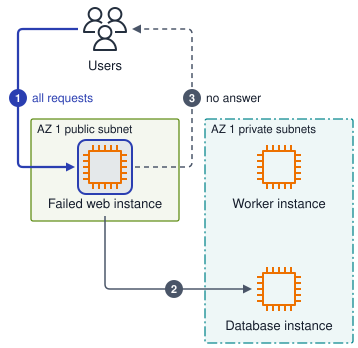
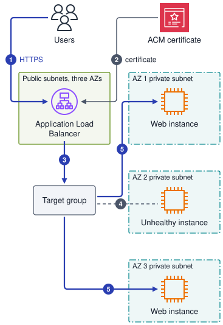

# Elastic Load Balancing in depth

## How it works (56 min)
<!-- section: role=how; route=full; minutes=56 -->

Follow one request: a node in a zone, security groups, listener rules, Transport Layer Security (TLS), a healthy target. Then the other two types and the bill.

### A load balancer gives each enabled Availability Zone its own node (4 min)

One web instance in one Availability Zone (AZ) is a **single point of failure**. A **load balancer** spreads requests over targets in several zones, for example an Application Load Balancer (ALB).

1. **Enable zones.** The ALB needs [at least two Availability Zone subnets](../facts/elb.md#elb-alb-subnets-two-azs-different), and Elastic Load Balancing [creates a load balancer node](../facts/elb.md#elb-node-per-enabled-az) in each zone.
2. **Resolve the name.** The client asks the Domain Name System (DNS), which returns the [IP addresses of the load balancer nodes](../facts/elb.md#elb-dns-returns-node-ips).
3. **Scale.** The record has a [time-to-live (TTL) of 60 seconds](../facts/elb.md#elb-dns-ttl-60-seconds-remap), so the [IP addresses can be remapped quickly](../facts/elb.md#elb-dns-ttl-60-seconds-remap) as the load balancer scales.
4. **Forward.** The node [selects a healthy registered target](../facts/elb.md#elb-node-sends-to-target-private-ip) from a **target group** and sends the request [using its private IP address](../facts/elb.md#elb-node-sends-to-target-private-ip). A healthy target passes its **health check** (HELTH chek).

<!-- table: plain -->
| Design | An instance fails | A zone fails |
|---|---|---|
| One instance, Elastic IP address | Down until moved by hand | Down |
| Targets in one zone | Served | Down |
| Targets in two or more zones | Served | Served |

Why a node in every zone? Losing one zone then removes one entry point, not all. AWS asks you to [avoid single points of failure, including the underlying physical infrastructure](../facts/vpc.md#vpc-wa-rel10-bp01-avoid-single-points-of-failure).

> **Exam signal:** "remove the single point of failure of the web tier" points to a load balancer [in front of your compute resources](../facts/elb.md#elb-wa-rel10-load-balancers-in-front-of-compute), with targets in two or more zones.

> **Exam trap:** Many think that any load balancer removes the single point of failure. With all targets in one zone, AWS still warns: [your production workload exists only in a single Availability Zone](../facts/vpc.md#vpc-wa-rel10-bp01-avoid-single-points-of-failure). <!-- trap: elb-trap-one-az-enough -->

Go deeper: subnets

Each ALB subnet needs [at least eight free IP addresses](../facts/elb.md#elb-alb-subnet-min-27-eight-free-ips). With cross-zone load balancing turned off for a target group, [avoid creating empty subnets](../facts/elb.md#elb-alb-empty-subnet-503): DNS still gives out their zonal addresses, which [triggers 503 errors for HTTP requests](../facts/elb.md#elb-alb-empty-subnet-503).

> **Say it:** The short answer is: each enabled zone gets its own node. The thing to watch is a zone that is not enabled.

**Stop and answer.** Instances run in AZ 1, AZ 2 and AZ 3, but the ALB enables only AZ 1 and AZ 2. Do the AZ 3 instances get requests?

Answer

No. In a zone that is not enabled, [these registered targets do not receive traffic](../facts/elb.md#elb-targets-in-disabled-az-no-traffic).

### Targets can stay private and accept traffic only from the load balancer (5 min)

The web instances serve internet users, and every request has to pass the load balancer's rules first.

1. **Choose the scheme.** An **internet-facing load balancer** has nodes that [have public IP addresses](../facts/elb.md#elb-internet-facing-nodes-public-ips). An **internal load balancer** has nodes that [have only private IP addresses](../facts/elb.md#elb-internal-nodes-private-ips-only).
2. **Reach the target privately.** Both reach targets [using private IP addresses](../facts/elb.md#elb-targets-need-no-public-ip), so the targets [do not need public IP addresses](../facts/elb.md#elb-targets-need-no-public-ip).
3. **Filter at the load balancer.** Its security group rules [allow traffic in both directions](../facts/elb.md#elb-alb-sg-listener-and-health-check-ports) on [both the listener and the health check ports](../facts/elb.md#elb-alb-sg-listener-and-health-check-ports).
4. **Filter at the target.** The targets' security group names [the load balancer's security group as the source](../facts/elb.md#elb-target-sg-reference-lb-sg), so they [receive traffic exclusively from the load balancer](../facts/elb.md#elb-target-sg-reference-lb-sg).

Why name a group instead of addresses? Node [IP addresses can be remapped quickly](../facts/elb.md#elb-dns-ttl-60-seconds-remap), but a rule that names the group keeps working.

> **Exam signal:** "a web tier and a private application tier" points to [both internal and internet-facing load balancers](../facts/elb.md#elb-multi-tier-internet-facing-plus-internal), one for each tier.

> **Exam trap:** Many think that targets of an internet-facing load balancer need public IP addresses. The node sends requests [using its private IP address](../facts/elb.md#elb-node-sends-to-target-private-ip). <!-- trap: elb-trap-targets-need-public-ip -->

> **Say it:** The short answer is: private targets whose security group names the load balancer's security group. The thing to watch is the health check port.

**Stop and answer.** A developer changes the targets' security group. It no longer names the ALB's security group; it allows port 80 from the whole VPC. Do requests through the ALB still work?

Answer

Yes. The load balancer reaches its targets [using private IP addresses](../facts/elb.md#elb-targets-need-no-public-ip) inside the VPC, so the VPC rule allows them. But every resource in the VPC can now reach the targets directly.

### Each load balancer type reads a different layer of the traffic (5 min)
<!-- section: route=pass -->

Exam questions use three load balancer types.

1. **Layer 7: the request.** An ALB [functions at the application layer](../facts/elb.md#elb-alb-layer-7), so it can route on [host-header](../facts/elb.md#elb-alb-condition-types) or [path-pattern](../facts/elb.md#elb-alb-condition-types).
2. **Layer 4: the connection.** A Network Load Balancer (NLB) handles [millions of requests per second](../facts/elb.md#elb-nlb-millions-of-requests-per-second) and picks a target [using a flow hash algorithm](../facts/elb.md#elb-nlb-flow-hash-target-selection), which keeps one connection on one target.
3. **Layer 3: the packet.** A Gateway Load Balancer (GWLB) [listens for all IP packets across all ports](../facts/elb.md#elb-gwlb-layer-3-all-ports).

<!-- table: plain -->
| Feature | ALB | NLB | GWLB |
|---|---|---|---|
| [Security Groups](../facts/elb.md#elb-compare-security-groups-not-gwlb) | Yes | Yes | No |
| [IP address - Static, Elastic](../facts/elb.md#elb-compare-static-elastic-ip-nlb-only) | No | Yes | No |
| Can AWS WAF protect it? | Yes: [Amazon CloudFront, Amazon API Gateway, Application Load Balancer](../facts/waf.md#waf-protected-resource-types) | No | No |

**Figure.** The kind of traffic and the feature it needs decide the type of load balancer.

> **Exam signal:** "static IP addresses" or "extreme performance" points to an NLB, for when [extreme performance and static IP is needed](../facts/elb.md#elb-choose-nlb-for-layer4-extreme-performance-static-ip).

> **Exam trap:** Many think that an NLB is a faster ALB that also routes by path. It reads [Layer 4](../facts/elb.md#elb-compare-layer-per-type); path rules exist on the ALB. <!-- trap: elb-trap-nlb-routes-by-path -->

> **Say it:** The short answer is: the traffic decides the type. The thing to watch is that a Network Load Balancer does not read URLs.

**Stop and answer.** A multiplayer game uses UDP. A teammate proposes an ALB for its features. Which type fits?

Answer

An NLB. ALB listeners take [HTTP, HTTPS](../facts/elb.md#elb-alb-listener-protocols-http-https); NLB listeners take [TCP, TLS, UDP](../facts/elb.md#elb-nlb-listener-protocols) and a few more.

### Listener rules are checked in priority order and the default rule comes last (5 min)
<!-- section: route=pass -->

A company runs five services under two domain names. A load balancer for each service multiplies the hourly charges.

1. **Listen.** The listener is [configured with a protocol and port number](../facts/elb.md#elb-listener-checks-connection-requests).
2. **Check rules in order.** Each **listener rule** has a priority. Rules run [from the lowest value to the highest value](../facts/elb.md#elb-alb-rules-lowest-priority-first), and [the default rule is evaluated last](../facts/elb.md#elb-alb-rules-lowest-priority-first).
3. **Match.** A rule matches, for example, on [host-header](../facts/elb.md#elb-alb-condition-types), [path-pattern](../facts/elb.md#elb-alb-condition-types), [query-string](../facts/elb.md#elb-alb-condition-types), [source-ip](../facts/elb.md#elb-alb-condition-types) or an HTTP header.
4. **Act.** The routing action forwards, returns a fixed response, or redirects, for example from [HTTP to HTTPS](../facts/elb.md#elb-alb-redirect-http-to-https). An HTTPS listener rule can add [a user authentication action and a routing action](../facts/elb.md#elb-alb-action-types-list). Users then sign in through an [OpenID Connect (OIDC) compliant](../facts/elb.md#elb-alb-user-authentication-idps) provider or Amazon Cognito.

> **Try it:** Route one path with a listener rule, add a catch-all rule with a lower priority number, and predict which rule wins. See [3-do.md](3-do.md). <!-- task: elb-t02 -->

Why share one load balancer? Each one is billed for [each hour or partial hour](../facts/elb.md#elb-partial-hour-billed-as-full-hour), so five services on one ALB pay one hourly charge.

> **Exam signal:** "route /api to one service and /images to another" points to ALB rules that [forward requests based on the URL](../facts/elb.md#elb-alb-path-conditions-smaller-services).

> **Exam trap:** Many think that each domain name needs its own load balancer. One ALB can [route requests to multiple domains](../facts/elb.md#elb-alb-host-conditions-many-domains-one-lb). <!-- trap: elb-trap-one-lb-per-service -->

> **Say it:** The short answer is: host and path rules let one load balancer serve many services. The thing to watch is rule priority.

**Stop and answer.** A listener has only its default rule. Can the team add a path condition for /admin to that rule?

Answer

No. The default rule [is always performed last](../facts/elb.md#elb-alb-default-rule-last-no-conditions) and has no conditions. Add a new rule.

### An HTTPS listener decrypts requests at the load balancer with its certificate (5 min)
<!-- section: route=pass -->

Browsers use HTTPS on several domain names, and renewing a certificate on every instance is slow work.

1. **Terminate.** An HTTPS listener uses a certificate from AWS Certificate Manager (ACM) or another source to [terminate the front-end connection](../facts/elb.md#elb-alb-https-listener-terminates-and-decrypts). This is **TLS termination**.
2. **Negotiate.** A **security policy** is [a combination of protocols and ciphers](../facts/elb.md#elb-alb-security-policy-protocols-ciphers), and [an HTTPS listener requires a security policy](../facts/elb.md#elb-alb-https-default-security-policy).
3. **Pick by name.** The client sends the host name with **Server Name Indication** (SNI), so the listener can [provide a different certificate for each domain](../facts/elb.md#elb-alb-sni-certificate-list-multiple-domains).

Why end TLS at the load balancer? Elastic Load Balancing [performs the work of encrypting and decrypting](../facts/elb.md#elb-offload-encryption-to-lb), so the instances do not.

> **Exam signal:** "offload TLS and renew certificates automatically" points to an ACM certificate, which [can be renewed automatically](../facts/elb.md#elb-alb-acm-certs-renew-automatically).

> **Exam trap:** Many think that each domain needs its own HTTPS listener. With more than one certificate, [SNI is automatically enabled](../facts/elb.md#elb-faq-sni-automatic-multiple-certificates). <!-- trap: elb-trap-one-certificate-per-listener -->

**Spot the bug.** An ALB runs in US West (Oregon). Its ACM certificate was requested in US East (N. Virginia), as for CloudFront, and the listener cannot use it. What is wrong?

Answer

ACM certificates [must be in the same Region](../facts/acm.md#acm-faq-certificate-same-region-as-resource) as the resource. [The only exception is Amazon CloudFront](../facts/acm.md#acm-faq-certificate-same-region-as-resource).

> **Say it:** The short answer is: the load balancer does the TLS work. The thing to watch is that it sees the decrypted request.

**Stop and answer.** One HTTPS listener serves shop.example.com. The team adds news.example.org. Does it need a new listener?

Answer

No. Add the certificate to the list. The default quota is [25](../facts/acm.md#acm-alb-certificates-per-load-balancer) extra certificates per ALB, and you can ask to raise it.

### Encryption to the targets needs a second TLS connection or a pass-through (5 min)

An auditor asks for **encryption in transit** all the way to the instances, but the HTTPS listener ends TLS at the load balancer.

1. **Re-encrypt.** With an HTTPS target group, the ALB opens a second TLS connection, but [only encryption is supported to the back-ends](../facts/elb.md#elb-alb-faq-no-backend-server-authentication), the targets.
2. **Pass through.** [A Network Load Balancer with a TCP listener on port 443](../facts/elb.md#elb-alb-https-decrypt-at-target-use-nlb-tcp) [passes encrypted traffic through to the targets](../facts/elb.md#elb-alb-https-decrypt-at-target-use-nlb-tcp).
3. **Terminate on the NLB.** A TLS listener ends TLS on the NLB. With instance targets, the [source IP continues to be preserved](../facts/elb.md#elb-nlb-faq-source-ip-preserved-with-tls); for IP targets with TLS, [the default is disabled](../facts/elb.md#elb-nlb-client-ip-preservation-defaults).

**Figure.** Where TLS ends decides whether the load balancer sees the request and whether the last hop is encrypted.

Why decrypt in the middle? Path rules read the plain request, so an ALB has to [terminate the front-end connection](../facts/elb.md#elb-alb-https-listener-terminates-and-decrypts) first.

> **Exam signal:** "the load balancer must not decrypt the traffic" points to an NLB that [passes encrypted traffic through to the targets](../facts/elb.md#elb-alb-https-decrypt-at-target-use-nlb-tcp).

> **Say it:** The short answer is: re-encrypt to the targets, or pass TLS through. The thing to watch is that the ALB skips target certificate checks.

**Stop and answer.** HTTPS targets behind an ALB use self-signed certificates. Does the ALB refuse to connect?

Answer

No. [The load balancer does not validate these certificates](../facts/elb.md#elb-alb-target-https-no-cert-validation).

### Sticky sessions send a user back to one target and bypass the algorithm (4 min)

Sessions live in the memory of one instance. When a request lands on another instance, the user is signed out.

1. **First request.** The algorithm picks the target: [round robin](../facts/elb.md#elb-alb-routing-algorithms-three), [least outstanding requests](../facts/elb.md#elb-alb-routing-algorithms-three) or [weighted random](../facts/elb.md#elb-alb-routing-algorithms-three).
2. **Set the cookie.** A **sticky session** is [enabled at the target group level](../facts/elb.md#elb-alb-sticky-duration-vs-application-cookie), and the ALB sets a [load balancer generated cookie](../facts/elb.md#elb-alb-duration-cookie-awsalb).
3. **Later requests.** The client returns to the same target, [bypassing the selected routing algorithm](../facts/elb.md#elb-alb-sticky-bypasses-algorithm).
4. **Expire.** The cookie lasts [1 day](../facts/elb.md#elb-alb-lb-cookie-duration-default-1-day) by default, at most [7 days](../facts/elb.md#elb-alb-lb-cookie-duration-default-1-day).

> **Startup example:** Callvale keeps sessions in each web instance's memory, so the team turns on stickiness for the launch. The ElastiCache chapter later moves them to a cache.

Why not stop at stickiness? It can cause an [uneven distribution of connections and flows](../facts/elb.md#elb-sticky-uneven-load-nat), and AWS calls a [centralized session management data store](../facts/elb.md#elb-session-store-centralized-not-on-servers) the ideal answer. The instances then become **stateless** (STAYT-less).

> **Exam signal:** "the server keeps session state, and the code cannot change" points to sticky sessions, for [servers that maintain state information](../facts/elb.md#elb-alb-sticky-for-stateful-servers).

> **Exam trap:** Many think that sticky sessions keep sessions when an instance is removed. Stickiness can [bind a user's session to a specific target](../facts/elb.md#elb-alb-sticky-sessions-what), but scale-in still ends the sessions on that instance. <!-- trap: elb-trap-sticky-sessions-keep-state -->

> **Say it:** The short answer is: a cookie sends each user back to the same instance. The thing to watch is the session on that instance.

**Stop and answer.** A target group uses weighted random routing. The team now needs sticky sessions. Can it keep the algorithm?

Answer

No. Weighted random [can not be used with sticky sessions](../facts/elb.md#elb-alb-weighted-random-no-sticky-slow-start).

### Health checks decide which registered targets receive requests (5 min)
<!-- section: route=pass -->

An instance can run, but its web server hangs. The load balancer has to notice.

1. **Register.** The load balancer starts by [performing the initial health checks on the target](../facts/elb.md#elb-alb-target-state-initial).
2. **Fail.** By default, after [2 consecutive failed health checks](../facts/elb.md#elb-alb-unhealthy-threshold-default-2), the load balancer acts: [it stops routing traffic to that target](../facts/elb.md#elb-unhealthy-target-stop-resume) until the target passes again.
3. **Leave.** A deregistered target [enters the draining state](../facts/elb.md#elb-deregister-stops-routing-draining) [until in-flight requests have completed](../facts/elb.md#elb-deregister-stops-routing-draining), up to the **deregistration delay**, [300 seconds](../facts/elb.md#elb-deregistration-delay-default-300-seconds) by default.

**Figure.** A new target starts in the initial state, and a deregistered target drains before it becomes unused.

> **Try it:** Read the default health check of a new target group, try to make one failed check enough, then shorten the interval. See [3-do.md](3-do.md). <!-- task: elb-t03 -->

Why no replacement? The load balancer routes. [Amazon EC2 Auto Scaling replaces the unhealthy instance](../facts/ec2-auto-scaling.md#ec2-auto-scaling-elb-checks-reroute-and-replace) when the group uses ELB checks. By default, the group [ignores the results of the Elastic Load Balancing](../facts/ec2-auto-scaling.md#ec2-auto-scaling-elb-health-checks-ignored-by-default) checks. <!-- xref: 17 EC2 Auto Scaling health check types -->

> **Exam signal:** "unresponsive instances must be replaced automatically" points to the Auto Scaling group: [select an ELB health check](../facts/ec2-auto-scaling.md#ec2-auto-scaling-faq-which-health-check-type).

Go deeper: reading a 504

A 504 can mean no answer [before the idle timeout period elapsed](../facts/elb.md#elb-alb-504-target-no-response-idle-timeout), or a network ACL that blocks [ephemeral ports (1024-65535)](../facts/elb.md#elb-alb-504-nacl-ephemeral-ports).

> **Say it:** The short answer is: health checks decide who gets requests. The thing to watch is that Auto Scaling, not the load balancer, replaces instances.

**Stop and answer.** A new target passes its first check; the healthy threshold is 5. Does it get requests now?

Answer

Yes: routing starts when it [passes the first initial health check](../facts/elb.md#elb-new-target-after-first-health-check).

### Cross-zone load balancing spreads requests over the targets in every enabled zone (5 min)

Zone 1 has two targets and zone 2 has six. If each zone gets half the requests, the two targets in zone 1 overload.

1. **Cross-zone on.** With **cross-zone load balancing**, each node uses the [registered targets in all enabled Availability Zones](../facts/elb.md#elb-cross-zone-what-it-does).
2. **Cross-zone off.** Each node uses the [registered targets in its Availability Zone](../facts/elb.md#elb-cross-zone-what-it-does) and no others.

<!-- table: plain -->
| Type | Default | Data transfer between zones |
|---|---|---|
| ALB | [On by default](../facts/elb.md#elb-alb-cross-zone-on-by-default) | [You are not charged](../facts/elb.md#elb-alb-cross-zone-no-data-transfer-charge) |
| NLB | Off: [cross-zone load balancing is disabled by default](../facts/elb.md#elb-nlb-gwlb-cross-zone-off-by-default) | [Charged for regional data transfer between Availability Zones](../facts/elb.md#elb-nlb-faq-cross-zone-regional-data-transfer-charged) |
| GWLB | Off: [cross-zone load balancing is disabled by default](../facts/elb.md#elb-nlb-gwlb-cross-zone-off-by-default) | [Charged for data transfer between Availability Zones](../facts/elb.md#elb-gwlb-faq-cross-zone-data-transfer-charged) |

Why turn it off? Traffic then stays in its zone, which AWS calls zonal isolation: an NLB [provides stable IP support and zonal isolation](../facts/elb.md#elb-nlb-faq-key-features). It also avoids the NLB and GWLB charge in the table.

> **Exam signal:** "uneven load because the zones hold different numbers of instances" points to cross-zone load balancing.

> **Exam trap:** Many think that cross-zone load balancing is one switch for the whole load balancer. On an ALB it [cannot be changed at the load balancer level](../facts/elb.md#elb-alb-cross-zone-on-by-default); it is [possible at the target group level](../facts/elb.md#elb-alb-cross-zone-on-by-default). <!-- trap: elb-trap-cross-zone-same-for-all -->

Go deeper: when a whole zone fails

An NLB removes the IP address of a zone without healthy targets: the [corresponding subnet from DNS](../facts/elb.md#elb-nlb-unhealthy-az-removed-from-dns-fail-open). A **zonal shift**, a capability of [Amazon Application Recovery Controller (ARC)](../facts/elb.md#elb-zonal-shift-what), moves traffic [away from an impaired Availability Zone](../facts/elb.md#elb-zonal-shift-what). On an ALB, [zonal shift is disabled by default](../facts/elb.md#elb-alb-zonal-shift-off-by-default-one-az). A shift lasts up to [three days (72 hours)](../facts/elb.md#elb-zonal-shift-ends-expiry-or-cancel), [which you can extend](../facts/elb.md#elb-zonal-shift-ends-expiry-or-cancel).

> **Say it:** The short answer is: cross-zone lets every node use every healthy target. The thing to watch is the default, which differs by type.

**Stop and answer.** An ALB target group has cross-zone turned off. Can it hold a Lambda function?

Answer

No. With cross-zone off, [Lambda functions as targets are not supported](../facts/elb.md#elb-alb-cross-zone-off-no-sticky-no-lambda).

### A Network Load Balancer gives static IP addresses and can keep client IPs (5 min)

A bank's firewall allows calls to a few fixed IP addresses, and the service logs each caller's address.

1. **One address per zone.** Each zone gets a network interface, and Elastic Load Balancing [uses it to get a static IP address](../facts/elb.md#elb-nlb-static-ip-per-az-optional-eip). You can [optionally associate one Elastic IP address](../facts/elb.md#elb-nlb-static-ip-per-az-optional-eip) per subnet [when you create the Network Load Balancer](../facts/elb.md#elb-nlb-static-ip-per-az-optional-eip).
2. **Keep the flow.** A TCP connection stays on a [single target for the life of the connection](../facts/elb.md#elb-nlb-flow-hash-target-selection).
3. **Show the client.** An NLB [can preserve the source IP addresses of clients](../facts/elb.md#elb-nlb-client-ip-disabled-source-is-nlb). This is **client IP preservation**.
4. **Hand HTTP to an ALB.** An ALB registered as the target [takes over the load balancing decision](../facts/elb.md#elb-nlb-alb-target-combines-features), so path rules sit behind fixed addresses.

<!-- table: plain -->
| In front of the target | The client IP arrives as |
|---|---|
| ALB | A header: the ALB [stores the IP address of the client](../facts/elb.md#elb-alb-xff-holds-client-ip) in X-Forwarded-For |
| NLB, IP targets with TCP or TLS | Not by default: [the default is disabled](../facts/elb.md#elb-nlb-client-ip-preservation-defaults) |
| NLB, every other case | The source address. [Otherwise, the default is enabled](../facts/elb.md#elb-nlb-client-ip-preservation-defaults) |

Why do the addresses stay fixed? The NLB keeps one network interface and its address in each zone. On an ALB, the node [IP addresses can be remapped quickly](../facts/elb.md#elb-dns-ttl-60-seconds-remap).

> **Exam signal:** "partners allow-list fixed IP addresses" points to an NLB. "Offer the service through AWS PrivateLink" needs a [Network Load Balancer or a Gateway Load Balancer](../facts/elb.md#elb-privatelink-needs-nlb-or-gwlb). <!-- xref: 11 PrivateLink endpoint services -->

> **Say it:** The short answer is: fixed addresses or raw TCP and UDP mean a Network Load Balancer. The thing to watch is client IP preservation.

**Stop and answer.** A team deletes an NLB that used two Elastic IP addresses. Are the addresses gone?

Answer

No. They [will return to your allocated pool](../facts/elb.md#elb-nlb-faq-eip-returned-on-delete). There is [a charge for all Elastic IP addresses](../facts/ec2.md#ec2-eip-charged-in-use-and-idle), so release the unused ones.

### A Gateway Load Balancer passes packets through appliances without changing them (4 min)

All traffic into and out of the VPC has to pass a fleet of third-party firewall appliances.

1. **Steer with routes.** A route table sends traffic to a **Gateway Load Balancer endpoint** [as the next hop in the route table](../facts/elb.md#elb-gwlb-endpoint-next-hop-route-table).
2. **Listen for everything.** [You cannot specify a protocol or port](../facts/elb.md#elb-gwlb-listener-no-protocol-port) for the GWLB listener.
3. **Wrap and send.** The GWLB wraps each original packet inside a packet of the [GENEVE protocol on port 6081](../facts/elb.md#elb-gwlb-5-tuple-geneve-6081). It [does not change any part of the packet](../facts/elb.md#elb-gwlb-faq-layer3-gateway-layer4-bump-in-wire), so the appliance sees the original source and destination.
4. **Return.** [Both directions of a flow](../facts/elb.md#elb-gwlb-faq-default-flow-5-tuple-both-directions) go to the same appliance.

<!-- table: plain -->
| Event | What the GWLB does |
|---|---|
| One appliance fails: new flows | Go to a healthy appliance: [new flows are sent to healthy targets](../facts/elb.md#elb-gwlb-target-failover-default-no-rebalance) |
| One appliance fails: existing flows, default setting | It will [send existing flows to the same target](../facts/elb.md#elb-gwlb-target-failover-default-no-rebalance) |
| Every appliance in one zone fails | It [will drop the network traffic](../facts/elb.md#elb-gwlb-faq-all-appliances-in-az-fail-drop) |

Why a separate type? The traffic is not addressed to the load balancer, which stays [invisible to the source and destination](../facts/elb.md#elb-gwlb-faq-when-inline-appliances).

> **Exam signal:** "one fleet of appliances for many VPCs or accounts" points to GWLB endpoints: the appliances [can reside in different AWS accounts and VPCs](../facts/elb.md#elb-gwlb-faq-endpoint-centralize-appliances).

> **Exam trap:** Many think that an NLB puts appliances inline. A GWLB is the type for [deploying inline virtual appliances](../facts/elb.md#elb-gwlb-faq-when-inline-appliances), reached through route tables. <!-- trap: elb-trap-nlb-for-inline-appliances -->

> **Say it:** The short answer is: a Gateway Load Balancer puts appliances into the traffic path. The thing to watch is the route tables.

**Stop and answer.** FTP control and data connections reach different appliances, and transfers break. Which setting helps?

Answer

Flow stickiness of [2-tuple (source IP, destination IP)](../facts/elb.md#elb-gwlb-faq-3-or-2-tuple-for-control-data-apps) instead of the default, [a combination of a 5-tuple](../facts/elb.md#elb-gwlb-faq-default-flow-5-tuple-both-directions) that includes the ports.

### You pay for each load balancer hour and its busiest capacity dimension (4 min)

An idle test load balancer and a busy production one both appear on the bill.

1. **Hours.** Each load balancer pays for [each hour or partial hour](../facts/elb.md#elb-partial-hour-billed-as-full-hour).
2. **Capacity units.** It also pays for [Load Balancer Capacity Units (LCU)](../facts/elb.md#elb-capacity-units-billed-per-minute) [used per minute](../facts/elb.md#elb-capacity-units-billed-per-minute).
3. **Busiest dimension.** [You are charged only on](../facts/elb.md#elb-lcu-charged-on-highest-dimension) the [dimension with the highest usage](../facts/elb.md#elb-lcu-charged-on-highest-dimension).

<!-- table: plain -->
| Dimension | One ALB LCU |
|---|---|
| New connections | [25 new connections per second](../facts/elb.md#elb-alb-lcu-25-new-connections-per-second) |
| Active connections | [3,000 active connections per minute](../facts/elb.md#elb-alb-lcu-3000-active-connections-per-minute) |
| Processed bytes | [1 GB per hour](../facts/elb.md#elb-alb-lcu-1-gb-per-hour-processed); [0.4 GB per hour](../facts/elb.md#elb-alb-lcu-1-gb-per-hour-processed) for Lambda targets |
| Rule evaluations | [1,000 rule evaluations per second](../facts/elb.md#elb-alb-lcu-1000-rule-evaluations-per-second) |

Why the busiest dimension? Elastic Load Balancing [scales your load balancer capacity automatically](../facts/elb.md#elb-scales-capacity-automatically), so the bill follows the traffic, not a size that you picked.

> **Exam signal:** "a very large spike at a known time" points to an LCU reservation, which can [reserve a static minimum capacity](../facts/elb.md#elb-lcu-reservation-static-minimum-capacity).

> **Say it:** The short answer is: hours plus the busiest capacity dimension. The thing to watch is that idle load balancers still pay.

**Stop and answer.** An ALB's traffic is steady. In each minute it uses 4 LCUs of new connections, 10 of active connections, 2 of processed bytes and 1 of rule evaluations. How many LCUs are billed for each minute?

Answer

Ten: the [maximum resource consumed amongst the four dimensions](../facts/elb.md#elb-alb-faq-lcu-four-dimensions-max).

## Numbers that decide answers (3 min)
<!-- section: role=numbers; route=full; minutes=3 -->

### A-list

<!-- table: numbers -->
| Number | What it is | Why it decides an answer |
|---|---|---|
| [300 seconds](../facts/elb.md#elb-deregistration-delay-default-300-seconds) | Default deregistration delay | In-flight requests finish first |
| [60 seconds](../facts/elb.md#elb-alb-idle-timeout-default-60-seconds) | ALB idle timeout | A slower target gives a 504 |
| [350 seconds](../facts/elb.md#elb-nlb-tcp-idle-timeout-default-350-seconds) | NLB TCP idle timeout | Longer than the ALB's |
| [2 consecutive failed health checks](../facts/elb.md#elb-alb-unhealthy-threshold-default-2) | ALB unhealthy threshold | Failure is found after two intervals |
| [30 seconds](../facts/elb.md#elb-alb-health-check-interval-default-30-seconds) | ALB health check interval | Sets how fast failures are found |
| [1 day](../facts/elb.md#elb-alb-lb-cookie-duration-default-1-day) | Stickiness cookie duration | After it, the algorithm picks again |
| [1 MB](../facts/elb.md#elb-lambda-target-body-max-1-mb) | Largest body for a Lambda target | Bigger payloads need another target |
| [GENEVE protocol on port 6081](../facts/elb.md#elb-gwlb-5-tuple-geneve-6081) | How a GWLB reaches appliances | Appliance rules allow it |

### B-list

<!-- table: numbers -->
| Number | What it is |
|---|---|
| [5 consecutive health checks](../facts/elb.md#elb-alb-healthy-threshold-default-5) | ALB healthy threshold |
| [120 seconds](../facts/elb.md#elb-nlb-udp-idle-timeout-fixed-120-seconds) | NLB UDP idle timeout, fixed |
| [99.99%](../facts/elb.md#elb-faq-sla-monthly-99-99) | Monthly availability commitment |

> **Changed recently:** (2026-09-03) Gateway Load Balancers can reset flows when a target fails. 
> **Old:** it will [send existing flows to the same target](../facts/elb.md#elb-gwlb-target-failover-default-no-rebalance) after a failure. 
> **Now:** you can turn on TCP Reset, but [TCP Reset is not enabled by default](../facts/elb.md#elb-change-gwlb-tcp-reset-2026-09). 
> **The exam probably expects:** flows that stay on a failed appliance. 
> **Status:** not examinable yet.

## Decision record (3 min)
<!-- section: role=example; route=full; minutes=3 -->

**Context.** The launch date is fixed, and Callvale's single web instance fails a load test at 150 requests per second.

**Figure.** Every user request reaches one web instance in one Availability Zone.

1. Users send every request to the one web instance.
2. The web instance runs in one Availability Zone, AZ 1.
3. In the load test the instance fails, and the site stops answering.

**Requirement.** Survive the loss of an instance or a zone, serve HTTPS, and route by URL path later, with the HIGHEST availability.

**Options.**

- A spare instance with an Elastic IP address, moved by hand.
- A Network Load Balancer.
- **An Application Load Balancer.**

**Decision.** An ALB in three zones. A spare instance is down until moved by hand. An NLB reads [Layer 4](../facts/elb.md#elb-compare-layer-per-type), so it cannot route by path.

**Figure.** Users reach an Application Load Balancer with a node in three zones, and it sends requests to the healthy web instances in private subnets.

1. Users connect over HTTPS to the load balancer's DNS name.
2. The HTTPS listener uses an ACM certificate to [terminate the front-end connection](../facts/elb.md#elb-alb-https-listener-terminates-and-decrypts).
3. A node in each Availability Zone [selects a healthy registered target](../facts/elb.md#elb-node-sends-to-target-private-ip) from the target group.
4. Health checks find the failed instance, and the load balancer [routes traffic only to the healthy targets](../facts/elb.md#elb-routes-only-to-healthy-targets).
5. The instances' security group names [the load balancer's security group as the source](../facts/elb.md#elb-target-sg-reference-lb-sg), so they [receive traffic exclusively from the load balancer](../facts/elb.md#elb-target-sg-reference-lb-sg).

**Trade-off.** The ALB is billed for [each hour or partial hour](../facts/elb.md#elb-partial-hour-billed-as-full-hour), at night too. Sticky sessions stay until the ElastiCache chapter.

## FAQ quick-fire (5 min)
<!-- section: role=faq; route=full; minutes=5 -->

**FAQ 1.** Can an ALB work as a Layer 4 load balancer?

Answer

No.

> "No. If you need Layer-4 features, you should use Network Load Balancer."
> — [Elastic Load Balancing FAQs](https://aws.amazon.com/elasticloadbalancing/faqs/)

**FAQ 2.** Can one ALB handle HTTP and HTTPS?

Answer

Yes.

> "Yes, you can add listeners for HTTP port 80 and HTTPS port 443 to a single Application Load Balancer."
> — [Elastic Load Balancing FAQs](https://aws.amazon.com/elasticloadbalancing/faqs/)

**FAQ 3.** Can you convert an older Classic Load Balancer into an ALB?

Answer

No. You migrate.

> "No, you cannot convert one load balancer type into another."
> — [Elastic Load Balancing FAQs](https://aws.amazon.com/elasticloadbalancing/faqs/)

**FAQ 4.** Does an ALB check the certificates of its HTTPS targets?

Answer

No.

> "No, only encryption is supported to the back-ends with an Application Load Balancer."
> — [Elastic Load Balancing FAQs](https://aws.amazon.com/elasticloadbalancing/faqs/)

**FAQ 5.** Does an ALB support WebSockets?

Answer

Yes.

> "WebSockets and Secure WebSockets support is available natively and ready for use on an Application Load Balancer."
> — [Elastic Load Balancing FAQs](https://aws.amazon.com/elasticloadbalancing/faqs/)

**FAQ 6.** Does an NLB with instance targets keep the client IP when it terminates TLS?

Answer

Yes.

> "Source IP continues to be preserved even if you terminate TLS on the Network Load Balancer."
> — [Elastic Load Balancing FAQs](https://aws.amazon.com/elasticloadbalancing/faqs/)

**FAQ 7.** Can an NLB accept TCP and UDP on one port?

Answer

Yes.

> "For example, for a DNS service using both TCP and UDP, you can create a TCP+UDP listener on port 53, and the load balancer will process traffic for both UDP and TCP requests on that port."
> — [Elastic Load Balancing FAQs](https://aws.amazon.com/elasticloadbalancing/faqs/)

**FAQ 8.** Does AWS PrivateLink work with a UDP listener of an NLB?

Answer

No.

> "You cannot set up PrivateLink with UDP listeners on Network Load Balancers."
> — [Elastic Load Balancing FAQs](https://aws.amazon.com/elasticloadbalancing/faqs/)

**FAQ 9.** Does a GWLB terminate TLS?

Answer

No.

> "Gateway Load Balancer does not perform TLS termination and does not maintain any application state."
> — [Elastic Load Balancing FAQs](https://aws.amazon.com/elasticloadbalancing/faqs/)

**FAQ 10.** Every appliance in one zone fails. Does the GWLB still pass traffic?

Answer

No.

> "If all virtual appliances within an Availability Zone fail, Gateway Load Balancer will drop the network traffic."
> — [Elastic Load Balancing FAQs](https://aws.amazon.com/elasticloadbalancing/faqs/)

