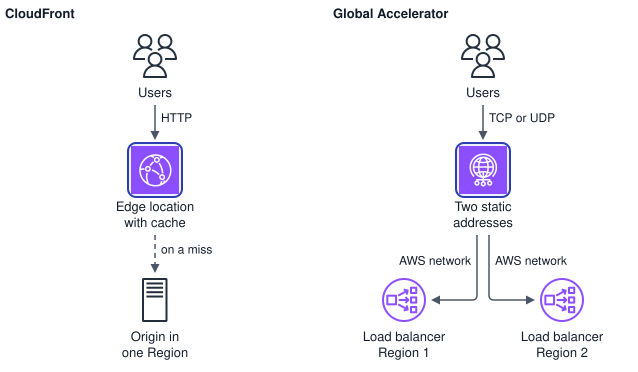
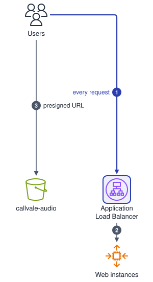

# CloudFront and Global Accelerator in depth

## How it works (55 min)
<!-- section: role=how; route=full; minutes=55 -->

### Requests reach the nearest edge location and cache misses travel on to the origin (5 min)

Each extra network hop between a user and your Region adds **latency** (LAY-ten-see).

1. **Send the configuration.** A **distribution** is your CloudFront setup. CloudFront sends the [distribution's configuration (but not your content)](../facts/cloudfront.md#cloudfront-config-sent-to-edge-not-content) to each **edge location**.
2. **Pick an edge location.** The request goes to the [edge location that provides the lowest latency](../facts/cloudfront.md#cloudfront-request-routed-lowest-latency-edge).
3. **Check the cache.** A hit in its **cache** (KASH) is [served directly from the CloudFront cache](../facts/cloudfront.md#cloudfront-cache-hit-ratio-definition).
4. **Climb on a miss.** The next stop is typically a **regional edge cache**. On a second miss, the request goes on to the **origin**, which holds the original files.
5. **Stream and keep.** [As soon as the first byte arrives](../facts/cloudfront.md#cloudfront-first-byte-forwarded-and-cached), CloudFront passes it on and adds the object to the cache.

Why two layers? The regional edge cache has a [larger cache width than any individual edge location](../facts/cloudfront.md#cloudfront-faq-regional-edge-cache-larger-cache-width).

Go deeper: requests that skip the regional edge cache

[Dynamic requests, as determined at request time](../facts/cloudfront.md#cloudfront-rec-dynamic-requests-skip), go from the edge location straight to the origin. So do requests to an S3 bucket when the regional edge cache is [in the same AWS Region as the S3 bucket](../facts/cloudfront.md#cloudfront-rec-skipped-same-region-s3).

> **Exam signal:** "users around the world see slow page loads" points to CloudFront, made for [any publicly accessible web application](../facts/cloudfront.md#cloudfront-dec-consider-for-any-public-web-application).

> **Say it:** The short answer is: the nearest edge location answers from its cache. The thing to watch is that a miss still reaches your origin.

**Stop and answer.** Two users reach the same edge location and request the same new file at the same moment. How many requests reach the origin?

Answer

One. CloudFront [sends the response from the original request](../facts/cloudfront.md#cloudfront-request-collapsing) to both users.

### Cache behaviors send each URL path to one origin and the first match wins (4 min)

One domain name serves static files from a bucket and an API from a load balancer.

1. **Match the path.** A **cache behavior** is a rule for one path pattern. In list order, [the first match determines which cache behavior](../facts/cloudfront.md#cloudfront-behavior-first-match-wins) applies.
2. **Fall back.** The default behavior, \*, is [always the last to be processed](../facts/cloudfront.md#cloudfront-behavior-default-last).
3. **Use one origin.** In each behavior [you specify the one origin](../facts/cloudfront.md#cloudfront-behavior-one-origin-each), for example an Application Load Balancer (ALB).
<!-- table: plain -->
| Order | Path pattern | Origin | Caching |
|---|---|---|---|
| 1 | /static/\* | S3 bucket | CachingOptimized |
| 2 | /api/\* | ALB | CachingDisabled |
| Last | \* | ALB | Origin headers decide |

Why one origin per behavior? Each path then has one source and one caching rule.

> **Exam signal:** "one domain name for static files in S3 and dynamic content on EC2" points to one distribution with a cache behavior per path.

**Spot the bug.** Behavior 1: `*.jpg` to the photo bucket, no signer. Behavior 2: `/premium/*` to the same bucket, signed URLs. What is wrong?

Answer

/premium/photo.jpg matches `*.jpg` first, which has no signer, so premium photos are free. List `/premium/*` first.

> **Say it:** The short answer is: each path pattern picks one origin and one caching rule. The thing to watch is the order.

**Stop and answer.** A distribution lists /api/\* first and /api/v2/\* second. Which origin answers /api/v2/users?

Answer

The origin of /api/\*, because [the first match determines which cache behavior](../facts/cloudfront.md#cloudfront-behavior-first-match-wins) applies. List longer patterns first.

### The cache key decides which requests share one cached copy (4 min)

If CloudFront sees two requests for one page as different, both go to the origin.

1. **Build the key.** The **cache key** identifies one cached object. A **cache policy** picks the values [included in the cache key](../facts/cloudfront.md#cloudfront-cache-policy-controls-cache-key): query strings, headers and cookies.
2. **Share the copy.** Requests with the same key share one copy. The **cache hit ratio** is the percentage of requests [served directly from the CloudFront cache](../facts/cloudfront.md#cloudfront-cache-hit-ratio-definition).
3. **Forward.** Key values [are automatically included in origin requests](../facts/cloudfront.md#cloudfront-cache-key-values-forwarded-to-origin). An **origin request policy** adds other values to origin requests, outside the key.

<!-- table: plain -->
| Managed policy | Cache key | Use it for |
|---|---|---|
| CachingOptimized | [Only includes the normalized Accept-Encoding header](../facts/cloudfront.md#cloudfront-managed-policy-caching-optimized) | Static files |
| CachingDisabled | None: [this policy disables caching](../facts/cloudfront.md#cloudfront-managed-policy-caching-disabled) | Dynamic content |

Why keep the key small? Each extra value splits one object into more copies. AWS says to [forward only the query string parameters](../facts/cloudfront.md#cloudfront-cache-hit-ratio-forward-only-needed-values) that change the response.

> **Exam signal:** "low cache hit ratio, overloaded origin" points to a smaller key and to **Origin Shield**, [an additional layer of caching in front](../facts/cloudfront.md#cloudfront-cache-hit-ratio-origin-shield-layer) of the origin.

> **Exam trap:** Many think that forwarding all cookies helps the cache. Each user's cookie makes its own copy. AWS says to [forward only specified cookies instead of forwarding all](../facts/cloudfront.md#cloudfront-cache-hit-ratio-forward-only-needed-values). <!-- trap: cloudfront-trap-forward-all-values -->

> **Say it:** The short answer is: put in the key what changes the response. The thing to watch is values that differ per user.

**Stop and answer.** An S3 origin serves images, and the session cookie is in the cache key. What happens to the hit ratio, and does S3 use the cookie?

Answer

The ratio falls: CloudFront [considers the forwarded cookie values](../facts/cloudfront.md#cloudfront-faq-forwarded-cookies-part-of-cache-key), and every session differs. S3 does not: [Amazon S3 ignores them](../facts/cloudfront.md#cloudfront-s3-origin-ignores-cookies).

### Cache headers decide how long a copy lives and versioned names replace it sooner (5 min)

A release changes app.js, but users still get the old copy. A copy lives for its **time to live** (TTL, tee-tee-EL).

1. **Read the headers.** Given Cache-Control max-age and Expires, CloudFront [uses only the value of Cache-Control max-age](../facts/cloudfront.md#cloudfront-expiration-cache-control-over-expires).
2. **Fall back.** With neither header, the Default TTL serves [as the object's TTL](../facts/cloudfront.md#cloudfront-ttl-default-ttl-only-without-headers): [86400 seconds](../facts/cloudfront.md#cloudfront-default-ttl-default-value) unless you change it.
3. **Check after expiry.** CloudFront asks the origin if the file changed. [304 Not Modified](../facts/cloudfront.md#cloudfront-expiration-304-not-modified-revalidation) keeps the copy; otherwise the new file comes back.
4. **Replace early.** An **invalidation** removes a path: [invalidate the file from edge caches](../facts/cloudfront.md#cloudfront-invalidate-removes-from-edge-caches).

<!-- table: plain -->
| Way to update | Cost |
|---|---|
| Wait for the TTL | None |
| Invalidate the path | [First 1,000 invalidation paths](../facts/cloudfront.md#cloudfront-invalidation-first-1000-paths-free) a month are free |
| New file name | [Versioning is less expensive](../facts/cloudfront.md#cloudfront-invalidation-prefer-versioning-for-frequent-updates) |

Why new names? A new name is a new object for every cache.

If a cache policy's [minimum TTL is greater than 0](../facts/cloudfront.md#cloudfront-min-ttl-above-zero-overrides-no-cache), CloudFront caches at least that long, even when the origin sends no-cache.

> **Exam signal:** "files change often and users must see the new version" points to versioned names, not the [Invalidation API](../facts/cloudfront.md#cloudfront-faq-remove-item-delete-origin-or-invalidate).

> **Exam trap:** Many think that AWS wants an invalidation after every release. AWS says to [use invalidation only in unexpected circumstances](../facts/cloudfront.md#cloudfront-faq-invalidate-only-unexpected-use-versioning). A new name also replaces copies in browsers and proxies, which an invalidation does not clear. <!-- trap: cloudfront-trap-invalidate-every-release -->

Go deeper: invalidation details

[Invalidation paths are case sensitive](../facts/cloudfront.md#cloudfront-invalidation-paths-case-sensitive), and a wildcard path [counts as one path](../facts/cloudfront.md#cloudfront-invalidation-wildcard-counts-one-path).

> **Say it:** The short answer is: give each release new file names. The thing to watch is the Default TTL.

**Stop and answer.** The origin sends no cache headers, and the TTL settings are defaults. After a change, how long can users get the old copy?

Answer

Until the copy is [86400 seconds](../facts/cloudfront.md#cloudfront-default-ttl-default-value) old, that is one day.

### Origin access control keeps the bucket private and lets your distribution read it (4 min)
<!-- section: route=pass -->

The recordings stay in a private bucket, but CloudFront has to read them, and S3 URLs should not work.

1. **Attach it.** You attach **origin access control** (OAC) to the S3 origin. The older option is origin access identity (OAI), and AWS says: "[We recommend that you use OAC instead](../facts/cloudfront.md#cloudfront-oac-oai-two-ways-oac-recommended)."
2. **Sign.** With Sign requests, [CloudFront always signs all requests](../facts/cloudfront.md#cloudfront-oac-signing-always-recommended) to the bucket.
3. **Allow one distribution.** The bucket policy allows the [CloudFront service principal (cloudfront.amazonaws.com)](../facts/cloudfront.md#cloudfront-oac-bucket-policy-cloudfront-service-principal), with a Condition for your distribution.
4. **Stay private.** Viewers [cannot access it directly by using Amazon S3 URLs](../facts/cloudfront.md#cloudfront-private-s3-oac-plus-signed-urls).

<!-- table: plain -->
| Signing setting | Bucket | Result |
|---|---|---|
| Sign requests | Private | [This prevents someone from bypassing CloudFront](../facts/cloudfront.md#cloudfront-private-s3-oac-plus-signed-urls) |
| Do not sign requests | Public | S3 URLs work |

Why the Condition? It allows reads [only when the request is on behalf](../facts/cloudfront.md#cloudfront-oac-bucket-policy-cloudfront-service-principal) of your own distribution.

> **Exam signal:** "users must reach the files only through CloudFront" points to OAC, even when an option names OAI. If no option names OAC, pick OAI.

> **Try it:** Build a private bucket behind a distribution and watch the bucket policy decide. See [3-do.md](3-do.md). <!-- task: cloudfront-t04 -->

> **Say it:** The short answer is: no, the bucket stays private and trusts your distribution. The thing to watch is the Condition.

**Stop and answer.** A team sets its origin access control to Do not sign requests and keeps the bucket private. What do viewers get?

Answer

Errors: [CloudFront cannot access the origin](../facts/cloudfront.md#cloudfront-oac-never-sign-needs-public-bucket).

### VPC origins let CloudFront reach load balancers and instances in private subnets (4 min)

An **internet-facing load balancer** behind CloudFront can still be called directly, around the cache.

1. **Create the origin.** A **VPC origin** can be an [Application Load Balancer, Network Load Balancer, or EC2 instance in a private subnet](../facts/cloudfront.md#cloudfront-origin-private-subnet-vpc-origin).
2. **Join the subnet.** CloudFront creates a [service-managed elastic network interface (ENI)](../facts/cloudfront.md#cloudfront-vpc-origin-private-subnet-ipv4-eni) there.
3. **Keep a gateway.** [You need to add an internet gateway](../facts/cloudfront.md#cloudfront-vpc-origin-needs-internet-gateway) to the VPC, but it does not route traffic to the subnet. The subnet stays private.
4. **One entry.** The result is [making CloudFront the single point of entry](../facts/cloudfront.md#cloudfront-vpc-origin-cloudfront-single-entry-point).

**Figure.** The kind of origin decides how you keep viewers from going around CloudFront.

An internet-facing ALB needs two locks. Its security group allows the [AWS-managed prefix list for CloudFront](../facts/elb.md#elb-alb-cloudfront-prefix-list-sg). And CloudFront can [add a custom HTTP header to requests](../facts/cloudfront.md#cloudfront-alb-restrict-custom-header-and-https), which a listener rule checks.

Why both? [The CloudFront managed prefix list contains the IP](../facts/cloudfront.md#cloudfront-prefix-list-origin-facing-servers) ranges of all CloudFront servers, so other customers' distributions pass it too.

> **Exam signal:** "the load balancer must not be reachable from the internet" points to [internal Application Load Balancers inside private subnets](../facts/cloudfront.md#cloudfront-alb-internal-needs-vpc-origins).

> **Exam trap:** Many think that CloudFront needs a public load balancer. It serves load balancers [in private subnets as VPC origins](../facts/elb.md#elb-cloudfront-vpc-origins-alb-nlb-private-subnets). <!-- trap: cloudfront-trap-alb-must-be-public -->

> **Say it:** The short answer is: keep the load balancer private and add it as a VPC origin. The thing to watch is the internet gateway.

**Stop and answer.** Can a Network Load Balancer with a Transport Layer Security (TLS) listener be a VPC origin?

Answer

No. [Network Load Balancers with TLS listeners cannot be](../facts/cloudfront.md#cloudfront-vpc-origin-gwlb-and-nlb-tls-not-allowed) VPC origins.

### CloudFront encrypts two separate connections and each one has its own setting (5 min)
<!-- section: route=pass -->

A request has two legs, viewer to edge and edge to origin. Each needs **encryption in transit**.

1. **Viewer leg.** The **viewer protocol policy** can redirect: [HTTP requests are automatically redirected to HTTPS requests](../facts/cloudfront.md#cloudfront-vpp-redirect-http-to-https).
2. **Certificate.** An AWS Certificate Manager (ACM) certificate for CloudFront comes from [US East (N. Virginia)](../facts/acm.md#acm-cloudfront-us-east-1).
3. **Origin leg.** For a custom origin, an **origin protocol policy** of [HTTPS only](../facts/cloudfront.md#cloudfront-origin-protocol-https-only) encrypts this leg.
4. **Origin certificate.** It must be [issued by a trusted certificate authority](../facts/cloudfront.md#cloudfront-https-origin-trusted-ca-no-self-signed).

<!-- table: plain -->
| Viewer policy | Origin policy | Encrypted end to end |
|---|---|---|
| Redirect HTTP to HTTPS | HTTP | No |
| Redirect HTTP to HTTPS | [HTTPS only](../facts/cloudfront.md#cloudfront-origin-protocol-https-only) | Yes |
| Any | [HTTP only](../facts/cloudfront.md#cloudfront-origin-protocol-s3-website-default-http-only) (S3 website endpoint) | No |

Why two settings? CloudFront [terminates TLS close to viewers](../facts/cloudfront.md#cloudfront-pricing-page-dynamic-acceleration-mechanisms) and opens a separate connection to the origin, with the protocol that the origin protocol policy sets.

> **Exam signal:** "encrypt data in transit to the origin" points to both: [require that viewers use HTTPS](../facts/cloudfront.md#cloudfront-dec-encrypt-in-transit-viewer-and-origin-https) and HTTPS to the origin.

> **Exam trap:** Many think that HTTPS for viewers also covers the origin. CloudFront can [return an object to a viewer](../facts/cloudfront.md#cloudfront-https-viewer-origin-protocol-independent) over HTTPS that it fetched from the origin over HTTP. <!-- trap: cloudfront-trap-https-viewer-means-origin -->

> **Say it:** The short answer is: set HTTPS for viewers and for the origin. The thing to watch is the certificate Region.

**Stop and answer.** The origin protocol policy is HTTPS only, but the origin shows a self-signed certificate. What does the viewer get?

Answer

[HTTP status code 502 (Bad Gateway)](../facts/cloudfront.md#cloudfront-https-origin-bad-certificate-502).

### Signed URLs and signed cookies decide which users can fetch private files (4 min)
<!-- section: route=pass -->

Origin access control stops S3 URLs, but any visitor can still fetch paid recordings through CloudFront.

1. **Create a signer.** A **trusted key group** holds your public keys. AWS says: "[We recommend that you use trusted key groups](../facts/cloudfront.md#cloudfront-signer-key-group-recommended)."
2. **Protect a behavior.** [As soon as you add the signer](../facts/cloudfront.md#cloudfront-signer-added-requires-signed-access), its files need a **signed URL** or **signed cookie**.
3. **Sign after sign-in.** Your application signs with a private key and sets [an ending date and time](../facts/cloudfront.md#cloudfront-dec-signed-url-expiry-restrictions).
4. **Check at the edge.** CloudFront checks the signature with the public keys.

A signed URL carries a policy. In a canned one, [You can specify the date and time](../facts/cloudfront.md#cloudfront-signed-policy-canned-only-expiry) when access ends. A custom one adds a start time and an IP range.

<!-- table: plain -->
| Need | Use |
|---|---|
| One file | Signed URL: [restrict access to individual files](../facts/cloudfront.md#cloudfront-signed-url-when-individual-files-or-no-cookies) |
| All segments of one video | Signed cookies |
| An IP range | Custom policy: [you can specify the IP address or range](../facts/cloudfront.md#cloudfront-signed-policy-canned-only-expiry) |

Why sign in your application? Your application knows who paid.

> **Exam signal:** "paying subscribers, for a limited time" points to signed URLs or cookies, for [users who have paid a fee](../facts/cloudfront.md#cloudfront-dec-signed-urls-cookies-for-paying-users). An S3 **presigned URL** (pree-SYND) uses the [principal who generated the URL](../facts/s3.md#s3-presigned-url-time-limited-creator-credentials) instead.

> **Exam trap:** Many think that a video of many segments needs a signed URL per segment. Signed cookies give [access to multiple restricted files](../facts/cloudfront.md#cloudfront-signed-cookies-when-multiple-files-or-keep-urls), with unchanged URLs. <!-- trap: cloudfront-trap-signed-url-per-file -->

> **Say it:** The short answer is: your application signs a link after sign-in, and CloudFront checks it. The thing to watch is the expiry.

**Stop and answer.** A viewer sends a valid signed cookie and an expired signed URL for one file. Does CloudFront serve it?

Answer

No. CloudFront decides [based only on the signed URL](../facts/cloudfront.md#cloudfront-signed-url-takes-precedence-over-cookies).

### CloudFront Functions do light rewrites and edge Lambda functions can call other services (4 min)

Each request needs a small decision at the edge, such as adding a header.

1. **Pick the event.** Lambda@Edge runs on four events, from [Viewer Request](../facts/cloudfront.md#cloudfront-faq-lambda-edge-four-trigger-events) to Origin Response. CloudFront Functions skip [origin request](../facts/lambda.md#lambda-edge-event-sources-row) and origin response.
2. **Light work.** CloudFront Functions suit [header manipulation](../facts/cloudfront.md#cloudfront-functions-use-cases) and URL rewrites, in [submillisecond](../facts/cloudfront.md#cloudfront-edge-compare-duration) time.
3. **Heavy work.** Lambda@Edge can [make network calls to external resources](../facts/cloudfront.md#cloudfront-lambda-edge-network-calls-allowed) for [up to 30 seconds](../facts/cloudfront.md#cloudfront-edge-compare-duration).
4. **Region.** The Lambda function [must be in the US East (N. Virginia)](../facts/cloudfront.md#cloudfront-lambda-edge-region-must-be-us-east-1) Region.

<!-- table: plain -->
| Task | Runs in |
|---|---|
| Add security headers | CloudFront Functions |
| Look up the user in a database | Lambda@Edge |
| Read the request body | Lambda@Edge, with Include Body: [40 KB](../facts/cloudfront.md#cloudfront-lambda-edge-body-truncated-viewer-request-40kb) on viewer requests |

Why two products? Short code runs on every request at [a fraction of the price of AWS Lambda@Edge](../facts/cloudfront.md#cloudfront-dec-functions-cheaper-than-lambda-edge).

> **Exam signal:** "header changes at scale, MOST cost-effectively" points to CloudFront Functions. "Call an external service" points to Lambda@Edge.

> **Exam trap:** Many think that the two products differ in price alone. CloudFront Functions have no [network access](../facts/cloudfront.md#cloudfront-functions-no-network-no-body-fs-access) and no access to the request body. <!-- trap: cloudfront-trap-edge-functions-interchangeable -->

> **Try it:** Test a CloudFront function without a distribution, then try to make it call the network. See [3-do.md](3-do.md). <!-- task: cloudfront-t02 -->

> **Say it:** The short answer is: CloudFront Functions for small rewrites, Lambda@Edge for network calls. The thing to watch is whether the code needs the network.

**Stop and answer.** A function must call a pricing API and put the price in a response header. Which product fits?

Answer

Lambda@Edge: CloudFront Functions have no [network access](../facts/cloudfront.md#cloudfront-functions-no-network-no-body-fs-access).

### An origin group fails over to a second origin when the first one fails (4 min)

A static site lives in one bucket. If its Region fails, viewers get errors.

1. **Group two origins.** An **origin group** needs [a distribution with at least two origins](../facts/cloudfront.md#cloudfront-failover-needs-two-origins), so that CloudFront can **fail over** (FAYL OH-ver).
2. **Try the primary.** CloudFront [routes all incoming requests to the primary origin](../facts/cloudfront.md#cloudfront-failover-primary-first-every-request).
3. **Switch on your codes.** On a failure code that you chose, [CloudFront automatically switches to the secondary origin](../facts/cloudfront.md#cloudfront-failover-switches-to-secondary).
4. **Read requests.** This works [only when the HTTP method of the viewer](../facts/cloudfront.md#cloudfront-failover-only-get-head-options) request is GET, HEAD or OPTIONS.

<!-- table: plain -->
| Request | Primary answers | Viewer gets |
|---|---|---|
| GET | 503, a chosen code | The secondary's answer |
| POST | 503 | The 503 |

Why automatic? Manual edits [depend on the CloudFront control plane](../facts/cloudfront.md#cloudfront-static-stability-use-origin-failover-not-manual).

> **Exam signal:** "serve the static site from a second Region if the first fails" points to an origin group: [assign a backup origin](../facts/cloudfront.md#cloudfront-faq-origin-failover-backup-origin).

> **Exam trap:** Many think that an origin group protects uploads too. A PUT to a failed primary gets the error: CloudFront [does not fail over when the viewer sends](../facts/cloudfront.md#cloudfront-failover-only-get-head-options) such methods. <!-- trap: cloudfront-trap-failover-any-request -->

> **Say it:** The short answer is: an origin group retries a second origin on codes that you choose. The thing to watch is writes.

**Stop and answer.** During a primary outage, a user opens three pages. Does the third page go straight to the secondary?

Answer

No. Each request tries the primary first. Connection attempts to an unreachable primary take [30 seconds](../facts/cloudfront.md#cloudfront-default-connect-wait-before-failover) by default; a primary that connects but does not answer adds a response timeout.

### Global Accelerator carries TCP and UDP from two static addresses over the AWS network (4 min)
<!-- section: route=pass -->

Players send UDP game traffic to two Regions. The internet adds jitter, and partners' firewalls need fixed addresses.

1. **Get two addresses.** An **accelerator** gets [two IPv4 static IP addresses](../facts/global-accelerator.md#global-accelerator-faq-two-static-ipv4-independent-network-zones), **anycast** (AN-ee-kast) from many edge locations.
2. **Enter nearby.** Anycast [routes traffic to the closest edge location](../facts/global-accelerator.md#global-accelerator-anycast-nearest-edge-then-closest-endpoint).
3. **Match a listener.** [A listener can be configured for TCP, UDP,](../facts/global-accelerator.md#global-accelerator-listener-tcp-udp-ports) or both.
4. **Choose a Region.** The listener sends traffic to an **endpoint group**, [each endpoint group with one AWS Region](../facts/global-accelerator.md#global-accelerator-listener-endpoint-group-per-region). Endpoints are load balancers, instances or an **Elastic IP address**.

<!-- table: plain -->
| Fixed address | Scope |
|---|---|
| Elastic IP address | [Advertised from a single AWS Region](../facts/global-accelerator.md#global-accelerator-faq-vs-elastic-ip-scope-and-advertisement) |
| Global Accelerator address | Endpoints [in any number of AWS Regions](../facts/global-accelerator.md#global-accelerator-faq-vs-elastic-ip-scope-and-advertisement) |

**Figure.** CloudFront answers HTTP requests from edge caches, and Global Accelerator carries TCP and UDP from two static addresses to endpoints in Regions.

Why anycast? Users enter the AWS network near home.

> **Exam signal:** "UDP", "gaming" or "fixed IP addresses" points to Global Accelerator, a fit for [gaming (UDP), IoT (MQTT), or Voice over IP](../facts/global-accelerator.md#global-accelerator-faq-good-fit-non-http-static-ip-fast-failover).

> **Try it:** Create an accelerator in CloudShell, read its two addresses, then disable it and read them again. See [3-do.md](3-do.md). <!-- task: cloudfront-t03 -->

> **Say it:** The short answer is: two fixed addresses bring TCP or UDP onto the AWS network. The thing to watch is one Region per endpoint group.

**Stop and answer.** A team disables its accelerator for a week. Must partners change their allow-lists afterward?

Answer

No. The addresses [remain assigned to your accelerator for as long](../facts/global-accelerator.md#global-accelerator-static-ips-kept-until-delete) as it exists.

### Health checks and traffic dials move new connections from one Region to another (5 min)

When a Region fails, users should move within seconds, not after Domain Name System (DNS) caches expire.

1. **Watch.** Global Accelerator [continuously monitors the health of all endpoints](../facts/global-accelerator.md#global-accelerator-health-checks-standard-failover-new-connections) with a **health check** (HELTH chek).
2. **Remove.** It takes a failed endpoint out in [less than one minute](../facts/global-accelerator.md#global-accelerator-faq-failover-detect-under-one-minute).
3. **Keep the addresses.** So [change propagation takes a matter of seconds](../facts/global-accelerator.md#global-accelerator-faq-no-dns-cache-dependency-seconds).
4. **Steer.** Each endpoint group has a **traffic dial**, [100%](../facts/global-accelerator.md#global-accelerator-faq-traffic-dial-default-100-percent) by default. For maintenance, [set the traffic dial to 0](../facts/global-accelerator.md#global-accelerator-dec-traffic-dial-zero-cuts-off-region).

<!-- table: plain -->
| Change | Acts on | Result |
|---|---|---|
| Traffic dial 0 | One endpoint group | No new connections to that Region, except in a failover |
| Weight 0 | One endpoint | [Stop sending traffic to an endpoint](../facts/global-accelerator.md#global-accelerator-weight-zero-stops-traffic) |
| Endpoint unhealthy | One endpoint | New connections move; it [continues to direct traffic for established connections](../facts/global-accelerator.md#global-accelerator-established-connections-until-idle-timeout) |

Why not DNS? Resolvers cache records [according to their time to live (TTL)](../facts/route53.md#route53-faq-resolver-caches-by-ttl-outside-control).

For a stateful application, **client affinity** set to Source IP can [route the user to the same endpoint whenever](../facts/global-accelerator.md#global-accelerator-client-affinity-source-ip-uses-2-tuple) they connect.

> **Exam signal:** "fail over between Regions within seconds, although clients cache DNS" points to Global Accelerator.

> **Exam trap:** Many think that a traffic dial of 0 moves open connections immediately. [The updated setting applies to only new connections](../facts/global-accelerator.md#global-accelerator-traffic-dial-new-connections-only). <!-- trap: cloudfront-trap-traffic-dial-moves-existing -->

> **Say it:** The short answer is: health checks move new connections to a healthy Region in seconds. The thing to watch is open connections.

**Stop and answer.** A team sets every endpoint weight in its standby Region to 0. The primary fails. Do new connections go to the standby?

Answer

No. Failover [tries to fail over to a healthy endpoint](../facts/global-accelerator.md#global-accelerator-failover-to-another-endpoint-group-ignores-dial) with a weight above zero. Use a traffic dial of 0 instead: for failover, [Global Accelerator ignores the traffic dial setting](../facts/global-accelerator.md#global-accelerator-failover-to-another-endpoint-group-ignores-dial).

### CloudFront bills data sent to viewers and Global Accelerator adds an hourly fee (3 min)

Teams fear that a content delivery network (CDN) adds a second transfer bill.

1. **Origin to edge.** Transfer is [always free when using AWS origins](../facts/cloudfront.md#cloudfront-price-origin-to-cloudfront-always-free-aws-origins).
2. **Edge to viewer.** You pay for [data transfers out from its edge locations](../facts/cloudfront.md#cloudfront-price-dimensions-transfer-out-and-requests) and for requests.
3. **Trim locations.** A **price class** cuts prices by [excluding Amazon CloudFront’s more expensive edge locations](../facts/cloudfront.md#cloudfront-faq-price-classes-exclude-expensive-locations).
4. **Accelerator.** Global Accelerator adds [a fixed hourly fee](../facts/global-accelerator.md#global-accelerator-price-fixed-hourly-fee-plus-dt-premium) per accelerator, [enabled or disabled](../facts/global-accelerator.md#global-accelerator-price-fixed-fee-enabled-or-disabled). It also charges a [Data Transfer-Premium fee (DT-Premium)](../facts/global-accelerator.md#global-accelerator-price-fixed-hourly-fee-plus-dt-premium).

<!-- table: plain -->
| Item | Charged |
|---|---|
| Origin Shield | [You incur additional charges for using Origin Shield](../facts/cloudfront.md#cloudfront-origin-shield-extra-charges) |
| HTTP redirected to HTTPS | [CloudFront charges for both requests](../facts/cloudfront.md#cloudfront-https-redirect-charges-both-requests) |

Why can the edge cost less? A cache hit is a request that the origin does not serve.

> **Exam signal:** "users are only in North America and Europe; reduce cost" points to a price class.

> **Say it:** The short answer is: you pay for data out to viewers, not for fetches from AWS origins. The thing to watch is Origin Shield.

**Stop and answer.** A price class leaves out South America, but CloudFront sometimes serves a South American viewer from outside the class. Which rate applies?

Answer

The rate of [the least expensive location in your price class](../facts/cloudfront.md#cloudfront-faq-price-classes-higher-latency-and-billing).

## Numbers that decide answers (3 min)
<!-- section: role=numbers; route=full; minutes=3 -->

### A-list

<!-- table: numbers -->
| Number | What it is | Why it decides an answer |
|---|---|---|
| [86400 seconds](../facts/cloudfront.md#cloudfront-default-ttl-default-value) | Default TTL | Without cache headers, old copies live a day |
| [first 1,000 invalidation paths](../facts/cloudfront.md#cloudfront-invalidation-first-1000-paths-free) | Free paths a month | A wildcard path counts as one |
| [Up to 30 seconds](../facts/cloudfront.md#cloudfront-edge-compare-duration) | Lambda@Edge run time | Network calls and longer code fit here |
| [10 KB](../facts/cloudfront.md#cloudfront-quota-function-max-size) | CloudFront Functions size | Bigger code needs Lambda@Edge |
| [two IPv4 static IP addresses](../facts/global-accelerator.md#global-accelerator-faq-two-static-ipv4-independent-network-zones) | Accelerator addresses | Partners allow-list them |
| [less than one minute](../facts/global-accelerator.md#global-accelerator-faq-failover-detect-under-one-minute) | Global Accelerator failure detection | Faster than DNS caches |
| [100%](../facts/global-accelerator.md#global-accelerator-faq-traffic-dial-default-100-percent) | Default traffic dial | A standby needs less |
| [30 seconds](../facts/cloudfront.md#cloudfront-default-connect-wait-before-failover) | CloudFront connection attempts before the secondary origin | Shorter timeouts fail over faster |

### B-list

<!-- table: numbers -->
| Number | What it is |
|---|---|
| [1](../facts/cloudfront.md#cloudfront-quota-ssl-certificates-per-distribution) | Certificates per distribution |
| [50 GB](../facts/cloudfront.md#cloudfront-quota-max-cacheable-file-size) | Largest cacheable file |
| [75](../facts/cloudfront.md#cloudfront-quota-cache-behaviors-per-distribution) | Default cache behaviors per distribution (adjustable) |
| [250,000](../facts/cloudfront.md#cloudfront-quota-requests-per-second-per-distribution) | Default requests per second per distribution (adjustable) |
| [128](../facts/global-accelerator.md#global-accelerator-endpoint-weight-default-128) | Default endpoint weight |
| [340 seconds](../facts/global-accelerator.md#global-accelerator-idle-timeout-tcp-340-seconds) | Global Accelerator TCP idle timeout |
| [30 seconds](../facts/global-accelerator.md#global-accelerator-idle-timeout-udp-30-seconds) | Global Accelerator UDP idle timeout |

> **Changed recently:** (2026-08-20) Origin access control for S3 Multi-Region Access Points. 
> **Old:** a [custom Lambda@Edge Function](../facts/cloudfront.md#cloudfront-change-oac-s3-mrap-2026-08) signed each request. 
> **Now:** from [2026-08-20](../facts/cloudfront.md#cloudfront-change-oac-s3-mrap-2026-08), CloudFront signs them [using CloudFront Origin Access Control (OAC)](../facts/cloudfront.md#cloudfront-change-oac-s3-mrap-2026-08). 
> **The exam probably expects:** OAC for an ordinary S3 bucket origin. Do not let this change decide an answer. 
> **Status:** not examinable yet.

## Decision record (3 min)
<!-- section: role=example; route=full; minutes=3 -->

**Context.** Before launch, 70% of web requests are for static files, and 20% of users are outside the United States.

**Figure.** Every request travels from the user to the load balancer or bucket in one Region.

1. Every request goes to the one Region.
2. Web instances serve pages and static files.
3. Recordings play through presigned URLs from the bucket.

**Requirement.** Reduce instance load and latency for users around the world, without making the bucket public.

**Options.**

- A larger web tier.
- CloudFront for static files only.
- **CloudFront in front of everything, with private S3 origins and signed URLs.**

**Decision.** CloudFront in front of everything: a larger tier or static caching alone leaves trips long. Recording links expire after five minutes.

**Figure.** Users reach the nearest edge location, static files come from its cache, recordings need signed URLs, and dynamic requests go to the load balancer.

1. Users connect to the edge location with the lowest latency.
2. Static files come from the cache, or from the bucket through origin access control.
3. A recording needs a signed URL with an ending time.
4. Dynamic requests go to the load balancer, locked by the prefix list and a secret header.

**Trade-off.** After a release, cached files can be old [until the files expire](../facts/cloudfront.md#cloudfront-removed-origin-file-stays-until-expiry); Callvale accepts that and uses versioned file names. The load balancer stays internet-facing; a VPC origin can come later.

## FAQ quick-fire (5 min)
<!-- section: role=faq; route=full; minutes=5 -->

**FAQ 1.** Does an origin outside AWS cost extra?

Answer

No: [no additional charge to use a custom origin](../facts/cloudfront.md#cloudfront-faq-custom-origin-any-server-no-charge).

> "There is no additional charge to use a custom origin."
> — [Amazon CloudFront FAQs](https://aws.amazon.com/cloudfront/faqs/)

**FAQ 2.** Does CloudFront cache responses to POST requests?

Answer

No: it proxies [POST, PUT, DELETE, and PATCH requests](../facts/cloudfront.md#cloudfront-faq-post-put-delete-patch-not-cached).

> "Amazon CloudFront does not cache the responses to POST, PUT, DELETE, and PATCH requests – these requests are proxied back to the origin server."
> — [Amazon CloudFront FAQs](https://aws.amazon.com/cloudfront/faqs/)

**FAQ 3.** Do you pay extra for the regional edge cache?

Answer

No: [no additional charges](../facts/cloudfront.md#cloudfront-faq-regional-edge-cache-default-on-no-charge).

> "There are no additional charges to use this feature."
> — [Amazon CloudFront FAQs](https://aws.amazon.com/cloudfront/faqs/)

**FAQ 4.** Can you remove a harmful file before it expires?

Answer

Yes, with the [Invalidation API](../facts/cloudfront.md#cloudfront-faq-remove-item-delete-origin-or-invalidate).

> "In the event that offensive or potentially harmful material needs to be removed before the specified expiration time, you can use the Invalidation API to remove the object from all Amazon CloudFront edge locations."
> — [Amazon CloudFront FAQs](https://aws.amazon.com/cloudfront/faqs/)

**FAQ 5.** Can you block viewers in some countries?

Answer

Yes. They get [403 (Forbidden)](../facts/cloudfront.md#cloudfront-faq-geo-restriction-403).

> "Alternatively, you can specify the countries in which your users cannot access your content."
> — [Amazon CloudFront FAQs](https://aws.amazon.com/cloudfront/faqs/)

**FAQ 6.** Can a browser without Server Name Indication (SNI) load an SNI Custom SSL site?

Answer

No: [older browsers that do not support SNI](../facts/cloudfront.md#cloudfront-faq-sni-custom-ssl-modern-browsers-no-extra-cost) fail.

> "Older browsers that do not support SNI cannot establish a connection with CloudFront to load the HTTPS version of your content."
> — [Amazon CloudFront FAQs](https://aws.amazon.com/cloudfront/faqs/)

**FAQ 7.** Does CloudFront Functions replace Lambda@Edge?

Answer

No. It complements Lambda@Edge and does [not replace it](../facts/cloudfront.md#cloudfront-faq-functions-complement-lambda-edge).

> "The combination of Lambda@Edge and CloudFront Functions allows you to pick the right tool for the job."
> — [Amazon CloudFront FAQs](https://aws.amazon.com/cloudfront/faqs/)

**FAQ 8.** Can example.com itself point to a distribution?

Answer

Yes, with [an ALIAS record](../facts/cloudfront.md#cloudfront-faq-zone-apex-route53-alias) in Route 53.

> "Route 53 doesn't charge for queries to ALIAS records that are mapped to a CloudFront distribution."
> — [Amazon CloudFront FAQs](https://aws.amazon.com/cloudfront/faqs/)

**FAQ 9.** Can Global Accelerator help a one-Region application?

Answer

Yes: you can move it between Regions [without changing your public interface](../facts/global-accelerator.md#global-accelerator-faq-single-region-static-ip-benefits).

> "Second, you have the freedom to easily move your application between AWS Regions without changing your public interface."
> — [AWS Global Accelerator FAQs](https://aws.amazon.com/global-accelerator/faqs/)

**FAQ 10.** Can an on-premises server be an endpoint directly?

Answer

No. Use a [Network Load Balancer (NLB) in each AWS Region](../facts/global-accelerator.md#global-accelerator-faq-on-premises-via-nlb).

> "Then you can register the NLBs as endpoints in your AWS Global Accelerator configuration."
> — [AWS Global Accelerator FAQs](https://aws.amazon.com/global-accelerator/faqs/)

