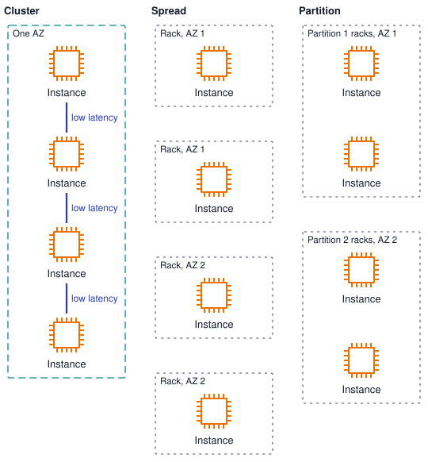
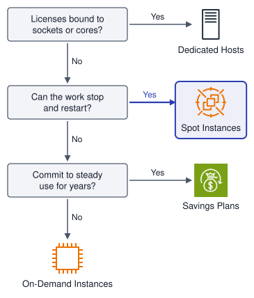
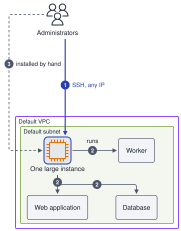

# Amazon EC2 in depth

## How it works (59 min)
<!-- section: role=how; route=full; minutes=59 -->

Follow one instance: choose it, build it, secure it, place it, change it, recover it, and pay for it.

### An EC2 instance gives you control and you patch and scale it yourself (4 min)

A team can rent an instance to run its code, or it can hand containers or functions to AWS.

1. **Rent an instance.** An Amazon EC2 **instance** is [a virtual server in the AWS Cloud](../facts/ec2.md#ec2-instance-virtual-server-type-sets-hardware). Its type [determines the hardware available to your instance](../facts/ec2.md#ec2-instance-virtual-server-type-sets-hardware).
2. **Own the operations.** You get [granular control over the compute environment](../facts/ec2.md#ec2-compute-guide-ec2-overhead-justified-for-control), and you patch and scale the instance.
3. **Or hand over the servers.** AWS Fargate can [run containers without having to manage servers](../facts/ec2.md#ec2-compute-guide-fargate-no-servers-for-containers). AWS Lambda runs code on events [without the need to manage servers](../facts/ec2.md#ec2-compute-guide-lambda-no-servers). This model is **serverless**.
4. **Check the limits.** A Lambda function runs for at most [15 minutes](../facts/lambda.md#lambda-faq-timeout-15-minutes). Work with [specific resource needs or persistent processes](../facts/lambda.md#lambda-choose-fargate-containers-persistent) fits Fargate or EC2.

<!-- table: plain -->
| Option | You manage | Fits |
|---|---|---|
| Amazon EC2 | Instances, operating system, scaling | Full control of the environment |
| AWS Fargate | Container images and task sizes | Long or persistent container work |
| AWS Lambda | Function code | [event-driven tasks, unpredictable workloads](../facts/lambda.md#lambda-choose-functions-event-driven-unpredictable) |
| AWS Batch | Job definitions | Batch jobs: it [automatically provisions compute resources](../facts/ec2.md#ec2-neighbour-batch-provisions-for-jobs) on [Amazon EC2 instances, Fargate resources](../facts/ec2.md#ec2-neighbour-batch-runs-on-ec2-fargate) |

Amazon EMR runs big data frameworks for [analytics purposes and business intelligence workloads](../facts/ec2.md#ec2-neighbour-emr-analytics-frameworks).

Why several options? Each moves a different share of the work to AWS. You weigh the [cost (like hourly charge or data transfer)](../facts/ec2.md#ec2-wa-evaluate-cost-and-management-overhead) against the [management overhead (like patching and scaling)](../facts/ec2.md#ec2-wa-evaluate-cost-and-management-overhead). <!-- xref: 20 AWS Batch -->

> **Exam signal:** "no servers to manage" points to Lambda for short event-driven work, or to Fargate for containers. "control of the operating system" points to EC2.

> **Exam trap:** Many think that any job can move to Lambda. A function runs for at most [15 minutes](../facts/lambda.md#lambda-faq-timeout-15-minutes), so a long job fits Fargate, AWS Batch or EC2. <!-- trap: ec2-trap-lambda-runs-any-job -->

> **Say it:** The short answer is: EC2 gives you control, and you run the instance. The thing to watch is patching, which is yours.

**Stop and answer.** Each audio conversion starts when a file arrives and runs up to 25 minutes. The team wants no servers to manage. Lambda or Fargate?

Answer

Fargate, or AWS Batch. A Lambda function runs for at most [15 minutes](../facts/lambda.md#lambda-faq-timeout-15-minutes).

### The instance family matches the resource that limits your workload (4 min)

Every workload runs out of one resource first. Choose the family that has more of that resource.

1. **Find the bottleneck.** Measure what runs out first: CPU, memory, local storage, or work for a graphics processing unit (GPU).
2. **Pick the family.** Each family fits one bottleneck, and the first letter of a type name shows the family.
3. **Pick the size.** Each type has [one or more instance sizes](../facts/ec2.md#ec2-instance-type-sizes-scale-resources), so you [scale your resources to the requirements](../facts/ec2.md#ec2-instance-type-sizes-scale-resources).

<!-- table: plain -->
| Bottleneck | Family and letter | Example |
|---|---|---|
| CPU | [Compute optimized](../facts/ec2.md#ec2-instance-type-series-letters), C | [batch processing workloads, media transcoding](../facts/ec2.md#ec2-family-compute-optimized) |
| Memory | [Memory optimized](../facts/ec2.md#ec2-instance-type-series-letters), R | Workloads that [process large data sets in memory](../facts/ec2.md#ec2-family-memory-optimized) |
| Local storage | [Storage optimized](../facts/ec2.md#ec2-instance-type-series-letters), I | [very large data sets on local storage](../facts/ec2.md#ec2-family-storage-optimized) |
| GPU work | [GPU accelerated](../facts/ec2.md#ec2-instance-type-series-letters), P | [training of large foundation models](../facts/ec2.md#ec2-faq-g-series-vs-p-series) |
| Nothing stands out | [General purpose](../facts/ec2.md#ec2-instance-type-series-letters), M | Applications [such as web servers and code repositories](../facts/ec2.md#ec2-family-general-purpose) |

Why so many families? Each type mixes CPU, memory, storage and networking in a different way. The right mix leaves no paid resource idle.

> **Exam signal:** "in-memory" points to memory optimized, and "media transcoding" to compute optimized.

Go deeper: the rest of a type name, Graviton and bare metal

After the number, [the third position indicates the options](../facts/ec2.md#ec2-instance-type-name-structure): g means [AWS Graviton processors](../facts/ec2.md#ec2-instance-type-option-letters). Graviton gives [up to 40% better price performance](../facts/ec2.md#ec2-graviton-40-percent-better-price-performance) than comparable instances, but compiled applications [need to be re-compiled to generate Arm binaries](../facts/ec2.md#ec2-graviton-compiled-apps-recompile).

AWS suggests that you [evaluate Bare Metal instances](../facts/ec2.md#ec2-faq-bare-metal-for-hardware-virtualization) when you [require access to hardware virtualization extensions](../facts/ec2.md#ec2-faq-bare-metal-for-hardware-virtualization). From [2026-02-16](../facts/ec2.md#ec2-change-nested-virtualization-2026-02), supported virtual types can also run a hypervisor: see Changed recently in [1-fast.md](1-fast.md).

> **Say it:** The short answer is: pick the family by what runs out first. The thing to watch is Graviton, which needs Arm builds.

**Stop and answer.** A team runs an in-memory cache on a C instance. CPU use stays low, but memory runs out every afternoon. Which family letter fits better?

Answer

R, memory optimized. The C instance pays for CPU that the cache does not use.

### A burstable instance earns CPU credits while idle and spends them in peaks (4 min)

Many instances sit almost idle and get busy for short periods. A fixed size pays all day for the peak.

1. **Run at a baseline.** A T instance has a baseline CPU level and can [burst above the baseline at any time](../facts/ec2.md#ec2-burstable-baseline-burst-any-time).
2. **Earn credits.** When it [stays below the CPU baseline](../facts/ec2.md#ec2-burstable-standard-earn-spend-credits), it earns CPU credits. One credit is [a full CPU core for one minute](../facts/ec2.md#ec2-burstable-cpu-credit-one-core-one-minute).
3. **Spend in the peak.** It [spends credits when it bursts above the baseline](../facts/ec2.md#ec2-burstable-standard-earn-spend-credits).
4. **Run out.** A T2 instance in standard mode drops back: its [performance will remain at baseline CPU performance](../facts/ec2.md#ec2-faq-t2-zero-credits-baseline). T3 and newer differ: [these instances launch as unlimited by default](../facts/ec2.md#ec2-burstable-unlimited-default-t3-and-newer).

<!-- table: plain -->
| Workload | Fits a T instance? | Why |
|---|---|---|
| Low average CPU, short peaks | Yes | It fits [the low-cost burstable general purpose instances](../facts/ec2.md#ec2-burstable-low-utilization-waste-use-t) |
| High CPU all day | No | AWS says to [consider dedicated CPU instances](../facts/ec2.md#ec2-faq-burstable-sustained-high-cpu-use-m-or-c), M or C |

Why credits? Idle CPU is paid for and unused, and T instances can save [up to 15%](../facts/ec2.md#ec2-burstable-t-vs-m-savings-and-smallest-size) compared with M instances.

> **Exam signal:** "low average CPU utilization with occasional spikes" points to a burstable T instance.

> **Exam trap:** Many think that a T3 instance runs at high CPU all day for its normal price. An average above the baseline over a [rolling 24-hour period](../facts/ec2.md#ec2-burstable-unlimited-24-hour-baseline-rule) adds a [flat additional rate per vCPU-hour](../facts/ec2.md#ec2-burstable-unlimited-24-hour-baseline-rule). <!-- trap: ec2-trap-burstable-for-steady-cpu -->

> **Say it:** The short answer is: a burstable instance is cheap for idle work with short peaks. The thing to watch is long peaks.

**Stop and answer.** A T2 instance with a full credit balance is stopped overnight. Does it start the next morning with its credits?

Answer

No. On T2, [the instance loses all its accrued credits](../facts/ec2.md#ec2-burstable-credits-after-stop-t2-lost-t3-7-days). On T3 and newer, the balance [persists for seven days after an instance stops](../facts/ec2.md#ec2-burstable-credits-after-stop-t2-lost-t3-7-days).

### An AMI and a launch template let you launch identical instances (4 min)

A hand-built instance is hard to build the same way twice. When it fails, some steps are forgotten.

1. **Capture the image.** You create an **Amazon Machine Image (AMI)** from a configured instance. By default, [Amazon EC2 powers down the instance before creating the AMI](../facts/ec2.md#ec2-create-ami-powers-down-by-default).
2. **Describe the launch.** A **launch template** stores [the AMI ID, instance type, and network settings](../facts/ec2.md#ec2-launch-template-stores-launch-parameters) in versions.
3. **Add first-boot work.** By default, **user data** scripts [run only during the boot cycle](../facts/ec2.md#ec2-user-data-runs-at-first-launch-by-default) of the first launch.
4. **Launch copies.** You can [launch multiple instances from a single AMI](../facts/ec2.md#ec2-ami-specific-to-region-os-arch).

<!-- table: plain -->
| Part | In the AMI? |
|---|---|
| Root volume with the software | Yes: EC2 [creates snapshots of your instance's root volume](../facts/ec2.md#ec2-create-ami-snapshots-all-ebs-volumes) |
| Other attached EBS volumes | Yes: EC2 takes snapshots of them too |
| Instance store data | No: it is [not included in the EBS-backed AMI](../facts/instance-store.md#instance-store-data-not-in-ebs-backed-ami) |
| User data | No: [user data is not included in the AMI](../facts/ec2.md#ec2-user-data-not-in-ami) |

Why both? The AMI fixes the software, and the template fixes how the instance starts. Auto Scaling groups launch from the template. <!-- xref: 17 Auto Scaling groups launch from a launch template -->

> **Exam signal:** "launch identical instances quickly" or "a golden image" points to a custom AMI and a launch template.

> **Exam trap:** Many think that one AMI launches instances in any Region. [AMIs are Region-specific resources](../facts/ec2.md#ec2-ami-region-specific-copy), so you copy the AMI first. <!-- trap: ec2-trap-ami-global -->

> **Say it:** The short answer is: software in the AMI, settings in the launch template. The thing to watch is the Region.

**Stop and answer.** A team creates an AMI of its database instance with the Reboot instance option cleared, so that the database keeps running. What risk does the team accept?

Answer

Then [it does not shut down and reboot](../facts/ec2.md#ec2-create-ami-no-reboot-integrity-risk) the instance, so file system integrity is not guaranteed.

### A role gives the instance credentials and Session Manager needs no open port (4 min)

Code on an instance calls AWS, and people sign in to fix it. A key in a file can leak, and anyone can try an open Secure Shell (SSH) port.

1. **Attach a role.** An **instance profile** carries the IAM role, and it [can contain only one IAM role](../facts/ec2.md#ec2-iam-role-one-per-instance).
2. **Get credentials.** The AWS SDKs read them [from the EC2 instance metadata service](../facts/ec2.md#ec2-iam-role-temporary-credentials-rotated). They are [temporary and updated automatically](../facts/iam.md#iam-ec2-role-credentials-rotate-automatically).
3. **Connect people.** With [AmazonSSMManagedInstanceCore](../facts/ec2.md#ec2-session-manager-prereq-iam-role) on the role, Session Manager opens a shell [without the need to open inbound ports](../facts/ec2.md#ec2-session-manager-no-inbound-ports-bastion-keys). The [SSM Agent initiates all connections](../facts/ec2.md#ec2-ssm-agent-outbound-https-443-no-inbound), so the instance needs no inbound rule. It needs a path out: VPC endpoints, or outbound internet access with [HTTPS (port 443) outbound traffic](../facts/ec2.md#ec2-ssm-agent-outbound-https-443-no-inbound) to the Systems Manager endpoints.
4. **Close the port.** The security pillar says [do not permit access on port 22/tcp (SSH) or port 3389/tcp (RDP)](../facts/vpc.md#vpc-wa-sec06-no-ssh-rdp-use-session-manager).

Why temporary credentials? Long-term keys [remain valid until you manually revoke them](../facts/iam.md#iam-long-term-keys-valid-until-revoked-temporary-expire), so a leaked key keeps working.

> **Exam signal:** "without opening inbound ports" or "without managing SSH keys" points to Session Manager.

> **Exam trap:** Many think that SSH to a private instance needs a bastion host. EC2 Instance Connect Endpoint connects [without using a bastion host](../facts/ec2.md#ec2-eice-no-public-ip-no-igw-no-bastion). <!-- trap: ec2-trap-ssh-needs-bastion -->

Go deeper: IMDSv2 and the hop limit

When no account or AMI setting asks for IMDSv2, an instance accepts [either IMDSv1 or IMDSv2, or both](../facts/ec2.md#ec2-imds-default-v1-or-v2). You can make it [only accept IMDSv2 calls](../facts/ec2.md#ec2-imds-default-v1-or-v2). The IMDSv2 token then has a [hop limit of 1](../facts/ec2.md#ec2-imds-put-hop-limit-default-1), and AWS suggests [increasing the hop limit to 2](../facts/ec2.md#ec2-imds-put-hop-limit-default-1) for containers.

**Spot the bug.** A user data script writes an access key into ~/.aws/credentials, so that the application can call Amazon S3. What is wrong?

Answer

User data is [not protected by authentication or cryptographic methods](../facts/ec2.md#ec2-metadata-user-data-not-protected), and the key is long-term. Attach an instance role instead.

> **Say it:** The short answer is: a role for code, Session Manager for people. The thing to watch is the role policy.

**Stop and answer.** Session Manager reaches instance A but not instance B. Neither security group has an inbound rule, and B has no instance profile. The account gives instances no other Systems Manager permissions. Why does B fail?

Answer

Session Manager needs a role with [AmazonSSMManagedInstanceCore](../facts/ec2.md#ec2-session-manager-prereq-iam-role). The inbound rule is not the problem: it works [without the need to open inbound ports](../facts/ec2.md#ec2-session-manager-no-inbound-ports-bastion-keys).

### Instances in several Availability Zones survive the failure of one zone (4 min)

An instance runs in one **Availability Zone** (AZ). A power fault there stops it: one instance is a **single point of failure**.

1. **Choose a Region.** A Region is [a separate geographic area where AWS has multiple Availability Zones](../facts/global-infrastructure.md#global-infrastructure-region-is-separate-geographic-area).
2. **Land in a subnet.** A subnet [must reside entirely within one Availability Zone](../facts/vpc.md#vpc-subnet-single-az).
3. **Keep zones apart.** Each zone runs on [physically distinct, independent infrastructure](../facts/ec2.md#ec2-faq-az-isolation).
4. **Spread the copies.** Instances [in multiple Availability Zones](../facts/ec2.md#ec2-multi-az-protects-from-location-failure) survive [the failure of a single location](../facts/ec2.md#ec2-multi-az-protects-from-location-failure). A load balancer sends work to the zones that still run. <!-- xref: 14 load balancers across Availability Zones -->

<!-- table: plain -->
| Workload | Placement | Why |
|---|---|---|
| Production | Two or more zones | Critical components [across multiple Availability Zones](../facts/ec2.md#ec2-bp-multi-az-critical-components) |
| Development and test | One zone | [save money by deploying your resources in only one Availability Zone](../facts/vpc.md#vpc-dev-test-one-az-saves-money) |
| Chatty tiers | A trade-off | [charges apply for cross-Availability Zone communication](../facts/ec2.md#ec2-data-transfer-same-az-free-cross-az-charged) |

Why are zones separate? Generators and cooling are [not shared across Availability Zones](../facts/ec2.md#ec2-faq-az-isolation), so one fault rarely reaches two zones.

> **Exam signal:** "remain available if an Availability Zone fails" points to instances in two or more zones behind a load balancer.

> **Say it:** The short answer is: run copies in two or more zones. The thing to watch is the charge for traffic between zones.

**Stop and answer.** A team runs two web instances in the same subnet and calls the design highly available. One Availability Zone fails. What happens?

Answer

Both instances can stop. A subnet [must reside entirely within one Availability Zone](../facts/vpc.md#vpc-subnet-single-az), so both share one zone.

### A placement group decides whether instances sit close together or apart (4 min)

Some instances need to sit close for speed. Others need to sit apart, so that one hardware fault does not stop them all.

1. **Start from the default.** Without a **placement group**, EC2 places instances [spread out across the underlying hardware](../facts/ec2.md#ec2-placement-optional-default-spread-out).
2. **Cluster.** A cluster group keeps instances [within a single Availability Zone](../facts/ec2.md#ec2-placement-cluster-single-az), for [low network latency, high network throughput, or both](../facts/ec2.md#ec2-placement-cluster-recommended-traffic-between-instances).
3. **Spread.** A spread group keeps a few critical instances [each placed on distinct hardware](../facts/ec2.md#ec2-placement-spread-critical-instances).
4. **Partition.** Each partition [has its own set of racks](../facts/ec2.md#ec2-placement-partition-separate-racks), for systems [such as HDFS, HBase, and Cassandra](../facts/ec2.md#ec2-placement-partition-distributed-workloads).

**Figure.** A cluster group packs instances close together, while spread and partition groups keep them on separate hardware.

<!-- table: plain -->
| Group | Limit | Fits |
|---|---|---|
| Cluster | One zone | Tightly coupled high performance computing (HPC) |
| Spread | [seven running instances in each Availability Zone](../facts/ec2.md#ec2-placement-spread-max-7-running-per-az) | A few critical instances |
| Partition | [maximum of seven partitions per Availability Zone](../facts/ec2.md#ec2-placement-partition-max-7-per-az) | Large distributed and replicated systems |

Why choose? Close hardware cuts latency but shares a fault. Separate racks [isolate the impact of hardware failure](../facts/ec2.md#ec2-placement-partition-separate-racks).

> **Exam signal:** "low latency between instances" points to a cluster group. "critical instances on distinct hardware" points to spread. "HDFS, HBase or Cassandra" points to partition.

> **Exam trap:** Many think that a cluster placement group makes an application highly available. Its instances are all [within a single Availability Zone](../facts/ec2.md#ec2-placement-cluster-single-az), so one zone failure stops them all. <!-- trap: ec2-trap-cluster-for-ha -->

Go deeper: placement group rules

An instance sits in [one placement group at a time](../facts/ec2.md#ec2-placement-one-group-per-instance). For a cluster group, [use a single launch request](../facts/ec2.md#ec2-placement-cluster-one-request-one-type) and [use the same instance type](../facts/ec2.md#ec2-placement-cluster-one-request-one-type), to avoid [getting an insufficient capacity error](../facts/ec2.md#ec2-placement-cluster-one-request-one-type).

> **Say it:** The short answer is: cluster for speed, spread or partition for safety. The thing to watch is that a cluster uses one zone.

**Stop and answer.** A team runs 12 critical instances in one Availability Zone and wants to limit how many fail together. A launch into one spread placement group fails. What fixes it?

Answer

A spread group holds [seven running instances in each Availability Zone](../facts/ec2.md#ec2-placement-spread-max-7-running-per-az). AWS recommends that you [use multiple spread placement groups](../facts/ec2.md#ec2-placement-spread-more-than-7-use-multiple-groups). Each group spreads its own instances, but two groups can share hardware.

### Stop reboot and terminate keep different parts of an instance (4 min)

Each action keeps different parts of an instance.

1. **Reboot.** [The instance remains on the same host computer](../facts/ec2.md#ec2-reboot-same-host-keeps-data) and keeps [any data on its instance store volumes](../facts/ec2.md#ec2-reboot-same-host-keeps-data).
2. **Stop.** A [stopped](../facts/ec2.md#ec2-state-stopped-not-billed) instance has no usage charge, but [charges are incurred for the storage](../facts/ec2.md#ec2-stopped-instance-type-change) of its EBS volumes. There is also [a charge for all Elastic IP addresses](../facts/ec2.md#ec2-eip-charged-in-use-and-idle) that it keeps.
3. **Start.** The instance is usually [moved to a new host computer](../facts/ec2.md#ec2-stop-start-moves-host-loses-instance-store), and [the instance gets a new public IPv4 address](../facts/ec2.md#ec2-state-diff-public-ipv4).
4. **Terminate.** You **terminate** (TER-mih-nayt) an instance to delete it. Its root volume is [deleted by default](../facts/ec2.md#ec2-state-diff-root-volume) through the [DeleteOnTermination](../facts/ec2.md#ec2-delete-on-termination-defaults) attribute.

<!-- table: plain -->
| Part | Reboot | Stop, then start | Terminate |
|---|---|---|---|
| Instance store data | [The data is preserved](../facts/ec2.md#ec2-state-diff-instance-store-data) | [The data is erased](../facts/ec2.md#ec2-state-diff-instance-store-data) | Erased |
| Public IPv4 address | Kept | A [new public IPv4 address](../facts/ec2.md#ec2-state-diff-public-ipv4) | Gone |
| Elastic IP address | Kept | [remains associated with the instance](../facts/ec2.md#ec2-state-diff-elastic-ip) | [disassociated from the instance](../facts/ec2.md#ec2-state-diff-elastic-ip) |
| Root EBS volume | Kept | [The volume is preserved](../facts/ec2.md#ec2-state-diff-root-volume) | [deleted by default](../facts/ec2.md#ec2-state-diff-root-volume) |

**Figure.** A stopped instance can start again, but a terminated instance is gone for good.

Why does a stop lose the **instance store**? It is a disk of the old host, so its data is **ephemeral** (ih-FEM-er-ul). AWS suggests that you [use the local instance store for temporary data](../facts/ec2.md#ec2-faq-instance-store-for-temporary-data), such as caches and scratch files.

> **Exam signal:** "the data must survive a stop" points to an EBS volume, because on the instance store [the data is erased](../facts/ec2.md#ec2-state-diff-instance-store-data). "keep the same public IP address" points to an Elastic IP address.

> **Exam trap:** Many think that hibernation keeps instance store data, because it keeps the memory. The data is lost when the instance is [stopped, hibernated, or terminated](../facts/instance-store.md#instance-store-data-persists-reboot-not-stop). <!-- trap: ec2-trap-stop-keeps-instance-store -->

> **Try it:** Launch an instance from a launch template, stop and start it, and watch the public address change. See [3-do.md](3-do.md). <!-- task: ec2-t02 -->

> **Say it:** The short answer is: a reboot keeps everything, and a stop keeps the EBS volumes. The thing to watch is the public IP address.

**Stop and answer.** A worker keeps temporary files on an instance store volume and its results on an EBS data volume. The team stops the worker overnight. What is left in the morning?

Answer

The results. An EBS-backed instance [can be stopped and later restarted](../facts/ec2.md#ec2-ebs-root-can-stop-and-restart) with its EBS data intact, but on the instance store [the data is erased](../facts/ec2.md#ec2-state-diff-instance-store-data).

### Hibernation saves the memory to an encrypted EBS root volume (4 min)
<!-- section: route=pass -->

A slow application loads data into memory at start-up, and a normal stop loses that work.

1. **Turn it on at launch.** You enable hibernation [when you launch it](../facts/ec2.md#ec2-hibernate-enable-only-at-launch), on an [EBS volume](../facts/ec2.md#ec2-hibernate-root-volume-requirements) root that [must be encrypted](../facts/ec2.md#ec2-hibernate-root-volume-requirements).
2. **Hibernate.** The operating system [saves the contents from the instance memory (RAM)](../facts/ec2.md#ec2-hibernate-saves-ram-to-root-volume) to the root volume.
3. **Wait.** [Hibernated instances are in ‘Stopped’ state](../facts/ec2.md#ec2-faq-hibernated-state-is-stopped), and [you do not incur instance usage fees](../facts/ec2.md#ec2-hibernate-no-instance-fee-ebs-rates).
4. **Resume.** At the next start, [the RAM contents are reloaded](../facts/ec2.md#ec2-hibernate-saves-ram-to-root-volume), and the processes continue.

<!-- table: plain -->
| Check | Requirement |
|---|---|
| Memory | Linux at most [150 GiB](../facts/ec2.md#ec2-hibernate-ram-limits-linux-windows); Windows at most [16 GiB](../facts/ec2.md#ec2-hibernate-ram-limits-linux-windows) |
| Time | At most [60 days](../facts/ec2.md#ec2-hibernate-max-duration) in hibernation |
| Family | Supported families; [bare metal instances are not supported](../facts/ec2.md#ec2-hibernate-supported-families-no-bare-metal) |
| Group | Not possible in an [Auto Scaling group or used by Amazon ECS](../facts/ec2.md#ec2-hibernate-not-in-auto-scaling-group) |

Why encrypted? Memory can hold secrets, and the [RAM data is always encrypted](../facts/ec2.md#ec2-faq-hibernate-ram-always-encrypted) when it moves to the volume.

> **Exam signal:** "pre-warmed" or a long start points to hibernation, for applications that [take a long time to bootstrap](../facts/ec2.md#ec2-faq-hibernate-use-case-prewarm). "in an Auto Scaling group" points to a warm pool. <!-- xref: 17 warm pools -->

> **Exam trap:** Many think that a stopped instance keeps its memory. On a stop, the [RAM is cleared](../facts/ec2.md#ec2-faq-hibernate-vs-stop-ram); only hibernation saves it. <!-- trap: ec2-trap-stop-keeps-memory -->

> **Try it:** Hibernate one instance, and see why a second instance cannot. See [3-do.md](3-do.md). <!-- task: ec2-t03 -->

> **Say it:** The short answer is: hibernation keeps the memory. The thing to watch is that you turn it on at launch.

**Stop and answer.** A team wants to launch a Linux instance with 192 GiB of RAM, an encrypted root volume and hibernation turned on. Can the instance hibernate?

Answer

No. A Linux instance can hibernate with at most [150 GiB](../facts/ec2.md#ec2-hibernate-ram-limits-linux-windows) of RAM.

### Scaling up needs a stop and scaling out adds instances instead (4 min)

An instance is too small at the peak or too big all day. You change its size or the number of instances.

1. **Measure.** AWS Compute Optimizer suggests changes to [improve performance, save money, or both](../facts/ec2.md#ec2-compute-optimizer-improve-performance-save-money).
2. **Stop.** To **scale up**, [you must stop your instance](../facts/ec2.md#ec2-resize-must-stop-instance), so you [plan for downtime](../facts/ec2.md#ec2-resize-must-stop-instance).
3. **Change the type.** The new type needs [the same processor architecture](../facts/ec2.md#ec2-resize-same-processor-architecture).
4. **Or scale out.** To **scale out** means [adding more instances to handle the load](../facts/ec2.md#ec2-compute-guide-vertical-vs-horizontal-definition), with no stop.

Why measure first? [Over-provisioning cloud resources can lead to extra costs](../facts/ec2.md#ec2-wa-over-under-provisioning-effects), and [under-provisioning can result in poor performance](../facts/ec2.md#ec2-wa-over-under-provisioning-effects).

> **Exam signal:** "over-provisioned" with "reduce cost" points to right-sizing with Compute Optimizer. "fluctuating demand" with "no downtime" points to scaling out, because [Horizontal scalability is essential](../facts/ec2.md#ec2-compute-guide-horizontal-for-fluctuating).

> **Exam trap:** Many think that EC2 resizes a running instance with no downtime. [You must stop your instance](../facts/ec2.md#ec2-resize-must-stop-instance) first. <!-- trap: ec2-trap-resize-running-instance -->

> **Say it:** The short answer is: scaling up needs a stop, and scaling out does not. The thing to watch is one instance failing.

**Stop and answer.** A team stops an x86 instance and wants to start it as a Graviton type with the same AMI. Will that work?

Answer

No: [AMIs are specific to the architecture](../facts/ec2.md#ec2-resize-same-processor-architecture). Build an Arm AMI and launch a new instance.

### Recovery and a moved network interface keep an instances addresses after a failure (5 min)
<!-- section: route=pass -->

A single instance fails, and clients know its IP address. The fix brings the service back at the same address.

1. **Detect.** Status checks are [performed every minute](../facts/ec2.md#ec2-status-checks-every-minute). A system check finds problems that [require AWS involvement to repair](../facts/ec2.md#ec2-status-check-system-needs-aws).
2. **Recover in place.** On supported instance types, [simplified automatic recovery is enabled during instance launch](../facts/ec2.md#ec2-recovery-simplified-enabled-by-default). It keeps the instance [including the instance ID](../facts/ec2.md#ec2-recovery-keeps-id-ips-metadata) and its [private IP addresses, Elastic IP addresses](../facts/ec2.md#ec2-recovery-keeps-id-ips-metadata).
3. **Or move an interface.** To **fail over** (FAYL OH-ver), move a secondary network interface from the failed instance to a [hot standby instance](../facts/ec2.md#ec2-eni-hot-standby-failover). It [maintains its private IP addresses, Elastic IP addresses](../facts/ec2.md#ec2-eni-hot-standby-failover).
4. **Or remap an address.** An **Elastic IP address** is [a static IPv4 address](../facts/ec2.md#ec2-eip-mask-instance-failure-remap) that you remap to another instance.

<!-- table: plain -->
| Failure | Who repairs | What you do |
|---|---|---|
| System check fails | AWS | Recovery, or a [stop and start](../facts/ec2.md#ec2-stop-start-fix-for-failed-status-check) |
| Instance check fails | You | A reboot alarm action, [recommended for Instance Health Check failures](../facts/ec2.md#ec2-alarm-reboot-instance-check-recover-system-check) |
| The instance is lost | You | Move the interface or the Elastic IP address |

Why can an interface move with its addresses? [The attributes of a network interface follow it](../facts/ec2.md#ec2-eni-attributes-follow-same-az).

> **Exam signal:** "fail over to a standby instance" with "a secondary network interface" points to moving the interface. "the same instance ID after a hardware failure" points to automatic recovery.

> **Exam trap:** Many think that a network interface can move to a standby in another zone. It attaches to instances [in the same Availability Zone](../facts/ec2.md#ec2-eni-attributes-follow-same-az). <!-- trap: ec2-trap-eni-across-az -->

> **Say it:** The short answer is: recovery brings back the instance, and an interface brings back the address. The thing to watch is the zone.

**Stop and answer.** After a bad kernel update, an instance fails its instance status check. The team waits for automatic recovery. Does recovery start?

Answer

No. Recovery acts when an instance [fails a system status check](../facts/ec2.md#ec2-recovery-system-status-check-only), not [if only the instance status check fails](../facts/ec2.md#ec2-recovery-system-status-check-only).

### On-Demand bills each second and a commitment lowers the price of steady use (5 min)
<!-- section: route=pass -->

On-Demand is simple: you pay for what runs. For instances that run all year, AWS lowers the price if you commit.

1. **Pay as you go.** **On-Demand Instances** bill each second with a [60-second minimum](../facts/ec2.md#ec2-on-demand-billing-per-second-60s-minimum), for common operating systems such as Amazon Linux, Ubuntu and Windows.
2. **Commit to a spend.** A **Savings Plan** is [a commitment to a consistent amount of usage, in USD per hour, for a term of 1 or 3 years](../facts/ec2.md#ec2-purchasing-options-list).
3. **Choose the flexibility.** Compute Savings Plans [also cover Fargate and Lambda usage](../facts/ec2.md#ec2-savings-plans-two-ec2-types-flexibility); EC2 Instance Savings Plans cover [a specific instance family within a Region](../facts/ec2.md#ec2-savings-plans-two-ec2-types-flexibility).
4. **Or reserve a configuration.** A **Reserved Instance** (RI) is a discount, not an instance: [Reserved Instances are not physical instances](../facts/ec2.md#ec2-ri-is-billing-discount-not-instance).

<!-- table: plain -->
| Question | On-Demand | Compute Savings Plan | EC2 Instance Savings Plan |
|---|---|---|---|
| Discount | None | [up to 66%](../facts/ec2.md#ec2-savings-plans-vs-ri-discounts-66-72) | [up to 72%](../facts/ec2.md#ec2-savings-plans-vs-ri-discounts-66-72) |
| Other Regions | Not applicable | [Compute Savings Plans apply across all Regions](../facts/ec2.md#ec2-compute-sp-discount-follows-regions) | [scoped to a specific Region](../facts/ec2.md#ec2-compute-sp-discount-follows-regions) |

Why a different price for each part? Short peaks would leave a commitment idle. Parts that run for [extended periods (for commitment discounts)](../facts/ec2.md#ec2-wa-pricing-model-per-component) get a commitment.

> **Exam signal:** "steady-state" points to a Savings Plan: such workloads [benefit most from long-term commitments through Savings Plans](../facts/ec2.md#ec2-steady-state-savings-plans). "used only in working hours" points to On-Demand and turning instances off, which saves [70% or more](../facts/ec2.md#ec2-wa-turn-off-after-hours-70-percent).

Go deeper: Reserved Instance details

AWS would [generally recommend replacing with Savings Plans](../facts/ec2.md#ec2-reserved-instances-older-option-savings-plans-recommended). A Standard RI gives [the most significant discount](../facts/ec2.md#ec2-ri-standard-biggest-discount-modify-only). A Convertible RI [can be exchanged for another Convertible Reserved Instance](../facts/ec2.md#ec2-ri-standard-biggest-discount-modify-only). You [cannot cancel your purchase](../facts/ec2.md#ec2-ri-purchase-cannot-be-cancelled).

> **Say it:** The short answer is: On-Demand for change, a commitment for steady use. The thing to watch is that a Savings Plan holds no capacity.

**Stop and answer.** A company runs 20 steady instances. It plans to move half of the work to AWS Fargate next year. Which commitment keeps its discount?

Answer

A Compute Savings Plan: these plans [also cover Fargate and Lambda usage](../facts/ec2.md#ec2-savings-plans-two-ec2-types-flexibility).

### Spot Instances use spare capacity that EC2 can take back with two minutes notice (5 min)
<!-- section: route=pass -->

AWS sells spare capacity cheaply, on one condition: it can take the capacity back.

1. **Request spare capacity.** **Spot Instances** cost [up to 90%](../facts/ec2.md#ec2-spot-discount-up-to-90-percent) less than On-Demand.
2. **Run like any instance.** A Spot Instance is [exactly the same as On-Demand or Reserved instances](../facts/ec2.md#ec2-faq-spot-same-instances-as-on-demand).
3. **Get the warning.** You get [two minutes of notice](../facts/ec2.md#ec2-spot-only-difference-interruption-two-minutes), [as an EventBridge event](../facts/ec2.md#ec2-spot-interruption-notice-channels) and in the instance metadata.
4. **Lose the instance.** EC2 [terminates the instance by default](../facts/ec2.md#ec2-spot-interruption-default-terminate).

<!-- table: plain -->
| Workload | Spot? | Why |
|---|---|---|
| Stateless web servers, big data | Yes | [stateless, fault-tolerant, flexible applications](../facts/ec2.md#ec2-spot-recommended-stateless-fault-tolerant-flexible) |
| A database, or a fixed deadline | No | [inflexible, stateful, fault-intolerant, or tightly coupled](../facts/ec2.md#ec2-spot-not-suitable-stateful-inflexible) |

Why so cheap? [Amazon EC2 can interrupt your Spot Instance when it needs it back](../facts/ec2.md#ec2-spot-interruption-reasons), so [Spot does not guarantee](../facts/ec2.md#ec2-spot-no-guarantee-to-finish) that your instances run long enough to finish. A **stateless** (STAYT-less) worker loses nothing.

> **Exam signal:** "fault-tolerant batch" with "MOST cost-effective" points to Spot. "reduce Spot interruptions" points to many instance types and the [price-capacity-optimized](../facts/ec2.md#ec2-spot-price-capacity-optimized-recommended) allocation strategy.

> **Exam trap:** Many think that a higher maximum price protects a Spot Instance. [Amazon EC2 can interrupt your Spot Instance when it needs it back](../facts/ec2.md#ec2-spot-interruption-reasons), and instances with a maximum price are [interrupted more frequently](../facts/ec2.md#ec2-spot-max-price-more-interruptions). <!-- trap: ec2-trap-spot-higher-max-price -->

> **Say it:** The short answer is: Spot is spare capacity at a deep discount. The thing to watch is the two-minute warning.

**Stop and answer.** A team runs a stateful database on Spot Instances and plans to fail over to On-Demand when Spot is interrupted. What does AWS say?

Answer

AWS discourages Spot here, and also [attempting to fail over to On-Demand Instances](../facts/ec2.md#ec2-spot-discourage-failover-to-on-demand). Run the database On-Demand, with a Savings Plan.

### Only a reservation holds capacity and a Dedicated Host holds a whole server (4 min)

A Savings Plan or a regional Reserved Instance lowers the price but holds no capacity. And default hardware is shared, which some licenses do not allow.

1. **Separate price and capacity.** Purchasing options [determine how AWS calculates your bill](../facts/ec2.md#ec2-purchasing-vs-capacity-reservation-independent). Capacity Reservations [determine whether capacity is held for you](../facts/ec2.md#ec2-purchasing-vs-capacity-reservation-independent).
2. **Hold capacity.** An **On-Demand Capacity Reservation** holds capacity [in a specific Availability Zone for any duration](../facts/ec2.md#ec2-capacity-reservation-immediate-no-term). It is [charged at the equivalent On-Demand rate](../facts/ec2.md#ec2-capacity-reservation-charged-used-or-not), used or not.
3. **Isolate the hardware.** **Dedicated Instances** are [instances that run on single-tenant hardware](../facts/ec2.md#ec2-purchasing-options-list).
4. **Own the server.** A **Dedicated Host** shows [the number of sockets and physical cores](../facts/ec2.md#ec2-dedicated-host-socket-core-visibility), for [per-socket, per-core, or per-VM software licenses](../facts/ec2.md#ec2-dedicated-host-byol-per-socket-core).

<!-- table: plain -->
| Question | Dedicated Instance | Dedicated Host |
|---|---|---|
| Billing | [Per-instance billing](../facts/ec2.md#ec2-dedicated-host-vs-instance-billing) | [Per-host billing](../facts/ec2.md#ec2-dedicated-host-vs-instance-billing) |
| Sockets and cores | [No visibility](../facts/ec2.md#ec2-dedicated-host-socket-core-visibility) | Visible |

**Figure.** Licensing, tolerance for interruption and steady use decide how you pay for an instance.

Why no capacity from a discount? [Savings Plans do not provide a capacity reservation](../facts/ec2.md#ec2-faq-savings-plans-no-capacity-reservation), and [a regional Reserved Instance does not reserve capacity](../facts/ec2.md#ec2-ri-capacity-reservation-zonal-only). But [a zonal Reserved Instance reserves capacity](../facts/ec2.md#ec2-ri-capacity-reservation-zonal-only) in its zone.

> **Exam signal:** "guarantee capacity" in "a specific Availability Zone" points to an On-Demand Capacity Reservation. "GPU capacity on future dates" points to Capacity Blocks, which give [scheduled, future-dated GPU capacity specifically for ML workloads](../facts/ec2.md#ec2-faq-capacity-blocks-vs-capacity-reservations). "per-core licenses" points to Dedicated Hosts.

> **Say it:** The short answer is: a Savings Plan lowers the price, and a reservation holds capacity. The thing to watch is an empty reservation.

**Stop and answer.** A company has a Compute Savings Plan and a Capacity Reservation for 10 instances. It runs 6 instances. Does it pay for the 4 empty slots?

Answer

Yes. Empty slots are [charged at the equivalent On-Demand rate](../facts/ec2.md#ec2-capacity-reservation-charged-used-or-not), and the plan lowers that rate: [Savings Plans and Regional Reserved Instances apply](../facts/ec2.md#ec2-capacity-reservation-discount-from-sp-or-regional-ri).

## Numbers that decide answers (3 min)
<!-- section: role=numbers; route=full; minutes=3 -->

### A-list

<!-- table: numbers -->
| Number | What it is | Why it decides an answer |
|---|---|---|
| [two minutes of notice](../facts/ec2.md#ec2-spot-only-difference-interruption-two-minutes) | Spot interruption warning | Work on Spot has to survive it |
| [up to 90%](../facts/ec2.md#ec2-spot-discount-up-to-90-percent) | Spot discount | Cheapest for work that can stop |
| [one-year or three-year commitment](../facts/ec2.md#ec2-ri-term-one-or-three-years) | Reserved Instance term | Longer term, bigger discount |
| [60-second minimum](../facts/ec2.md#ec2-on-demand-billing-per-second-60s-minimum) | Shortest billed On-Demand time | Per-second billing fits short jobs |
| [60 days](../facts/ec2.md#ec2-hibernate-max-duration) | Longest hibernation | A longer pause needs a restart |
| [150 GiB](../facts/ec2.md#ec2-hibernate-ram-limits-linux-windows) | Largest Linux RAM for hibernation | More RAM rules out hibernation |
| [seven running instances in each Availability Zone](../facts/ec2.md#ec2-placement-spread-max-7-running-per-az) | Spread placement group | More instances need more groups |
| [maximum of seven partitions per Availability Zone](../facts/ec2.md#ec2-placement-partition-max-7-per-az) | Partition placement group | Large clusters fit partitions |

### B-list

<!-- table: numbers -->
| Number | What it is |
|---|---|
| [16 GiB](../facts/ec2.md#ec2-hibernate-ram-limits-linux-windows) | Largest Windows RAM for hibernation |
| [5 Elastic IP addresses per Region](../facts/ec2.md#ec2-eip-quota-5-per-region) | Default quota |
| [limited to 16 KB](../facts/ec2.md#ec2-user-data-16-kb-limit) | User data, before base64 encoding |
| [up to 10 Gbps for single-flow traffic](../facts/ec2.md#ec2-placement-cluster-single-flow-10-gbps) | One flow in a cluster group |
| [500 placement groups per Region](../facts/ec2.md#ec2-placement-groups-quota-500-per-region) | Account limit |
| [maximum of two partitions](../facts/ec2.md#ec2-placement-partition-dedicated-max-2) | Partition group with Dedicated Instances |
| [14 days](../facts/ec2.md#ec2-odcr-future-dated-min-14-days) | Future-dated Capacity Reservation minimum |
| [from 1 to 182 days](../facts/ec2.md#ec2-capacity-blocks-duration-1-to-182-days) | Capacity Block length |
| [169.254.169.254](../facts/ec2.md#ec2-imds-addresses-ipv4-ipv6) | Instance metadata service address |

## Decision record (3 min)
<!-- section: role=example; route=full; minutes=3 -->

**Context.** Callvale's demo-day instance averages 9% CPU, with peaks of 85% on weekday mornings.

**Figure.** One large hand-built instance runs the web application, the worker and the database, with port 22 open to the world.

1. Administrators connect with SSH from any IP address.
2. One large instance runs the web application, the worker and the database.
3. The instance was installed by hand, so it is hard to rebuild.

**Requirement.** Callvale must launch identical instances in minutes, pay less for idle capacity, and close the administration port. Which solution meets all three needs?

**Options.**

- Keep the instance and allow SSH from the office only.
- Resize the instance in place.
- **Rebuild from an AMI and a launch template, split the roles, and use Session Manager.**

**Decision.** Rebuild: a burstable web instance, a compute optimized worker and a separate database instance. Session Manager works [without the need to open inbound ports](../facts/ec2.md#ec2-session-manager-no-inbound-ports-bastion-keys).

**Figure.** Three right-sized instances start from one AMI and a launch template, and administrators connect through Session Manager with no inbound port.

1. An AMI and a launch template describe the instance once.
2. The web, worker and database instances launch from that image.
3. Each instance gets a size that matches its work.
4. Administrators connect through Session Manager, so no inbound port is open.
5. The web instance keeps a fixed public address with an Elastic IP address.

**Trade-off.** Every change goes into the image or the template, so quick fixes on a running instance stop. The database keeps a public address until the VPC redesign.

## FAQ quick-fire (5 min)
<!-- section: role=faq; route=full; minutes=5 -->

**FAQ 1.** Does a Savings Plan reserve capacity?

Answer

No.

> "No, Savings Plans do not provide a capacity reservation."
> — [Amazon EC2 FAQs](https://aws.amazon.com/ec2/faqs/)

**FAQ 2.** Does a Reserved Instance discount apply to Spot Instances?

Answer

No.

> "No, RIs do not apply to Spot instances or instances running on Dedicated Hosts."
> — [Amazon EC2 FAQs](https://aws.amazon.com/ec2/faqs/)

**FAQ 3.** Can you move a Reserved Instance to another Region?

Answer

No.

> "No, an RI is associated with a specific region, which is fixed for the duration of the reservation's term."
> — [Amazon EC2 FAQs](https://aws.amazon.com/ec2/faqs/)

**FAQ 4.** Does an EC2 Fleet switch to On-Demand when Spot capacity runs short?

Answer

No.

> "No, EC2 Fleet will continue to attempt to meet your desired Spot capacity based on the number of Spot instances you requested in your Fleet launch specification."
> — [Amazon EC2 FAQs](https://aws.amazon.com/ec2/faqs/)

**FAQ 5.** Can you cancel a Capacity Block after you reserve it?

Answer

No.

> "No, an EC2 Capacity Block cannot be modified or canceled once it is reserved."
> — [Amazon EC2 FAQs](https://aws.amazon.com/ec2/faqs/)

**FAQ 6.** Can you resume a Spot Instance that Spot hibernated?

Answer

No.

> "Hibernate-resume cycle is controlled by Amazon EC2."
> — [Amazon EC2 FAQs](https://aws.amazon.com/ec2/faqs/)

**FAQ 7.** Can you run Windows Server with SQL Server on Spot?

Answer

Not currently.

> "Windows Server with SQL Server is not currently available."
> — [Amazon EC2 FAQs](https://aws.amazon.com/ec2/faqs/)

**FAQ 8.** Does an EC2 limit increase apply in every Region?

Answer

No.

> "Limit increases are tied to the region they were requested for."
> — [Amazon EC2 FAQs](https://aws.amazon.com/ec2/faqs/)

**FAQ 9.** Do you pay for a stopped instance?

Answer

Not for usage, but [charges are incurred for the storage](../facts/ec2.md#ec2-stopped-instance-type-change) of its EBS volumes.

> "When you stop an instance, we shut it down but don't charge hourly usage for a stopped instance, or data transfer fees, but we do charge for the storage for any Amazon EBS volumes."
> — [Amazon EC2 FAQs](https://aws.amazon.com/ec2/faqs/)

**FAQ 10.** Can an instance hibernate if its root volume is too small?

Answer

No.

> "If the EBS root volume does not have enough space, hibernation will fail and the instance will get shut down instead."
> — [Amazon EC2 FAQs](https://aws.amazon.com/ec2/faqs/)

