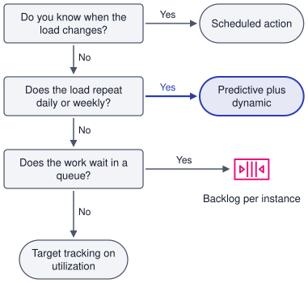
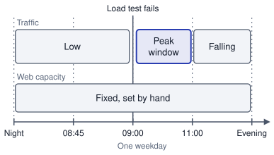
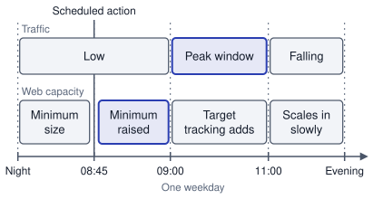

# EC2 Auto Scaling in depth

## How it works (54 min)
<!-- section: role=how; route=full; minutes=54 -->

### An Auto Scaling group holds its desired capacity between a minimum and maximum (4 min)

An **Auto Scaling group** counts the running instances all day and replaces the ones that fail.

1. **Set three numbers.** The group has a [minimum number of instances](../facts/ec2-auto-scaling.md#ec2-auto-scaling-min-max-never-crossed) and a [maximum number of instances](../facts/ec2-auto-scaling.md#ec2-auto-scaling-min-max-never-crossed). The **desired capacity** stays [within the range of your minimum and maximum](../facts/ec2-auto-scaling.md#ec2-auto-scaling-desired-within-min-max).
2. **Hold the count.** An instance that [terminates unexpectedly](../facts/ec2-auto-scaling.md#ec2-auto-scaling-health-unexpected-termination-replaced) gets a replacement.
3. **Move the count.** A **scaling policy** [adjusts the desired capacity of the group](../facts/ec2-auto-scaling.md#ec2-auto-scaling-scaling-policy-adjusts-desired), and the group [launches or terminates the instances as needed](../facts/ec2-auto-scaling.md#ec2-auto-scaling-scaling-policy-adjusts-desired).

Why three numbers? The minimum protects availability, and the maximum protects the bill.

> **Exam signal:** "replace failed instances automatically" with a steady load points to a group that can [maintain a fixed size](../facts/ec2-auto-scaling.md#ec2-auto-scaling-default-no-policies-fixed-size).

> **Try it:** Terminate an instance of a small group by hand and watch the group launch a replacement. See [3-do.md](3-do.md). <!-- task: auto-scaling-t02 -->

> **Say it:** The short answer is: the group keeps the desired count. The thing to watch is the maximum, because it caps the peak.

**Stop and answer.** A group has minimum 2, maximum 4 and desired 4. A policy calculates that 6 instances are needed. How many run?

Answer

Four. The new capacity [never goes outside of the minimum and maximum](../facts/ec2-auto-scaling.md#ec2-auto-scaling-dynamic-capacity-kept-within-min-max).

### A launch template tells the group what to launch in numbered versions (4 min)

Every new instance needs the same Amazon Machine Image (AMI), instance type and role. The group reads one recipe for that.

1. **Write the recipe.** A **launch template** stores [the AMI ID, instance type, and network settings](../facts/ec2.md#ec2-launch-template-stores-launch-parameters).
2. **Keep versions.** A group can use [multiple versions of a launch template](../facts/ec2-auto-scaling.md#ec2-auto-scaling-launch-template-versions).
3. **Give it a role.** In the template you [choose an instance profile](../facts/ec2-auto-scaling.md#ec2-auto-scaling-instance-profile-for-app-credentials), and code on the instances gets its credentials. <!-- xref: 03 IAM instance profiles -->

<!-- table: plain -->
| Question | Launch template | Launch configuration |
|---|---|---|
| Spot and On-Demand Instances in one group? | Yes | No: you [must use a launch template](../facts/ec2-auto-scaling.md#ec2-auto-scaling-launch-config-no-mixed-types) |
| Account created on or after [October 1, 2024](../facts/ec2-auto-scaling.md#ec2-auto-scaling-launch-configurations-blocked-for-new-accounts)? | Yes | It [cannot create new launch configurations using any method](../facts/ec2-auto-scaling.md#ec2-auto-scaling-launch-configurations-blocked-for-new-accounts) |

Why versions? You add a version instead of editing the recipe, so the old version stays ready for a rollback.

> **Exam signal:** "use the latest patched AMI without a new template version" points to an AWS Systems Manager parameter, so the group can [use new AMI IDs](../facts/ec2-auto-scaling.md#ec2-auto-scaling-ssm-parameter-for-ami).

> **Exam trap:** Many think that you edit a launch configuration to change its AMI. You [must create a launch configuration](../facts/ec2-auto-scaling.md#ec2-auto-scaling-launch-config-immutable) and update the group; a launch template takes a new version. <!-- trap: auto-scaling-trap-launch-configuration-editable -->

> **Say it:** The short answer is: the launch template is the recipe for new instances. The thing to watch is that running instances keep their version.

**Stop and answer.** A group launches from version 3. You create version 4 with a new AMI and set the group to use version 4. Which instances run the new AMI?

Answer

Instances launched after the change, such as a replacement, which uses the [current settings of the Auto Scaling group](../facts/ec2-auto-scaling.md#ec2-auto-scaling-health-replacement-uses-current-settings).

### The group spreads instances evenly across its Availability Zones (4 min)

Instances in one Availability Zone (AZ) fail together when that zone fails.

1. **Give it zones.** The [desired capacity is distributed across these Availability Zones](../facts/ec2-auto-scaling.md#ec2-auto-scaling-desired-spread-across-azs) that you give the group.
2. **Fill the smallest zone.** A new instance goes to [the Availability Zone with the fewest instances](../facts/ec2-auto-scaling.md#ec2-auto-scaling-launch-in-az-with-fewest).
3. **Lose a zone.** [If one Availability Zone becomes unavailable](../facts/ec2-auto-scaling.md#ec2-auto-scaling-az-unavailable-launch-elsewhere), the group can [launch instances in another one to compensate](../facts/ec2-auto-scaling.md#ec2-auto-scaling-az-unavailable-launch-elsewhere).
4. **Rebalance.** On recovery, it [launches new instances before terminating the earlier ones](../facts/ec2-auto-scaling.md#ec2-auto-scaling-rebalance-launch-before-terminate).

Why balance? A group in one zone is a single point of failure; with several zones, a zone failure removes one share.

> **Exam signal:** "survive the loss of one Availability Zone" points to one group across several zones, with [at least one instance in each Availability Zone](../facts/ec2-auto-scaling.md#ec2-auto-scaling-resilience-practices). With "no wait for new instances", run enough capacity in the other zones: [static stability is preferred for high availability](../facts/ec2-auto-scaling.md#ec2-auto-scaling-wa-static-stability-for-az-loss).

> **Exam trap:** Many think that the load balancer serves every zone of the group. For targets in a zone that is not enabled for the load balancer, it [does not route traffic to them](../facts/ec2-auto-scaling.md#ec2-auto-scaling-lb-no-traffic-to-disabled-az). Add the zone to the group and to the load balancer. <!-- trap: auto-scaling-trap-lb-serves-every-group-zone -->

> **Say it:** The short answer is: give the group subnets in several zones. The thing to watch is that the load balancer serves every zone.

**Stop and answer.** A group with desired capacity 4 runs 2 instances in AZ 1 and 2 in AZ 2. AZ 2 becomes unavailable. What does the group do, and what happens when AZ 2 recovers?

Answer

It can [launch instances in another one to compensate](../facts/ec2-auto-scaling.md#ec2-auto-scaling-az-unavailable-launch-elsewhere), here AZ 1. On recovery it rebalances: it [launches new instances before terminating the earlier ones](../facts/ec2-auto-scaling.md#ec2-auto-scaling-rebalance-launch-before-terminate).

### A new instance joins the load balancer before it becomes InService (4 min)

An instance that gets requests before its software is ready returns errors.

1. **Wait, if you add a hook.** A launch **lifecycle hook** holds the instance in [Pending:Wait](../facts/ec2-auto-scaling.md#ec2-auto-scaling-launch-hook-states). A hook made in the console [sends lifecycle event notifications to Amazon EventBridge](../facts/ec2-auto-scaling.md#ec2-auto-scaling-lifecycle-hook-eventbridge-default), or a user data script does the setup. When your code completes the action, the instance moves to [Pending:Proceed](../facts/ec2-auto-scaling.md#ec2-auto-scaling-launch-hook-states).
2. **Register.** With a load balancer, the group [registers your instance with the load balancer before it marks the instance as InService](../facts/ec2-auto-scaling.md#ec2-auto-scaling-registers-with-lb-before-inservice).
3. **Count.** Now the instance is [counted against the desired capacity](../facts/ec2-auto-scaling.md#ec2-auto-scaling-inservice-counts-toward-desired).

With no answer, the hook waits [3600 seconds](../facts/ec2-auto-scaling.md#ec2-auto-scaling-lifecycle-hook-heartbeat-timeout-default), then takes [ABANDON](../facts/ec2-auto-scaling.md#ec2-auto-scaling-lifecycle-hook-default-result).

**Figure.** A lifecycle hook holds an instance in a wait state at launch or termination; the Proceed states are not drawn.

Standby takes an instance out of service for an update and keeps it in the group. Standby instances [do not actively handle load balancer traffic](../facts/ec2-auto-scaling.md#ec2-auto-scaling-standby-no-lb-traffic), and the group [does not perform health checks](../facts/ec2-auto-scaling.md#ec2-auto-scaling-standby-no-health-checks) on them.

Why a wait state? EC2 Auto Scaling has [no visibility into the applications](../facts/ec2-auto-scaling.md#ec2-auto-scaling-no-visibility-into-applications), so your code says "ready".

> **Exam signal:** "configure software before the instance gets traffic" points to a launch hook: [launch hooks can perform software configuration](../facts/ec2-auto-scaling.md#ec2-auto-scaling-faq-lifecycle-hooks-definition).

> **Say it:** The short answer is: a launch hook holds a new instance until setup ends. The thing to watch is the timeout, which ends in ABANDON.

**Stop and answer.** A launch hook keeps its default settings. The bootstrap script crashes and never answers. What happens to the instance?

Answer

The hook takes [ABANDON](../facts/ec2-auto-scaling.md#ec2-auto-scaling-lifecycle-hook-default-result). At launch, [abandon indicates that your custom actions were unsuccessful](../facts/ec2-auto-scaling.md#ec2-auto-scaling-lifecycle-hook-abandon-continue), so the group replaces the instance.

### The group replaces instances that fail the health checks you turned on (5 min)
<!-- section: route=pass -->

An application hangs, but its instance still runs. The load balancer sees the failure; the group might not.

1. **EC2 checks from the start.** EC2 status checks are the [default health check type](../facts/ec2-auto-scaling.md#ec2-auto-scaling-health-check-type-ec2-default) and are [always enabled](../facts/ec2-auto-scaling.md#ec2-auto-scaling-ec2-status-checks-always-enabled).
2. **Load balancer checks, when turned on.** By default, the group [ignores the results of the Elastic Load Balancing](../facts/ec2-auto-scaling.md#ec2-auto-scaling-elb-health-checks-ignored-by-default) (ELB) checks: [you must turn it on](../facts/ec2-auto-scaling.md#ec2-auto-scaling-health-elb-check-must-be-turned-on).
3. **Grace period.** A **health check grace period** protects a new instance: [300 seconds](../facts/ec2-auto-scaling.md#ec2-auto-scaling-grace-period-console-300-cli-0) in the console, [0 seconds](../facts/ec2-auto-scaling.md#ec2-auto-scaling-grace-period-console-300-cli-0) with the AWS CLI.
4. **Replace.** The group [terminates the unhealthy instance and launches another](../facts/ec2-auto-scaling.md#ec2-auto-scaling-unhealthy-terminated-replaced).

<!-- table: plain -->
| Check type | Starts | What it sees |
|---|---|---|
| EC2 status checks | On | Not running, impaired, or [affected by a scheduled event](../facts/ec2-auto-scaling.md#ec2-auto-scaling-health-scheduled-event-replaced) |
| ELB | Off | Whether the load balancer gets answers |
| Amazon EBS | Off | Whether the volumes pass [Amazon EBS health checks](../facts/ec2-auto-scaling.md#ec2-auto-scaling-health-ebs-check-must-be-turned-on) |
| Custom | Off | What your code reports with [SetInstanceHealth](../facts/ec2-auto-scaling.md#ec2-auto-scaling-faq-set-instance-health-custom-check) |

> **Exam signal:** "instances return errors, and nothing replaces them" points to the group's setting: [select an ELB health check](../facts/ec2-auto-scaling.md#ec2-auto-scaling-faq-which-health-check-type).

**Spot the bug.** A group made with the AWS CLI uses ELB checks and the default grace period. The application needs 4 minutes to start. New instances are replaced again and again. What is wrong?

Answer

With the AWS CLI, the grace period is [0 seconds](../facts/ec2-auto-scaling.md#ec2-auto-scaling-grace-period-console-300-cli-0), so a starting instance fails the check. Set a grace period that covers the start.

> **Exam trap:** Many think that a longer grace period keeps a new instance away from traffic. The grace period is the [minimum amount of time (in seconds)](../facts/ec2-auto-scaling.md#ec2-auto-scaling-grace-period-definition) before the group can replace a new instance as unhealthy. To hold traffic back until the instance is [ready to accept traffic](../facts/ec2-auto-scaling.md#ec2-auto-scaling-lifecycle-hook-lb-registration), use a launch hook. <!-- trap: auto-scaling-trap-grace-period-holds-traffic -->

> **Say it:** The short answer is: the group replaces what fails its checks. The thing to watch is the load balancer check, which starts off.

**Stop and answer.** A worker group has no load balancer. The worker process crashes, but the instance keeps running. Does the group replace the instance?

Answer

No. The group [only replaces instances that are unhealthy or unreachable](../facts/ec2-auto-scaling.md#ec2-auto-scaling-lb-default-ec2-checks-only) by the EC2 checks. A custom check can call [SetInstanceHealth](../facts/ec2-auto-scaling.md#ec2-auto-scaling-faq-set-instance-health-custom-check).

### A target tracking policy keeps one metric near the value you choose (4 min)
<!-- section: route=pass -->

Most teams want to keep CPU utilization, or requests per instance, near one value.

1. **Pick a metric and a value.** With [target tracking scaling](../facts/ec2-auto-scaling.md#ec2-auto-scaling-dynamic-target-tracking-definition), you choose a CloudWatch metric, such as [ALBRequestCountPerTarget](../facts/ec2-auto-scaling.md#ec2-auto-scaling-target-tracking-predefined-metrics), and a target value.
2. **AWS writes the alarms.** EC2 Auto Scaling [creates and manages the CloudWatch alarms](../facts/ec2-auto-scaling.md#ec2-auto-scaling-target-tracking-service-manages-alarms).
3. **Out fast, in slowly.** It [prioritizes availability](../facts/ec2-auto-scaling.md#ec2-auto-scaling-target-tracking-scale-in-gradual) by [scaling in more gradually when traffic is decreasing](../facts/ec2-auto-scaling.md#ec2-auto-scaling-target-tracking-scale-in-gradual).
4. **Several policies.** Scale out needs [any of the target tracking policies](../facts/ec2-auto-scaling.md#ec2-auto-scaling-target-tracking-out-any-in-all); scale in needs [all of the target tracking policies](../facts/ec2-auto-scaling.md#ec2-auto-scaling-target-tracking-out-any-in-all).

<!-- table: plain -->
| Metric | Falls as instances are added? |
|---|---|
| Average CPU utilization | Yes |
| Load balancer RequestCount or Latency | No: these [do not work for target tracking](../facts/ec2-auto-scaling.md#ec2-auto-scaling-target-tracking-unsuitable-metrics) |
| Memory | No: it [does not correspond to demand in both directions](../facts/ec2-auto-scaling.md#ec2-auto-scaling-wa-memory-is-a-poor-scaling-metric) |

Why must it fall? Target tracking assumes the metric is [inversely proportional to the capacity](../facts/ec2-auto-scaling.md#ec2-auto-scaling-target-tracking-metric-must-fall-as-capacity-grows).

> **Exam signal:** "keep the average CPU utilization at 50%" points to target tracking, which works like a [home thermostat](../facts/ec2-auto-scaling.md#ec2-auto-scaling-faq-target-tracking-definition).

> **Try it:** Attach a target tracking policy to an empty group and read the two alarms that AWS creates for it. See [3-do.md](3-do.md). <!-- task: auto-scaling-t03 -->

> **Say it:** The short answer is: name a metric and a target. The thing to watch is that the metric falls as instances are added.

**Stop and answer.** Two target tracking policies: CPU at 50% and requests per target at 1,000. CPU is at 30%; requests reach 1,400. Does the group scale out?

Answer

Yes. One policy that asks is enough to scale out.

### Step scaling follows alarm size and warmup replaces the old cooldown (4 min)

A new instance can show high CPU utilization as it starts. Counting that CPU can add instances without need.

1. **Your alarm, your steps.** With a **step scaling policy**, the adjustment follows [the size of the alarm breach](../facts/ec2-auto-scaling.md#ec2-auto-scaling-dynamic-step-definition).
2. **Simple scaling waits.** A **simple scaling policy** waits a **cooldown** of [300 seconds](../facts/ec2-auto-scaling.md#ec2-auto-scaling-default-cooldown-300-seconds) by default.
3. **Warmup instead.** During its **instance warmup**, a new instance is [not counted toward the aggregated EC2 instance metrics](../facts/ec2-auto-scaling.md#ec2-auto-scaling-warmup-instance-not-in-metrics).

<!-- table: plain -->
| Activity | Waits for the cooldown? |
|---|---|
| Simple scaling | Yes |
| Scheduled action | No: it can [initiate a scaling activity immediately](../facts/ec2-auto-scaling.md#ec2-auto-scaling-cooldown-scheduled-action-does-not-wait) |
| Unhealthy instance replacement | No: it [does not wait for the cooldown period](../facts/ec2-auto-scaling.md#ec2-auto-scaling-cooldown-unhealthy-replacement-does-not-wait) |

Why warmup? A cooldown pauses further [scaling activities initiated by simple scaling policies](../facts/ec2-auto-scaling.md#ec2-auto-scaling-cooldown-applies-to-simple-scaling) for a fixed time. A warmup acts on the metric: a new instance [waits before contributing usage data](../facts/ec2-auto-scaling.md#ec2-auto-scaling-default-instance-warmup-purpose).

> **Exam signal:** "add more instances when the breach is larger" points to [step scaling](../facts/ec2-auto-scaling.md#ec2-auto-scaling-dynamic-step-definition).

> **Exam trap:** Many think that every policy waits for the cooldown. Step scaling and target tracking scale out [without waiting for the cooldown period to end](../facts/ec2-auto-scaling.md#ec2-auto-scaling-cooldown-target-tracking-step-do-not-wait). <!-- trap: auto-scaling-trap-cooldown-for-all-policies -->

> **Say it:** The short answer is: prefer target tracking or step scaling with a warmup. The thing to watch is simple scaling, which waits for the cooldown.

**Stop and answer.** A simple scaling policy keeps the default cooldown. A spike adds 2 instances; 90 seconds later a larger spike arrives. Can the policy act?

Answer

Not yet: the cooldown lasts [300 seconds](../facts/ec2-auto-scaling.md#ec2-auto-scaling-default-cooldown-300-seconds). AWS says [do not use simple scaling policies](../facts/ec2-auto-scaling.md#ec2-auto-scaling-simple-scaling-not-recommended).

### Scheduled and predictive scaling add capacity before the load arrives (5 min)
<!-- section: route=pass -->

A new instance needs minutes to serve traffic, so a reactive policy adds capacity late.

1. **Schedule what you know.** A **scheduled action** sets [desired, minimum, and maximum capacity](../facts/ec2-auto-scaling.md#ec2-auto-scaling-scheduled-action-sets-capacities) at a date and time.
2. **Forecast what repeats.** **Predictive scaling** can [proactively increase capacity ahead of upcoming demand](../facts/ec2-auto-scaling.md#ec2-auto-scaling-faq-predictive-ahead-of-demand), after [at least 24 hours of data](../facts/ec2-auto-scaling.md#ec2-auto-scaling-predictive-needs-24-hours-of-data).
3. **Combine.** You can [use scheduled scaling and scaling policies together](../facts/ec2-auto-scaling.md#ec2-auto-scaling-scheduled-plus-policies-together). The policy keeps acting after the action. So set the minimum in the action: capacity [must fall within the minimum and maximum capacity](../facts/ec2-auto-scaling.md#ec2-auto-scaling-scheduled-plus-policies-together) that it sets.

**Figure.** How the load changes decides the method: a schedule, a forecast, a queue backlog or a utilization target.

Why not forecast everything? A surprise spike needs a dynamic policy.

> **Exam signal:** "traffic rises at the same time every weekday" points to a schedule, because [the need arises on a predictable schedule](../facts/ec2-auto-scaling.md#ec2-auto-scaling-scheduled-vs-dynamic-when-to-use).

> **Exam trap:** Many think that predictive scaling also removes capacity. [It will not scale in to remove capacity](../facts/ec2-auto-scaling.md#ec2-auto-scaling-predictive-does-not-scale-in); pair it with a dynamic policy. <!-- trap: auto-scaling-trap-predictive-scales-in -->

> **Say it:** The short answer is: schedule what you know and forecast what repeats. The thing to watch is scale in, which predictive scaling does not do.

**Stop and answer.** A new group gets a predictive scaling policy today. Tomorrow morning it adds nothing before the peak. Why?

Answer

The policy needs [at least 24 hours of data](../facts/ec2-auto-scaling.md#ec2-auto-scaling-predictive-needs-24-hours-of-data), and it starts in [forecast only](../facts/ec2-auto-scaling.md#ec2-auto-scaling-predictive-forecast-only-mode-first) mode.

### A worker group scales on the backlog of messages per instance (4 min)
<!-- section: route=pass -->

Uploads arrive in bursts. A queue lets the web tier and the workers scale on their own signals.

1. **Split the tiers.** With a group for each layer, [each layer can scale independently](../facts/ec2-auto-scaling.md#ec2-auto-scaling-whitepaper-group-per-tier). <!-- xref: 31 SQS queues between tiers -->
2. **Divide by the workers.** Take the queue length and [divide that number by the fleet's running capacity](../facts/ec2-auto-scaling.md#ec2-auto-scaling-sqs-backlog-per-instance). The result is the **backlog per instance**.
3. **Set the target.** Take the acceptable wait and [divide it by the average time](../facts/ec2-auto-scaling.md#ec2-auto-scaling-sqs-acceptable-backlog-per-instance-target) that one message needs.

Why divide? Then the metric falls when the group grows, as target tracking needs.

> **Exam signal:** "scale the workers on the messages in the queue" points to target tracking on [backlog per instance](../facts/ec2-auto-scaling.md#ec2-auto-scaling-sqs-backlog-per-instance).

> **Exam trap:** Many think that the raw queue length is a good target. The number of messages [might not change proportionally](../facts/ec2-auto-scaling.md#ec2-auto-scaling-sqs-queue-length-not-proportional) to the size of the group. <!-- trap: auto-scaling-trap-queue-length-metric -->

> **Say it:** The short answer is: scale workers on messages per instance. The thing to watch is the target, set from the wait customers accept.

**Stop and answer.** A message takes 0.5 seconds and can wait 30 seconds. The queue holds 1,800 messages; 10 workers are InService. Should the group scale out?

Answer

Yes. The target is 30 divided by 0.5, which is 60. The backlog is 1,800 divided by 10, which is 180.

### Scale in removes the instance that the termination policy picks (4 min)

When the group shrinks, one instance leaves, perhaps during a long job.

1. **Balance zones first.** The group [always balances instances across Availability Zones first](../facts/ec2-auto-scaling.md#ec2-auto-scaling-termination-az-balance-first), from the zone that [has the most instances](../facts/ec2-auto-scaling.md#ec2-auto-scaling-termination-default-zone-with-most).
2. **Apply the policy.** The default **termination policy** tries to [terminate instances that are using outdated configurations first](../facts/ec2-auto-scaling.md#ec2-auto-scaling-termination-default-outdated-first), then the one [closest to the next billing hour](../facts/ec2-auto-scaling.md#ec2-auto-scaling-termination-default-billing-hour-then-random).
3. **Drain.** The group [automatically deregisters the terminating instance](../facts/ec2-auto-scaling.md#ec2-auto-scaling-deregisters-on-scale-in), and requests get [300 seconds](../facts/ec2-auto-scaling.md#ec2-auto-scaling-cooldown-elb-deregistration-300-seconds) by default.

- **Wrong belief:** A longer deregistration delay gives the instance time to copy its logs. **Truth:** The delay runs no code. A termination hook [pauses the instance before it is terminated](../facts/ec2-auto-scaling.md#ec2-auto-scaling-lifecycle-hook-scale-in-use), so your code can [download logs or other data](../facts/ec2-auto-scaling.md#ec2-auto-scaling-lifecycle-hook-scale-in-use). <!-- trap: auto-scaling-trap-deregistration-delay-runs-shutdown-work -->

> **Exam signal:** "a long job must not be removed by scale in" points to scale-in protection: [use instance protection to prevent](../facts/ec2-auto-scaling.md#ec2-auto-scaling-faq-termination-policy-and-instance-protection) it.

> **Exam trap:** Many think that scale-in protection blocks every termination. It [does not protect Auto Scaling instances](../facts/ec2-auto-scaling.md#ec2-auto-scaling-scale-in-protection-not-health-replacement) from [health check replacement](../facts/ec2-auto-scaling.md#ec2-auto-scaling-scale-in-protection-not-health-replacement). Against manual termination, [enable Amazon EC2 termination protection](../facts/ec2-auto-scaling.md#ec2-auto-scaling-scale-in-protection-ec2-termination-protection-for-manual). <!-- trap: auto-scaling-trap-scale-in-protection-protects-all -->

> **Say it:** The short answer is: scale in drains one instance from the fullest zone. The thing to watch is long-running work, which needs protection.

**Stop and answer.** A group runs 4 instances in AZ 1 and 3 in AZ 2, all current, with the default policy. Which zone loses an instance on scale in?

Answer

AZ 1, the zone that [has the most instances](../facts/ec2-auto-scaling.md#ec2-auto-scaling-termination-default-zone-with-most).

### A mixed instances group adds Spot capacity on top of an On-Demand base (4 min)

Spot Instances cost less, but Amazon EC2 can take them back.

1. **Mix purchase options.** A group can hold a [desired split between On-Demand and Spot capacity](../facts/ec2-auto-scaling.md#ec2-auto-scaling-faq-single-group-mixed-purchase-options), [only when you use a launch template](../facts/ec2-auto-scaling.md#ec2-auto-scaling-purchase-options-need-launch-template).
2. **Base, then a percentage.** You let the [base capacity be fulfilled with On-Demand instances](../facts/ec2-auto-scaling.md#ec2-auto-scaling-faq-on-demand-base-spot-above); above it comes a [specified percentage mix of On-Demand or Spot instances](../facts/ec2-auto-scaling.md#ec2-auto-scaling-faq-on-demand-base-spot-above).
3. **Replace early.** **Capacity Rebalancing** acts when a Spot Instance is [at an elevated risk of interruption](../facts/ec2-auto-scaling.md#ec2-auto-scaling-capacity-rebalancing-spot).

Why an On-Demand base? Spot interruptions [bypass all Amazon EC2 Auto Scaling protection mechanisms](../facts/ec2-auto-scaling.md#ec2-auto-scaling-spot-interruption-bypasses-all-protection). <!-- xref: 41 Spot Instances and purchase options -->

> **Exam signal:** "stateless, fault-tolerant workers at the lowest cost" points to Spot, for [stateless, fault-tolerant, flexible applications](../facts/ec2.md#ec2-spot-recommended-stateless-fault-tolerant-flexible).

> **Exam trap:** Many think that a termination hook keeps a Spot Instance until its job ends. Amazon EC2 still reclaims it after the [two-minute interruption notice](../facts/ec2-auto-scaling.md#ec2-auto-scaling-lifecycle-hook-spot-two-minute-notice). <!-- trap: auto-scaling-trap-lifecycle-hook-stops-spot -->

**Spot the bug.** Spot workers use one instance type in one Availability Zone, with lowest-price. They are interrupted often. What is wrong?

Answer

One pool with lowest-price has the [highest risk of interruption](../facts/ec2-auto-scaling.md#ec2-auto-scaling-spot-lowest-price-not-recommended). Be [flexible about which instance types you request](../facts/ec2.md#ec2-spot-be-flexible-types-and-azs), and use price-capacity-optimized.

> **Say it:** The short answer is: an On-Demand base, plus Spot across many instance types. The thing to watch is interruptions, which give short notice.

**Stop and answer.** An On-Demand base of 2, then 50 percent Spot. Desired capacity is 10. How many instances are On-Demand?

Answer

Six: the base of 2, plus half of the other 8.

### Stopped instances belong in a warm pool not in the running group (4 min)

Two plans stop a running instance of the group: a resize to a larger instance type, and hibernation at night. Both fail.

1. **A stopped instance looks failed.** The group [marks the stopped instance as unhealthy](../facts/ec2-auto-scaling.md#ec2-auto-scaling-cannot-hibernate-group-instance) and can replace it.
2. **Prepare in a warm pool.** A **warm pool** is a [pool of pre-initialized EC2 instances](../facts/ec2-auto-scaling.md#ec2-auto-scaling-warm-pool-definition) beside the group, kept [Stopped, Running, or Hibernated](../facts/ec2-auto-scaling.md#ec2-auto-scaling-warm-pool-states).
3. **Scale out from the pool.** Pool instances [count toward the desired capacity](../facts/ec2-auto-scaling.md#ec2-auto-scaling-warm-pool-definition) when they leave the pool.

<!-- table: plain -->
| Pool state | Memory |
|---|---|
| Stopped | [RAM is cleared](../facts/ec2.md#ec2-faq-hibernate-vs-stop-ram) |
| Hibernated | [The RAM data persisted](../facts/ec2.md#ec2-faq-hibernate-vs-stop-ram) |

Why outside the group? Inside it, a stopped instance is replaced, because the group [marks the stopped instance as unhealthy](../facts/ec2-auto-scaling.md#ec2-auto-scaling-cannot-hibernate-group-instance). <!-- xref: 16 EC2 hibernation limits -->

> **Exam signal:** "instances take a long time to initialize" points to a warm pool of stopped instances, [an effective way to minimize costs](../facts/ec2-auto-scaling.md#ec2-auto-scaling-warm-pool-states).

> **Exam trap:** Many think that a larger instance type adds capacity without downtime. [You must stop your instance](../facts/ec2-auto-scaling.md#ec2-auto-scaling-vertical-stop-required) to change its type, so [plan for downtime](../facts/ec2-auto-scaling.md#ec2-auto-scaling-vertical-stop-required). <!-- trap: auto-scaling-trap-scale-up-without-downtime -->

> **Say it:** The short answer is: keep prepared instances stopped in a warm pool. The thing to watch is cost, because a fast boot needs no pool.

**Stop and answer.** An application starts in 20 seconds; users notice no delay on scale-out. Does it need a warm pool?

Answer

Probably not: a pool that is not needed [can lead to unnecessary costs](../facts/ec2-auto-scaling.md#ec2-auto-scaling-warm-pool-unnecessary-cost).

### An instance refresh replaces running instances to roll out a new version (4 min)

A security patch is in a new AMI. **Immutable infrastructure** replaces instances instead of patching them.

1. **Build new.** A new launch template version holds the new AMI.
2. **Refresh.** An **instance refresh** helps with [Deploying a new Amazon Machine Image (AMI)](../facts/ec2-auto-scaling.md#ec2-auto-scaling-instance-refresh-use-cases). With no **instance maintenance policy**, the minimum healthy percentage is [90 percent](../facts/ec2-auto-scaling.md#ec2-auto-scaling-instance-refresh-min-healthy-percentage-default), so it replaces [10 percent](../facts/ec2-auto-scaling.md#ec2-auto-scaling-instance-refresh-ten-percent-at-a-time) at a time. Since [November 15, 2023](../facts/ec2-auto-scaling.md#ec2-auto-scaling-change-instance-maintenance-policy-2023), that policy decides whether new instances are [launched before or after existing instances are terminated](../facts/ec2-auto-scaling.md#ec2-auto-scaling-change-instance-maintenance-policy-2023).
3. **Roll back.** Automatic rollback is [Disabled (false)](../facts/ec2-auto-scaling.md#ec2-auto-scaling-instance-refresh-auto-rollback-default) by default.

<!-- table: plain -->
| Minimum healthy percentage | Result |
|---|---|
| [100 percent](../facts/ec2-auto-scaling.md#ec2-auto-scaling-instance-refresh-launch-before-terminate) | [Launch the new instances first](../facts/ec2-auto-scaling.md#ec2-auto-scaling-instance-refresh-launch-before-terminate) |
| [0 percent](../facts/ec2-auto-scaling.md#ec2-auto-scaling-instance-refresh-all-at-once) | All instances together |

Why replace? With an immutable deployment, [the previous working version is not changed](../facts/ec2-auto-scaling.md#ec2-auto-scaling-wa-immutable-rollback-benefit), so a rollback is safe.

> **Exam signal:** "deploy new application code to the running instances" points to [AWS CodeDeploy or CloudFormation](../facts/ec2-auto-scaling.md#ec2-auto-scaling-faq-codedeploy-cloudformation-for-changes); code baked into a new AMI points to an instance refresh.

> **Exam trap:** Many think that a new template version updates running instances. AWS says [existing instances are not affected](../facts/ec2-auto-scaling.md#ec2-auto-scaling-faq-launch-configuration-change-existing-unaffected) by a new launch configuration. With a template, too, a new instance launches with the [current settings of the Auto Scaling group](../facts/ec2-auto-scaling.md#ec2-auto-scaling-health-replacement-uses-current-settings). <!-- trap: auto-scaling-trap-update-template-updates-instances -->

> **Say it:** The short answer is: a new template version plus an instance refresh. The thing to watch is rollback, which you turn on yourself.

**Stop and answer.** A group of 20 instances starts a default refresh. The new instances never pass health checks. What happens?

Answer

Each step replaces two. The group keeps retrying for [an hour](../facts/ec2-auto-scaling.md#ec2-auto-scaling-instance-refresh-retry-timeout), and then the refresh fails.

## Numbers that decide answers (3 min)
<!-- section: role=numbers; route=full; minutes=3 -->

### A-list

<!-- table: numbers -->
| Number | What it is | Why it decides an answer |
|---|---|---|
| [300 seconds](../facts/ec2-auto-scaling.md#ec2-auto-scaling-default-cooldown-300-seconds) | Default cooldown | Simple scaling waits for it |
| [300 seconds](../facts/ec2-auto-scaling.md#ec2-auto-scaling-grace-period-console-300-cli-0) / [0 seconds](../facts/ec2-auto-scaling.md#ec2-auto-scaling-grace-period-console-300-cli-0) | Grace period: console / AWS CLI | A CLI group can replace starting instances |
| [3600 seconds](../facts/ec2-auto-scaling.md#ec2-auto-scaling-lifecycle-hook-heartbeat-timeout-default) | Default lifecycle hook timeout | Then [ABANDON](../facts/ec2-auto-scaling.md#ec2-auto-scaling-lifecycle-hook-default-result) applies |
| [at least 24 hours of data](../facts/ec2-auto-scaling.md#ec2-auto-scaling-predictive-needs-24-hours-of-data) | Predictive scaling history | A new group has no forecast yet |
| [two-minute interruption notice](../facts/ec2-auto-scaling.md#ec2-auto-scaling-lifecycle-hook-spot-two-minute-notice) | Warning before a Spot Instance is reclaimed | A hook does not extend it |
| [90 percent](../facts/ec2-auto-scaling.md#ec2-auto-scaling-instance-refresh-min-healthy-percentage-default) | Default minimum healthy percentage of a refresh, with no maintenance policy | It replaces [10 percent](../facts/ec2-auto-scaling.md#ec2-auto-scaling-instance-refresh-ten-percent-at-a-time) at a time |
| [86,400 seconds](../facts/ec2-auto-scaling.md#ec2-auto-scaling-max-instance-lifetime-min-one-day) | Shortest maximum instance lifetime | Scheduled replacement is daily or slower |
| [300 seconds](../facts/ec2-auto-scaling.md#ec2-auto-scaling-cooldown-elb-deregistration-300-seconds) | Default deregistration delay | In-flight requests finish on scale in |

### B-list

<!-- table: numbers -->
| Number | What it is |
|---|---|
| [500 Auto Scaling groups](../facts/ec2-auto-scaling.md#ec2-auto-scaling-quota-groups-per-region) | Default quota per Region, adjustable |
| [20 step adjustments](../facts/ec2-auto-scaling.md#ec2-auto-scaling-quota-step-adjustments-per-policy) | Per step scaling policy |
| [48 hours](../facts/ec2-auto-scaling.md#ec2-auto-scaling-predictive-forecast-next-48-hours) | Predictive forecast horizon |
| [30 to 7200 seconds](../facts/ec2-auto-scaling.md#ec2-auto-scaling-lifecycle-hook-heartbeat-timeout-range) | Lifecycle hook timeout range |
| [10 percent](../facts/ec2-auto-scaling.md#ec2-auto-scaling-unhealthy-replacement-10-percent-at-a-time) | Default share of unhealthy instances replaced at a time |
| [lowest supported interval is 10 seconds](../facts/ec2-auto-scaling.md#ec2-auto-scaling-high-resolution-target-tracking) | High-resolution target tracking |

> **Changed recently:** (2026-08-17) Batch termination in one API call. 
> **Old:** not available. 
> **Now:** one TerminateInstanceInAutoScalingGroup call takes [up to 100 instance IDs](../facts/ec2-auto-scaling.md#ec2-auto-scaling-change-batch-termination-2026), at [no additional cost](../facts/ec2-auto-scaling.md#ec2-auto-scaling-change-batch-termination-2026). 
> **The exam probably expects:** no batch termination. Do not let this number decide an answer. 
> **Status:** not examinable yet.

## Decision record (3 min)
<!-- section: role=example; route=full; minutes=3 -->

**Context.** The load test shows a fixed shape: the peak comes every weekday from 09:00 to 11:00 Eastern. A new web instance needs 4 minutes before it serves traffic. The web tier needs 3 instances at night and up to 12 at peak.

**Figure.** The web tier keeps the same capacity all day, so it is idle at night and short at the weekday peak.

**Requirement.** Replace failed instances automatically, have capacity in service when the weekday peak starts, and do not pay for 12 instances all day. Which solution is the MOST cost-effective?

**Options.**

- 12 instances all the time.
- Scheduled scaling only.
- **Target tracking plus a scheduled action at 08:45 on weekdays.**

**Decision.** Target tracking plus a scheduled action, maximum 12. At 08:45 the action raises the minimum capacity from 3 to 6, and a second action at 11:00 sets it back to 3. You can [use scheduled scaling and scaling policies together](../facts/ec2-auto-scaling.md#ec2-auto-scaling-scheduled-plus-policies-together): target tracking adds more, and capacity [must fall within the minimum and maximum capacity](../facts/ec2-auto-scaling.md#ec2-auto-scaling-scheduled-plus-policies-together) of the action. Fixed capacity pays for idle instances, billed [as soon as they are launched](../facts/ec2-auto-scaling.md#ec2-auto-scaling-billed-from-launch), and a schedule alone misses spikes at unknown times. The action uses America/New_York to [automatically adjust for DST](../facts/ec2-auto-scaling.md#ec2-auto-scaling-scheduled-dst-location-time-zones).

**Figure.** A scheduled action raises the minimum before the weekday peak, and target tracking follows the traffic after it.

**Trade-off.** A sudden spike outside the schedule is served about 4 minutes late. Target tracking acts after the metric moves, [which is reactive in nature](../facts/ec2-auto-scaling.md#ec2-auto-scaling-predictive-long-initialization-fit).

## FAQ quick-fire (4 min)
<!-- section: role=faq; route=full; minutes=4 -->

**FAQ 1.** Can one Auto Scaling group span two AWS Regions?

Answer

No. A second Region needs a second group.

> "EC2 Auto Scaling groups are regional constructs. They can span Availability Zones, but not AWS regions."
> — [Amazon EC2 Auto Scaling FAQs](https://aws.amazon.com/ec2/autoscaling/faqs/)

**FAQ 2.** Is the data on a running instance copied to new instances?

Answer

No. Use lifecycle hooks, or keep the data off the instance.

> "Data is not automatically copied from existing instances to new instances."
> — [Amazon EC2 Auto Scaling FAQs](https://aws.amazon.com/ec2/autoscaling/faqs/)

**FAQ 3.** Do the running instances survive when you delete their group?

Answer

No.

> "If you have an EC2 Auto Scaling group (ASG) with running instances and you choose to delete the ASG, the instances will be terminated and the ASG will be deleted."
> — [Amazon EC2 Auto Scaling FAQs](https://aws.amazon.com/ec2/autoscaling/faqs/)

**FAQ 4.** Can you change a launch configuration after you create it?

Answer

No. Create a new one and update the group.

> "However, you can only specify one launch configuration for an EC2 Auto Scaling group at a time, and you can't modify a launch configuration after you've created it."
> — [Amazon EC2 Auto Scaling FAQs](https://aws.amazon.com/ec2/autoscaling/faqs/)

**FAQ 5.** Do you need Elastic Load Balancing to use EC2 Auto Scaling?

Answer

No. The EC2 health check finds and replaces unhealthy instances.

> "You don't have to use ELB to use Auto Scaling."
> — [Amazon EC2 Auto Scaling FAQs](https://aws.amazon.com/ec2/autoscaling/faqs/)

**FAQ 6.** Can one group mix On-Demand, Reserved and Spot Instances?

Answer

Yes. RIs are a discount: you [receive your RI pricing for On-Demand Instances](../facts/ec2-auto-scaling.md#ec2-auto-scaling-faq-ri-discount-applies-to-on-demand).

> "You can provision and automatically scale EC2 capacity across different EC2 instance types, Availability Zones, and On-Demand, RIs and Spot purchase options in a single Auto Scaling Group."
> — [Amazon EC2 Auto Scaling FAQs](https://aws.amazon.com/ec2/autoscaling/faqs/)

**FAQ 7.** Can a group scale past the account's EC2 instance limit?

Answer

No. Request a higher limit.

> "Amazon EC2 Auto Scaling cannot scale past the Amazon EC2 limit of instances that you can run."
> — [Amazon EC2 Auto Scaling FAQs](https://aws.amazon.com/ec2/autoscaling/faqs/)

**FAQ 8.** Does a group created from an existing instance create a new AMI?

Answer

No.

> "When you create an Auto Scaling group from an existing instance, it does not create a new AMI."
> — [Amazon EC2 Auto Scaling FAQs](https://aws.amazon.com/ec2/autoscaling/faqs/)

**FAQ 9.** Do you need an AWS Auto Scaling plan for predictive scaling?

Answer

No.

> "Predictive Scaling Policy brings the similar prediction algorithm offered through AWS Auto Scaling plan as a native scaling policy in EC2 Auto Scaling."
> — [Amazon EC2 Auto Scaling FAQs](https://aws.amazon.com/ec2/autoscaling/faqs/)

**FAQ 10.** Can EC2 Auto Scaling add an EBS volume when a disk fills up?

Answer

No. Use the EC2 API to add a volume to the instance.

> "Amazon EC2 Auto Scaling doesn't automatically add a volume when the existing one is approaching capacity."
> — [Amazon EC2 Auto Scaling FAQs](https://aws.amazon.com/ec2/autoscaling/faqs/)

