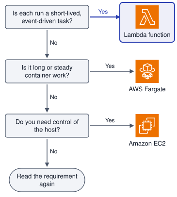
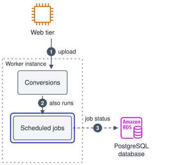

# AWS Lambda in depth

## How it works (61 min)
<!-- section: role=how; route=full; minutes=61 -->

Follow one event through a **function**: where it runs, how it arrives, who retries it.

### Each request runs in an execution environment that Lambda can freeze and reuse (5 min)
<!-- section: route=pass -->

Does a job's memory cache or temporary file survive when the job moves into a function?

1. **Create.** With no free **execution environment**, Lambda [downloads your code, starts the environment](../facts/lambda.md#lambda-cold-start-definition) and runs the [Init phase](../facts/lambda.md#lambda-lifecycle-phases). This is a **cold start**.
2. **Invoke.** The **handler**, the [method in your function code that processes events](../facts/lambda.md#lambda-function-single-handler), runs.
3. **Reuse.** Then [the execution environment is frozen](../facts/lambda.md#lambda-warm-start-environment-reuse), and the next request can reuse it: the Init code [is not run again](../facts/lambda.md#lambda-static-init-reuse-connections).
4. **Recycle.** Lambda [terminates execution environments every few hours](../facts/lambda.md#lambda-environment-not-persistent).

<!-- table: plain -->
| Kept in | Next warm request | A new environment |
|---|---|---|
| An Init variable | Kept | Lost |
| A file in /tmp | Kept: it [remains when the execution environment is frozen](../facts/lambda.md#lambda-tmp-transient-cache) | Lost: [temporary and unique to each execution environment](../facts/lambda.md#lambda-tmp-unique-per-environment) |

Why **stateless** (STAYT-less)? The next request can reach another environment, with its own **ephemeral** (ih-FEM-er-ul) /tmp storage.

> **Exam signal:** "reuse the database connection between invocations" points to Init code, so that warm invocations [reuse connections over multiple invocations](../facts/lambda.md#lambda-static-init-reuse-connections).

> **Exam trap:** Many think that a function can keep user sessions in memory or in /tmp. A function [should not rely on any existing data structures](../facts/lambda.md#lambda-stateless-store-state-elsewhere). <!-- trap: lambda-trap-state-in-environment -->

> **Say it:** The short answer is: Lambda reuses warm environments. The thing to watch is that nothing in them is sure to last.

**Stop and answer.** A function counts orders in a global variable. Two requests arrive together. Do both see the same count?

Answer

Not necessarily. Requests can be [processed out of order or concurrently](../facts/lambda.md#lambda-requests-out-of-order), in different environments. Store the count in DynamoDB.

### AWS services push events to a function and Lambda polls queues and streams (4 min)

An upload, a queue message and a schedule each start work. What tells the function?

1. **Push.** A service invokes the function through a **trigger**: [direct invocation (push)](../facts/lambda.md#lambda-event-push-or-pull). Amazon S3 does not wait, so its call is **asynchronous** (ay-SING-kruh-nus). API Gateway waits: a **synchronous invocation**.
2. **Pull.** For a **queue** (KYOO) or a stream, an **event source mapping** reads the records. [Lambda handles the polling](../facts/lambda.md#lambda-esm-lambda-polls-source) and can [batch records together](../facts/lambda.md#lambda-esm-batches-records).

<!-- table: plain -->
| Source | Model | Invocation |
|---|---|---|
| Amazon S3, [Amazon Simple Notification Service](../facts/lambda.md#lambda-trigger-sns-async) (Amazon SNS) | Push | [Event-driven; asynchronous invocation](../facts/lambda.md#lambda-trigger-s3-async) |
| Amazon EventBridge rules | Push | [asynchronous invocation (event buses and rules)](../facts/lambda.md#lambda-trigger-eventbridge-async-rules) |
| API Gateway, [Application Load Balancer](../facts/lambda.md#lambda-trigger-alb-sync), [Amazon Cognito](../facts/lambda.md#lambda-trigger-cognito-sync) | Push | [Event-driven; synchronous invocation](../facts/lambda.md#lambda-trigger-apigateway-sync) |
| Amazon Simple Queue Service (Amazon SQS), [Amazon Kinesis](../facts/lambda.md#lambda-trigger-kinesis-esm) | Pull | [Event source mapping](../facts/lambda.md#lambda-trigger-sqs-esm) |

A cron schedule becomes an EventBridge rule. <!-- xref: 31 EventBridge rules and schedules -->

**Figure.** Synchronous: [`Lambda` runs the function and waits for a response](../facts/lambda.md#lambda-sync-invocation-waits); asynchronous: it [places the event in a queue](../facts/lambda.md#lambda-async-queue-then-separate-process); mapping: `Lambda` handles the polling.

> **Exam signal:** "an instance checks the bucket for new files" points to an S3 event notification: [polling can be highly inefficient](../facts/lambda.md#lambda-eda-polling-inefficient).

> **Say it:** The short answer is: services push, and Lambda polls queues and streams. The thing to watch is the mapping, which does the polling.

**Stop and answer.** An S3 bucket and an SQS queue both start one function. Can one invocation hold records from both?

Answer

No. Each event [has data from only one trigger](../facts/lambda.md#lambda-multiple-triggers-one-per-event).

### A synchronous caller handles errors itself but Lambda retries asynchronous events (5 min)
<!-- section: route=pass -->

An order function fails now and then. Is the failed order lost?

1. **Synchronous.** Lambda [runs the function and waits for a response](../facts/lambda.md#lambda-sync-invocation-waits). On an error, the caller must [retry the invocation manually](../facts/lambda.md#lambda-sync-error-caller-retries).
2. **Asynchronous.** Lambda [places the event in a queue](../facts/lambda.md#lambda-async-queue-then-separate-process) and returns a success response immediately.
3. **Retry.** After a function error, Lambda by default tries [two more times](../facts/lambda.md#lambda-async-default-two-retries).
4. **Keep or lose.** Then [Lambda discards it](../facts/lambda.md#lambda-async-discard-then-destination), unless you configure a failed-event destination.

<!-- table: plain -->
| Question | Synchronous | Asynchronous |
|---|---|---|
| Who retries? | The caller | Lambda |
| Largest payload | [6 MB](../facts/lambda.md#lambda-payload-sync) | [1 MB](../facts/lambda.md#lambda-payload-async) |

> **Try it:** Invoke a failing function both ways and find each error. See [3-do.md](3-do.md). <!-- task: lambda-t03 -->

Why no synchronous retry? The caller waits and decides: [the service controls the error strategy](../facts/lambda.md#lambda-sync-service-controls-error-strategy).

> **Exam signal:** "no failed upload event can be lost" points to an on-failure destination, such as [a standard SQS queue](../facts/lambda.md#lambda-async-destination-targets).

> **Exam trap:** Many think that Lambda retries a failed call from API Gateway. API Gateway [always relays the error response back](../facts/lambda.md#lambda-apigateway-relays-error) to its client. <!-- trap: lambda-trap-lambda-retries-sync -->

Go deeper: destinations or a dead-letter queue

Another choice is a **dead-letter queue**: a queue for the events that failed every attempt.

- **Wrong belief:** A dead-letter queue keeps the error details. **Truth:** Lambda [only sends the content of the event](../facts/lambda.md#lambda-dlq-content-only-vs-destinations). An on-failure destination keeps the details. <!-- trap: lambda-trap-dlq-keeps-details -->
- **Wrong belief:** A dead-letter queue also catches failed synchronous calls. **Truth:** It receives asynchronous events after the retries. A synchronous caller must [retry the invocation manually](../facts/lambda.md#lambda-sync-error-caller-retries). <!-- trap: lambda-trap-dlq-for-sync -->

> **Say it:** The short answer is: synchronous callers retry, and Lambda retries asynchronous events. The thing to watch is the destination, which keeps failed events.

**Stop and answer.** A function that Amazon S3 invokes never fails, yet some results are written twice. Why?

Answer

The same event can arrive twice: [the queue itself is eventually consistent](../facts/lambda.md#lambda-async-queue-eventually-consistent). Make the function **idempotent** (eye-dem-POH-tent).

### A failed batch returns to its queue but blocks its stream shard (5 min)

One bad record fails the function every time. What happens to the other records?

1. **Batch.** The mapping invokes the function when [the batch size is met](../facts/lambda.md#lambda-esm-batch-triggers-three-criteria), the batching window reaches its maximum value, or the payload reaches [6 MB](../facts/lambda.md#lambda-esm-batch-triggers-three-criteria).
2. **Queue.** After an error, the messages [become visible in the queue again](../facts/lambda.md#lambda-sqs-visibility-timeout-retry) when the **visibility timeout** ends.
3. **Stream.** Lambda [stops processing additional records in a shard](../facts/lambda.md#lambda-kinesis-in-order-stops-on-error) until it [succeeds or the data expires](../facts/lambda.md#lambda-faq-streams-retry-until-expiry).
4. **Duplicates.** Mappings [process each event at least once](../facts/lambda.md#lambda-esm-at-least-once), so the code must be idempotent.

<!-- table: plain -->
| Question | SQS queue | Kinesis stream |
|---|---|---|
| A tool to isolate the failed part | A [partial batch response](../facts/lambda.md#lambda-sqs-partial-batch-response) | Bisect: it [splits a failed batch into two smaller batches](../facts/lambda.md#lambda-stream-bisect-batch-on-error) |

Why does a stream wait? A shard keeps its order, so Lambda [reprocesses the entire batch](../facts/lambda.md#lambda-esm-stream-reprocess-batch-pause-shard) and holds the shard.

> **Exam signal:** "one bad record blocks the stream for days" points to a retry limit or maximum record age with an on-failure destination: by default, a bad record can block a shard for [up to one week](../facts/lambda.md#lambda-kinesis-bad-record-block-one-week), even with bisect.

> **Exam trap:** Many think that the function's dead-letter queue catches failing SQS messages. The source queue's [visibility timeout and redrive policy](../facts/lambda.md#lambda-queue-esm-retry-set-on-queue) decide. <!-- trap: lambda-trap-function-dlq-for-sqs -->

Go deeper: failed records of a Kinesis stream

- **Wrong belief:** For a Kinesis stream, the function's dead-letter queue catches failing records. **Truth:** By default, [failed records are retried until the record expires](../facts/lambda.md#lambda-kinesis-max-retry-attempts). To keep them, add an [Amazon SQS queue or Amazon SNS topic](../facts/lambda.md#lambda-kinesis-failure-destination-sqs-sns) as an on-failure destination. <!-- trap: lambda-trap-function-dlq-for-streams -->

**Spot the bug.** A function has a 5-minute timeout, and its SQS queue has a 30-second visibility timeout. What is wrong?

Answer

The function timeout [must be less than or equal to](../facts/lambda.md#lambda-sqs-timeout-not-above-visibility) the visibility timeout, or Lambda returns an error. AWS recommends [at least six times](../facts/lambda.md#lambda-sqs-visibility-six-times-timeout) the function timeout.

> **Say it:** The short answer is: queue batches return, and stream batches block their shard. The thing to watch is the visibility timeout, which returns failed messages.

**Stop and answer.** A Kinesis stream has 100 shards, and the function falls behind. Shards cannot be added. Which setting helps?

Answer

The parallelization factor, [from 1 (default) to 10](../facts/lambda.md#lambda-kinesis-parallelization-factor-1-to-10) batches for each shard.

### One Regional concurrency quota is shared by all functions and throttles the excess (5 min)
<!-- section: route=pass -->

Campaign traffic is ten times the usual, and some requests fail. Which limit did they reach?

1. **Count.** **Concurrency** is the number of requests in flight: [multiplying average requests per second](../facts/lambda.md#lambda-concurrency-formula) by the average duration.
2. **Share.** All functions of an account share one Regional quota: [1,000](../facts/lambda.md#lambda-concurrent-executions-default) by default, adjustable to tens of thousands.
3. **Scale.** Each function adds [1,000 additional execution environment instances](../facts/lambda.md#lambda-scaling-rate-10000-rps) [every 10 seconds](../facts/lambda.md#lambda-scaling-rate-not-adjustable).
4. **Throttle.** Requests above the limit get a [throttling error (429 status code)](../facts/lambda.md#lambda-throttle-429). This is **throttling**.

<!-- table: plain -->
| Caller | Sees | Then |
|---|---|---|
| API Gateway or direct code | A [429 error code](../facts/lambda.md#lambda-faq-throttle-sync-429) | The caller decides |
| Amazon S3 or Amazon SNS | Success | Lambda retries for [up to 6 hours by default](../facts/lambda.md#lambda-async-throttle-retry-6-hours) |
| An SQS mapping | No error | [Lambda continues to retry the message](../facts/lambda.md#lambda-sqs-throttle-drop-after-visibility) until the visibility timeout passes |

Why one pool? Lambda keeps one [default safety throttle](../facts/lambda.md#lambda-faq-parallel-no-limit-safety-throttle) per account per Region; reserved concurrency stops one function from taking it all.

> **Exam signal:** "the standby Region must take the full load after a failover" points to a quota increase there too: quotas apply [per AWS Region](../facts/lambda.md#lambda-quota-scope-region-vs-vpc).

> **Exam trap:** Many think that a primary-Region increase covers the standby Region. A quota can be [changed in one region but not in other regions](../facts/lambda.md#lambda-wa-quotas-failover-region). <!-- trap: lambda-trap-quota-follows-region -->

Go deeper: quota increases are requests

- **Wrong belief:** AWS raises a quota by itself when a workload reaches it. **Truth:** In Service Quotas, you [request and track quota increases](../facts/lambda.md#lambda-wa-quotas-not-auto-increased), in each Region, before the load arrives. New accounts start lower, and AWS [raises these quotas automatically](../facts/lambda.md#lambda-new-account-reduced-quotas). <!-- trap: lambda-trap-quota-auto-increase -->

> **Say it:** The short answer is: a Region's functions share one quota. The thing to watch is the standby Region, with its own quota.

**Stop and answer.** A function was quiet for an hour. Can it now use its unused scaling steps all at once?

Answer

No. The rate is [always 1,000 concurrency units at maximum](../facts/lambda.md#lambda-scaling-rate-not-accrued).

### Reserved concurrency guarantees and caps the concurrency of one function at no charge (4 min)

A nightly batch function takes the whole account pool, and the payment function is throttled.

1. **Reserve.** **Reserved concurrency** can [reserve a subset of your account concurrency limit](../facts/lambda.md#lambda-faq-per-function-concurrency-control) for one function.
2. **Cap.** It can also [limit how high your function can scale](../facts/lambda.md#lambda-bp-reserved-protects-downstream), for example to protect a database.
3. **Floor.** Lambda keeps [100 units of concurrency](../facts/lambda.md#lambda-unreserved-concurrency-100-always) for other functions, so you can reserve [up to 900 units of concurrency](../facts/lambda.md#lambda-reserve-up-to-900-default) at the default quota.

> **Try it:** Set reserved concurrency to 0, watch a call fail, then remove the setting. See [3-do.md](3-do.md). <!-- task: lambda-t02 -->

Why is it free? It divides your pool: it [incurs no additional charges](../facts/lambda.md#lambda-reserved-concurrency-no-charge).

> **Exam signal:** "stop a function immediately without deleting it" points to reserved concurrency 0, which will [throttle all invocations to the function](../facts/lambda.md#lambda-bp-runaway-reserved-zero).

> **Say it:** The short answer is: reserved concurrency sets aside and caps a share. The thing to watch is that it warms nothing.

**Stop and answer.** An asynchronous function with a dead-letter queue has reserved concurrency 0. What happens to new events?

Answer

They go to the dead-letter queue [without any retries](../facts/lambda.md#lambda-reserved-zero-async-to-dlq-no-retry).

### Provisioned concurrency keeps environments initialized and you pay for them while idle (4 min)

After a quiet period, the first requests to an API are slow.

1. **Prepare.** **Provisioned concurrency** keeps [pre-initialized execution environments](../facts/lambda.md#lambda-pc-scales-beyond-setting), ready in [double-digit milliseconds](../facts/lambda.md#lambda-faq-pc-what).
2. **Pin.** It applies to a published version, a fixed copy of the code, or an `alias` that points to one, [not the $LATEST version](../facts/lambda.md#lambda-pc-not-latest-no-cold-start).
3. **Overflow.** Extra requests scale [above and beyond your provisioned concurrency setting](../facts/lambda.md#lambda-pc-scales-beyond-setting), [billed for excess function execution](../facts/lambda.md#lambda-pc-excess-at-on-demand-rate).
4. **Pay.** You pay for the [amount of concurrency you configure](../facts/lambda.md#lambda-pc-pricing-dimensions), [rounded up to the nearest five minutes](../facts/lambda.md#lambda-pc-rounded-5-minutes), also when idle.

<!-- table: plain -->
| Setting | First requests |
|---|---|
| Provisioned concurrency | Fastest: it [does not exhibit cold start behavior](../facts/lambda.md#lambda-pc-not-latest-no-cold-start) |
| **SnapStart** | Resumes from a [pre-initialized snapshot](../facts/lambda.md#lambda-faq-snapstart-how); best effort, [as low as sub-second](../facts/lambda.md#lambda-snapstart-vs-pc-guide) |

Why pay when idle? The environments stay initialized: [it increases costs](../facts/lambda.md#lambda-pc-costs-while-idle).

> **Exam signal:** "strict double-digit millisecond startup" points to provisioned concurrency; SnapStart is a [best-effort optimization](../facts/lambda.md#lambda-faq-snapstart-vs-pc).

> **Exam trap:** Many think that provisioned concurrency serves every caller. If an event source calls $LATEST, the function does not [use provisioned concurrency environments](../facts/lambda.md#lambda-pc-event-source-alias). <!-- trap: lambda-trap-provisioned-on-latest -->

Go deeper: provisioned concurrency is not a cap

- **Wrong belief:** Provisioned concurrency caps how far a function scales. **Truth:** Extra requests overflow, as step 3 shows. Reserved concurrency is the setting that caps. <!-- trap: lambda-trap-provisioned-caps -->

> **Say it:** The short answer is: provisioned concurrency keeps environments ready. The thing to watch is the idle cost of ready environments.

**Stop and answer.** Reserved concurrency is 50. Can the team configure a provisioned concurrency of 80?

Answer

No. You cannot allocate [more provisioned concurrency than reserved concurrency](../facts/lambda.md#lambda-provisioned-not-above-reserved) for a function.

### Memory is the one size setting and CPU grows in proportion to it (4 min)

An image function is slow, and the console shows no CPU setting.

1. **Memory.** You set [128 MB](../facts/lambda.md#lambda-memory-range) to [10,240 MB](../facts/lambda.md#lambda-memory-range) in [1-MB increments](../facts/lambda.md#lambda-memory-range). The default is [128 MB](../facts/lambda.md#lambda-memory-default).
2. **CPU.** CPU comes [in proportion to the amount of memory](../facts/lambda.md#lambda-cpu-proportional-to-memory): [1,769 MB](../facts/lambda.md#lambda-one-vcpu-at-1769-mb) gives one vCPU.
3. **Timeout.** The timeout is [3 seconds](../facts/lambda.md#lambda-timeout-default) by default, at most [900 seconds (15 minutes)](../facts/lambda.md#lambda-timeout-default).
4. **Disk.** The /tmp storage holds [between 512 MB and 10,240 MB](../facts/lambda.md#lambda-tmp-transient-cache).

Why raise memory? For CPU-bound code, [increasing the memory can help resolve the compute](../facts/lambda.md#lambda-memory-tuning-cpu-bound) bottleneck. Duration is billed [measured in GB-seconds](../facts/lambda.md#lambda-pricing-dimensions), so measure the cost too.

> **Exam signal:** "choose the memory size from measured data" points to the [AWS Lambda Power Tuning project](../facts/lambda.md#lambda-right-size-memory-power-tuning).

> **Exam trap:** Many think that a slow function needs a CPU setting. Raise the memory: it brings [proportional CPU power](../facts/lambda.md#lambda-faq-memory-cpu-proportional). <!-- trap: lambda-trap-cpu-separate-setting -->

> **Say it:** The short answer is: raise the memory, and CPU rises with it. The thing to watch is the price per millisecond.

**Stop and answer.** A calculation needs eight vCPUs in parallel. Which memory setting gives that?

Answer

None for a standard function. CPU grows [up to 6 vCPU](../facts/lambda.md#lambda-cpu-up-to-6-vcpu). AWS Fargate offers [0.25 vCPUs to 32 vCPUs](../facts/lambda.md#lambda-vs-fargate-cpu-memory-ceilings).

### Code ships as a zip archive or an image and published versions never change (4 min)

A function needs a large library, and releases should reach a few users first.

1. **Package.** Code ships as [.zip file archives](../facts/lambda.md#lambda-faq-deploy-zip-or-image) of at most [250 MB](../facts/lambda.md#lambda-package-250-mb-unzipped) unzipped, or as container images of at most [10 GB](../facts/lambda.md#lambda-container-image-10-gb).
2. **Share.** A **Lambda layer** is a [.zip file archive that contains supplementary code](../facts/lambda.md#lambda-layer-zip-contents).
3. **Publish.** A published **function version** is [immutable](../facts/lambda.md#lambda-version-immutable-latest-unpublished). The [unpublished version is named $LATEST](../facts/lambda.md#lambda-version-immutable-latest-unpublished).
4. **Shift.** A function `alias` is [a pointer to a function version](../facts/lambda.md#lambda-alias-pointer-to-version). The `alias` can split traffic between two versions.

Why immutable versions? Moving the `alias` back lets you [quickly roll back](../facts/lambda.md#lambda-weighted-alias-canary).

> **Exam signal:** "send a small share of traffic to the new version and roll back fast" points to a weighted `alias` with a [small percentage of traffic](../facts/lambda.md#lambda-weighted-alias-canary).

Go deeper: layers do not add space

- **Wrong belief:** Layers add room beyond the package quota. **Truth:** The unzipped function and all its layers stay within [250 MB](../facts/lambda.md#lambda-layers-five-and-250-mb). Larger code goes into a container image. <!-- trap: lambda-trap-layers-add-space -->

> **Say it:** The short answer is: ship large code as an image, and release with versions. The thing to watch is $LATEST, the version you edit.

**Stop and answer.** A team wants a weighted `alias` that sends 5 percent of traffic to $LATEST. Can it?

Answer

No. It [cannot point to $LATEST](../facts/lambda.md#lambda-weighted-alias-two-versions-not-latest): both versions must be published.

### An execution role grants permissions and a resource-based policy allows invocation (4 min)

An upload starts a function that reads the object. Two policies decide these calls.

1. **Outbound.** Every function [must have an execution role](../facts/lambda.md#lambda-execution-role-required-logs). The **execution role** is an AWS Identity and Access Management (IAM) role that Lambda assumes.
2. **Least privilege.** Start from [AWSLambdaBasicExecutionRole](../facts/lambda.md#lambda-execution-role-required-logs) for logs. Then [limit the execution role to these permissions](../facts/lambda.md#lambda-bp-least-privilege-role) that the code needs.
3. **Inbound.** When Amazon S3 invokes the function, [Lambda considers only the resource-based policy](../facts/lambda.md#lambda-service-caller-resource-policy-only).
4. **Polling.** For a mapping, the role reads the source, for example with [sqs:ReceiveMessage](../facts/lambda.md#lambda-sqs-execution-role-read-permissions).

Why two policies? The function acts as its role, but it is also a resource others call.

> **Exam signal:** "the function needs database credentials" points to AWS Secrets Manager: [use AWS Secrets Manager instead of environment variables](../facts/lambda.md#lambda-secrets-manager-not-env-vars). <!-- xref: 07 Secrets Manager for database credentials -->

> **Say it:** The short answer is: the role covers outbound calls, and the resource-based policy covers who invokes. The thing to watch is permission for Amazon S3.

**Stop and answer.** The role allows every S3 action on every bucket, but the code reads one bucket. What should change?

Answer

The role should [include only the required permissions](../facts/lambda.md#lambda-exec-role-least-privilege): read access to that bucket.

### A VPC function reaches private resources and needs a NAT gateway for the internet (4 min)

A function queries a database in private subnets and calls a payment provider on the internet.

1. **Default.** A function runs in a virtual private cloud (VPC) [owned and managed by the Lambda service](../facts/lambda.md#lambda-runs-in-lambda-managed-vpc). By default, functions [have access to the public internet](../facts/lambda.md#lambda-vpc-attached-only-vpc-resources).
2. **Attach.** You choose a [subnet and security group](../facts/lambda.md#lambda-faq-vpc-subnet-security-group), and Lambda adds an elastic network interface there.
3. **Lose the internet.** After that, the function [can only access resources available within that VPC](../facts/lambda.md#lambda-vpc-attached-only-vpc-resources).
4. **Route out.** Private subnets [access the internet through the NAT gateway](../facts/lambda.md#lambda-vpc-public-subnet-no-internet).

<!-- table: plain -->
| Configuration | Database | Internet |
|---|---|---|
| Not attached | Not reachable | Reachable |
| Public subnet | Reachable | Not reachable |
| Private subnets with a NAT gateway route | Reachable | Reachable |

Why does a public subnet not help? [Connecting a function to a public subnet](../facts/lambda.md#lambda-vpc-public-subnet-no-internet) gives it no public IP address and no internet access.

> **Exam signal:** "clients in a VPC must invoke the function without internet access" points to an [interface VPC endpoint](../facts/lambda.md#lambda-interface-endpoint-private-invoke) for Lambda. <!-- xref: 10 VPC NAT gateway and VPC endpoints -->

> **Say it:** The short answer is: use private subnets and a NAT gateway. The thing to watch is the public subnet, which gives no internet access.

**Stop and answer.** A VPC function writes to DynamoDB and has no route to the internet. What does it need?

Answer

A gateway VPC endpoint. Gateway endpoints are [available only for AWS services including S3 and DynamoDB](../facts/vpc.md#vpc-faq-endpoint-types-gateway-interface).

### RDS Proxy pools the database connections that many concurrent functions would exhaust (4 min)

Many copies of a function each open a PostgreSQL connection, and the database refuses new ones.

1. **Scale out.** Each environment holds its own connection, so many environments can [exhaust database connection limits](../facts/lambda.md#lambda-vpc-db-connections-rds-proxy).
2. **Fixed database.** Amazon Relational Database Service (Amazon RDS) has fixed capacity: [you might exceed your connection quota](../facts/lambda.md#lambda-rds-connection-quota-spikes).
3. **Pool.** **RDS Proxy** lets applications [pool and share database connections](../facts/rds-proxy.md#rds-proxy-definition-pool-share). In a surge it [queues or throttles application connections](../facts/rds-proxy.md#rds-proxy-surges-queue-throttle).

Why a proxy? A few pooled connections serve many functions, so [proxies are recommended for production](../facts/lambda.md#lambda-rds-proxy-recommended-production), at [an hourly rate for proxies](../facts/lambda.md#lambda-rds-proxy-hourly-charge). <!-- xref: 26 RDS Proxy -->

> **Exam signal:** "remove the database password from the function code" points to the proxy with the function's [IAM execution role](../facts/rds-proxy.md#rds-proxy-faq-lambda-iam-execution-role).

> **Exam trap:** Many think that the database scales with Lambda, so each invocation can open a new connection. A burst of environments is a burst of connections. <!-- trap: lambda-trap-connection-per-invocation -->

> **Say it:** The short answer is: RDS Proxy pools the connections of many functions. The thing to watch is its hourly charge.

**Stop and answer.** Can a reporting tool outside AWS connect to the proxy over the internet?

Answer

No. The proxy cannot [be publicly accessible](../facts/rds-proxy.md#rds-proxy-same-vpc-not-public), even when the database is. Attach the functions to the database's VPC, where the proxy sits.

### A function URL is the simplest HTTPS endpoint and API Gateway adds API features (4 min)

Partners need an HTTPS endpoint for one function, some with their own request limits.

1. **Function URL.** A **function URL** is public (no authentication) or can [require IAM authentication](../facts/lambda.md#lambda-furl-auth-public-or-iam).
2. **API Gateway.** API Gateway adds [API keys for usage plans](../facts/lambda.md#lambda-apigw-extra-features-waf-keys) and WAF integration for additional security.

Why does a function URL return [HTTP 429 responses](../facts/lambda.md#lambda-furl-429-no-queue) under load? Nothing holds requests in front of it.

> **Exam signal:** "each partner needs its own API key and request quota" points to API Gateway usage plans. <!-- xref: 33 API Gateway usage plans -->

> **Exam trap:** Many think that a function URL has AWS WAF integration, like an API. [WAF integration for additional security](../facts/lambda.md#lambda-apigw-extra-features-waf-keys) is an API Gateway feature. <!-- trap: lambda-trap-function-url-api-features -->

> **Say it:** The short answer is: a function URL is an address; API Gateway adds keys and WAF. The thing to watch is that nothing queues requests.

**Stop and answer.** Can a function URL accept only signed AWS callers?

Answer

Yes. It can [require IAM authentication](../facts/lambda.md#lambda-furl-auth-public-or-iam).

### Short event-driven work fits Lambda and long or steady work fits containers or instances (5 min)
<!-- section: route=pass -->

A company makes thumbnails after uploads, runs a busy API all day, and runs hour-long video jobs.

1. **Short and bursty.** AWS suggests functions for [event-driven tasks, unpredictable workloads](../facts/lambda.md#lambda-choose-functions-event-driven-unpredictable), and you do not [pay for idle capacity](../facts/lambda.md#lambda-no-pay-for-idle-capacity).
2. **Long.** A function runs at most [15 minutes per invocation](../facts/lambda.md#lambda-fargate-no-execution-time-limit), and AWS Fargate has no hard limit on execution time.
3. **Steady.** For [sustained, high-throughput workloads](../facts/lambda.md#lambda-vs-fargate-cost-by-volume), Fargate tends to cost less.

**Figure.** A function suits [short-lived, event-driven tasks](../facts/lambda.md#lambda-fargate-long-running-lambda-short), and long or steady work points to a container or an instance.

Why does steady load favor containers? Lambda costs grow with every request. At low traffic, you [pay less with Lambda at lower traffic volumes](../facts/lambda.md#lambda-vs-fargate-cost-by-volume).

> **Exam signal:** "one commitment that lowers the cost of Lambda, Fargate and EC2" points to a Compute Savings Plan, which covers [AWS Fargate and AWS Lambda usage](../facts/lambda.md#lambda-compute-savings-plans-apply). <!-- xref: 41 Compute Savings Plans -->

> **Say it:** The short answer is: Lambda for short bursts, containers or instances for long or steady work. The thing to watch is run length.

**Stop and answer.** The company has an EC2 Instance Savings Plan. Does it lower the bill of its functions?

Answer

No. For Lambda, [Compute Savings Plans](../facts/lambda.md#lambda-sp-ec2-instance-plans-exclude-lambda) apply.

## Numbers that decide answers (3 min)
<!-- section: role=numbers; route=full; minutes=3 -->

### A-list

<!-- table: numbers -->
| Number | What it is | Why it decides an answer |
|---|---|---|
| [900 seconds](../facts/lambda.md#lambda-timeout-max) | Maximum timeout | Longer jobs move to Fargate, Batch or EC2 |
| [3 seconds](../facts/lambda.md#lambda-timeout-default) | Default timeout | A slow call fails until you raise it |
| [10,240 MB](../facts/lambda.md#lambda-memory-range) | Largest memory of a standard function | More memory also brings more CPU |
| [1,000](../facts/lambda.md#lambda-concurrent-executions-default) | Default concurrency quota of a Region | Requests above it are throttled |
| [two more times](../facts/lambda.md#lambda-async-default-two-retries) | Default retries of an asynchronous event | Then it is discarded or sent on |
| [6 MB](../facts/lambda.md#lambda-payload-sync) | Synchronous payload | Larger data goes through Amazon S3 |
| [10 GB](../facts/lambda.md#lambda-container-image-10-gb) | Largest container image | Large libraries fit in an image |
| [10,240 MB](../facts/lambda.md#lambda-tmp-storage-range) | Largest /tmp storage | Large temporary files fit |

## Decision record (3 min)
<!-- section: role=example; route=full; minutes=3 -->

**Context.** On launch day, conversions fill Callvale's one worker instance, and its small jobs stop. The database reaches 900 connections, and conversions take up to 25 minutes.

**Figure.** One worker instance runs the conversions and the small scheduled jobs, so a busy worker stops them all.

1. The web tier sends each upload to the one worker instance.
2. Scheduled jobs on the worker register uploads, save results and send notifications.
3. On launch day the conversions fill the worker, and the small jobs stop too.

**Requirement.** Run each small job for each event, with no idle cost. Which solution is the MOST cost-effective?

**Options.**

- The same jobs on a larger worker instance.
- Containers that run all day.
- **AWS Lambda functions that events invoke.**

**Decision.** Lambda functions. A larger worker still fills up, and containers that run all day cost money at night too. With functions, Callvale does not [pay for idle capacity](../facts/lambda.md#lambda-no-pay-for-idle-capacity).

**Figure.** Events now start small functions, while the long conversions stay on the workers and the database is reached through RDS Proxy.

1. An upload to the audio bucket sends an event to the uploads queue.
2. With an event source mapping, [Lambda handles the polling](../facts/lambda.md#lambda-esm-lambda-polls-source) of the uploads queue for the start-job function.
3. Start-job puts the conversion on the convert queue, and the workers convert the audio.
4. The save-results function stores the results through [connection pooling offered by RDS Proxy](../facts/rds-proxy.md#rds-proxy-lambda-connection-pooling).
5. The notify function tells the customer that the transcript is ready.

**Trade-off.** The longest conversion is above the [900 seconds (15 minutes)](../facts/lambda.md#lambda-timeout-default) maximum, so conversions stay on the workers. Many environments can [exhaust database connection limits](../facts/lambda.md#lambda-vpc-db-connections-rds-proxy), so the functions use RDS Proxy.

## FAQ quick-fire (5 min)
<!-- section: role=faq; route=full; minutes=5 -->

**FAQ 1.** Does Lambda have maintenance windows?

Answer

No.

> "There are no maintenance windows or scheduled downtimes for either."
> — [AWS Lambda FAQs](https://aws.amazon.com/lambda/faqs/)

**FAQ 2.** Does a function stay available during a code update?

Answer

Yes.

> "Yes. When you update a Lambda function, there will be a brief window of time, typically less than a minute, when requests could be served by either the old or the new version of your function."
> — [AWS Lambda FAQs](https://aws.amazon.com/lambda/faqs/)

**FAQ 3.** Does the account limit how many copies of a function run at once?

Answer

Yes: a [default safety throttle](../facts/lambda.md#lambda-faq-parallel-no-limit-safety-throttle) per account per Region, [1,000](../facts/lambda.md#lambda-concurrent-executions-default) by default.

> "However, AWS Lambda has a default safety throttle, for the number of concurrent executions per account per region (visit here for info on default safety throttle limits)."
> — [AWS Lambda FAQs](https://aws.amazon.com/lambda/faqs/)

**FAQ 4.** What happens to S3 events that Lambda rejects?

Answer

Amazon S3 can retry them for [24 hours](../facts/lambda.md#lambda-faq-throttle-s3-retry-24-hours). An accepted, throttled event is retried by Lambda for [up to 6 hours by default](../facts/lambda.md#lambda-async-throttle-retry-6-hours).

> "In case the Lambda function is being invoked in response to Amazon S3 events, events rejected by AWS Lambda may be retained and retried by S3 for 24 hours."
> — [AWS Lambda FAQs](https://aws.amazon.com/lambda/faqs/)

**FAQ 5.** What can be the dead-letter queue of a function?

Answer

An [Amazon SQS queue or an Amazon SNS topic](../facts/lambda.md#lambda-faq-dlq-sqs-or-sns).

> "You can configure an Amazon SQS queue or an Amazon SNS topic as your dead letter queue."
> — [AWS Lambda FAQs](https://aws.amazon.com/lambda/faqs/)

**FAQ 6.** A role and a queue policy both control polling. Which wins?

Answer

The [more restrictive of the two](../facts/lambda.md#lambda-faq-sqs-poll-role-or-queue-policy).

> "If both policies are present, the more restrictive of the two permissions will be applied."
> — [AWS Lambda FAQs](https://aws.amazon.com/lambda/faqs/)

**FAQ 7.** Can SnapStart and provisioned concurrency run on one function together?

Answer

No.

> "No. Lambda SnapStart and PC cannot be enabled at the same time, on the same function."
> — [AWS Lambda FAQs](https://aws.amazon.com/lambda/faqs/)

**FAQ 8.** Where should a function keep a database password?

Answer

In AWS Secrets Manager: [use AWS Secrets Manager instead of environment variables](../facts/lambda.md#lambda-secrets-manager-not-env-vars). In an environment variable, AWS recommends [client-side encryption using AWS Key Management Service](../facts/lambda.md#lambda-faq-sensitive-env-vars-kms).

> "For sensitive information, such as database passwords, we recommend you use client-side encryption using AWS Key Management Service and store the resulting values as ciphertext in your environment variable."
> — [AWS Lambda FAQs](https://aws.amazon.com/lambda/faqs/)

**FAQ 9.** Do you pay for compute while a durable function waits for an approval?

Answer

No. A durable function can [suspend execution for up to one year](../facts/lambda.md#lambda-change-durable-functions-2025) while it waits.

> "No. For on-demand functions, when using the wait capabilities of the durable execution SDK, there are no compute charges during suspension."
> — [AWS Lambda FAQs](https://aws.amazon.com/lambda/faqs/)

**FAQ 10.** Can provisioned concurrency follow the demand?

Answer

Yes.

> "You can use Application Auto Scaling to configure schedules, or have Auto Scaling automatically adjust the level of Provisioned Concurrency in real time as demand changes."
> — [AWS Lambda FAQs](https://aws.amazon.com/lambda/faqs/)

