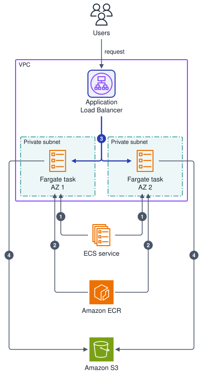

# ECS, EKS, Fargate and ECR

## Predict (1 min)
<!-- section: role=predict; route=fast; minutes=1 -->

**Predict 1.** The team adds S3 read permissions to the task execution role of a Fargate task. Can the application read the bucket? <!-- gist-trap -->

**Predict 2.** A Fargate Spot service loses its Spot capacity. Does ECS start the tasks on regular Fargate?

## Look first (3 min)
<!-- section: role=task; route=fast; minutes=3 -->

<!-- task:start id=containers-t01 -->

Look

**It kills the belief.** "Fargate is serverless, so no account quota limits how many tasks run."

> **Cost:** $0.

**Permissions.** `servicequotas:ListAWSDefaultServiceQuotas`, `servicequotas:ListServiceQuotas`

**No permission to create resources?** This task is read-only. It needs no alternative.

1. Open AWS CloudShell. List the default Fargate quotas of the current Region and read the Adjustable column.

   ```bash
   aws service-quotas list-aws-default-service-quotas --service-code fargate --query "Quotas[].[QuotaName,Value,Adjustable]" --output table
   ```

   Expect: A table of quota names, default values and True or False. Find Fargate On-Demand vCPU resource count and Fargate Spot vCPU resource count. Both count vCPUs, not tasks, and both show True: you can ask to increase them.

2. List the quota values that apply to your account in the same Region.

   ```bash
   aws service-quotas list-service-quotas --service-code fargate --query "Quotas[].[QuotaName,Value,Adjustable]" --output table
   ```

   Expect: The values of your account. Compare the two vCPU rows with step 1. A new account can show lower values than the defaults. A quota that has no applied value for your account is not in this table.

3. Run the same command for a second Region, <OTHER_REGION>. Choose a Region you do not work in, for example eu-west-1.

   ```bash
   aws service-quotas list-service-quotas --service-code fargate --region <OTHER_REGION> --query "Quotas[].[QuotaName,Value,Adjustable]" --output table
   ```

   Expect: The values of that Region. Each Region has its own vCPU quotas: tasks that run in one Region do not use the quota of another Region.

**Label.** checked against docs, not run in a real account. Checked 2026-10-15.

<!-- task:end -->

## In one breath (2 min)
<!-- section: role=breath; route=fast; minutes=2 -->

> **Say it:** Amazon ECS is a [fully managed container orchestration service](../facts/ecs.md#ecs-fully-managed-orchestration), Amazon EKS runs the Kubernetes **control plane**, and Fargate is a [serverless compute engine for containers](../facts/fargate.md#fargate-faq-serverless-engine-for-ecs-and-eks).

**The problem it solves.** Containers need something that places, restarts and scales them.

**Predict the picture.** Does the load balancer send requests to instances, or to tasks?

<details>
<summary>Show the picture</summary>



**Figure.** An ECS service runs tasks from an ECR image on Fargate, and the load balancer sends each request to one task.

1. The ECS service starts tasks on Fargate, and Fargate will [try its best to spread tasks](../facts/fargate.md#fargate-no-placement-strategies-best-effort-az-spread) across Availability Zones.
2. The task execution role [grants the Amazon ECS container and Fargate agents](../facts/ecs.md#ecs-task-execution-role-for-agents) permission to pull the image from Amazon ECR.
3. The awsvpc mode [provides each task with an elastic network interface](../facts/fargate.md#fargate-requires-awsvpc-network-mode), and the load balancer sends each request to one task.
4. The task role lets the application [use other AWS services](../facts/ecs.md#ecs-iam-role-table-task-role), such as Amazon S3.

</details>

> **Startup example:** Callvale's web application runs on one Auto Scaling group that the team patches. Its 14 engineers share each 40-minute release. Callvale wants six services that deploy and scale on their own.

## Words that go together (1 min)
<!-- section: role=words; route=fast; minutes=1 -->

<!-- table: words -->
| Term | Words that go with it | Plain meaning | Do not confuse with |
|---|---|---|---|
| container image | **push** an image to a repository | The packaged application that tasks start from | a running container |
| task definition | **register** a task definition | The JSON blueprint of a task | a running task |
| task role | **attach** a policy to the task role | The role that application code uses | task execution role |
| capacity provider | **associate** a capacity provider with a cluster | Fargate, Fargate Spot, an Auto Scaling group or [Amazon ECS Managed Instances](../facts/ecs.md#ecs-change-managed-instances-launch-2025-09) | launch type |

## Choose it or not (2 min)
<!-- section: role=choose; route=fast; minutes=2 -->

### Fargate or EC2 capacity or Lambda

<!-- table: compare -->
| Question | AWS Fargate | EC2 capacity | AWS Lambda |
|---|---|---|---|
| Who manages the instances? | AWS: you [run containers without having to manage servers](../facts/ec2.md#ec2-compute-guide-fargate-no-servers-for-containers) | [You manage the underlying Amazon EC2 instances directly](../facts/ecs.md#ecs-cluster-ec2-full-control-you-manage-instances) | AWS |
| Longest run? | [There is no hard limit on execution time](../facts/fargate.md#fargate-guide-containers-run-indefinitely-no-hard-limit) | Until the task stops | At most [15 minutes per invocation](../facts/lambda.md#lambda-fargate-no-execution-time-limit) |

**Deciding question:** Does it need a GPU or the host, or end within minutes?

### ECS or EKS

<!-- table: compare -->
| Question | Amazon ECS | Amazon EKS |
|---|---|---|
| Orchestrator charge? | [No additional charge for Amazon ECS](../facts/ecs.md#ecs-faq-no-additional-charge) | A [per cluster per hour fee](../facts/eks.md#eks-pricing-per-cluster-per-hour-fee) |
| Fargate Spot? | Yes: it can [run interruption tolerant Amazon ECS tasks](../facts/fargate.md#fargate-spot-interruption-tolerant-discount) | No: Amazon EKS does not support [Fargate Spot](../facts/eks.md#eks-fargate-no-spot) |
| Team skills | Amazon ECS | Kubernetes: the [skills of your organization are a major factor](../facts/eks.md#eks-decision-guide-kubernetes-skills-sre-teams) |

**Deciding question:** Does the team already run Kubernetes, or want nothing extra to operate?

## Signals and traps (2 min)
<!-- section: role=signals; route=fast; minutes=2 -->

<!-- table: signals -->
| The stem says | Think | Because | But not if |
|---|---|---|---|
| "run containers without managing servers or clusters" | AWS Fargate | you [run containers without having to manage servers](../facts/ec2.md#ec2-compute-guide-fargate-no-servers-for-containers) | GPUs or privileged mode: EC2 capacity |
| "already runs Kubernetes, minimal code changes" | Amazon EKS | [deploy Kubernetes-compatible applications without refactoring](../facts/eks.md#eks-certified-kubernetes-conformant) | clusters stay in the data center: EKS Anywhere |
| "can tolerate interruption, lowest cost" | FARGATE_SPOT | [run interruption tolerant Amazon ECS tasks](../facts/fargate.md#fargate-spot-interruption-tolerant-discount) | some tasks must always run: a FARGATE base |
| "the containerized application must read an S3 bucket" | task role | when [your application accesses other AWS services](../facts/ecs.md#ecs-iam-role-table-task-role) | the image pull fails: task execution role |
| "Kubernetes in a data center with no connection to AWS" | Amazon EKS Anywhere | for [isolated or air-gapped environments](../facts/eks.md#eks-faq-anywhere-for-isolated-or-air-gapped) | AWS runs the control plane: EKS Hybrid Nodes |
| "private subnets with no internet access, images in Amazon ECR" | VPC endpoints for ECR and S3 | tasks [require both Amazon ECR VPC endpoints](../facts/ecr.md#ecr-vpc-endpoints-fargate-need-ecr-and-s3) plus one for S3 | images in Docker Hub: an ECR pull through cache rule |

### Traps

- **Wrong belief:** The task execution role gives the application its permissions. **Truth:** The application uses the task role, which [allows your application code (running in the container)](../facts/ecs.md#ecs-task-role-gives-app-code-aws-permissions) to call AWS. <!-- trap: containers-trap-execution-role-for-app -->
- **Wrong belief:** Fargate runs any container that an instance runs. **Truth:** [Privileged containers or access are currently unavailable](../facts/fargate.md#fargate-no-privileged-containers), GPUs are [not supported on AWS Fargate today](../facts/fargate.md#fargate-faq-gpu-not-supported), and tasks [do not support the DAEMON scheduling strategy](../facts/fargate.md#fargate-no-daemon-scheduling-strategy). <!-- trap: containers-trap-fargate-runs-anything -->
- **Wrong belief:** Without Spot capacity, ECS uses regular Fargate. **Truth:** ECS [services retry launching tasks](../facts/fargate.md#fargate-spot-no-on-demand-replacement) on Fargate Spot. <!-- trap: containers-trap-fargate-spot-falls-back -->

## Changed recently (1 min)
<!-- section: role=changed; route=fast; minutes=1 -->

> **Changed recently:** (2025-07-15) Native blue/green.<br>
> **Old:** blue/green through AWS CodeDeploy.<br>
> **Now:** [native blue/green deployments](../facts/ecs.md#ecs-change-native-blue-green-deployments-2025-07) in Amazon ECS.<br>
> **The exam probably expects:** CodeDeploy in older questions; both [provide similar functionality](../facts/ecs.md#ecs-blue-green-native-similar-to-codedeploy).<br>
> **Status:** examinable.

> **Changed recently:** (2025-09-30) ECS Managed Instances.<br>
> **Old:** Fargate or self-managed EC2.<br>
> **Now:** [Amazon ECS Managed Instances](../facts/ecs.md#ecs-change-managed-instances-launch-2025-09), [the recommended choice for most new workloads](../facts/ecs.md#ecs-cluster-managed-instances-recommended-for-most-new-workloads).<br>
> **The exam probably expects:** Fargate or EC2 in older questions.<br>
> **Status:** examinable.

## Check (1 min)
<!-- section: role=check; route=fast; minutes=1 -->

**Check 1.** A task definition passes a database password from Secrets Manager. Which role reads the secret?

<details>
<summary>Answer</summary>

The task execution role: it serves a task definition that [references sensitive data using Secrets Manager secrets](../facts/ecs.md#ecs-task-execution-role-use-cases).

**Predict 1:** No. The application uses the task role.

</details>

**Check 2.** Two tasks of a Fargate Spot service must always run. What goes in the capacity provider strategy?

<details>
<summary>Answer</summary>

A FARGATE base of 2: it sets [how many tasks, at a minimum, to run](../facts/ecs.md#ecs-strategy-base-minimum-tasks).

**Predict 2:** No. ECS [services retry launching tasks](../facts/fargate.md#fargate-spot-no-on-demand-replacement) on Spot.

</details>

## Recap from memory (1 min)
<!-- section: role=recap; route=fast; minutes=1 -->

**Recap 1.** Deciding question for ECS or EKS?

<details>
<summary>Answer</summary>

Does the team already run Kubernetes, or want nothing extra to operate?

</details>

**Recap 2.** What is the "But not if" case of EKS Anywhere?

<details>
<summary>Answer</summary>

AWS runs the control plane: EKS Hybrid Nodes.

</details>

**Recap 3.** Which role does the code use, and which does the agent use?

<details>
<summary>Answer</summary>

The task role. The task execution role.

</details>
