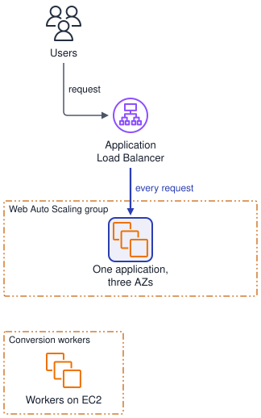
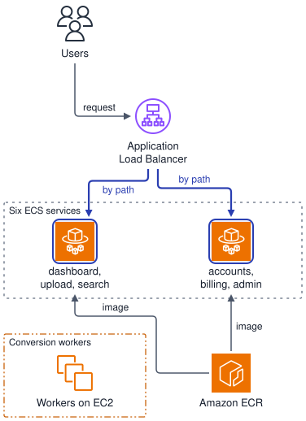

# ECS, EKS, Fargate and ECR in depth

## How it works (28 min)
<!-- section: role=how; route=full; minutes=28 -->

### Images live in a Regional ECR repository that tasks pull from (4 min)

A **container** runs a packaged application, and it starts from a **container image**. Tasks in two Regions need one image.

1. **Log in.** The Docker client gets an ECR token that is valid for [12 hours](../facts/ecr.md#ecr-authorization-token-valid-12-hours).
2. **Push.** The image goes into a **repository** in the **registry** of the account.
3. **Protect.** **Tag immutability** can [prevent image tags from being overwritten](../facts/ecr.md#ecr-tag-immutability-prevent-overwrite).
4. **Pull.** A task pulls the image, and transfer in the same Region [is free of charge](../facts/ecr.md#ecr-pricing-same-region-transfer-free).

Why one repository in each Region? ECR is a [Regional service](../facts/ecr.md#ecr-faq-regional-service), and a pull from another Region adds [additional latency and data transfer costs](../facts/ecr.md#ecr-faq-cross-region-pull-latency-and-transfer-cost).

> **Exam signal:** "scan images when they are pushed" points to scan on push, which scans [each new image pushed to the repository](../facts/ecr.md#ecr-scan-on-push-each-new-image).

> **Exam trap:** Many think that one repository serves every Region. Instead, copy the images: ECR can [automatically replicate them to other Regions and accounts](../facts/ecr.md#ecr-faq-replicates-across-regions-and-accounts). <!-- trap: containers-trap-ecr-global -->

> **Try it:** Create a repository, then look for it in another Region. See [3-do.md](3-do.md). <!-- task: containers-t02 -->

Go deeper: caching images

A **pull through cache** rule can [cache repositories in an upstream registry](../facts/ecr.md#ecr-pull-through-cache-keeps-cache-current).

> **Say it:** The short answer is: keep images in the Region of the tasks. The thing to watch is replication.

**Stop and answer.** Replication starts for a repository that already holds images. Does last week's release tag reach the second Region?

Answer

No. Only content pushed or restored [after replication is configured is replicated](../facts/ecr.md#ecr-replication-only-new-pushes).

### A task definition gives the agent one role and the application another (4 min)
<!-- section: route=pass -->

A new task pulls a private image, sends logs, and writes to Amazon S3.

1. **Describe.** A **task definition** is [a text file in JSON format](../facts/ecs.md#ecs-task-definition-json-blueprint) with up to [10 container definitions](../facts/ecs.md#ecs-containers-per-task-definition-limit).
2. **Start.** A **task** is [the instantiation of a task definition](../facts/ecs.md#ecs-task-is-instantiation-of-task-definition) in an **ECS cluster**, a group of tasks and their capacity.
3. **Pull and log.** The **task execution role** [grants the Amazon ECS container and Fargate agents](../facts/ecs.md#ecs-task-execution-role-for-agents) permission to pull from [an Amazon ECR private repository](../facts/ecs.md#ecs-task-execution-role-use-cases), send logs, and read secrets.
4. **Run the code.** The **task role** [allows your application code (running in the container)](../facts/ecs.md#ecs-task-role-gives-app-code-aws-permissions) to call other AWS services.

Why two roles? Two programs call AWS: the agent and your code. The permissions of the execution role are not [directly accessible by the containers](../facts/ecs.md#ecs-task-execution-role-for-agents).

> **Exam signal:** "the application needs access to an S3 bucket" points to the task role, which lets code [use other AWS services](../facts/ecs.md#ecs-iam-role-table-task-role).

> **Say it:** The short answer is: the agent uses the execution role, and your code uses the task role. The thing to watch is who calls.

**Stop and answer.** Two services share one task definition and its task role. One needs fewer permissions. What do you change?

Answer

Give each service its own task definition family, [for only one business purpose](../facts/ecs.md#ecs-one-task-definition-family-per-business-purpose), and [a role for each specific task definition](../facts/ecs.md#ecs-task-role-least-privilege-per-task-definition).

### Fargate gives each task its own isolated compute and no instance to manage (4 min)
<!-- section: route=pass -->

A team wants containers without instances to patch. What does it give up?

1. **Size.** The task asks for vCPU and memory, and you no longer [provision, configure, or scale clusters](../facts/fargate.md#fargate-no-provision-vm-clusters). This is **serverless** compute.
2. **Isolate.** Each task runs on [its own single use, single tenant compute instance](../facts/fargate.md#fargate-faq-single-tenant-instance-per-workload).
3. **Patch.** [AWS is responsible for maintaining the underlying infrastructure](../facts/fargate.md#fargate-task-retirement-aws-maintains-infrastructure). At retirement, [the Amazon ECS scheduler automatically replaces the tasks](../facts/fargate.md#fargate-retirement-service-tasks-replaced-automatically) of a service, not a standalone task.
4. **Bill.** You pay for the requested vCPU and memory, [rounded up to the nearest second](../facts/ecs.md#ecs-faq-fargate-billing-granularity).

Why can AWS patch for you? The host belongs to AWS: Fargate [prevents containers from accessing the underlying host](../facts/fargate.md#fargate-containers-cannot-access-host-resources).

> **Exam signal:** "strict isolation between tasks" points to Fargate: [for workloads with strict isolation requirements, use Fargate](../facts/ecs.md#ecs-containers-not-security-boundary-use-fargate-for-isolation).

> **Exam trap:** Many think that files in a task's storage stay for the next task. Fargate gives [20 GiB](../facts/fargate.md#fargate-faq-ephemeral-storage-20-gib-erased) of **ephemeral** (ih-FEM-er-ul) storage by default, erased when the task stops. Keep tasks stateless, and put lasting files on [Amazon Elastic File System (EFS)](../facts/fargate.md#fargate-faq-efs-for-persistent-storage). <!-- trap: containers-trap-task-storage-persists -->

> **Say it:** The short answer is: Fargate gives each task its own compute, and AWS patches it. The thing to watch is host access.

**Stop and answer.** A nightly report runs as a standalone Fargate task. AWS retires its platform revision that night. What happens?

Answer

AWS stops the task, and Amazon ECS does not [launch a replacement task](../facts/fargate.md#fargate-retirement-service-tasks-replaced-automatically).

### In awsvpc mode each task gets its own network interface (4 min)

A task in a private subnet takes requests from a load balancer and pulls its image.

1. **Attach.** Fargate tasks need the **awsvpc network mode**, which [provides each task with an elastic network interface](../facts/fargate.md#fargate-requires-awsvpc-network-mode) (ENI).
2. **Address.** The task will [receive an IP address from the configured subnet](../facts/fargate.md#fargate-network-security-groups-nacls-ip-from-subnet).
3. **Receive.** So for the load balancer, [you must choose ip as the target type](../facts/fargate.md#fargate-target-group-ip-target-type).
4. **Pull.** The task [must have a route to the internet](../facts/fargate.md#fargate-task-has-route-to-internet-to-pull), or its virtual private cloud (VPC) needs endpoints.

<!-- table: plain -->
| Subnet | The image pull needs |
|---|---|
| Public | [A public IP address needs to be assigned](../facts/fargate.md#fargate-public-subnet-image-pull-needs-public-ip) |
| Private, with internet | A network address translation (NAT) gateway |
| Private, no internet, image in Amazon ECR | VPC endpoints: tasks [require both Amazon ECR VPC endpoints](../facts/ecr.md#ecr-vpc-endpoints-fargate-need-ecr-and-s3) and one for S3 |

Why ip targets? The task, not an instance, owns the network interface.

> **Exam signal:** "each task must have its own security group" points to awsvpc: security groups work [at a more granular level within your tasks](../facts/ecs.md#ecs-awsvpc-task-own-eni-security-groups).

> **Exam trap:** Many think that an instance target group works for Fargate tasks. The tasks are [associated with an elastic network interface](../facts/fargate.md#fargate-target-group-ip-target-type), not an instance. <!-- trap: containers-trap-instance-target-type -->

> **Try it:** Break and fix the network mode of a Fargate task definition. See [3-do.md](3-do.md). <!-- task: containers-t03 -->

**Spot the bug.** Fargate tasks in private subnets with no NAT gateway have interface endpoints for the ECR API and the Docker registry. The image pull fails. Why?

Answer

The gateway endpoint for Amazon S3 is missing: tasks [require both Amazon ECR VPC endpoints](../facts/ecr.md#ecr-vpc-endpoints-fargate-need-ecr-and-s3) and that endpoint.

> **Say it:** The short answer is: each task gets its own network interface. The thing to watch is the image pull.

**Stop and answer.** EC2 instances run awsvpc tasks, but fewer than their CPU and memory allow. Why?

Answer

Each task in this [network mode requires an ENI](../facts/ecs.md#ecs-awsvpc-eni-limits-tasks-per-instance), and an instance has a [default quota for the number of network interfaces](../facts/ecs.md#ecs-awsvpc-eni-limits-tasks-per-instance).

### A service keeps the desired task count and replaces tasks during a release (4 min)

A web service runs three tasks and ships new versions without dropping requests.

1. **Keep the count.** An **ECS service** exists to [maintain a specified number of instances](../facts/ecs.md#ecs-service-maintains-desired-count) of a task definition.
2. **Replace.** The scheduler replaces a task after a [load balancer target group health check](../facts/ecs.md#ecs-service-scheduler-replaces-unhealthy-tasks) fails.
3. **Roll out.** A **rolling update** [replaces the currently running tasks with new tasks](../facts/ecs.md#ecs-rolling-update-replaces-tasks). By default, the minimum healthy percent is [100%](../facts/ecs.md#ecs-rolling-minimum-healthy-percent-default-100) and the maximum percent is [200%](../facts/ecs.md#ecs-rolling-maximum-percent-default-200).
4. **Undo.** The **deployment circuit breaker** can [automatically roll back a failed deployment](../facts/ecs.md#ecs-circuit-breaker-rolls-back-to-completed).

Why start new tasks first? The minimum healthy percent is the [lower limit on the number of tasks](../facts/ecs.md#ecs-minimum-healthy-percent-meaning) that stay healthy. At the default, capacity does not drop.

> **Exam signal:** "test the new version before it gets production traffic" points to a **blue/green deployment**: [two identical production environments called blue and green](../facts/ecs.md#ecs-blue-green-definition-and-zero-downtime).

> **Say it:** The short answer is: a service keeps the count and replaces failed tasks. The thing to watch is room for new tasks.

**Stop and answer.** A service has four tasks, a minimum healthy percent of 50 and a maximum percent of 100. What can a release do first?

Answer

It can [stop two existing tasks](../facts/ecs.md#ecs-min-healthy-percent-example-50-of-four) before it starts two new ones, so capacity drops by half.

### Service auto scaling changes the task count and capacity providers supply the compute (4 min)
<!-- section: route=pass -->

Traffic doubles every weekday morning. The service needs more tasks, and on EC2 also more instances.

1. **Count tasks.** **Service auto scaling** can [increase or decrease the desired number](../facts/ecs.md#ecs-service-auto-scaling-application-auto-scaling) of tasks.
2. **Choose capacity.** A **capacity provider strategy** lists providers with [the base and weight to assign to them](../facts/ecs.md#ecs-capacity-provider-manages-infrastructure-scaling). The base says [how many tasks, at a minimum, to run](../facts/ecs.md#ecs-strategy-base-minimum-tasks) on one provider. AWS recommends [using the launch type only for defining compatibilities](../facts/ecs.md#ecs-launch-type-only-for-compatibility).
3. **Add instances.** On EC2, **cluster auto scaling** lets the Auto Scaling group [launch EC2 instances, and then register them](../facts/ecs.md#ecs-cluster-auto-scaling-reservation-above-or-below-target). Binpack placement [minimizes the number of container instances in use](../facts/ecs.md#ecs-placement-binpack-least-unused-cpu-memory).
4. **Lose Spot.** A Fargate Spot task gets a [two-minute warning](../facts/fargate.md#fargate-spot-two-minute-interruption-warning).

Why two layers? A task needs room, and an instance gives room. On Fargate, [AWS manages and automatically scales the underlying capacity](../facts/ecs.md#ecs-predictive-scaling-service-level-not-compute).

> **Exam signal:** "scale on an Amazon SQS queue" points to backlog per task, the queue depth divided by the running tasks: queue depth is [not a reliable metric to scale on directly](../facts/ecs.md#ecs-sqs-scale-on-backlog-per-task).

> **Exam trap:** Many think that service auto scaling adds EC2 instances. It changes the task count; instances follow when ECS can [manage the scaling of Amazon EC2 instances](../facts/ecs.md#ecs-cluster-auto-scaling-managed-scaling-asg-capacity-provider). <!-- trap: containers-trap-service-scaling-adds-instances -->

> **Say it:** The short answer is: service auto scaling counts tasks, and capacity providers bring compute. The thing to watch is Spot capacity.

**Stop and answer.** A service runs one task on Fargate Spot. AWS reclaims the Spot capacity. What happens?

Answer

[A service with only one task is interrupted](../facts/fargate.md#fargate-spot-single-task-service-interrupted) until capacity is available. Add a FARGATE base.

### EKS runs the Kubernetes control plane and you choose where pods run (4 min)
<!-- section: route=pass -->

A team runs Kubernetes and wants AWS to run the **control plane**, the part that decides where work runs.

1. **Control plane.** EKS runs it [across three Availability Zones within an AWS Region](../facts/eks.md#eks-control-plane-three-azs-api-etcd), for a [per cluster per hour fee](../facts/eks.md#eks-pricing-per-cluster-per-hour-fee).
2. **Pods and nodes.** A **pod** is [the smallest deployable unit](../facts/eks.md#eks-pod-smallest-deployable-unit), and a **node** is [a machine that runs containerized applications](../facts/eks.md#eks-kubernetes-node-machine-runs-containers).
3. **Choose compute.** A **managed node group** keeps nodes in [an Amazon EC2 Auto Scaling group](../facts/eks.md#eks-managed-node-group-asg-in-your-account). A **Fargate profile** selects pods [matched using a namespace and the labels](../facts/eks.md#eks-fargate-profile-selects-pods).
4. **Permissions.** AWS [recommends using EKS Pod Identities](../facts/eks.md#eks-pod-identity-recommended-over-irsa) whenever possible. Pods on Fargate use [IAM roles for service accounts](../facts/eks.md#eks-fargate-imds-unavailable-use-irsa) (IRSA).

<!-- table: plain -->
| Question | Managed node groups | Fargate |
|---|---|---|
| Who manages instances? | You: [must deploy and manage Amazon EC2 instances](../facts/eks.md#eks-compute-compare-who-manages-ec2-instances) | AWS |
| DaemonSets | Yes | No: [run as a sidecar container](../facts/eks.md#eks-fargate-no-daemonsets) |

Why can AWS run the control plane? It is separate from the nodes, and AWS [automatically detects and replaces unhealthy control plane nodes](../facts/eks.md#eks-faq-control-plane-multi-az-and-self-healing).

> **Exam signal:** "existing Kubernetes manifests and tools" points to Amazon EKS: it can [deploy Kubernetes-compatible applications without refactoring](../facts/eks.md#eks-certified-kubernetes-conformant).

Go deeper: scaling pods and nodes

The Horizontal Pod Autoscaler [automatically scales the number of Pods](../facts/eks.md#eks-hpa-scales-pod-count-on-cpu). For nodes, [the Cluster Autoscaler uses Auto Scaling groups](../facts/eks.md#eks-cluster-autoscaler-uses-auto-scaling-groups).

> **Say it:** The short answer is: AWS runs the control plane, and you choose where pods run. The thing to watch is the fee per cluster.

**Stop and answer.** A cluster has no node groups and one Fargate profile, for the namespace web. Where do pods of the namespace jobs run?

Answer

Nowhere yet. Pods [must match a Fargate profile](../facts/eks.md#eks-fargate-pods-not-matching-profile-pending), and the others [might be stuck as Pending](../facts/eks.md#eks-fargate-pods-not-matching-profile-pending).

## Numbers that decide answers (2 min)
<!-- section: role=numbers; route=full; minutes=2 -->

### A-list

<!-- table: numbers -->
| Number | What it is | Why it decides an answer |
|---|---|---|
| [15 minutes per invocation](../facts/lambda.md#lambda-fargate-no-execution-time-limit) | Longest Lambda run | Longer jobs go to Fargate |
| [two-minute warning](../facts/fargate.md#fargate-spot-two-minute-interruption-warning) | Notice before Fargate Spot stops a task | The container saves its work |
| [up to a 70 percent discount](../facts/fargate.md#fargate-faq-spot-up-to-70-percent-discount) | Fargate Spot compared with Fargate | Cheapest for tasks that tolerate stops |
| [per second with a 1-minute minimum](../facts/fargate.md#fargate-pricing-per-second-one-minute-minimum) | Fargate billing of a Linux task | Very short tasks pay the minimum |
| [20 GiB](../facts/fargate.md#fargate-ephemeral-storage-default-20-gib) | Default ephemeral storage of a task | Lasting files go to Amazon EFS |

## Decision record (2 min)
<!-- section: role=example; route=full; minutes=2 -->

**Context.** Callvale's web application runs on one Auto Scaling group.

**Figure.** One application on one Auto Scaling group means one release for all 14 engineers and instances that the team patches.

**Requirement.** Deploy and scale six services separately, with no instances to patch and the LEAST operational overhead.

**Options.**

- Six Auto Scaling groups.
- Amazon EKS with managed node groups.
- **Amazon ECS with AWS Fargate, six services.**

**Decision.** Six ECS services on Fargate, each a **microservice**. EKS is not chosen: the [skills of your organization are a major factor](../facts/eks.md#eks-decision-guide-kubernetes-skills-sre-teams), and one engineer knows Kubernetes.

**Figure.** The load balancer routes by path to six Fargate services that each deploy and scale on their own, with images from Amazon ECR.

**Trade-off.** No host access: [neither customers nor AWS operators can connect](../facts/fargate.md#fargate-no-host-access-ecs-exec). Idle tasks still cost money: [you pay for what you provision](../facts/fargate.md#fargate-guide-pricing-per-second-pay-for-what-you-provision).

## FAQ quick-fire (3 min)
<!-- section: role=faq; route=full; minutes=3 -->

**FAQ 1.** Can a Fargate task use a GPU?

Answer

No: [not supported on AWS Fargate today](../facts/fargate.md#fargate-faq-gpu-not-supported).

> "Use Amazon EC2 for GPU workloads, which are not supported on AWS Fargate today."
> — [AWS Fargate FAQs](https://aws.amazon.com/fargate/faqs/)

**FAQ 2.** Can a Fargate workload keep data after it stops?

Answer

Yes, on [Amazon Elastic File System (EFS)](../facts/fargate.md#fargate-faq-efs-for-persistent-storage).

> "Amazon Elastic File System (EFS) an be used to provide persistent storage to workloads running on AWS Fargate."
> — [AWS Fargate FAQs](https://aws.amazon.com/fargate/faqs/)

**FAQ 3.** Is Amazon ECR global?

Answer

No, a [Regional service](../facts/ecr.md#ecr-faq-regional-service).

> "Amazon ECR is a Regional service and is designed to give you flexibility in how images are deployed."
> — [Amazon ECR FAQs](https://aws.amazon.com/ecr/faqs/)

**FAQ 4.** Can ECS Anywhere run in an air-gapped data center?

Answer

No. It needs a [stable internet connection](../facts/ecs-anywhere.md#ecs-anywhere-faq-needs-stable-internet-not-air-gapped).

> "Hence, it requires your on-premises compute to have a stable internet connection to communicate with the in-region ECS control plane."
> — [Amazon ECS Anywhere FAQs](https://aws.amazon.com/ecs/anywhere/faqs/)

**FAQ 5.** Can EKS use existing Kubernetes tools?

Answer

Yes, as on [any standard Kubernetes environment](../facts/eks.md#eks-faq-runs-open-source-kubernetes-compatible).

> "Amazon EKS runs the open-source Kubernetes software, so you can use all the existing plug-ins and tooling from the Kubernetes community."
> — [Amazon EKS FAQs](https://aws.amazon.com/eks/faqs/)

## In the real world (1 min)
<!-- section: role=realworld; route=full; minutes=1 -->

**Smartsheet, 2024.** It used Amazon ECS with AWS Fargate to [transition from coupled deployments to independent deployments](../facts/ecs.md#ecs-case-study-smartsheet-fargate-independent-deployments).

> "Using a serverless platform on AWS, Smartsheet can deploy more frequently, increase throughput, and reduce the engineering time to deploy from hours to minutes."
> — [Smartsheet improves deployment efficiency and reduces cost with Amazon ECS and AWS Fargate](https://aws.amazon.com/solutions/case-studies/smartsheet-ecs-fargate-case-study/)

**It shows:** independent services make each release shorter.

