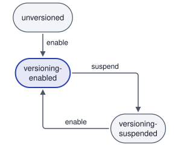
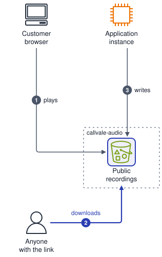
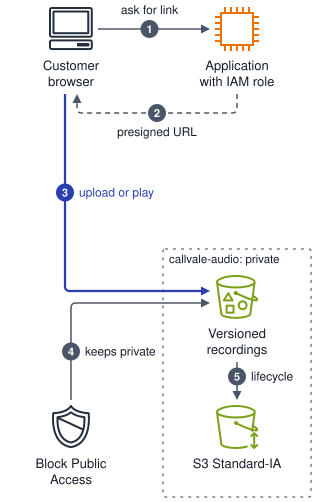

# Amazon S3 in depth

## How it works (64 min)
<!-- section: role=how; route=full; minutes=64 -->

Follow one object from upload to delete.

### A bucket stays in one Region and names each object by a unique key (4 min)

An application keeps millions of recordings and reads each one back by name.

1. **Create the bucket.** [A bucket is a container for objects](../facts/s3.md#s3-object-storage-definition). You choose [the AWS Region where the bucket will reside](../facts/s3.md#s3-bucket-region-fixed), and you [cannot change the name of the bucket](../facts/s3.md#s3-bucket-region-fixed) or its Region later.
2. **Put an object.** An object is [a file and any metadata](../facts/s3.md#s3-object-storage-definition), stored under a key, the [unique identifier for the object within the bucket](../facts/s3.md#s3-object-key-unique-in-bucket). The bucket has a [flat structure](../facts/s3.md#s3-flat-namespace-no-folders), so the key customer-17/call.wav looks like a path but is one name.
3. **Store it.** S3 Standard keeps the object across [a minimum of three Availability Zones](../facts/s3.md#s3-durability-three-az-design).
4. **Read it back.** After a successful write, a read [immediately receives the latest version](../facts/s3.md#s3-faq-consistency-read-latest).

Why one Region? You decide where the data lives. Objects [never leave the Region unless you explicitly transfer](../facts/s3.md#s3-objects-stay-in-region) them.

> **Exam signal:** "store any amount of data and serve it to applications over HTTP" points to Amazon S3, because the amount you can store is [unlimited](../facts/s3.md#s3-faq-storage-unlimited). <!-- xref: 23 EFS and FSx file storage -->

Go deeper: four bucket types

S3 has [four types of buckets](../facts/s3.md#s3-table-and-vector-buckets): general purpose, directory, table and vector. A directory bucket holds S3 Express One Zone objects in [a single AWS Availability Zone](../facts/s3.md#s3-directory-bucket-single-az-express).

> **Say it:** The short answer is: a bucket in one Region holds objects by key. The thing to watch is that folders are key names.

**Stop and answer.** Worker A overwrites transcript.json. A second later, worker B reads the same key. Can worker B get a mix of the old and the new file?

Answer

No. [Updates to a single key are atomic](../facts/s3.md#s3-single-key-updates-atomic), so worker B gets old or new data, [never partial or corrupt data](../facts/s3.md#s3-single-key-updates-atomic).

### A single PUT stops at 5 GB so large uploads use multipart upload (5 min)

A customer uploads a four-hour recording over a weak connection. If one request fails near the end, the upload starts again.

1. **Send one request.** A single PUT uploads an object of up to [5 GB](../facts/s3.md#s3-single-put-max).
2. **Split the object.** A **multipart upload** sends parts of [5 MiB to 5 GiB](../facts/s3.md#s3-mpu-part-size), and you can [upload parts in parallel to improve throughput](../facts/s3.md#s3-multipart-upload-parallel-parts-throughput). S3 then assembles one object of up to [50 TB](../facts/s3.md#s3-object-max-size).
3. **Clean up.** An open upload has [no expiry](../facts/s3.md#s3-mpu-no-expiry), and its parts cost storage. A lifecycle rule with [AbortIncompleteMultipartUpload](../facts/s3.md#s3-lifecycle-abort-incomplete-multipart) removes them.
4. **Upload from far away.** With Transfer Acceleration, data travels from a CloudFront edge location [over an optimized network path](../facts/s3.md#s3-transfer-acceleration-how-it-works).

Why parts? A broken connection costs one part, not the whole recording, because you can [retransmit that part without affecting other parts](../facts/s3.md#s3-multipart-upload-parts-parallel).

> **Exam signal:** "large uploads fail and must start again from the beginning" points to multipart upload.

> **Exam trap:** A common belief is that one PUT can upload any object. One PUT stops at [5 GB](../facts/s3.md#s3-single-put-max), far below the [50 TB](../facts/s3.md#s3-object-max-size) limit of one object. <!-- trap: s3-trap-single-put-any-size -->

Go deeper: event notifications after an upload

A new object can trigger an event to [Amazon EventBridge, Amazon SNS, Amazon SQS](../facts/s3.md#s3-faq-events-destinations) or [directly to AWS Lambda](../facts/s3.md#s3-faq-events-destinations). Each event is [delivered at least once](../facts/s3.md#s3-event-notifications-at-least-once-seconds). <!-- xref: 31 event-driven designs with S3 Event Notifications -->

A common belief is that any Amazon SQS queue can receive these events. A first-in-first-out (FIFO) queue cannot: to reach one, [you can use Amazon EventBridge](../facts/s3.md#s3-event-notifications-no-fifo-destinations). <!-- trap: s3-trap-event-notification-fifo -->

> **Say it:** The short answer is: for big files, upload in parts that travel in parallel. The thing to watch is unfinished uploads, which still cost money.

**Stop and answer.** A team uploads 2 GB video files with one PUT each, from an office on another continent. Uploads often fail near the end. Is the single PUT size limit the cause, and what helps?

Answer

No. The files are below [5 GB](../facts/s3.md#s3-single-put-max). Use multipart upload and Transfer Acceleration.

### S3 allows a request only when a policy allows it and nothing denies it (5 min)
<!-- section: route=pass -->

A role in an analytics account needs to read recordings in the production account's bucket. Several policies apply to that one request, and one of them can say no.

1. **Start with no access.** Buckets and objects [can be accessed only if you explicitly grant](../facts/s3.md#s3-private-by-default) access.
2. **Collect the policies.** S3 [evaluates all the relevant access policies](../facts/s3.md#s3-authorization-evaluation-order), for example the identity-based policy of the caller and the **bucket policy**.
3. **Look for a deny.** [If there is an explicit deny set](../facts/s3.md#s3-authorization-evaluation-order), S3 refuses the request.
4. **Count the allows.** In one account, an allow in the bucket policy or in the identity-based policy is enough. Across accounts, the caller needs [permission from both the parent AWS account](../facts/s3.md#s3-authorization-both-accounts-must-allow) and the bucket owner.

<!-- table: plain -->
| Caller | Identity-based policy | Bucket policy | Result |
|---|---|---|---|
| Same account | Silent | Allows | Allowed |
| Other account | Allows | Silent | Denied |
| Other account | Allows | Allows | Allowed |
| Any account | Allows | Has a matching Deny | Denied |

Why two allows across accounts? Each account controls its own side: its role, or its bucket.

> **Exam signal:** "grant another AWS account read access to the bucket" points to a bucket policy that names a role of that account, plus that role's own allow.

> **Exam trap:** A common belief is that you share objects with another account through an access control list (ACL). In a new bucket, [all ACLs are disabled](../facts/s3.md#s3-object-ownership-default-bucket-owner-enforced), so the request fails with [AccessControlListNotSupported](../facts/s3.md#s3-acl-writes-fail-when-bucket-owner-enforced). <!-- trap: s3-trap-acl-cross-account -->

Go deeper: organization limits

A Deny with the condition key [aws:PrincipalOrgID](../facts/s3.md#s3-bucket-policy-deny-outside-org) stops every caller outside your organization. A resource control policy sets the [maximum available permissions](../facts/s3.md#s3-change-rcp-for-s3-2024-11) on buckets across an organization. <!-- xref: 04 resource control policies -->

> **Say it:** The short answer is: across accounts, both sides have to allow the read. The thing to watch is an explicit deny, which wins.

**Stop and answer.** The bucket policy in account A allows a role of account B to call s3:GetObject. The role's own policy allows only s3:ListBucket. Can the role download an object?

Answer

No. The request needs [permission from both the parent AWS account](../facts/s3.md#s3-authorization-both-accounts-must-allow) and the bucket owner, and account B's side does not allow s3:GetObject.

### Block Public Access overrides any policy or ACL that would make data public (4 min)

A developer adds a bucket policy with `"Principal": "*"` so that a browser can play recordings.

1. **The edit.** The policy names a wildcard principal, [which effectively means "anyone"](../facts/s3.md#s3-best-practice-wildcard-principal-means-anyone).
2. **The check.** **Block Public Access** has [four settings](../facts/s3.md#s3-block-public-access-four-settings-most-restrictive), [turned on at the bucket level](../facts/s3.md#s3-block-public-access-default-on) by default. S3 refuses or ignores the public policy.
3. **The levels.** Account and organization settings apply too, and S3 [applies the most restrictive combination](../facts/s3.md#s3-block-public-access-four-settings-most-restrictive).

<!-- table: plain -->
| Level | Covers |
|---|---|
| Bucket | That bucket |
| Account | [Applies to all buckets and access points](../facts/s3.md#s3-block-public-access-account-level-recommended) |
| Organization | Accounts in scope: it can [override account-level settings](../facts/s3.md#s3-bpa-org-level-overrides-account) |
| One object | Not set [on a per-object basis](../facts/s3.md#s3-block-public-access-not-per-object) |

Why a switch above the policies? Many people write policies, and policies change often. AWS recommends that you [turn on all four settings](../facts/s3.md#s3-block-public-access-account-level-recommended) for the account. <!-- xref: 15 CloudFront origin access control -->

> **Exam signal:** "ensure that no bucket in the account can be made public" points to Block Public Access at the account or organization level. IAM Access Analyzer for S3 alerts you about a bucket open to [anyone on the internet](../facts/s3.md#s3-faq-access-analyzer-s3).

> **Exam trap:** A common belief is that a bucket policy that allows public reads makes objects public even with Block Public Access on. The [settings override these policies and permissions](../facts/s3.md#s3-block-public-access-overrides-policies). <!-- trap: s3-trap-bucket-policy-beats-bpa -->

> **Say it:** The short answer is: keep Block Public Access on for the account. The thing to watch is that it overrides a public policy.

**Stop and answer.** Block Public Access is on at the account level. One bucket has all four bucket-level settings off and a bucket policy that allows public reads. Can anyone on the internet read its objects?

Answer

No. S3 [applies the most restrictive combination](../facts/s3.md#s3-block-public-access-four-settings-most-restrictive), so the account setting still blocks the public policy.

### A presigned URL lends the permission of its signer until the URL expires (5 min)
<!-- section: route=pass -->

Customers upload and play recordings in the browser, and the bucket stays private. The browser has no AWS credentials.

1. **Ask.** The browser asks the application for a link to one object.
2. **Sign.** The application signs a **presigned URL** (pree-SYND) with the credentials of the [principal who generated the URL](../facts/s3.md#s3-presigned-url-time-limited-creator-credentials). It names the bucket, the key, the HTTP method and the expiry, and [the request signature is part of the URL](../facts/s3.md#s3-presigned-url-signature-must-match-request). From the AWS CLI, the expiry is at most [7 days](../facts/s3.md#s3-presign-cli-sdk-expiration).
3. **Use.** The browser sends GET or PUT directly to Amazon S3. The URL allows [an upload without requiring another party](../facts/s3.md#s3-presigned-url-upload-no-credentials-needed) to have AWS credentials. A page on another domain also needs a CORS configuration on the bucket, to [explicitly enable cross-origin requests](../facts/s3.md#s3-cors-purpose).
4. **Check.** S3 checks the expiry [at the time of the HTTP request](../facts/s3.md#s3-presigned-url-reusable-until-expiry). It also checks the signature. When the method, headers or query string differ from the signed request, [the service denies the request](../facts/s3.md#s3-presigned-url-signature-must-match-request).

Why not make the bucket public? A presigned URL gives [time-limited access to objects in Amazon S3](../facts/s3.md#s3-presigned-url-time-limited-creator-credentials) without a change to the bucket policy.

> **Exam signal:** "users without AWS credentials upload or download a private object for a limited time" points to a presigned URL. <!-- xref: 15 CloudFront signed URLs -->

> **Exam trap:** A common belief is that a presigned URL carries its own permission. The URL is [limited by the permissions of the user](../facts/s3.md#s3-presigned-url-creator-needs-permission) who created it. <!-- trap: s3-trap-presigned-url-own-permission -->

> **Try it:** Presign a link to a private object, use it, and watch it fail after it expires. See [3-do.md](3-do.md). <!-- task: s3-t02 -->

**Spot the bug.** An application signs a download URL with its EC2 instance role, sets a 7-day expiry and emails the URL. The next day, the customer gets Access Denied. What is wrong?

Answer

The URL [expires when the role session ends](../facts/s3.md#s3-presigned-url-expires-with-temporary-credentials), [typically 6 hours](../facts/s3.md#s3-presign-ec2-role-duration) for an instance role. Sign a new short-lived URL each time the customer asks for the file.

> **Say it:** The short answer is: the app signs a short-lived link for the browser. The thing to watch is who holds the link.

**Stop and answer.** The application presigns a GET URL for one recording. A script sends a PUT to the same URL. Does the upload work?

Answer

No. The method differs from the signed request, so [the service denies the request](../facts/s3.md#s3-presigned-url-signature-must-match-request).

### Access points and Requester Pays control who reaches shared data and who pays (4 min)

Five teams and two partners read one shared dataset. One bucket policy for all of them grows too large, and the bucket owner pays for every download.

1. **Create an access point per application.** An **access point** is one of the [named network endpoints with dedicated access policies](../facts/s3.md#s3-access-point-definition). You can set one to [accept requests only from a virtual private cloud](../facts/s3.md#s3-access-point-vpc-only).
2. **Check both policies.** A request through an access point needs [both the access point and the underlying bucket](../facts/s3.md#s3-access-point-needs-bucket-permission-too) to allow it.
3. **Let the reader pay.** With **Requester Pays**, [the requester instead of the bucket owner pays](../facts/s3.md#s3-requester-pays-who-pays) for requests and downloads. Each request carries [x-amz-request-payer](../facts/s3.md#s3-requester-pays-header-required), and [anonymous access to that bucket is not allowed](../facts/s3.md#s3-requester-pays-no-anonymous).

Why access points instead of one big bucket policy? Each access point carries its own policy, which gives [significantly more space for policy statements](../facts/s3.md#s3-access-points-scale-policy-space) <!-- xref: 10 VPC and 11 VPC connectivity, endpoints for S3 -->

> **Exam signal:** "share a large dataset, and the requesters pay for the data transfer" points to Requester Pays. Applications that need their own permissions on one shared bucket point to S3 access points.

> **Exam trap:** A common belief is that a security group can limit a bucket to one VPC, as it does for an instance. S3 access is set by policies, such as [bucket policies, access point policies](../facts/s3.md#s3-faq-access-control-mechanisms) and VPC endpoint policies. Use a VPC-only access point, or a bucket policy with the [aws:SourceVpce](../facts/s3.md#s3-bucket-policy-source-vpce-condition) condition. <!-- trap: s3-trap-security-group-on-bucket -->

> **Say it:** The short answer is: an access point per application, and Requester Pays for downloads. The thing to watch is the bucket policy: it also decides.

**Stop and answer.** A partner signed in to its own AWS account downloads from a Requester Pays bucket but leaves out the request-payer header. What happens, and who pays for that request?

Answer

[Amazon S3 returns a 403 error and charges the bucket owner for the request](../facts/s3.md#s3-requester-pays-header-required).

### Every new object is encrypted with SSE-S3 unless you choose another key (5 min)

A customer's security questionnaire asks who holds the encryption keys and who can see each use of a key.

1. **Default.** New objects [are automatically encrypted at rest](../facts/s3.md#s3-sse-s3-default-every-bucket) with server-side encryption with Amazon S3 managed keys ([SSE-S3](../facts/s3.md#s3-sse-s3-default-every-bucket)), unless the request or the bucket names another type. Since [2023-01-05](../facts/s3.md#s3-change-default-encryption-sse-s3-2023-01), every upload is encrypted. Older questions can still ask you to turn default encryption on.
2. **A KMS key.** With SSE-KMS, AWS Key Management Service (AWS KMS) holds the key. [There are separate permissions](../facts/s3.md#s3-sse-kms-benefits-over-sse-s3) for the key, and logs show [who used your key to access which object](../facts/s3.md#s3-sse-kms-benefits-over-sse-s3).
3. **Your key on each request.** With customer-provided keys (SSE-C), S3 encrypts, but [S3 never stores the encryption key](../facts/s3.md#s3-sse-c-key-never-stored-https-required). [Starting April 2026](../facts/s3.md#s3-sse-c-disabled-by-default-2026-04), [SSE-C is disabled by default](../facts/s3.md#s3-sse-c-disabled-by-default-2026-04) on new buckets, so you turn it on first.
4. **Encrypt before upload.** With client-side encryption, [you manage the encryption process, the encryption keys](../facts/s3.md#s3-client-side-encryption-you-manage-keys).

<!-- table: plain -->
| Option | Key held by | Choose it when |
|---|---|---|
| SSE-S3 | Amazon S3 | The default is enough |
| SSE-KMS | AWS KMS | You need key permissions and an audit trail |
| Dual-layer SSE-KMS (DSSE-KMS) | AWS KMS | You need [two layers of encryption to your data](../facts/s3.md#s3-dsse-kms-two-layers) |
| SSE-C | You, in every request | S3 encrypts, but keys stay outside AWS |

Why choose SSE-KMS over the default? A reader then needs permission on the key as well as on the object. <!-- xref: 06 KMS keys and key policies -->

> **Exam signal:** "the company manages its own keys, and the keys are never stored in AWS" points to SSE-C, because [S3 never stores the encryption key](../facts/s3.md#s3-sse-c-key-never-stored-https-required).

> **Exam trap:** A common belief is that SSE-KMS with a customer managed key keeps the keys out of AWS. The key lives in AWS KMS. With SSE-C, [you retain control of the encryption keys](../facts/s3.md#s3-faq-sse-c-keys). <!-- trap: s3-trap-kms-keys-on-premises --> Another belief is that SSE-C keeps unencrypted data away from AWS. S3 encrypts it. With client-side encryption, S3 [does not play a role in encrypting](../facts/s3.md#s3-client-side-encryption-not-exposed-to-aws). <!-- trap: s3-trap-sse-c-is-client-side -->

> **Say it:** The short answer is: S3 encrypts every new object for you. The thing to watch is who holds the key.

**Stop and answer.** A partner's role in another account can call s3:GetObject on the bucket. The objects use SSE-KMS with the AWS managed key aws/s3. Can the partner read them?

Answer

No. For access from another account, [use a customer managed key](../facts/s3.md#s3-sse-kms-cross-account-needs-customer-managed-key) whose key policy allows that account.

### Infrequent access classes add retrieval fees and a minimum storage duration (5 min)
<!-- section: route=pass -->

Recordings are read often in the first weeks and rarely after a few months.

1. **Upload.** Without a class in the request, [Amazon S3 assigns the S3 Standard storage class](../facts/s3.md#s3-storage-class-default-standard). The **storage class** is set [at the object level](../facts/s3.md#s3-storage-class-set-per-object).
2. **Read less often.** S3 Standard-IA stays [available for millisecond access](../facts/s3.md#s3-ia-classes-millisecond-access-retrieval-fee), but S3 [charges a retrieval fee for these objects](../facts/s3.md#s3-ia-classes-millisecond-access-retrieval-fee).
3. **Leave early or store small.** If you delete an object before [30 days](../facts/s3.md#s3-ia-min-duration-charge), you still pay for the full period. A small object is billed as if it were [128 KB](../facts/s3.md#s3-ia-min-billable-size).
4. **Lose a zone.** S3 One Zone-IA keeps data in [1 Availability Zone](../facts/s3.md#s3-class-one-zone-ia-profile) and is [not resilient to the physical loss](../facts/s3.md#s3-one-zone-ia-az-loss) of that zone.

**Figure.** How often the data is read, and how fast the first byte is needed, decide the storage class.

Why fees and minimums? These classes charge less to store and more to read, so AWS says to choose by [access patterns and retention time](../facts/s3.md#s3-faq-storage-class-cost-structure).

> **Exam signal:** "infrequently accessed data that can be re-created" points to S3 One Zone-IA, because you can [re-create the data if the Availability Zone fails](../facts/s3.md#s3-standard-ia-vs-one-zone-ia-use).

> **Exam trap:** A common belief is that S3 Standard-IA is the cheaper choice for any rarely read data. Each read pays a [per-GB retrieval charge](../facts/s3.md#s3-faq-standard-ia-retrieval-charge), and a small object is billed as [128 KB](../facts/s3.md#s3-ia-min-billable-size). <!-- trap: s3-trap-ia-always-cheaper -->

> **Say it:** The short answer is: pay less to store, and more to read. The thing to watch is the minimum duration and the minimum object size.

**Stop and answer.** A team writes ten million thumbnails of 20 KB each to S3 Standard-IA and deletes each one after ten days. Which two charges make this costly?

Answer

Each thumbnail is billed as [128 KB](../facts/s3.md#s3-ia-min-billable-size), and each one pays for the full [30 days](../facts/s3.md#s3-ia-min-duration-charge).

### Intelligent-Tiering moves an unread object to cheaper tiers with no retrieval fee (4 min)

The team does not know which old recordings customers will open again. A fixed rule could move a popular recording into a class with retrieval fees.

1. **Store it.** S3 watches each object for [a low monthly object monitoring and automation charge](../facts/s3.md#s3-intelligent-tiering-automatic-tiers).
2. **No reads.** After [30 consecutive days](../facts/s3.md#s3-int-tiering-automatic-tiers) without access, the object moves to the Infrequent Access tier. After [90 days](../facts/s3.md#s3-int-tiering-automatic-tiers), it moves to the Archive Instant Access tier.
3. **A read.** The object is [automatically moved back to the Frequent Access tier](../facts/s3.md#s3-int-tiering-move-back), with [no retrieval fees](../facts/s3.md#s3-int-tiering-no-retrieval-fees).

Why no retrieval fee? The class charges a monitoring fee for each object instead. Objects in the [two optional archive access tiers](../facts/s3.md#s3-intelligent-tiering-archive-tiers-need-restore) need a restore first. Objects smaller than [128 KB](../facts/s3.md#s3-int-tiering-small-objects) stay in the Frequent Access tier.

> **Exam signal:** "unknown, changing or unpredictable access patterns" points to S3 Intelligent-Tiering.

> **Say it:** The short answer is: Intelligent-Tiering moves objects for you, and reads have no retrieval fee. The thing to watch is the monitoring charge.

**Stop and answer.** An object in the Archive Instant Access tier is read one time. Where is the object the next day, and does the read add a retrieval fee?

Answer

It is [automatically moved back to the Frequent Access tier](../facts/s3.md#s3-int-tiering-move-back), with [no retrieval fees](../facts/s3.md#s3-int-tiering-no-retrieval-fees).

### Flexible Retrieval and Deep Archive objects must be restored before anyone reads them (5 min)

A customer asks for a two-year-old recording. The archived object is listed, but a plain GET does not return its data.

1. **GET fails.** You first [retrieve data using the RestoreObject REST API](../facts/s3.md#s3-archive-restore-needed-flexible-deep). S3 Glacier Instant Retrieval objects are [immediately available using GET](../facts/s3.md#s3-archive-restore-needed-flexible-deep).
2. **Restore.** You choose Expedited, Standard or Bulk, and how many days to keep the copy. [Standard is the default option](../facts/s3.md#s3-archive-retrieval-options-three).
3. **Wait.** The class and the option set the wait, as the table shows. Bulk is [the lowest-cost retrieval option](../facts/s3.md#s3-archive-retrieval-options-three).
4. **Read the copy.** S3 makes a temporary copy, and [the object's storage class remains](../facts/s3.md#s3-archive-restore-temporary-copy) archived.

<!-- table: plain -->
| Retrieval option | From Flexible Retrieval (typical) | From Deep Archive |
|---|---|---|
| Expedited | [1–5 minutes](../facts/s3.md#s3-archive-retrieval-times-flexible), for smaller objects | [Not available](../facts/s3.md#s3-archive-retrieval-times-deep) |
| Standard | [3–5 hours](../facts/s3.md#s3-archive-retrieval-times-flexible) | [Within 12 hours](../facts/s3.md#s3-archive-retrieval-times-deep) |
| Bulk | [5–12 hours](../facts/s3.md#s3-archive-retrieval-times-flexible) | [Within 48 hours](../facts/s3.md#s3-archive-retrieval-times-deep) |

Why wait for a restore? The long wait comes with the lowest price: Deep Archive is [the lowest cost storage in the cloud](../facts/s3.md#s3-class-deep-archive-lowest-cost-twelve-hours).

> **Exam signal:** "retrieval within 12 hours" with the lowest cost points to S3 Glacier Deep Archive. Rarely read data that is needed in milliseconds points to [S3 Glacier Instant Retrieval](../facts/s3.md#s3-class-glacier-ir-lowest-cost-milliseconds).

> **Say it:** The short answer is: restore first, then read a temporary copy. The thing to watch is that Deep Archive has no Expedited option.

**Stop and answer.** Data in S3 Glacier Deep Archive has to be readable at most eight hours after a request. Which retrieval option meets that?

Answer

None. Standard finishes [within 12 hours](../facts/s3.md#s3-archive-retrieval-times-deep), and Expedited is [not available](../facts/s3.md#s3-archive-retrieval-times-deep). Use S3 Glacier Flexible Retrieval instead.

### A lifecycle rule moves objects one way to colder classes and then expires them (5 min)
<!-- section: route=pass -->

Recordings are kept for years but are rarely opened after a few months.

1. **Write a rule.** A **lifecycle rule** (LYFE-sy-kul) can filter by [key prefix, object tags, or a combination](../facts/s3.md#s3-lifecycle-filter-prefix-tags-and).
2. **Transition.** Objects move down [a waterfall model for transitioning between storage classes](../facts/s3.md#s3-lifecycle-transition-waterfall): a rule never moves an object back to a warmer class.
3. **Pay for the move.** Each transition is [charged per object](../facts/s3.md#s3-faq-lifecycle-transition-request-charge), and an early move is [charged for the remainder of that duration](../facts/s3.md#s3-lifecycle-early-transition-charge).
4. **Expire.** At the age you set, the object expires. In a versioned bucket, expiration only [adds a delete marker](../facts/s3.md#s3-lifecycle-expiration-versioned-delete-marker). A NoncurrentVersionExpiration action can [permanently delete noncurrent versions of objects](../facts/s3.md#s3-lifecycle-noncurrent-version-expiration).

Why one way? Lifecycle exists to lower cost as data ages.

> **Startup example:** Callvale's rule on callvale-audio moves recordings to S3 Standard-IA after 90 days, then expires them and their old versions after 7 years. Only 2% of recordings are opened after 90 days.

The rule uses S3 Standard-IA, not S3 One Zone-IA: the recordings are the [primary or only copy of data](../facts/s3.md#s3-standard-ia-primary-copy).

> **Exam signal:** "move objects to a cheaper class after some days and delete them after some years" points to one S3 Lifecycle rule with a transition and an expiration.

> **Exam trap:** A common belief is that a lifecycle rule can move archived objects back to S3 Standard. You [make a temporary copy of the object first](../facts/s3.md#s3-lifecycle-no-transition-out-of-archive), then copy it. <!-- trap: s3-trap-lifecycle-back-to-standard -->

**Spot the bug.** A rule moves every transcript of callvale-transcripts, 30 KB on average, to S3 Standard-IA after 30 days. The bill does not fall. What is wrong?

Answer

By default, lifecycle [prevents objects smaller than 128 KB from being transitioned](../facts/s3.md#s3-lifecycle-small-object-default), so the transcripts stayed in S3 Standard. Keep them there.

Go deeper: when the rule runs and which rule wins

On one day, [permanent deletion takes precedence over transition](../facts/s3.md#s3-lifecycle-conflict-deletion-wins). A bucket policy that denies everything leaves the rule working: it [still functions as normal](../facts/s3.md#s3-bucket-policy-cannot-stop-lifecycle).

> **Say it:** The short answer is: a rule moves aging objects to colder classes, then deletes them. The thing to watch is small objects and early moves.

**Stop and answer.** One rule moves objects to S3 Glacier Instant Retrieval on day 4 and to S3 Glacier Deep Archive on day 30. Can one rule do that?

Answer

No. One rule cannot move an object before its minimum duration ends, so the Deep Archive step needs [at least 94 days](../facts/s3.md#s3-lifecycle-no-single-rule-before-minimum-duration). Two rules can do it, but you pay that charge.

### Versioning turns a delete into a delete marker and keeps every version (4 min)

A cleanup script deletes thousands of recordings by mistake. Without versioning, deleted data [cannot be recovered by AWS](../facts/s3.md#s3-faq-delete-is-immediate).

1. **Turn it on.** [S3 Versioning is disabled on buckets](../facts/s3.md#s3-versioning-off-by-default) by default.
2. **Overwrite.** A PUT to an existing key [creates another version of the object](../facts/s3.md#s3-upload-overwrite-creates-new-version).
3. **Delete without a version ID.** S3 adds a **delete marker**, which [becomes the current (or newest) version](../facts/s3.md#s3-delete-marker-soft-delete). A plain GET returns [404 Not Found](../facts/s3.md#s3-versioning-get-delete-marker-404), but older versions [can be retrieved or restored](../facts/s3.md#s3-versioning-preserves-on-overwrite-and-delete).
4. **Delete with a version ID.** Then [that object version is permanently deleted](../facts/s3.md#s3-versioning-delete-with-version-id-permanent).
5. **Undo the delete.** To undelete, [you must delete this delete marker](../facts/s3.md#s3-versioning-delete-the-delete-marker-restores): [include its version ID](../facts/s3.md#s3-versioning-delete-the-delete-marker-restores) in the DELETE. Then [the most recent non-current version](../facts/s3.md#s3-versioning-delete-the-delete-marker-restores) is current again.

**Figure.** A bucket can switch between versioning-enabled and suspended, but it [can never return to an unversioned state](../facts/s3.md#s3-versioning-never-back-to-unversioned).

What does versioning cost? Normal rates [apply for every version of an object](../facts/s3.md#s3-versioning-every-version-billed).

> **Exam signal:** "recover objects after an accidental delete or overwrite" points to S3 Versioning. A second factor before a permanent delete points to multi-factor authentication (MFA) delete, which asks for [two forms of authentication](../facts/s3.md#s3-mfa-delete-protected-operations). It can be turned on by [only the bucket owner (root account)](../facts/s3.md#s3-mfa-delete-root-only-cli-api), and [you cannot use MFA delete with lifecycle configurations](../facts/s3.md#s3-mfa-delete-not-with-lifecycle).

> **Try it:** Delete a versioned object, watch the delete marker appear, and get the data back. See [3-do.md](3-do.md). <!-- task: s3-t03 -->

> **Say it:** The short answer is: with versioning, a delete adds a marker and keeps the data. The thing to watch is the cost of old versions.

**Stop and answer.** Versioning is suspended on a bucket that holds three versions of report.csv. What happens to the three versions?

Answer

Nothing. The [existing objects in your bucket do not change](../facts/s3.md#s3-versioning-suspend-keeps-existing-versions).

### Object Lock compliance mode stops every user from deleting a version until its date (4 min)

A bank requires call records that no person can delete or change for years, administrators included.

1. **Prepare the bucket.** **Object Lock** works only in [buckets that have S3 Versioning enabled](../facts/s3.md#s3-object-lock-requires-versioning). Afterwards, you [cannot disable S3 Object Lock or S3 Versioning](../facts/s3.md#s3-faq-object-lock-cannot-disable).
2. **Choose the mode.** In governance mode, users cannot delete a locked version [unless they have special permissions](../facts/s3.md#s3-object-lock-governance-mode). In compliance mode, no user can remove the protection, [including the root account](../facts/s3.md#s3-faq-object-lock-modes). The one early path is to [delete the associated AWS account](../facts/s3.md#s3-object-lock-compliance-mode).
3. **Try to delete.** A DELETE with the version ID returns [Access Denied (403 Forbidden)](../facts/s3.md#s3-object-lock-delete-behavior). A DELETE without it only [inserts a delete marker in the bucket](../facts/s3.md#s3-object-lock-delete-behavior); the locked version stays.

Why two modes? AWS says to use compliance mode when you [never want any user, including the root user](../facts/s3.md#s3-object-lock-mode-choice), to delete during the retention period.

> **Exam signal:** "WORM" or "no user, including the root user, can delete the records" points to Object Lock in compliance mode, which uses a [write-once-read-many (WORM) model](../facts/s3.md#s3-object-lock-worm-definition).

> **Exam trap:** A common belief is that governance mode stops every user. A user with [s3:BypassGovernanceRetention](../facts/s3.md#s3-object-lock-governance-mode) can delete the version. <!-- trap: s3-trap-governance-stops-everyone --> The opposite belief is that an administrator can end compliance mode early. No user can, [including the root account](../facts/s3.md#s3-faq-object-lock-modes). If a privileged team needs that power, choose governance mode. <!-- trap: s3-trap-compliance-mode-admin-override -->

> **Say it:** The short answer is: compliance mode stops every user, the root user too. The thing to watch is that the date moves later, not earlier.

**Stop and answer.** A version in compliance mode has a retain-until date in 2030. The security team wants to move the date to 2028. Can it?

Answer

No. The team can only set a later date: [you can extend the retention period](../facts/s3.md#s3-object-lock-retention-extend-only).

> "When an object is locked in compliance mode, its retention mode can't be changed, and its retention period can't be shortened."
> — [Locking objects with Object Lock](https://docs.aws.amazon.com/AmazonS3/latest/userguide/object-lock.html)

### Replication copies new objects asynchronously and needs versioning on both buckets (5 min)

A second copy of every recording needs to exist in another Region in case the first Region fails.

1. **Prepare.** The [source and destination buckets must have versioning enabled](../facts/s3.md#s3-replication-requires-versioning-both).
2. **A new object arrives.** S3 gives [automatic, asynchronous copying](../facts/s3.md#s3-faq-replication-async): the copy is **asynchronous** (ay-SING-kruh-nus), after the write.
3. **Objects from before the rule.** S3 Batch Replication [allows you to replicate existing objects](../facts/s3.md#s3-batch-replication-for-existing-objects).
4. **A delete.** A DELETE that names a version ID stays in the source bucket, which [protects data from malicious deletions](../facts/s3.md#s3-replication-version-deletes-not-replicated).

<!-- table: plain -->
| Need | Use |
|---|---|
| Copies far away, or near users in another Region | Cross-Region Replication (CRR) |
| A copy in a [separate AWS account in the same region](../facts/s3.md#s3-faq-srr-reasons) | Same-Region Replication (SRR) |
| A [single global endpoint](../facts/s3.md#s3-faq-crr-vs-mrap) for several Regions | A Multi-Region Access Point |

Why asynchronous? The write finishes first, so the writer does not wait. When copy time matters, S3 Replication Time Control is designed to copy [99.99% of objects within 15 minutes](../facts/s3.md#s3-replication-time-control-15-minutes). <!-- xref: 40 HA and DR, Cross-Region Replication -->

> **Exam signal:** "replicate objects within a predictable time" points to S3 Replication Time Control. A need to copy existing objects points to [S3 Batch Replication](../facts/s3.md#s3-faq-batch-replication-existing).

Go deeper: what replication skips

Objects in Flexible Retrieval, Deep Archive or the Intelligent-Tiering archive tiers are not copied [until you restore them and copy them](../facts/s3.md#s3-replication-archived-objects-not-replicated). For SSE-KMS objects, you [Explicitly opt in](../facts/s3.md#s3-replication-sse-kms-opt-in).

> **Say it:** The short answer is: replication copies each new object to another bucket, a little later. The thing to watch is objects that existed before.

**Stop and answer.** An attacker deletes one object version in the source bucket and names its version ID. Replication with delete marker replication is on. Is the copy in the destination deleted?

Answer

No. That delete stays in the source bucket, which [protects data from malicious deletions](../facts/s3.md#s3-replication-version-deletes-not-replicated), and it adds no marker to replicate.

## Numbers that decide answers (3 min)
<!-- section: role=numbers; route=full; minutes=3 -->

### A-list

<!-- table: numbers -->
| Number | What it is | Why it decides an answer |
|---|---|---|
| [5 GB](../facts/s3.md#s3-single-put-max) | Largest object for one PUT | A bigger file needs multipart upload |
| [50 TB](../facts/s3.md#s3-object-max-size) | Largest object | Older questions say [5 TB](../facts/s3.md#s3-object-max-size) |
| [30 days](../facts/s3.md#s3-ia-min-duration-charge) | Minimum duration of the IA classes | Short-lived data costs more there |
| [180 days](../facts/s3.md#s3-archive-min-duration) | Minimum duration of S3 Glacier Deep Archive | Flexible Retrieval needs [90 days](../facts/s3.md#s3-archive-min-duration) |
| [128 KB](../facts/s3.md#s3-ia-min-billable-size) | Minimum billable size of the IA classes | Small objects cost more there |
| [1–5 minutes](../facts/s3.md#s3-archive-retrieval-times-flexible) | Expedited restore of a smaller object from Flexible Retrieval | Standard takes [3–5 hours](../facts/s3.md#s3-archive-retrieval-times-flexible) |
| [Within 48 hours](../facts/s3.md#s3-archive-retrieval-times-deep) | Bulk restore from Deep Archive | Standard: [within 12 hours](../facts/s3.md#s3-archive-retrieval-times-deep) |
| [7 days](../facts/s3.md#s3-presign-cli-sdk-expiration) | Longest presigned URL from the AWS CLI or an SDK | Role credentials can end it sooner |

### B-list

<!-- table: numbers -->
| Number | What it is |
|---|---|
| [3,500 PUT/COPY/POST/DELETE](../facts/s3.md#s3-prefix-request-rate-baseline) | Baseline writes per second per partitioned prefix; more prefixes scale it |
| [5,500 GET/HEAD requests per second](../facts/s3.md#s3-prefix-request-rate-baseline) | Baseline reads per partitioned prefix |
| [99.999999999%](../facts/s3.md#s3-class-standard-profile) | Designed durability |
| [5 MiB to 5 GiB](../facts/s3.md#s3-mpu-part-size) | Size of one upload part |
| [100 MB](../facts/s3.md#s3-mpu-recommended-threshold) | Multipart upload recommended from here |
| [30 consecutive days](../facts/s3.md#s3-int-tiering-automatic-tiers) | Intelligent-Tiering move to Infrequent Access |
| [12 hours](../facts/s3.md#s3-presign-console-expiration) | Longest presigned URL from the console |
| [10,000 general purpose buckets](../facts/s3.md#s3-bucket-quota-default) | Default bucket quota |
| [20 KB](../facts/s3.md#s3-bucket-policy-max-size) | Largest bucket policy |

> **Changed recently:** (2026-07-16) Lifecycle transition to S3 Standard-IA or S3 One Zone-IA. 
> **Old:** [30-day minimum retention in S3 Standard](../facts/s3.md#s3-change-lifecycle-ia-no-30-day-minimum-2026-07). 
> **Now:** [as soon as 0 days after creation](../facts/s3.md#s3-change-lifecycle-ia-no-30-day-minimum-2026-07). 
> **The exam probably expects:** the old minimum stay in S3 Standard first. Do not let this number decide an answer. 
> **Status:** not examinable yet.

## Decision record (3 min)
<!-- section: role=example; route=full; minutes=3 -->

**Context.** A pilot customer finds that anyone with the link can download a recording.

**Figure.** Anyone who has the link to a recording can download it from the public audio bucket.

1. The browser plays a recording straight from the public bucket.
2. Anyone who has the link can download the same recording.
3. The application instance writes new recordings to the bucket.

**Requirement.** Recordings contain personal data and must be private. Customers must still upload and play recordings from the browser. Which design is the MOST secure?

**Options.**

- A public bucket with long random object names.
- A private bucket, with all transfers through the application instance.
- **A private bucket with presigned URLs.**

**Decision.** Presigned URLs: 15 minutes for an upload, 5 minutes for playback.

**Figure.** The browser uploads and plays recordings with short-lived presigned URLs, and the bucket stays private.

1. The browser asks the application for a link to one recording.
2. The application signs a presigned URL with its IAM role.
3. The browser uploads or plays the recording directly in Amazon S3.
4. Block Public Access keeps the bucket private, and S3 encrypts every new object.
5. Versioning keeps earlier versions, and a lifecycle rule moves older recordings to S3 Standard-IA.

**Trade-off.** A URL works for anyone who holds it until it expires: [presigned URLs are bearer tokens](../facts/s3.md#s3-presigned-url-creator-needs-permission).

## FAQ quick-fire (5 min)
<!-- section: role=faq; route=full; minutes=5 -->

**FAQ 1.** Does S3 durability protect against an accidental delete?

Answer

No.

> "Amazon S3’s durability system does not protect against accidental or malicious deletes."
> — [Amazon S3 FAQs](https://aws.amazon.com/s3/faqs/)

**FAQ 2.** After an overwrite, does the next read return the new data?

Answer

Yes.

> "After a successful write of a new object or an overwrite of an existing object, any subsequent read request immediately receives the latest version of the object."
> — [Amazon S3 FAQs](https://aws.amazon.com/s3/faqs/)

**FAQ 3.** Can you turn off Object Lock on a bucket?

Answer

No.

> "No, you cannot disable S3 Object Lock or S3 Versioning for buckets once S3 Object Lock is enabled."
> — [Amazon S3 FAQs](https://aws.amazon.com/s3/faqs/)

**FAQ 4.** Does S3 Intelligent-Tiering have a minimum storage duration?

Answer

No.

> "The S3 Intelligent-Tiering storage class has no minimum storage duration."
> — [Amazon S3 FAQs](https://aws.amazon.com/s3/faqs/)

**FAQ 5.** Do you pay for 30 days when you delete an S3 Standard-IA object after 10 days?

Answer

Yes.

> "Data that is deleted from S3 Standard-IA within 30 days will be charged for a full 30 days."
> — [Amazon S3 FAQs](https://aws.amazon.com/s3/faqs/)

**FAQ 6.** Does an Object Lock legal hold end on a set date?

Answer

No.

> "A Legal Hold prevents an object version from being modified or deleted indefinitely until it is explicitly removed."
> — [Amazon S3 FAQs](https://aws.amazon.com/s3/faqs/)

**FAQ 7.** Does S3 Intelligent-Tiering charge you to read an object?

Answer

No.

> "There are no retrieval charges in S3 Intelligent-Tiering."
> — [Amazon S3 FAQs](https://aws.amazon.com/s3/faqs/)

**FAQ 8.** Are lifecycle actions replicated to the destination bucket?

Answer

No.

> "Lifecycle actions are not replicated, and if you want the same lifecycle configuration applied to both source and destination buckets, enable the same lifecycle configuration on both."
> — [Amazon S3 FAQs](https://aws.amazon.com/s3/faqs/)

**FAQ 9.** Who pays when another AWS account downloads from your bucket?

Answer

You do, unless the bucket uses [Requester Pays](../facts/s3.md#s3-faq-cross-account-access-billing).

> "Normal Amazon S3 pricing applies when your storage is accessed by another AWS Account."
> — [Amazon S3 FAQs](https://aws.amazon.com/s3/faqs/)

**FAQ 10.** Can delete markers be replicated to the destination bucket?

Answer

Yes, when it is turned on.

> "Yes, you can replicate delete markers from source to destination if you have delete marker replication enabled in your replication configuration."
> — [Amazon S3 FAQs](https://aws.amazon.com/s3/faqs/)

