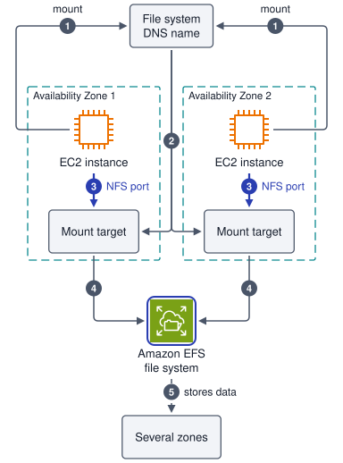

# EFS and FSx

## Predict (1 min)
<!-- section: role=predict; route=fast; minutes=1 -->

Guess before you read. The answers are in the Check section.

**Predict 1.** A company's Linux instances share files on Amazon Elastic File System (Amazon EFS) over the **Network File System** (NFS) protocol. The company adds Windows instances that need the same files. Can the Windows instances mount the **file system**? <!-- gist-trap -->

**Predict 2.** A file on Amazon EFS moved to **EFS Infrequent Access** (EFS IA), a cheaper **storage class**, because nobody read it. Today a user opens the file. Does the file move back to **EFS Standard** on its own?

**Predict 3.** A team links an Amazon FSx for **Lustre** (LUSS-ter) file system to a large S3 bucket. Must the whole bucket be copied in before a job can start?

## Look first (3 min)
<!-- section: role=task; route=fast; minutes=3 -->

Open AWS CloudShell and list the EFS and FSx file systems of one Region. Look for a storage size that someone chose: an EFS file system works [without provisioning or managing storage capacity](../facts/efs.md#efs-serverless-elastic-no-provisioning).

<!-- task:start id=efs-fsx-t01 -->

Look

**It kills the belief.** "An EFS file system has a size that you must choose and grow."

> **Cost:** $0.

**Permissions.** `elasticfilesystem:DescribeFileSystems`, `elasticfilesystem:DescribeMountTargets`, `ec2:DescribeAvailabilityZones`, `fsx:DescribeFileSystems`

**No permission to create resources?** This task is read-only. It needs no alternative.

1. Open AWS CloudShell. List the EFS file systems of this Region with their throughput mode, performance mode, encryption, zone and size.

   ```bash
   aws efs describe-file-systems --query "FileSystems[].[FileSystemId,ThroughputMode,PerformanceMode,Encrypted,AvailabilityZoneName,SizeInBytes.Value]" --output table
   ```

   Expect: One row per file system, or no rows. The throughput mode is elastic, bursting or provisioned. The zone column shows a zone name only for a One Zone file system; a Regional file system shows None. The last column is the size in bytes that EFS measured. No column holds a size that someone chose.

2. List the Availability Zones of this Region. A Regional file system can have one mount target in each of them.

   ```bash
   aws ec2 describe-availability-zones --filters Name=zone-type,Values=availability-zone --query "AvailabilityZones[].ZoneName"
   ```

   Expect: A list of zone names, for example us-east-1a and us-east-1b.

3. If the first list showed a file system, pick its ID as <FS_ID> and list its mount targets. If the list was empty, skip this step.

   ```bash
   aws efs describe-mount-targets --file-system-id <FS_ID> --query "MountTargets[].[AvailabilityZoneName,SubnetId,IpAddress,LifeCycleState]" --output table
   ```

   Expect: At most one row per Availability Zone, each with a subnet and a private IP address. A One Zone file system shows at most one row. No rows means that no client can mount the file system yet.

4. List the Amazon FSx file systems of this Region with their type, storage type and storage capacity. Compare them with the EFS list.

   ```bash
   aws fsx describe-file-systems --query "FileSystems[].[FileSystemId,FileSystemType,StorageType,StorageCapacity]" --output table
   ```

   Expect: No rows, or one row per file system: WINDOWS, LUSTRE, ONTAP or OPENZFS, with SSD, HDD or INTELLIGENT_TIERING and a capacity in GiB. On FSx for Lustre and FSx for OpenZFS, someone specified the size of an SSD file system when creating it; an INTELLIGENT_TIERING file system has no size to specify.

**Label.** checked against docs, not run in a real account. Checked 2026-10-14.

<!-- task:end -->

## In one breath (3 min)
<!-- section: role=breath; route=fast; minutes=3 -->

> **Say it:** Amazon EFS is [serverless, fully elastic file storage](../facts/efs.md#efs-serverless-elastic-no-provisioning) that Linux clients mount over NFS. FSx offers [four options that align to widely used file systems](../facts/fsx.md#fsx-decision-guide-four-file-systems-align-to-popular).

**The problem it solves.** Many instances read and write the same files, often in more than one Availability Zone (AZ). A file system gives every client the same folders and files, with [strong consistency and file locking](../facts/efs.md#efs-faq-efs-semantics-strong-consistency-locking).

**Predict the picture.** Web instances in two Availability Zones save reports to one EFS file system. What does each instance connect to, and where is the data stored?

<details>
<summary>Show the picture</summary>



**Figure.** Every instance reaches one shared file system through the mount target in its own Availability Zone.

1. Each instance mounts the file system by its Domain Name System (DNS) name.
2. The name [resolves to the IP address of the EFS](../facts/efs.md#efs-dns-name-resolves-to-same-az-mount-target) mount target in the same zone.
3. The client connects to the [NFS port (TCP port 2049)](../facts/efs.md#efs-nfs-client-needs-network-connection-to-port-2049) of that mount target.
4. The file system serves [one to thousands of Amazon Elastic Compute Cloud (EC2) instances](../facts/efs.md#efs-concurrent-access-multiple-clients-multiple-azs) at the same time.
5. A **Regional file system** stores data across [multiple geographically separated Availability Zones](../facts/efs.md#efs-regional-recommended-type).

</details>

> **Startup example:** Callvale's application writes report files to the volume of the instance that creates them. A download request often reaches another instance. Linux conversion workers also need one shared directory for large temporary files. The application code that reads and writes files cannot change this year.

## Words that go together (1 min)
<!-- section: role=words; route=fast; minutes=1 -->

<!-- table: words -->
| Term | Words that go with it | Plain meaning | Do not confuse with |
|---|---|---|---|
| file system | **mount** a file system | Shared storage that many clients read and write as files and folders | volume or bucket |
| mount target | **create** a mount target in each Availability Zone | The network endpoint of a file system in one zone | EFS access point |
| throughput (THROO-put) | **high** throughput | The amount of data that moves each second | latency |
| latency (LAY-ten-see) | **low** latency | The time between a request and its response | throughput |
| storage class | **choose** a storage class | A price and access level for stored data (S3 objects, EFS files) | file system type: Regional or One Zone |
| lifecycle policy | a lifecycle policy **transitions** files to EFS IA | Moves unread files to a cheaper storage class | S3 lifecycle rule |
| fail over (FAYL OH-ver) | fail over to the **standby** | Move work from a failed file server to its standby | back up |
| Active Directory | **join** a file system to Active Directory | The Microsoft directory of users, groups and computers | IAM |

## Choose it or not (4 min)
<!-- section: role=choose; route=fast; minutes=4 -->

### Block or file or object storage

<!-- table: compare -->
| Question | Amazon EBS | Amazon EFS | Amazon S3 |
|---|---|---|---|
| What storage type? | A [block-level storage service](../facts/efs.md#efs-faq-use-case-file-vs-block-vs-object) | A [file storage service](../facts/efs.md#efs-faq-use-case-file-vs-block-vs-object) | An [object storage service](../facts/efs.md#efs-faq-use-case-file-vs-block-vs-object) |
| Who uses it? | Storage [attached to single Amazon EC2 instances or containers](../facts/efs.md#efs-decision-guide-block-row-single-instance) | [One to thousands of Amazon Elastic Compute Cloud (EC2) instances](../facts/efs.md#efs-concurrent-access-multiple-clients-multiple-azs) | Applications, through an [application programming interface (API) over the internet](../facts/efs.md#efs-decision-guide-object-storage-api-read-heavy) |
| What does it fit? | Databases and boot volumes | Clients that need [shared read and write access](../facts/efs.md#efs-decision-guide-file-system-row-shared-access) | Objects such as call recordings |

**Deciding question:** Does one instance need a disk, do many clients need shared files, or does an application store objects through an API?

### Amazon EFS or FSx for Windows File Server

Windows clients reach a **file share** over the **Server Message Block** (SMB) protocol. Amazon FSx for Windows File Server gives them one.

<!-- table: compare -->
| Question | Amazon EFS | FSx for Windows File Server |
|---|---|---|
| Which protocol? | [NFS v4](../facts/efs.md#efs-faq-nfs-v4-protocol) | [the SMB protocol](../facts/fsx.md#fsx-faq-windows-smb-protocol) |
| Windows clients? | No: using EFS with [Microsoft Windows–based Amazon EC2 instances](../facts/efs.md#efs-windows-ec2-not-supported) [is not supported](../facts/efs.md#efs-windows-ec2-not-supported) | Yes: [Windows, Linux, and MacOS](../facts/fsx.md#fsx-faq-windows-clients-and-concurrency) clients |
| Who can read a file? | [Portable Operating System Interface (POSIX) permissions](../facts/efs.md#efs-posix-permissions-and-no-code-change-for-nfs-apps) decide | Domain users: you [join it to your Active Directory domain](../facts/fsx.md#fsx-windows-joins-active-directory-for-authentication-and-acls) |
| How does capacity change? | [elastic, automatically growing and shrinking](../facts/efs.md#efs-faq-elastic-grow-shrink) | You set a size: [Increase only](../facts/fsx.md#fsx-windows-storage-capacity-increase-only-never-decrease) |
| Which zones? | Regional, across [multiple geographically separated Availability Zones](../facts/efs.md#efs-regional-recommended-type), or One Zone, in one zone | [Single-AZ and Multi-AZ](../facts/fsx.md#fsx-compare-deployment-options) options |

**Deciding question:** Do the clients use Linux and NFS, or Windows and SMB with Active Directory permissions?

### FSx for Lustre or FSx for NetApp ONTAP or FSx for OpenZFS

<!-- table: compare -->
| Question | Amazon FSx for Lustre | Amazon FSx for NetApp ONTAP | Amazon FSx for OpenZFS |
|---|---|---|---|
| Built for? | [machine learning, high-performance computing (HPC)](../facts/fsx.md#fsx-decision-guide-lustre-speed-workloads) | Today's NetApp ONTAP storage: AWS points to [FSx for NetApp ONTAP](../facts/fsx.md#fsx-when-to-choose-ontap-from-nas) | Today's ZFS or Linux file server: AWS points to [FSx for OpenZFS](../facts/fsx.md#fsx-when-to-choose-openzfs-from-zfs) |
| Which protocol? | A custom protocol for Linux clients | NFS and SMB, with [multi-protocol access](../facts/fsx.md#fsx-faq-ontap-nfs-smb-multiprotocol) | [NFS 3, 4.0, 4.1, 4.2](../facts/fsx.md#fsx-compare-protocol-support) |
| Which clients? | [Linux](../facts/fsx.md#fsx-compare-client-compatibility) | Windows, Linux and macOS | Windows, Linux and macOS, all over NFS |
| What stands out? | It [transparently presents S3 objects as files](../facts/fsx.md#fsx-lustre-s3-presents-objects-as-files-and-writes-back) | [primary storage and capacity pool storage](../facts/fsx.md#fsx-faq-ontap-two-storage-tiers); SnapMirror to [migrate your NetApp ONTAP file systems](../facts/fsx.md#fsx-ontap-snapmirror-recommended-for-migrating-onprem-netapp) | [point-in-time snapshots, in-place data cloning](../facts/fsx.md#fsx-faq-openzfs-snapshots-clones-replication) |

**Deciding question:** Is the workload a compute job on S3 data, a NetApp or mixed NFS and SMB estate, or a ZFS or Linux NFS server?

## Signals and traps (3 min)
<!-- section: role=signals; route=fast; minutes=3 -->

<!-- table: signals -->
| The stem says | Think | Because | But not if |
|---|---|---|---|
| "shared file system for Linux instances across Availability Zones" | Amazon EFS | used [concurrently from multiple NFS clients](../facts/efs.md#efs-concurrent-access-multiple-clients-multiple-azs) | Windows clients or SMB: FSx for Windows File Server |
| "SMB, Windows file shares, Active Directory users" | FSx for Windows File Server | you [join it to your Active Directory domain](../facts/fsx.md#fsx-windows-joins-active-directory-for-authentication-and-acls) | Linux NFS clients too: FSx for NetApp ONTAP |
| "HPC, machine learning training, data in S3" | FSx for Lustre linked to the bucket | built for [machine learning, high-performance computing (HPC)](../facts/fsx.md#fsx-decision-guide-lustre-speed-workloads) | no compute job, only shared Linux files: Amazon EFS |
| "NetApp ONTAP, SnapMirror, NFS and SMB on the same data" | FSx for NetApp ONTAP | [multi-protocol access](../facts/fsx.md#fsx-faq-ontap-nfs-smb-multiprotocol) to the same data | a ZFS server today: FSx for OpenZFS |
| "ZFS or Linux NFS file server, snapshots and clones" | FSx for OpenZFS | AWS maps ZFS servers to [FSx for OpenZFS](../facts/fsx.md#fsx-when-to-choose-openzfs-from-zfs) | clients need SMB: FSx for NetApp ONTAP |
| "development or staging files, MOST cost-effective" | **One Zone file system** | suits [development, build, and staging environments](../facts/efs.md#efs-faq-one-zone-use-cases) | files must survive a zone loss: Regional file system |
| "spiky or unpredictable throughput" | **Elastic throughput** | fits [spiky or unpredictable workloads](../facts/efs.md#efs-elastic-best-for-spiky-low-average-to-peak) | known, steady throughput: **Provisioned throughput** |
| "files are rarely read after a few weeks" | a lifecycle policy to EFS IA | EFS IA suits data read [a few times a quarter](../facts/efs.md#efs-faq-ia-quarter-archive-year-designed-for) | tiny files: one [smaller than 128 KiB](../facts/efs.md#efs-faq-ia-archive-128-kib-billing) is billed at that size |

### Traps

- **Wrong belief:** EFS is a network file system, so Windows instances can mount it. **Truth:** Using Amazon EFS with [Microsoft Windows–based Amazon EC2 instances](../facts/efs.md#efs-windows-ec2-not-supported) [is not supported](../facts/efs.md#efs-windows-ec2-not-supported). Use FSx for Windows File Server. <!-- trap: efs-fsx-trap-windows-clients -->
- **Wrong belief:** An EFS file system needs a size that someone must grow. **Truth:** Amazon EFS works [without provisioning or managing storage capacity](../facts/efs.md#efs-serverless-elastic-no-provisioning). <!-- trap: efs-fsx-trap-provision-capacity -->
- **Wrong belief:** You can turn on encryption at rest for an existing EFS file system. **Truth:** After creation, you [cannot change its encryption setting](../facts/efs.md#efs-encryption-setting-cannot-change-after-creation). Copy the files to a new encrypted file system. <!-- trap: efs-fsx-trap-encrypt-existing-file-system -->
- **Wrong belief:** Max I/O is the fastest performance mode for many clients. **Truth:** AWS recommends [always using General Purpose performance mode](../facts/efs.md#efs-general-purpose-always-recommended-max-io-higher-latency), because of [higher per-operation latencies with Max I/O](../facts/efs.md#efs-general-purpose-always-recommended-max-io-higher-latency). <!-- trap: efs-fsx-trap-max-io-fastest -->
- **Wrong belief:** A scratch FSx for Lustre file system keeps its data when a file server fails. **Truth:** On a **scratch file system**, [data is not replicated](../facts/fsx.md#fsx-lustre-scratch-temporary-not-replicated). Backups are [supported only on FSx for Lustre persistent](../facts/fsx.md#fsx-lustre-backups-persistent-only-not-s3-linked-not-scratch) file systems without an S3 link. <!-- trap: efs-fsx-trap-lustre-scratch-keeps-data -->

## Changed recently (1 min)
<!-- section: role=changed; route=fast; minutes=1 -->

> **Changed recently:** (2023-04-13) Default EFS throughput mode.<br>
> **Old:** [Bursting](../facts/efs.md#efs-change-elastic-replaces-bursting-default-2023-04).<br>
> **Now:** [Elastic](../facts/efs.md#efs-change-elastic-replaces-bursting-default-2023-04), the default and recommended mode.<br>
> **The exam probably expects:** older questions can treat Bursting as the default, with throughput that grows with stored data. Today Elastic is the default.<br>
> **Status:** examinable.

> **Changed recently:** (2023-11-26) The EFS Archive storage class.<br>
> **Old:** not available.<br>
> **Now:** EFS offers [three storage classes](../facts/efs.md#efs-change-archive-storage-class-and-file-system-types-2023-11): EFS Standard, EFS IA and EFS Archive.<br>
> **The exam probably expects:** older questions know only EFS Standard and EFS IA, not the file system types Regional and One Zone.<br>
> **Status:** examinable.

> **Changed recently:** (2025-02-10) Access points for one EFS file system.<br>
> **Old:** [1,000](../facts/efs.md#efs-change-access-points-10000-per-file-system-2025-02).<br>
> **Now:** [10,000](../facts/efs.md#efs-change-access-points-10000-per-file-system-2025-02).<br>
> **The exam probably expects:** older questions can use a lower limit, and you can request an increase. Do not choose on the count alone.<br>
> **Status:** examinable.

## Check (2 min)
<!-- section: role=check; route=fast; minutes=2 -->

**Check 1.** Linux instances use NFS and Windows instances use SMB, and both must edit the same files. Which file service fits?

<details>
<summary>Answer</summary>

FSx for NetApp ONTAP: [multi-protocol access](../facts/fsx.md#fsx-faq-ontap-nfs-smb-multiprotocol) to the same data. Using EFS with [Microsoft Windows–based Amazon EC2 instances](../facts/efs.md#efs-windows-ec2-not-supported) [is not supported](../facts/efs.md#efs-windows-ec2-not-supported).

**Predict 1:** No, for the same reason.

</details>

**Check 2.** A lifecycle policy moved old reports to EFS IA. A team reads one report daily for a week, with default lifecycle settings. Where is it on day 7?

<details>
<summary>Answer</summary>

Still in EFS IA. By default, files are [not moved back to the Standard storage class](../facts/efs.md#efs-lifecycle-default-no-move-back-to-standard). Transition into Standard can [transition files into Standard storage](../facts/efs.md#efs-lifecycle-transition-to-standard-on-first-access) on first access.

**Predict 2:** No, for the same reason.

</details>

**Check 3.** FSx for Lustre is linked to a bucket of 500 TB of images. A job reads 2 TB. How much data gets loaded?

<details>
<summary>Answer</summary>

Only the files it reads: content is [imported automatically from S3 only when you access](../facts/fsx.md#fsx-faq-lustre-s3-object-imported-on-first-access) the file. The file list comes first.

**Predict 3:** No. The job starts without a full copy.

</details>

## Recap from memory (2 min)
<!-- section: role=recap; route=fast; minutes=2 -->

**Recap 1.** What deciding question follows the Amazon EFS or FSx for Windows File Server table?

<details>
<summary>Answer</summary>

Do the clients use Linux and NFS, or Windows and SMB with Active Directory permissions?

</details>

**Recap 2.** What fits "HPC, machine learning training, data in S3"?

<details>
<summary>Answer</summary>

FSx for Lustre, linked to the bucket.

</details>

**Recap 3.** What does the trap list say about encrypting an existing EFS file system?

<details>
<summary>Answer</summary>

After creation, you [cannot change its encryption setting](../facts/efs.md#efs-encryption-setting-cannot-change-after-creation). Copy the files to a new encrypted file system.

</details>
