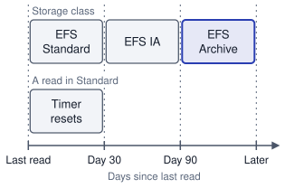
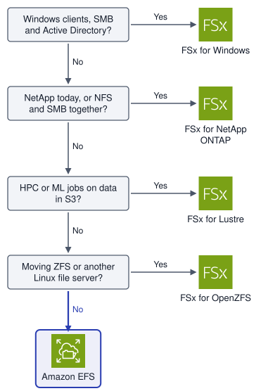
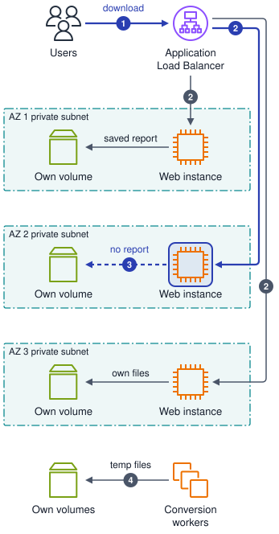
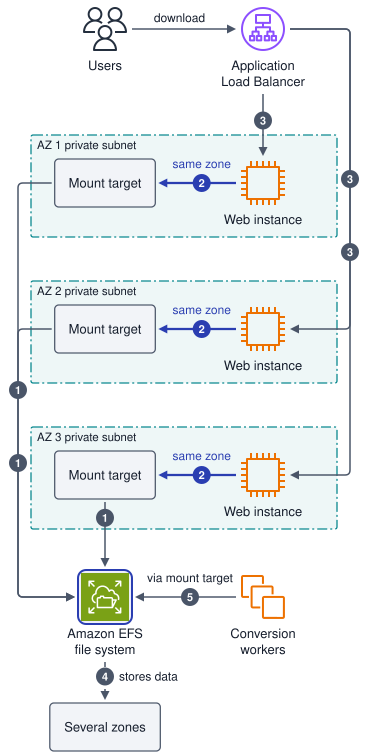

# EFS and FSx in depth

## How it works (49 min)
<!-- section: role=how; route=full; minutes=49 -->

### Amazon EFS gives many Linux clients one shared file system over NFS (3 min)

Many instances need the same files at the same time. A **file system** gives every client the same folders.

1. **Store files.** Amazon Elastic File System (Amazon EFS) is a [file storage service](../facts/efs.md#efs-faq-use-case-file-vs-block-vs-object).
2. **Mount over NFS.** Clients use the Network File System (NFS) protocol, versions [NFSv4.1 and NFSv4.0](../facts/efs.md#efs-protocol-nfsv4-versions).
3. **Share it.** You access it [concurrently from multiple NFS clients](../facts/efs.md#efs-concurrent-access-multiple-clients-multiple-azs).
4. **Plan no capacity.** It grows [without provisioning or managing storage capacity](../facts/efs.md#efs-serverless-elastic-no-provisioning).

Amazon ECS tasks mount it with [both EC2 and Fargate launch types](../facts/efs.md#efs-faq-access-from-ecs-task-definition).

Why a file system? Clients keep the file interface, so EFS [requires no changes to your existing applications](../facts/efs.md#efs-overview-regional-linux-shared-access).

> **Exam signal:** "a shared file system for Linux instances" points to Amazon EFS. "Windows instances" points to FSx for Windows File Server.

- **Wrong belief:** EFS suits the data files of a database on one instance. **Truth:** A one-instance database fits block storage, [attached to single Amazon EC2 instances or containers](../facts/efs.md#efs-decision-guide-block-row-single-instance). <!-- trap: efs-fsx-trap-efs-for-single-instance-database -->

> **Say it:** The short answer is: EFS is one shared folder for many Linux clients. The thing to watch is Windows.

**Stop and answer.** A Lambda function and three Fargate tasks must read one 2 GB model file. Can they share one EFS file system?

Answer

Yes. Lambda references [an EFS file system in your function settings](../facts/efs.md#efs-faq-access-from-lambda-function-settings), and Fargate tasks mount it too.

### Each client reaches EFS through the mount target in its own Availability Zone (4 min)

An Amazon EBS volume [must be in the same Availability Zone](../facts/ebs.md#ebs-volume-same-az-as-instance) as its instance. EFS gives each Availability Zone (AZ) a network address instead.

1. **One per zone.** A **mount target** [provides an IP address for an NFSv4 endpoint](../facts/efs.md#efs-mount-target-definition-ip-nfs-endpoint); instances of a zone [share that mount target](../facts/efs.md#efs-one-mount-target-per-az-shared-by-instances).
2. **Mount by name.** The Domain Name System (DNS) name [resolves to the IP address of the EFS](../facts/efs.md#efs-dns-name-resolves-to-same-az-mount-target) mount target in the client's zone.
3. **Open the port.** The client connects to the [NFS port (TCP port 2049)](../facts/efs.md#efs-nfs-client-needs-network-connection-to-port-2049).
4. **Reach from outside.** Servers on premises use [AWS Direct Connect or Site-to-Site VPN](../facts/efs.md#efs-onpremises-mount-via-direct-connect-or-vpn) and [must have a Linux-based operating system](../facts/efs.md#efs-onpremises-server-must-be-linux). AWS recommends a [mount target IP address instead of](../facts/efs.md#efs-onpremises-use-mount-target-ip-instead-of-dns) a name.

Why one per zone? Same-zone access has [no data transfer charges](../facts/efs.md#efs-pricing-no-charge-same-az-access).

> **Exam signal:** "servers on premises must mount the file system" points to Direct Connect or Site-to-Site VPN.

- **Wrong belief:** An encrypted mount uses HTTPS, so the mount target security group allows port 443. **Truth:** A client [can only mount a file system](../facts/efs.md#efs-nfs-client-needs-network-connection-to-port-2049) through the [NFS port (TCP port 2049)](../facts/efs.md#efs-nfs-client-needs-network-connection-to-port-2049). <!-- trap: efs-fsx-trap-nfs-over-https-port -->

> **Say it:** The short answer is: each zone gets one mount target. The thing to watch is the NFS port.

**Stop and answer.** A server in a data center reaches the VPC over VPN but cannot mount by name. What helps?

Answer

A [mount target IP address instead of](../facts/efs.md#efs-onpremises-use-mount-target-ip-instead-of-dns) the name, and an [NFS port (2049)](../facts/efs.md#efs-onpremises-security-group-allow-nfs-port-2049) rule for the server.

### A Regional file system survives a zone failure but One Zone does not (3 min)
<!-- section: route=pass -->

A file system in one zone stops when that zone stops.

1. **Regional.** A **Regional file system** stores data across [multiple geographically separated Availability Zones](../facts/efs.md#efs-regional-recommended-type).
2. **One Zone.** A **One Zone file system** has [only one highly available EFS mount target](../facts/efs.md#efs-faq-one-zone-single-mount-target).
3. **Zone outage.** One Zone is [not resilient to a complete AZ outage](../facts/efs.md#efs-onezone-not-resilient-to-az-outage).

<!-- table: plain -->
| Question | Regional | One Zone |
|---|---|---|
| A zone is lost | Designed to [sustain data if an AZ is lost](../facts/efs.md#efs-regional-designed-to-sustain-az-loss) | The [file systems might be lost](../facts/efs.md#efs-whatisefs-one-zone-single-az-loss-risk) |
| Fits | Production | [development, build, and staging environments](../facts/efs.md#efs-faq-one-zone-use-cases) |

**Multi-AZ** (MUL-tee ay-ZEE) means several zones. Why offer One Zone? Many workloads [do not require the Multi-AZ availability and durability](../facts/efs.md#efs-pricing-one-zone-for-no-multi-az-need).

> **Exam signal:** "test data that can be re-created" with "MOST cost-effective" points to One Zone. "survive an Availability Zone failure" points to Regional.

> **Exam trap:** Many expect One Zone copies to survive a zone outage. One Zone file systems [store data redundantly within a single AZ](../facts/efs.md#efs-faq-one-zone-single-az), so every copy is in that zone. <!-- trap: efs-fsx-trap-one-zone-survives-az-loss -->

> **Say it:** The short answer is: Regional survives a zone loss, and One Zone does not. The thing to watch is data with no other copy.

**Stop and answer.** Build files live on a One Zone file system in AZ 1. Build servers run in AZ 1 and AZ 2. Which servers pay data transfer charges between zones?

Answer

The AZ 2 servers. AZ 1 servers [avoid data transfer charges between Availability Zones](../facts/efs.md#efs-onezone-same-az-avoids-transfer-charges-better-performance).

### Elastic throughput follows the workload and Provisioned throughput follows your setting (4 min)
<!-- section: route=pass -->

**Throughput** (THROO-put) is data moved each second. Some applications read in spikes; others read steadily.

1. **Elastic.** **Elastic throughput** [scales automatically](../facts/efs.md#efs-elastic-scales-automatically-no-provisioning-pay-per-use), and you pay for data read or written.
2. **Provisioned.** With **Provisioned throughput**, [you specify a level of throughput](../facts/efs.md#efs-provisioned-throughput-independent-of-size) and pay for it.
3. **Bursting.** **Bursting throughput** [scales with the amount of storage](../facts/efs.md#efs-throughput-bursting-scales-with-storage). It spends **burst credits**, [deducted when throughput exceeds the base rate](../facts/efs.md#efs-bursting-credits-accrue-below-base-and-deducted-above).

<!-- table: plain -->
| Average throughput compared with peak | Mode |
|---|---|
| Low or spiky: [5% or less of the peak throughput](../facts/efs.md#efs-elastic-best-for-spiky-low-average-to-peak) | Elastic |
| Steady: [5% or more of the average-to-peak ratio](../facts/efs.md#efs-provisioned-use-when-known-needs-5-percent-or-more), or you [know your workload's performance requirements](../facts/efs.md#efs-provisioned-use-when-known-needs-5-percent-or-more) | Provisioned |

You can [change the throughput mode](../facts/efs.md#efs-switch-throughput-mode-no-downtime) later; after a move to Provisioned, [wait at least 24 hours](../facts/efs.md#efs-provisioned-24-hour-wait-before-switch-or-decrease) before the next change.

> **Exam signal:** "spiky" or "unpredictable" points to Elastic. "sustained, predictable throughput" points to Provisioned.

> **Exam trap:** Many provision a spiky workload for its peak. You are [charged for the amount of throughput enabled](../facts/efs.md#efs-provisioned-billed-for-throughput-enabled). <!-- trap: efs-fsx-trap-provisioned-for-spiky -->

- **Wrong belief:** On Bursting throughput, extra stored data is a cheap way to get speed. **Truth:** You pay for that storage. Provisioned throughput is [independent of the file system's size](../facts/efs.md#efs-provisioned-throughput-independent-of-size). <!-- trap: efs-fsx-trap-pad-data-for-throughput -->

Go deeper: Max I/O

Max I/O is a previous generation mode with [higher per-operation latencies with Max I/O](../facts/efs.md#efs-general-purpose-always-recommended-max-io-higher-latency). It is [not supported for One Zone file systems](../facts/efs.md#efs-max-io-not-supported-one-zone-or-elastic) or [file systems that use Elastic throughput](../facts/efs.md#efs-max-io-not-supported-one-zone-or-elastic). You [cannot change the performance mode](../facts/efs.md#efs-performance-mode-cannot-change-after-available) later.

> **Say it:** The short answer is: Elastic for spikes, Provisioned for steady load. The thing to watch is that Bursting speed follows stored size.

**Stop and answer.** A 50 GiB Bursting file system serves a job that reads at one high rate all day, and it has no burst credits left. Which mode fits?

Answer

Provisioned: the load is steady, and the level is set [independent of the file system's size](../facts/efs.md#efs-provisioned-throughput-independent-of-size).

### Cold files move to cheaper classes and stay there unless you ask (4 min)
<!-- section: route=pass -->

Most files are read often for some weeks and then rarely. A cheaper **storage class** fits them.

1. **Move when unread.** The recommended **lifecycle policy** moves an unread file to EFS Infrequent Access (EFS IA) after [30 days](../facts/efs.md#efs-lifecycle-default-ia-after-30-days), and to EFS Archive after [90 days](../facts/efs.md#efs-lifecycle-default-archive-after-90-days).
2. **Come back on request.** A **Transition into Standard** policy can [transition files into Standard storage](../facts/efs.md#efs-lifecycle-transition-to-standard-on-first-access).
3. **Archive needs Elastic.** EFS Archive works on [EFS Regional file systems](../facts/efs.md#efs-faq-archive-regional-elastic-only) in the [default Elastic Throughput mode](../facts/efs.md#efs-faq-archive-regional-elastic-only). When a policy moves files to Archive, you [cannot change the throughput mode](../facts/efs.md#efs-archive-needs-elastic-throughput-no-bursting-provisioned) to Bursting or Provisioned.

<!-- table: plain -->
| Class | Read | First-byte latency |
|---|---|---|
| EFS Standard | Often | [sub-millisecond latencies](../facts/efs.md#efs-faq-standard-sub-millisecond) |
| EFS IA | [a few times a quarter](../facts/efs.md#efs-faq-ia-quarter-archive-year-designed-for) | [tens of milliseconds](../facts/efs.md#efs-latency-ia-archive-first-byte) |
| EFS Archive | [a few times a year or less](../facts/efs.md#efs-faq-ia-quarter-archive-year-designed-for) | [tens of milliseconds](../facts/efs.md#efs-latency-ia-archive-first-byte) |

**Figure.** With the recommended lifecycle policy, a file that nobody reads moves to EFS IA after [30 days](../facts/efs.md#efs-lifecycle-recommended-defaults-quick-create) and to EFS Archive after [90 days](../facts/efs.md#efs-lifecycle-recommended-defaults-quick-create).

Why not move everything? Reads from IA or Archive are [billed data access charges](../facts/efs.md#efs-ia-archive-billed-per-class-plus-access-charges).

> **Exam signal:** "rarely accessed after 30 days" points to a lifecycle policy to EFS IA.

> **Exam trap:** Many expect a read to bring a file back. By default, files are [not moved back to the Standard storage class](../facts/efs.md#efs-lifecycle-default-no-move-back-to-standard). <!-- trap: efs-fsx-trap-ia-moves-back-by-default -->

> **Try it:** Set a lifecycle policy and see which throughput change it blocks. See [3-do.md](3-do.md). <!-- task: efs-fsx-t02 -->

> **Say it:** The short answer is: lifecycle policies move unread files to cheaper classes. The thing to watch is that read files stay there.

**Stop and answer.** Lawyers rarely open old contracts, but sometimes reopen one daily for a week. Which two settings fit?

Answer

EFS IA after [30 days](../facts/efs.md#efs-lifecycle-default-ia-after-30-days), and Transition into Standard for the [fastest latency performance](../facts/efs.md#efs-lifecycle-transition-to-standard-on-first-access).

### Security groups decide who connects and IAM policies decide who mounts (4 min)

A shared file system raises three questions: who connects, who mounts, and which files each user touches.

1. **Connect.** [Network security policies, such as security groups](../facts/efs.md#efs-security-access-iam-and-security-groups) decide who reaches a mount target.
2. **Mount.** [Attach an IAM policy to your file system](../facts/efs.md#efs-faq-control-instances-with-security-groups-and-iam), the **file system policy**, to [control which clients can mount your file system](../facts/efs.md#efs-faq-file-system-policy-mount-permissions).
3. **Touch files.** Linux user and group bits, the [Portable Operating System Interface (POSIX) permissions](../facts/efs.md#efs-posix-permissions-and-no-code-change-for-nfs-apps) (POZ-iks), apply.
4. **Encrypt.** You [enable encryption at rest when creating](../facts/efs.md#efs-two-forms-encryption-when-enabled) the file system; you [cannot change its encryption setting](../facts/efs.md#efs-encryption-setting-cannot-change-after-creation) later.
5. **Scope.** An **EFS access point** can [enforce a different root directory](../facts/efs.md#efs-access-point-enforces-posix-user-and-root-directory) for one application.

Why layers? The default file system policy [grants full access to any anonymous client](../facts/efs.md#efs-default-file-system-policy-full-access-anonymous) that reaches a mount target.

> **Exam signal:** "each application must see only its own directory" points to an EFS access point. "Encrypt data in transit" points to the mount helper's Transport Layer Security (TLS) option, which [establishes a secure TLS connection](../facts/efs.md#efs-mount-helper-tls-option-encrypts-nfs-traffic).

> **Say it:** The short answer is: security groups decide who connects; a file system policy decides who mounts. The thing to watch is the open default policy.

**Stop and answer.** Team A must see only /team-a and act as one fixed Linux user. What do you create?

Answer

An access point that can [enforce a user identity](../facts/efs.md#efs-access-point-enforces-posix-user-and-root-directory) and [enforce a different root directory](../facts/efs.md#efs-access-point-enforces-posix-user-and-root-directory).

### EFS Replication keeps a read-only copy in another Region or zone (4 min)

A Regional file system survives a zone loss, not a Region loss.

1. **Replicate.** **EFS Replication** copies data to a [Region or Availability Zone (AZ) of your choice](../facts/efs.md#efs-replication-destination-faq-region-or-az-of-choice).
2. **Read-only copy.** The copy is a [new read-only destination file system](../facts/efs.md#efs-replication-destination-read-only-while-replicating).
3. **Recover fast.** After the first sync, the **recovery point objective** (RPO) is [15 minutes](../facts/efs.md#efs-replication-rpo-15-minutes-most-file-systems) [for most file systems](../facts/efs.md#efs-replication-rpo-15-minutes-most-file-systems). Replication aims at a **recovery time** [objective (RTO) of minutes](../facts/efs.md#efs-replication-rpo-rto-minutes).
4. **Fail over.** You delete the replication configuration, and then [the replica becomes writeable](../facts/efs.md#efs-replication-failover-delete-configuration-replica-writeable).

<!-- table: plain -->
| Question | EFS Replication | AWS Backup |
|---|---|---|
| Keeps | The current state | In the default backup plan, [daily backups with a 35-day retention period](../facts/efs.md#efs-default-backup-plan-daily-35-day-retention) |
| On for a new file system? | No, you set it up | Console: yes. CLI or API: [enabled by default only for One Zone](../facts/efs.md#efs-backup-cli-api-default-only-one-zone) |

Why both? The replica copies a mistake too; a backup still holds yesterday's file. <!-- xref: 24 AWS Backup plans and vaults -->

> **Exam signal:** "RPO and RTO of minutes in another Region" points to EFS Replication. "restore files deleted last week" points to AWS Backup.

> **Exam trap:** Many plan to write in both Regions. Applications [use the replica file system in read-only mode](../facts/efs.md#efs-replication-destination-read-only-while-replicating) during replication. <!-- trap: efs-fsx-trap-replica-writable -->

> **Try it:** Replicate an empty file system and see which delete the replication blocks. See [3-do.md](3-do.md). <!-- task: efs-fsx-t03 -->

> **Say it:** The short answer is: replication keeps a read-only copy that you promote in minutes. The thing to watch is that it copies mistakes too.

**Stop and answer.** In a Region outage, an application mounts the replica and every write fails. What was missed?

Answer

The failover: after you delete the configuration, [the replica becomes writeable](../facts/efs.md#efs-replication-failover-delete-configuration-replica-writeable).

### The four FSx file systems match the storage and protocol you use today (3 min)
<!-- section: route=pass -->

Many companies already run a file server. Amazon FSx gives it a managed twin with the same protocol.

1. **Windows.** Windows Server maps to [FSx for Windows File Server](../facts/fsx.md#fsx-when-to-choose-windows-from-windows-server), over Server Message Block (SMB).
2. **NetApp and ZFS.** NetApp maps to [FSx for NetApp ONTAP](../facts/fsx.md#fsx-when-to-choose-ontap-from-nas), ZFS to [FSx for OpenZFS](../facts/fsx.md#fsx-when-to-choose-openzfs-from-zfs).
3. **Lustre.** Lustre maps to [FSx for Lustre](../facts/fsx.md#fsx-when-to-choose-lustre-from-parallel-fs), for [Linux](../facts/fsx.md#fsx-compare-client-compatibility) clients.

<!-- table: plain -->
| Question | Windows | ONTAP | OpenZFS | Lustre |
|---|---|---|---|---|
| Protocol | SMB | NFS, SMB and iSCSI (block storage over the network) | NFS | A custom POSIX-compliant protocol |
| Latency | [<1 ms](../facts/fsx.md#fsx-compare-latency-by-type) | [<1 ms](../facts/fsx.md#fsx-compare-latency-by-type) | [<0.5 ms](../facts/fsx.md#fsx-compare-latency-by-type) | [<1 ms](../facts/fsx.md#fsx-compare-latency-by-type) |

**Figure.** The clients, the protocol and the file server in use today decide which AWS file service fits.

> **Exam signal:** "move the file server without changing the application" points to the matching FSx type; "new Linux applications" points to Amazon EFS.

- **Wrong belief:** EFS fits every move of a Linux NFS server. **Truth:** AWS maps ZFS servers to [FSx for OpenZFS](../facts/fsx.md#fsx-when-to-choose-openzfs-from-zfs) and NetApp to [FSx for NetApp ONTAP](../facts/fsx.md#fsx-when-to-choose-ontap-from-nas). <!-- trap: efs-fsx-trap-efs-for-any-nfs-migration -->
- **Wrong belief:** A file server on EC2 is as little work as FSx. **Truth:** On EC2, your team patches, sizes and fails over the server. FSx gives [fully managed Microsoft Windows file servers](../facts/fsx.md#fsx-windows-fully-managed-native-windows-file-servers-smb). <!-- trap: efs-fsx-trap-self-managed-file-server -->

> **Say it:** The short answer is: pick the FSx type that matches today's server. The thing to watch is that Lustre serves [Linux](../facts/fsx.md#fsx-compare-client-compatibility) clients.

**Stop and answer.** A company moves a Lustre cluster from its data center. Which FSx type keeps its tools?

Answer

[FSx for Lustre](../facts/fsx.md#fsx-when-to-choose-lustre-from-parallel-fs).

### FSx for Windows File Server serves SMB shares that join your Active Directory (3 min)

A good move keeps shares, permissions and sign-ins.

1. **Windows servers.** FSx gives [fully managed Microsoft Windows file servers](../facts/fsx.md#fsx-windows-fully-managed-native-windows-file-servers-smb); users open a **file share** over SMB.
2. **Join the domain.** You [join it to your Active Directory domain](../facts/fsx.md#fsx-windows-joins-active-directory-for-authentication-and-acls). **Active Directory** (AD) holds the users.
3. **Keep permissions.** FSx enforces [standard Windows access control lists (ACLs)](../facts/fsx.md#fsx-windows-bp-windows-acls-enforced-existing-acls-migrate).

<!-- table: plain -->
| Directory | Can the file system join it? |
|---|---|
| AWS Managed Microsoft AD | Yes |
| Self-managed AD | Yes: an [existing, self-managed Active Directory domain](../facts/fsx.md#fsx-windows-ad-options-aws-managed-or-self-managed) |
| AD Connector or Simple AD | No: [Amazon FSx does not support](../facts/fsx.md#fsx-windows-ad-connector-simple-ad-not-supported) them |

Why AD? FSx checks each domain sign-in against the [Windows access control lists (ACLs)](../facts/fsx.md#fsx-windows-access-control-acls-security-groups-iam-ad). <!-- xref: 05 AWS Managed Microsoft AD and AD Connector -->

> **Exam signal:** "Windows file shares" or "Active Directory users" points to FSx for Windows File Server.

> **Exam trap:** Many reuse their AD Connector. [Amazon FSx does not support](../facts/fsx.md#fsx-windows-ad-connector-simple-ad-not-supported) it: join the domain as a self-managed AD. <!-- trap: efs-fsx-trap-ad-connector-works -->

> **Say it:** The short answer is: a managed Windows file server in your domain. The thing to watch is the directory type.

**Stop and answer.** A company's only directory runs in its data center. Must it create AWS Managed Microsoft AD first?

Answer

No. The file system can join an [existing, self-managed Active Directory domain](../facts/fsx.md#fsx-windows-ad-options-aws-managed-or-self-managed) directly.

### A Multi-AZ Windows file system fails over to a standby in another zone (3 min)

A Single-AZ file system is one file server in one zone. Production needs a second server.

1. **Two zones.** Multi-AZ uses [a preferred AZ and a standby AZ](../facts/fsx.md#fsx-windows-multi-az-standby-two-azs-sync-replication).
2. **Fail over.** It **fails over** (FAYL OH-ver) to the standby in three cases. [An Availability Zone outage occurs](../facts/fsx.md#fsx-windows-failover-triggers-az-outage-unavailable-maintenance). [The preferred file server becomes unavailable](../facts/fsx.md#fsx-windows-failover-triggers-az-outage-unavailable-maintenance). Or the preferred server [undergoes planned maintenance](../facts/fsx.md#fsx-windows-failover-triggers-az-outage-unavailable-maintenance).
3. **Same name.** The [DNS name remains the same](../facts/fsx.md#fsx-windows-failover-transparent-same-dns-name) for Windows clients.

<!-- table: plain -->
| Question | Single-AZ | Multi-AZ |
|---|---|---|
| After a failure | [about 30 minutes of downtime](../facts/fsx.md#fsx-windows-single-az-one-server-one-az-30-minutes-downtime) | Typically [less than 30 seconds](../facts/fsx.md#fsx-windows-failover-under-30-seconds-failback-automatic) |
| Fits | Test and development | [Multi-AZ file systems for most production workloads](../facts/fsx.md#fsx-windows-multi-az-recommended-production-single-az-dev-test) |

> **Exam signal:** "shares must stay available if an Availability Zone fails" points to Multi-AZ. "SQL Server" points to [continuously available (CA) file shares](../facts/fsx.md#fsx-windows-ca-shares-required-multi-az-for-sql-server).

> **Exam trap:** Many expect Single-AZ to move zones. It has a [single Windows file server instance](../facts/fsx.md#fsx-windows-single-az-one-server-one-az-30-minutes-downtime), so it waits for recovery. <!-- trap: efs-fsx-trap-single-az-fails-over -->

> **Say it:** The short answer is: Multi-AZ keeps a standby server in a second zone. The thing to watch is that Linux clients wait for failback.

**Stop and answer.** After a failover, Windows users keep working, but a Linux server stops. Why?

Answer

Linux clients [do not support automatic DNS-based failover](../facts/fsx.md#fsx-windows-linux-clients-no-automatic-dns-failover); they resume after failback.

### Windows file system storage grows in place but does not shrink (3 min)

Unlike EFS, FSx for Windows File Server has a **storage capacity** that you set.

1. **Pick the disk.** Hard disk drive (HDD) storage fits [home directories, user and departmental shares](../facts/fsx.md#fsx-windows-storage-hdd-vs-ssd-use-cases).
2. **Grow in use.** An increase runs [without any downtime impact](../facts/fsx.md#fsx-faq-windows-storage-grow-no-downtime).
3. **No shrink.** Storage capacity is [Increase only](../facts/fsx.md#fsx-windows-storage-capacity-increase-only-never-decrease).
4. **Go wider.** **DFS Namespaces** join file systems into [one common folder structure, or namespace](../facts/fsx.md#fsx-windows-dfs-namespaces-group-file-systems-scale-beyond-64-tib).

<!-- table: plain -->
| You want | Possible? |
|---|---|
| More storage | Yes, by a [minimum of 10 percent](../facts/fsx.md#fsx-windows-storage-capacity-increase-minimum-10-percent) |
| Other **throughput capacity** (the speed of the file server) | Yes: [increase or decrease the throughput capacity](../facts/fsx.md#fsx-faq-windows-increase-storage-change-throughput) |

> **Exam signal:** "one share path for more data than one file system" points to DFS Namespaces.

- **Wrong belief:** One Windows file system keeps growing as long as the data grows. **Truth:** One file system holds at most [64 TiB](../facts/fsx.md#fsx-windows-limit-max-storage-capacity). <!-- trap: efs-fsx-trap-windows-file-system-grows-without-limit -->

**Spot the bug.** An administrator changes an SSD file system to HDD with one update. What is wrong?

Answer

The type changes [from HDD to SSD](../facts/fsx.md#fsx-windows-storage-type-hdd-to-ssd-only), not back. To go [from SSD to HDD](../facts/fsx.md#fsx-windows-storage-type-hdd-to-ssd-only), restore a backup to a new file system that uses HDD.

> **Say it:** The short answer is: Windows storage grows during use. The thing to watch is that it does not shrink.

**Stop and answer.** A team expects 200 TiB under one share path. What design scales?

Answer

Several file systems under DFS Namespaces: one holds [64 TiB](../facts/fsx.md#fsx-windows-limit-max-storage-capacity).

### FSx for Lustre feeds compute-heavy jobs and loads S3 data on first access (4 min)

A training job reads a huge dataset in Amazon S3. Expensive instances wait for the download.

1. **Built for compute.** Amazon FSx for **Lustre** (LUSS-ter) serves [machine learning, high performance computing (HPC)](../facts/fsx.md#fsx-lustre-workloads-ml-hpc-video-financial) jobs.
2. **Link a bucket.** A [data repository association (DRA)](../facts/fsx.md#fsx-lustre-dra-links-directory-to-bucket-or-prefix) links a directory to a bucket.
3. **Load on read.** Data is [lazy loaded as needed from Amazon S3](../facts/fsx.md#fsx-lustre-lazy-loaded-from-s3-as-needed), and it can [write file system data back to S3](../facts/fsx.md#fsx-lustre-s3-presents-objects-as-files-and-writes-back).

<!-- table: plain -->
| Question | Scratch file system | Persistent file system |
|---|---|---|
| Built for | [cost-optimized storage for short-term, processing-heavy workloads](../facts/fsx.md#fsx-lustre-use-scratch-for-short-term-persistent-for-long-term) | Long jobs [sensitive to disruptions in availability](../facts/fsx.md#fsx-lustre-use-scratch-for-short-term-persistent-for-long-term) |
| A file server fails | An [immediate I/O error](../facts/fsx.md#fsx-lustre-scratch-server-failure-io-error-no-replacement) | [replaced automatically within minutes of failure](../facts/fsx.md#fsx-lustre-persistent-failed-server-replaced-within-minutes-clients-retry) |

Why load lazily? Jobs start without a full copy: the file list comes first, and file content loads on first read.

> **Exam signal:** "HPC" or "machine learning training on data in S3" points to FSx for Lustre.

> **Exam trap:** Many expect a full copy of the bucket first. Content is [imported automatically from S3 only when you access](../facts/fsx.md#fsx-faq-lustre-s3-object-imported-on-first-access) a file. <!-- trap: efs-fsx-trap-lustre-copies-whole-bucket -->

- **Wrong belief:** EFS fits HPC jobs on data in S3. **Truth:** FSx for Lustre is built for [machine learning, high-performance computing (HPC)](../facts/fsx.md#fsx-decision-guide-lustre-speed-workloads), and it [transparently presents S3 objects as files](../facts/fsx.md#fsx-lustre-s3-presents-objects-as-files-and-writes-back). <!-- trap: efs-fsx-trap-efs-for-hpc-on-s3-data -->

> **Say it:** The short answer is: Lustre gives compute jobs fast file access to S3 data. The thing to watch is that scratch data is not replicated.

**Stop and answer.** A short-term job of three days reads 300 TB from S3 one time and can reread it after a failure. Which deployment type costs the least?

Answer

Scratch, [cost-optimized storage for short-term, processing-heavy workloads](../facts/fsx.md#fsx-lustre-use-scratch-for-short-term-persistent-for-long-term). [Data is not replicated](../facts/fsx.md#fsx-lustre-scratch-temporary-not-replicated), but the bucket keeps the input; export the results.

### FSx for NetApp ONTAP serves NFS and SMB clients from the same data (4 min)

Linux users on NFS and Windows users on SMB often edit the same files.

1. **One copy.** FSx for NetApp ONTAP (ON-tap) gives [multi-protocol access](../facts/fsx.md#fsx-faq-ontap-nfs-smb-multiprotocol).
2. **Two tiers.** Data lives in [primary storage and capacity pool storage](../facts/fsx.md#fsx-faq-ontap-two-storage-tiers); **capacity pool storage** holds rarely read data.
3. **Tiering.** Each volume's **tiering policy** decides what moves there, some after a **cooling period** of days without reads.

<!-- table: plain -->
| Tiering policy | What it moves |
|---|---|
| Auto | Unread data, after a period that [by default is 31 days](../facts/fsx.md#fsx-ontap-tiering-policy-auto-31-days-default-console); console default |
| Snapshot-only | It [moves only snapshot data](../facts/fsx.md#fsx-ontap-tiering-policy-snapshot-only-2-days-default-cli); AWS CLI and API default |
| All | It [marks all user data and snapshot data](../facts/fsx.md#fsx-ontap-tiering-policy-all-marks-everything-cold) as cold |
| None | Nothing: it [keeps all of your volume’s data](../facts/fsx.md#fsx-ontap-tiering-policy-none-keeps-all-on-ssd) |

> **Exam signal:** "NetApp" or "NFS and SMB on the same data" points to FSx for NetApp ONTAP; AWS recommends **SnapMirror** to [migrate your NetApp ONTAP file systems](../facts/fsx.md#fsx-ontap-snapmirror-recommended-for-migrating-onprem-netapp). "write once, read many (WORM)" for files points to **SnapLock**, for [SEC Rule 17a-4(f)](../facts/fsx.md#fsx-faq-ontap-snaplock-compliance-use-case).

> **Exam trap:** Many plan two file systems and a sync job. One volume gives [multi-protocol access](../facts/fsx.md#fsx-faq-ontap-nfs-smb-multiprotocol) to one copy. <!-- trap: efs-fsx-trap-two-file-systems-for-nfs-and-smb -->

> **Say it:** The short answer is: ONTAP serves NFS and SMB on one copy. The thing to watch is the default tiering policy: console and CLI differ.

**Stop and answer.** A volume holds 50 TB; 5 TB are active. Which policy keeps active files fast at the lowest cost?

Answer

Auto, after a cooling period that [by default is 31 days](../facts/fsx.md#fsx-ontap-tiering-policy-auto-31-days-default-console). All would move active files too.

### FSx for OpenZFS moves ZFS and Linux NFS servers with snapshots and clones (3 min)

ZFS teams rely on snapshots and fast clones, and want them in AWS.

1. **Managed NFS.** FSx for OpenZFS serves data from [on-premises ZFS or other Linux-based file servers](../facts/fsx.md#fsx-openzfs-fully-managed-move-from-onprem-zfs-linux-file-servers).
2. **Snapshots.** A snapshot is a [read-only image of an FSx for OpenZFS volume](../facts/fsx.md#fsx-openzfs-snapshot-read-only-image-restore-files).
3. **Clones.** A **clone volume** is a [writable copy](../facts/fsx.md#fsx-openzfs-clone-volume-writable-instant-depends-on-snapshot) of a snapshot, [created almost instantly](../facts/fsx.md#fsx-openzfs-clone-volume-writable-instant-depends-on-snapshot). A full copy takes a [significantly longer time to create](../facts/fsx.md#fsx-openzfs-full-copy-volume-independent-slower).

> **Exam signal:** "ZFS" or "snapshots and clones" points to FSx for OpenZFS. "Lowest latency over NFS" points to OpenZFS, at [<0.5 ms](../facts/fsx.md#fsx-compare-latency-by-type).

- **Wrong belief:** FSx for OpenZFS also serves SMB to Windows. **Truth:** AWS lists [NFS 3, 4.0, 4.1, 4.2](../facts/fsx.md#fsx-compare-protocol-support) for it, so a Windows client of OpenZFS uses NFS. NFS and SMB on one copy points to FSx for NetApp ONTAP. <!-- trap: efs-fsx-trap-openzfs-serves-smb -->

> **Say it:** The short answer is: OpenZFS moves ZFS servers with their snapshots and clones. The thing to watch is the snapshot that a clone needs.

**Stop and answer.** Testers need a fresh writable copy of a 20 TB volume every morning, within minutes. What do you create?

Answer

A clone volume; you [cannot delete this source snapshot](../facts/fsx.md#fsx-openzfs-clone-volume-writable-instant-depends-on-snapshot) as long as the clone exists.

## Numbers that decide answers (3 min)
<!-- section: role=numbers; route=full; minutes=3 -->

### A-list

<!-- table: numbers -->
| Number | What it is | Why it decides an answer |
|---|---|---|
| [1 mount target](../facts/efs.md#efs-quota-mount-targets-per-az) | Per file system in each zone | Instances of a zone share it |
| [NFS port (TCP port 2049)](../facts/efs.md#efs-nfs-client-needs-network-connection-to-port-2049) | Mount target port | The security group allows it |
| [30 days](../facts/efs.md#efs-lifecycle-default-ia-after-30-days) | Recommended move to EFS IA | Archive follows after [90 days](../facts/efs.md#efs-lifecycle-default-archive-after-90-days) |
| [minimum storage duration of 90 days](../facts/efs.md#efs-faq-archive-minimum-duration-90-days) | EFS Archive | EFS IA has [no minimum storage duration](../facts/efs.md#efs-faq-archive-minimum-duration-90-days) |
| [recovery point objective (RPO) of 15 minutes](../facts/efs.md#efs-replication-rpo-15-minutes-most-file-systems) | EFS Replication | Data a failover can lose |
| [5% or less of the peak throughput](../facts/efs.md#efs-elastic-best-for-spiky-low-average-to-peak) | Average-to-peak ratio for Elastic | A steady load points to Provisioned |
| [less than 30 seconds](../facts/fsx.md#fsx-windows-failover-under-30-seconds-failback-automatic) | Typical Multi-AZ Windows failover | Single-AZ waits for recovery |
| [64 TiB](../facts/fsx.md#fsx-windows-limit-max-storage-capacity) | Largest Windows file system | More data needs DFS Namespaces |

### B-list

<!-- table: numbers -->
| Number | What it is |
|---|---|
| [99.999999999%](../facts/efs.md#efs-faq-durability-11-nines) | EFS durability over a year |
| [up to 95% lower cost](../facts/efs.md#efs-faq-ia-cost-95-percent) | EFS IA compared with EFS Standard |
| [typically within 60 seconds](../facts/fsx.md#fsx-faq-ontap-failover-within-60-seconds) | FSx for NetApp ONTAP failover |
| [as low as five minutes](../facts/fsx.md#fsx-faq-ontap-snapmirror-rpo-5-minutes) | SnapMirror RPO to another Region |

## Decision record (3 min)
<!-- section: role=example; route=full; minutes=3 -->

**Context.** Callvale's web instances run in three Availability Zones. The code that reads and writes files cannot change this year.

**Figure.** Each web instance keeps the reports it creates on its own volume, so a download that reaches another instance fails.

1. A user asks for a report through the load balancer.
2. The load balancer sends the download to another web instance.
3. That instance does not have the report, so the download fails.
4. Each conversion worker keeps its temporary files on its own volume.

**Requirement.** Share files across three Availability Zones with the LEAST change to the application.

**Options.**

- Sticky sessions.
- Code that writes reports to Amazon S3.
- **A shared Amazon EFS file system.**

**Decision.** One encrypted Regional EFS file system with Elastic throughput. Sticky sessions [bind a user's session to a specific target](../facts/elb.md#elb-alb-sticky-sessions-what); a colleague's download is another session. Amazon S3 needs a code change that cannot happen this year.

**Figure.** All web instances and conversion workers mount one Amazon EFS file system through a mount target in each Availability Zone.

1. Every web instance and every worker mounts one Amazon EFS file system.
2. Each instance connects through the mount target [within the same Availability Zone](../facts/efs.md#efs-regional-mount-target-per-az-same-az-access).
3. A report that one web instance writes can be downloaded from any web instance.
4. The file system stores data across [multiple geographically separated Availability Zones](../facts/efs.md#efs-regional-recommended-type).
5. Workers share one work directory for the parts of long recordings.

**Trade-off.** The old file code stays for now. Reports move to Amazon S3 when the code is rewritten.

## FAQ quick-fire (5 min)
<!-- section: role=faq; route=full; minutes=5 -->

**FAQ 1.** Can servers on premises and EC2 instances share one EFS file system?

Answer

Yes, [on-premises datacenter as well as EC2 instances](../facts/efs.md#efs-faq-concurrent-onprem-and-ec2).

> "You can access your Amazon EFS file system concurrently from servers in your on-premises datacenter as well as EC2 instances in your Amazon VPC."
> — [Amazon EFS FAQs](https://aws.amazon.com/efs/faq/)

**FAQ 2.** Does EFS IA have a minimum storage duration?

Answer

No: EFS IA has [no minimum storage duration](../facts/efs.md#efs-faq-archive-minimum-duration-90-days). Reads from IA still have [billed data access charges](../facts/efs.md#efs-ia-archive-billed-per-class-plus-access-charges).

> "EFS IA has no minimum storage duration. Data that is tiered to EFS Archive has a minimum storage duration of 90 days."
> — [Amazon EFS FAQs](https://aws.amazon.com/efs/faq/)

**FAQ 3.** Can you encrypt in transit without encrypting at rest?

Answer

Yes, [together or separately](../facts/efs.md#efs-faq-encrypt-rest-and-transit).

> "Encryption of data at rest and data in transit can be configured together or separately to help meet your unique security requirements."
> — [Amazon EFS FAQs](https://aws.amazon.com/efs/faq/)

**FAQ 4.** Can a Lambda function use EFS?

Answer

Yes, through [an EFS file system in your function settings](../facts/efs.md#efs-faq-access-from-lambda-function-settings).

> "You can access EFS from functions running in Lambda by referencing an EFS file system in your function settings."
> — [Amazon EFS FAQs](https://aws.amazon.com/efs/faq/)

**FAQ 5.** How much data can EFS store?

Answer

[Petabytes](../facts/efs.md#efs-faq-store-petabytes).

> "You can store petabytes of data with Amazon EFS."
> — [Amazon EFS FAQs](https://aws.amazon.com/efs/faq/)

**FAQ 6.** How durable is EFS?

Answer

[11 nines](../facts/efs.md#efs-faq-durability-11-nines) over a year.

> "Amazon EFS is designed to provide 99.999999999% (11 nines) of durability over a given year."
> — [Amazon EFS FAQs](https://aws.amazon.com/efs/faq/)

**FAQ 7.** Can you back up a scratch FSx for Lustre file system?

Answer

No: backups are [supported only on FSx for Lustre persistent](../facts/fsx.md#fsx-lustre-backups-persistent-only-not-s3-linked-not-scratch) file systems [not linked to an Amazon S3 data repository](../facts/fsx.md#fsx-lustre-backups-persistent-only-not-s3-linked-not-scratch).

> "Backups aren’t supported on scratch file systems because these file systems are designed for temporary storage and shorter-term processing of data."
> — [Amazon FSx for Lustre FAQs](https://aws.amazon.com/fsx/lustre/faqs/)

**FAQ 8.** Can several FSx for Lustre file systems link to one bucket?

Answer

Yes, [linked to the same S3 bucket](../facts/fsx.md#fsx-faq-lustre-multiple-file-systems-one-bucket).

> "Yes, you can create multiple FSx for Lustre file systems linked to the same S3 bucket."
> — [Amazon FSx for Lustre FAQs](https://aws.amazon.com/fsx/lustre/faqs/)

**FAQ 9.** Can all of an ONTAP volume's data move to capacity pool storage?

Answer

Yes: Amazon FSx [does not limit to the percentage](../facts/fsx.md#fsx-faq-ontap-tiering-no-percentage-limit) tiered.

> "Amazon FSx does not limit to the percentage of your data that you can tier to capacity pool storage."
> — [Amazon FSx for NetApp ONTAP FAQs](https://aws.amazon.com/fsx/netapp-ontap/faqs/)

**FAQ 10.** Can an administrator delete a WORM file in SnapLock Compliance mode?

Answer

No: it [cannot be modified or deleted by any user](../facts/fsx.md#fsx-faq-ontap-snaplock-compliance-no-delete) during its retention period.

> "In Compliance mode, a file once transitioned to WORM cannot be modified or deleted by any user during their retention period."
> — [Amazon FSx for NetApp ONTAP FAQs](https://aws.amazon.com/fsx/netapp-ontap/faqs/)

