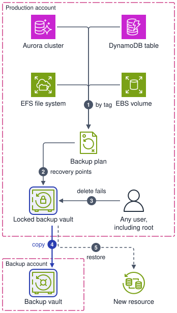

# AWS Backup and backup strategy

## Predict (1 min)
<!-- section: role=predict; route=fast; minutes=1 -->

**Predict 1.** A database copies every write to a standby in another Availability Zone. A developer deletes a table. Can the standby give the table back? <!-- gist-trap -->

**Predict 2.** A daily rule keeps backups for 30 days and moves them to cold storage after 7 days. Will AWS Backup accept the rule?

## Look first (3 min)
<!-- section: role=task; route=fast; minutes=3 -->

Per service, you [opt in to using AWS Backup](../facts/backup.md#backup-service-opt-in-before-plan-assignment). Read this setting in your Region.

<!-- task:start id=backup-t01 -->
<!-- task:end -->

## In one breath (2 min)
<!-- section: role=breath; route=fast; minutes=2 -->

> **Say it:** AWS Backup is a [fully-managed service](../facts/backup.md#backup-what-is-fully-managed-centralize) that helps you [centralize and automate data protection](../facts/backup.md#backup-what-is-fully-managed-centralize) across AWS services, [in the cloud, and on premises](../facts/backup.md#backup-what-is-fully-managed-centralize).

**The problem it solves.** Each service backs up differently, but companies need one policy.

**Predict the picture.** Where can the team restore a deleted database from?

Show the picture

**Figure.** A backup plan selects tagged resources, stores recovery points in a locked backup vault, and copies them to a vault in a second account.

1. AWS Backup can [apply backup plans to your AWS resources](../facts/backup.md#backup-plan-applied-by-tagging-resources) by their tags.
2. Each backup job [saves recovery points in backup vaults](../facts/backup.md#backup-recovery-points-saved-in-vaults), here a vault with Vault Lock.
3. In the locked vault, a delete fails for every user, [including the root user](../facts/backup.md#backup-vault-lock-denies-delete-and-lifecycle-change-even-root).
4. A copy action puts each backup in a vault [in the same or another AWS Region](../facts/backup.md#backup-copy-action-same-or-other-region-and-account) and in a second account.
5. For most resource types, AWS Backup [creates a new resource during restore](../facts/backup.md#backup-restore-destructive-exceptions-listed).

> **Startup example:** Callvale's data is in Amazon Aurora, Amazon DynamoDB, Amazon EFS and Amazon EBS, in several accounts. Each service has different backup settings. The bank requires daily backups kept for 30 days and monthly backups kept for 7 years. Administrators must not be able to delete backups.

## Words that go together (1 min)
<!-- section: role=words; route=fast; minutes=1 -->

<!-- table: words -->
| Term | Words that go with it | Plain meaning | Do not confuse with |
|---|---|---|---|
| backup plan | **assign** resources to a backup plan | When to back up, how long to keep, where | backup policy |
| recovery point | **restore** a recovery point | One backup of one resource at one moment | backup vault |
| backup vault | **lock** a backup vault | Holds recovery points, encrypted | S3 bucket |
| Vault Lock | turn on Vault Lock in **compliance mode** | Stops deletes and retention changes | S3 Object Lock |

## Choose it or not (2 min)
<!-- section: role=choose; route=fast; minutes=2 -->

### AWS Backup or the backups of each service

<!-- table: compare -->
| Question | AWS Backup | Backup features of each service |
|---|---|---|
| What does it manage? | Many services, [from a single place](../facts/backup.md#backup-faq-dlm-vs-backup-when-to-use) | One service, for example Amazon Data Lifecycle Manager |
| Many accounts and Regions? | One policy: you [apply it across accounts and Regions](../facts/ebs.md#ebs-aws-backup-central-policy-across-accounts) | One setting per account |
| Delete protection? | Vault Lock can [prevent manual deletion of backups](../facts/backup.md#backup-faq-vault-lock-purpose-worm) | Varies by service |
| Backups made elsewhere? | It [does not govern backups](../facts/backup.md#backup-does-not-govern-backups-outside-aws-backup) made [outside of AWS Backup](../facts/backup.md#backup-does-not-govern-backups-outside-aws-backup) | Its own backups |

**Deciding question:** Do several services or accounts need one policy, lock and report?

### Backups or replication

<!-- table: compare -->
| Question | Backups | Replication |
|---|---|---|
| Data deleted or corrupted? | A recovery point keeps the [content of a resource at a specified time](../facts/backup.md#backup-faq-recovery-point-definition) | The copy changes too |
| How does it recover? | A restore from a recovery point | A failover: for Amazon RDS Multi-AZ, [as quickly as 60 seconds](../facts/rds.md#rds-compare-maz-failover-time) |

**Deciding question:** Is the risk lost data, lost time, or both?

## Signals and traps (2 min)
<!-- section: role=signals; route=fast; minutes=2 -->

<!-- table: signals -->
| The stem says | Think | Because | But not if |
|---|---|---|---|
| "no one, including the root user, can delete backups" | Vault Lock in compliance mode | the lock [cannot be altered or deleted by any user](../facts/backup.md#backup-vault-lock-compliance-immutable-by-anyone) | single S3 objects: S3 Object Lock |
| "one backup policy for all accounts" | backup policies in AWS Organizations | they [centrally manage and apply backup plans](../facts/organizations.md#organizations-backup-policy-effective-plan-immutable) | EBS snapshots only: Amazon Data Lifecycle Manager |
| "restore to a specific second" | continuous backup | restores [within 1 second of precision](../facts/backup.md#backup-pitr-restore-rewinds-to-chosen-time) | kept for years: snapshot backup |
| "monthly backups for years, lowest cost" | cold storage | a [lower-cost tier called cold storage](../facts/backup.md#backup-every-backup-starts-in-warm-storage) | Aurora or S3: no cold storage |
| "survive the loss of a Region or account" | copy action | copies [in the same or another AWS Region](../facts/backup.md#backup-copy-action-same-or-other-region-and-account) or account | another organization: a shared logically air-gapped vault |
| "prove that backups meet the policy" | AWS Backup Audit Manager | audits [the compliance of your data protection policies](../facts/backup.md#backup-faq-audit-manager-purpose) | prove that restores work: restore testing |

### Traps

- **Wrong belief:** A replica or standby is a backup. **Truth:** The copy receives deletes too. A recovery point keeps an older state. <!-- trap: backup-trap-replication-is-backup -->
- **Wrong belief:** Any Vault Lock stops every administrator. **Truth:** A governance-mode vault can have its [lock removed by users with sufficient IAM permissions](../facts/backup.md#backup-vault-lock-governance-lock-removable-with-iam). <!-- trap: backup-trap-governance-stops-admins -->
- **Wrong belief:** The vault key encrypts every backup in the vault. **Truth:** It [applies to the backups of certain resource types](../facts/backup.md#backup-vault-key-applies-only-to-independent-encryption-types). RDS backups keep the key used to [encrypt the source Amazon RDS database](../facts/backup.md#backup-encryption-rds-row). <!-- trap: backup-trap-vault-key-encrypts-everything -->

## Changed recently (1 min)
<!-- section: role=changed; route=fast; minutes=1 -->

> **Changed recently:** (2022-10-04) Vault Lock governance mode. 
> **Old:** not available. 
> **Now:** AWS Backup Vault Lock can be created in [governance mode for additional IAM protections](../facts/backup.md#backup-change-vault-lock-governance-mode-2022-10). 
> **The exam probably expects:** older questions treat every Vault Lock as permanent. 
> **Status:** examinable.

## Check (1 min)
<!-- section: role=check; route=fast; minutes=1 -->

**Check 1.** With delete marker replication, are deleted objects still visible in the replica bucket?

Answer

No. S3 acts as if [the object was deleted in both buckets](../facts/s3.md#s3-replication-delete-markers-optional).

**Predict 1:** No, for the same reason.

**Check 2.** Monthly EBS backups are kept for 7 years. Can they move to cold storage after 30 days?

Answer

Yes, because the rule runs [monthly or less often](../facts/backup.md#backup-cold-ebs-is-snapshot-archive-monthly-or-less).

**Predict 2:** No. Cold storage needs a total retention of [90 days or greater](../facts/backup.md#backup-cold-storage-plan-total-retention-90-days).

## Recap from memory (1 min)
<!-- section: role=recap; route=fast; minutes=1 -->

**Recap 1.** What decides between AWS Backup and per-service backups?

Answer

Do several services or accounts need one policy, lock and report?

**Recap 2.** Single S3 objects, not backups, must stay unchanged. What fits?

Answer

S3 Object Lock.

**Recap 3.** Which Vault Lock mode can users with enough IAM permissions remove?

Answer

Governance mode.

