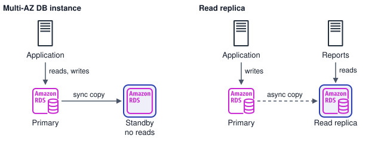
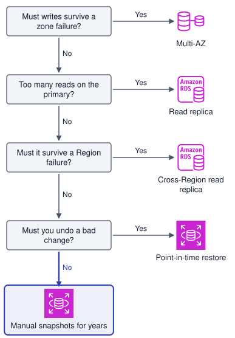
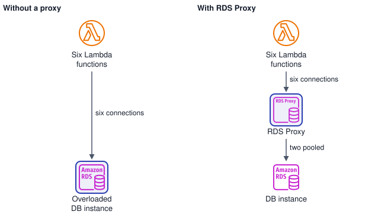
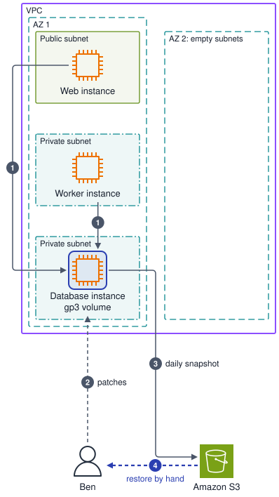
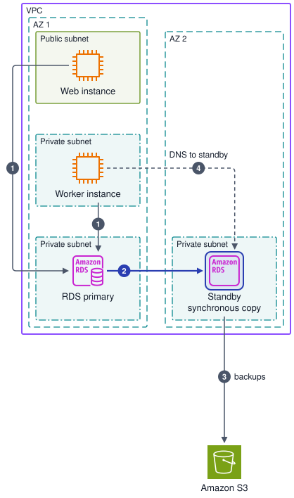

# Amazon RDS in depth

## How it works (51 min)
<!-- section: role=how; route=full; minutes=51 -->

### Amazon RDS runs the database engine while you keep the queries (3 min)

A database needs patches, backups and a plan for failures. Amazon Relational Database Service (Amazon RDS) is a **managed service** that takes over this routine work.

1. **Choose an engine.** RDS offers [IBM Db2, MariaDB, Microsoft SQL Server](../facts/rds.md#rds-engines-supported), [MySQL, Oracle Database, and PostgreSQL](../facts/rds.md#rds-engines-supported).
2. **AWS runs the routine work.** RDS [manages backups, software patching](../facts/rds.md#rds-managed-tasks), [automatic failure detection, and recovery](../facts/rds.md#rds-managed-tasks).
3. **You keep the queries.** [You are responsible for query tuning](../facts/rds.md#rds-customer-owns-query-tuning).
4. **No host access.** Standard RDS gives none; RDS Custom lets you [customize your database environment and operating system](../facts/rds.md#rds-custom-os-access). Check that RDS Custom runs your engine; if not, use Amazon EC2.

Why RDS? On Amazon EC2, your team owns [upgrades, patches, backups, capacity planning](../facts/rds.md#rds-decision-guide-rehost-ec2-tasks).

A move to the same engine is a **homogeneous migration**. For MySQL, MariaDB and PostgreSQL, the RDS console runs it with [AWS Database Migration Service (AWS DMS)](../facts/rds.md#rds-console-dms-migration). A move to another engine is **heterogeneous** (chapter 39). <!-- xref: 39 DMS homogeneous and heterogeneous migrations -->

> **Exam signal:** "a relational database with the LEAST operational overhead" points to Amazon RDS, a [fully managed relational database](../facts/rds.md#rds-decision-guide-rds-row).

> **Say it:** The short answer is: RDS runs the engine and its routine work. The thing to watch is host access, which RDS does not give.

**Stop and answer.** A team moves PostgreSQL from an EC2 instance to Amazon RDS. Slow queries stay slow. Whose job is the fix?

Answer

The team's job: [application optimization](../facts/rds.md#rds-vs-ec2-application-optimization) stays with the customer.

### A DB instance sits in private subnets behind its security group (4 min)

A database with sensitive data should accept connections from the application tier and from nothing else.

1. **Pick the subnets.** A DB instance runs in a virtual private cloud (VPC). Its DB subnet group needs [a subnet in at least two Availability Zones](../facts/rds.md#rds-subnet-group-two-azs).
2. **Keep it private.** The database is [deployed in the private subnet](../facts/rds.md#rds-private-subnet-web-tier-pattern), so that [only the web servers have access](../facts/rds.md#rds-private-subnet-web-tier-pattern).
3. **Open one port to one source.** At first, [its firewall prevents any database access](../facts/rds.md#rds-firewall-blocks-until-sg-rules). A rule [specifying a VPC security group as the source](../facts/rds.md#rds-security-group-source-sg) admits the application instances of that group.

Why two zones for a database in one zone? The group is ready for a second copy.

> **Exam signal:** "must not be reachable from the internet" points to private subnets and a rule [specifying a VPC security group as the source](../facts/rds.md#rds-security-group-source-sg).

> **Try it:** Build a DB subnet group, and watch RDS refuse one zone. See [3-do.md](3-do.md). <!-- task: rds-t02 -->

> **Say it:** The short answer is: private subnets, and one port open to one security group. The thing to watch is the source of that rule.

**Stop and answer.** An application connects over VPC peering. The DB instance's security group has no rule for it. Can it connect?

Answer

Not yet. [Network access is turned off](../facts/rds.md#rds-security-group-default-no-access) until a rule allows it.

### The instance class sets compute and the storage type sets IOPS (3 min)

A database can run short of CPU, of memory, or of input/output operations per second: **IOPS** (EYE-ops). RDS sizes compute and storage separately.

1. **Pick a class.** RDS has general-purpose, memory-optimized, [compute-optimized instance class types](../facts/rds.md#rds-class-types-use-cases) and [burstable-performance DB instance class types](../facts/rds.md#rds-class-types-use-cases).
2. **Fit the working set in memory.** The best practice is a working set that [resides almost completely in memory](../facts/rds.md#rds-bp-working-set-in-memory). ReadIOPS that rise under load mean that it no longer fits.
3. **Pick storage.** gp3 starts at [3000 IOPS](../facts/rds.md#rds-storage-gp3-baseline); io2 Block Express reaches [up to 256,000 I/O operations per second](../facts/rds.md#rds-storage-io2-max-iops).
4. **Change the class later.** To **scale up**, [you can change your DB instance class](../facts/rds.md#rds-instance-class-changeable). The database is [temporarily unavailable](../facts/rds.md#rds-faq-compute-scale-brief-outage) for typically [only a few minutes](../facts/rds.md#rds-faq-compute-scale-brief-outage).
5. **Stop it when idle.** Storage is still billed, [but not for DB instance hours](../facts/rds.md#rds-faq-billing-stopped-instance). After [7 consecutive days](../facts/rds.md#rds-stop-max-seven-days), RDS starts it again.

OLTP is online transaction processing.

<!-- table: plain -->
| Storage | Built for | Latency |
|---|---|---|
| gp3 | [moderate I/O requirements](../facts/rds.md#rds-storage-choice-oltp-moderate) | [Single-digit millisecond, provided consistently 99% of the time](../facts/rds.md#rds-storage-latency-by-type) |
| io2 Block Express | [High-performance OLTP workloads](../facts/rds.md#rds-storage-choice-oltp-moderate) | [Sub-millisecond, provided consistently 99.9% of the time](../facts/rds.md#rds-storage-latency-by-type) |

Why not Provisioned IOPS everywhere? You pay for them [whether or not you use them](../facts/rds.md#rds-storage-piops-charged-provisioned).

> **Exam signal:** "I/O-intensive" points to Provisioned IOPS, for [low I/O latency and consistent I/O throughput](../facts/rds.md#rds-storage-piops-for-production).

> **Say it:** The short answer is: the class buys CPU and memory, and storage buys IOPS. The thing to watch is unused IOPS.

**Stop and answer.** A reporting database is slow at peak. CPU use is moderate, but ReadIOPS is high. What does the best practice suggest first?

Answer

More memory for the working set: a memory-optimized class is [optimized for memory-intensive applications](../facts/rds.md#rds-class-memory-optimized-memory-intensive).

### Storage autoscaling grows storage before it fills but never shrinks it (3 min)

A database that runs out of storage stops, and data growth is hard to predict.

1. **Set a ceiling.** You set a [maximum storage threshold](../facts/rds.md#rds-storage-autoscaling-max-threshold); the default is [1,000 GiB](../facts/rds.md#rds-storage-autoscaling-default-threshold).
2. **RDS watches free space.** It scales when free space falls to [10 percent of the allocated storage](../facts/rds.md#rds-storage-autoscaling-trigger-free-space) for [at least five minutes](../facts/rds.md#rds-storage-autoscaling-trigger-five-minutes), after the last change finishes optimizing.
3. **Storage grows online.** It grows [while maintaining DB Instance availability](../facts/rds.md#rds-faq-storage-scale-stays-available).

<!-- table: plain -->
| Change | How |
|---|---|
| Grow by hand | By [a minimum of 10%](../facts/rds.md#rds-storage-increase-min-10-percent) |
| Grow by autoscaling | Up to the [maximum storage threshold](../facts/rds.md#rds-storage-autoscaling-max-threshold) |

> **Exam signal:** "unpredictable storage growth" points to storage autoscaling: RDS detects low space, and [it automatically scales up your storage](../facts/rds.md#rds-storage-autoscaling-unpredictable).

> **Exam trap:** Many think that a restore gives a smaller DB instance after a cleanup. You cannot [reduce the amount of storage when you restore](../facts/rds.md#rds-restore-cannot-reduce-storage) a DB instance. <!-- trap: rds-trap-storage-shrinks -->

> **Say it:** The short answer is: autoscaling adds space before the disk fills. The thing to watch is the threshold that you set.

**Stop and answer.** A team turns on storage autoscaling for a 500 GiB DB instance with a threshold of 520 GiB. Will RDS accept it?

Answer

No. The threshold must be [at least 10% more](../facts/rds.md#rds-storage-autoscaling-threshold-min-10-percent) than the allocated storage.

### A Multi-AZ DB instance copies every write to a standby synchronously (4 min)
<!-- section: route=pass -->

If the DB instance or its Availability Zone fails, the application stops. A second copy helps when it holds every committed write.

1. **RDS adds a standby.** A **Multi-AZ** (MUL-tee ay-ZEE) DB instance deployment adds a **standby**: a [synchronous standby replica in a different Availability Zone](../facts/rds.md#rds-multi-az-instance-standby-no-reads).
2. **Each write lands twice.** Writes are [concurrent on the primary and standby](../facts/rds.md#rds-faq-multiaz-replication-synchronous).
3. **The standby waits.** [A Multi-AZ standby cannot serve read requests](../facts/rds.md#rds-faq-multiaz-standby-no-reads).

<!-- table: plain -->
| Question | Single-AZ | Multi-AZ DB instance |
|---|---|---|
| Storage or zone failure | [a user-initiated restore operation would be required](../facts/rds.md#rds-multi-az-durability-no-restore-needed) | [all of your database updates are intact](../facts/rds.md#rds-multi-az-durability-no-restore-needed) |
| Cost | Base | [approximately twice as much](../facts/rds.md#rds-pricing-multi-az-about-twice) |

Why make every write wait? Then the standby holds the latest commit when the primary fails. The price is [increased write and commit latency](../facts/rds.md#rds-multi-az-instance-higher-write-latency).

> **Exam signal:** "survive the loss of an Availability Zone" points to Multi-AZ, which protects against [DB instance failure and Availability Zone disruption](../facts/rds.md#rds-multi-az-instance-protects-az-disruption).

> **Exam trap:** Many think that Multi-AZ hides the downtime of an engine version upgrade. The upgrade [causes downtime until the upgrade is complete](../facts/rds.md#rds-multi-az-engine-upgrade-both-down), [even for Multi-AZ instances](../facts/rds.md#rds-faq-upgrade-downtime-even-multiaz). You can minimize it [using a blue/green deployment](../facts/rds.md#rds-engine-upgrade-downtime-blue-green): a copy that [stays in sync with the current production environment](../facts/rds.md#rds-blue-green-staging-in-sync). <!-- trap: rds-trap-multi-az-hides-upgrade-downtime -->

> **Say it:** The short answer is: Multi-AZ keeps a synchronous copy in another zone. The thing to watch is that the copy serves no reads.

**Stop and answer.** A company turns on Multi-AZ to make slow dashboards faster. Will they get faster?

Answer

No. The dashboards still read from the primary, and writes now wait for the standby.

### On failover RDS points the same endpoint at the standby (4 min)

The primary fails at night. The application has to find the new primary without a person.

1. **RDS detects the failure.** For example, [loss of network connectivity to primary](../facts/rds.md#rds-faq-multiaz-failover-triggers) or a zone outage. It does not fail over for [long running queries, deadlocks, or database corruption errors](../facts/rds.md#rds-multi-az-no-failover-db-operations).
2. **It promotes the standby.** RDS can **fail over** (FAYL OH-ver) [without administrative intervention](../facts/rds.md#rds-multi-az-failover-no-admin-intervention).
3. **It moves the name.** RDS [flips the canonical name record (CNAME)](../facts/rds.md#rds-multi-az-cname-flip-retry) to the standby.
4. **Clients reconnect.** Applications must [re-establish any existing connections](../facts/rds.md#rds-multi-az-failover-dns-change-reconnect).

Why a name? The standby has its own address, and the [name record for your DB instance](../facts/rds.md#rds-faq-multiaz-automatic-failover) stays.

> **Exam signal:** "reconnect automatically after a failover" points to retry logic: AWS advises you to [implement database connection retry at the application layer](../facts/rds.md#rds-multi-az-cname-flip-retry).

> **Exam trap:** Many think that open connections survive a failover, because the name stays. Without a proxy, [your application must reopen them](../facts/rds.md#rds-failover-without-proxy-outage). <!-- trap: rds-trap-failover-keeps-connections -->

> **Say it:** The short answer is: RDS moves the endpoint name to the standby. The thing to watch is that the application reconnects.

**Stop and answer.** A Java application caches DNS answers for an hour. After a failover it keeps failing. What fixes it?

Answer

A shorter cache: the Java cache should be [no more than 60 seconds](../facts/rds.md#rds-multi-az-jvm-dns-ttl-60). For other client DNS caches, AWS advises [less than 30 seconds](../facts/rds.md#rds-bp-dns-ttl-under-30-seconds).

### A Multi-AZ DB cluster has two readable standbys and fails over faster (3 min)

Some workloads want a faster failover and standbys that also serve reads.

1. **Three instances.** A writer and [two reader DB instances](../facts/rds.md#rds-multi-az-cluster-three-azs-all-read) run in [three separate Availability Zones](../facts/rds.md#rds-multi-az-cluster-three-azs-all-read).
2. **A commit waits for one reader.** The cluster uses [semisynchronous replication](../facts/rds.md#rds-multi-az-cluster-semisynchronous): a commit needs an [acknowledgment from at least one reader DB instance](../facts/rds.md#rds-multi-az-cluster-semisynchronous).
3. **Two endpoints.** The [writer endpoint](../facts/rds.md#rds-multi-az-cluster-writer-reader-endpoints) takes writes; the [reader endpoint](../facts/rds.md#rds-multi-az-cluster-writer-reader-endpoints) spreads reads.
4. **Two engines.** Multi-AZ DB clusters run RDS for MySQL and RDS for PostgreSQL. <!-- fact: rds-multi-az-cluster-engines-mysql-postgresql; its one display has a contraction (L803) -->

A failover typically takes [under 35 seconds](../facts/rds.md#rds-multi-az-cluster-failover-time), against [60–120 seconds](../facts/rds.md#rds-multi-az-instance-failover-time) for a Multi-AZ DB instance.

Why choose it? It adds [increased capacity for read workloads](../facts/rds.md#rds-multi-az-cluster-benefits) and [lower write latency](../facts/rds.md#rds-multi-az-cluster-benefits) than a Multi-AZ DB instance.

> **Exam signal:** "standbys that also serve reads" points to a Multi-AZ DB cluster, whose standbys [can also serve read traffic](../facts/rds.md#rds-multi-az-one-vs-two-standbys).

> **Say it:** The short answer is: a DB cluster adds two standbys that serve reads. The thing to watch is the writer endpoint.

**Stop and answer.** In a Multi-AZ DB cluster, one reader is slow, and the other reader confirms a change right away. Does the commit wait for the slow reader?

Answer

No. A commit needs an [acknowledgment from at least one reader DB instance](../facts/rds.md#rds-multi-az-cluster-semisynchronous).

### A read replica receives changes later and serves only reads (4 min)
<!-- section: route=pass -->

Dashboard queries read and change nothing, but they slow the primary. A **read replica** (REP-lih-kuh) takes those reads.

1. **Backups first.** The source needs a backup **retention period** of [a value other than 0](../facts/rds.md#rds-read-replica-requires-automated-backups).
2. **RDS copies the source.** RDS starts from a **snapshot**: it [takes a snapshot of the source instance](../facts/rds.md#rds-read-replica-created-from-snapshot).
3. **Changes arrive later.** Replication is **asynchronous** (ay-SING-kruh-nus), and clients get [read-only access to the replica](../facts/rds.md#rds-read-replica-async-read-only).
4. **Your application chooses.** Each replica has its own endpoint: [it is up to your application](../facts/rds.md#rds-faq-read-replica-own-endpoint) to spread reads.

**Figure.** A Multi-AZ standby gets each write at once and serves no reads; a read replica gets writes later and serves reads.

Why can a replica show old data? With [asynchronous replication](../facts/rds.md#rds-compare-replication-sync-async), changes arrive after the commit.

> **Exam signal:** "reporting queries slow down the production database" points to a read replica, for [business reporting or data warehousing scenarios](../facts/rds.md#rds-read-replica-use-reporting).

> **Exam trap:** Many think that a replica needs a Multi-AZ source, or that the source can stop backups later. A Single-AZ source works, with an I/O pause of [about one second](../facts/rds.md#rds-read-replica-create-io-suspension). The source's retention period [cannot be set to 0](../facts/rds.md#rds-faq-retention-not-0-for-replica-source). <!-- trap: rds-trap-replica-without-backups --> <!-- trap: rds-trap-replica-needs-multi-az-source -->

Go deeper: a writable replica

You can enable a MySQL or MariaDB [read replica to be writable](../facts/rds.md#rds-replica-mysql-logical-writable). RDS for PostgreSQL does not allow a replica [to be made writable](../facts/rds.md#rds-replica-postgresql-not-writable).

> **Say it:** The short answer is: a read replica takes reads off the primary. The thing to watch is delay: a replica can be behind.

**Stop and answer.** At peak, a replica falls further behind its busy source. It has half the vCPUs of the source. What is the first fix?

Answer

Give the replica [as much or more compute and storage resources](../facts/rds.md#rds-replica-size-as-much-as-source) as the source.

### A read replica in another Region can be promoted after a disaster (4 min)

For a Region failure, the copy has to be in another Region already.

1. **Create the replica in another Region.** It works with [Db2, MariaDB, Microsoft SQL Server, MySQL, Oracle, or PostgreSQL](../facts/rds.md#rds-cross-region-replica-all-engines).
2. **Replication crosses the Region.** Changes travel [longer network channels between regional data centers](../facts/rds.md#rds-cross-region-replica-higher-lag).
3. **A person decides.** A replica [can be manually promoted](../facts/rds.md#rds-compare-failover-vs-promote): [RDS stops replication and reboots the read replica](../facts/rds.md#rds-read-replica-promote-reboot-minutes).

**Figure.** Each failure has its own RDS answer: a standby for a zone, a replica for reads or a Region, a restore for a mistake.

Why not a replica for availability in the Region? For writes, AWS recommends that you [run your DB instance as a Multi-AZ deployment](../facts/rds.md#rds-faq-multi-az-for-write-availability).

> **Exam signal:** "recover from the failure of an entire AWS Region" points to a cross-Region read replica, a copy [if one Region becomes unavailable](../facts/rds.md#rds-multi-region-async-replica-survives-region).

> **Exam trap:** Many think that a read replica takes over, or takes writes, when the primary fails. It takes writes after you promote it [into a standalone DB instance](../facts/rds.md#rds-read-replica-promote-standalone), and promotion takes [several minutes or longer](../facts/rds.md#rds-read-replica-promote-reboot-minutes). <!-- trap: rds-trap-read-replica-for-failover --> <!-- trap: rds-trap-replica-accepts-writes -->

> **Say it:** The short answer is: a replica in another Region is your Region copy. The thing to watch is that someone has to promote it.

**Stop and answer.** A Multi-AZ primary has a read replica in another Region. The primary's zone fails. Does the replica become the primary?

Answer

No. RDS uses [automatic failover to standby](../facts/rds.md#rds-compare-failover-vs-promote), and the replicas [automatically resume replication once failover has completed](../facts/rds.md#rds-replicas-resume-after-multi-az-failover).

### RDS Proxy shares a small pool of connections among many clients (4 min)
<!-- section: route=pass -->

Hundreds of short-lived functions can open more connections than the database accepts.

1. **The class sets the limit.** Unless you set it in a parameter group, RDS sets max_connections [based on the database instance class](../facts/rds.md#rds-max-connections-from-instance-class).
2. **Functions multiply connections.** Many concurrent AWS Lambda environments can [exhaust database connection limits](../facts/lambda.md#lambda-vpc-db-connections-rds-proxy).
3. **The proxy pools.** RDS Proxy lets applications [pool and share database connections](../facts/rds-proxy.md#rds-proxy-definition-pool-share) and [keeps a smaller number of connections open](../facts/rds-proxy.md#rds-proxy-multiplexing-fewer-db-connections).
4. **The proxy caps itself.** The setting MaxConnectionsPercent caps its share of max_connections. In a surge, it [queues or throttles application connections](../facts/rds-proxy.md#rds-proxy-surges-queue-throttle).

**Figure.** Without a proxy each function holds its own database connection; RDS Proxy shares a few database connections among all of them.

Why does a pool help? Most connections sit idle between queries, and the proxy can [hold idling connections](../facts/rds-proxy.md#rds-proxy-faq-use-case-idle-connections).

> **Exam signal:** "too many connections" with "Lambda functions" points to RDS Proxy, for [frequent short database connections](../facts/rds-proxy.md#rds-proxy-lambda-connection-pooling).

> **Exam trap:** Many think that a larger DB instance class fixes connection errors from Lambda functions. If many functions connect at the same time, [you might exceed your connection quota](../facts/lambda.md#lambda-rds-connection-quota-spikes) again. Others think that RDS Proxy makes heavy queries lighter. It lets clients [pool and share database connections](../facts/rds-proxy.md#rds-proxy-definition-pool-share), but the queries still run on the DB instance. <!-- trap: rds-trap-bigger-instance-for-connection-storms --> <!-- trap: rds-trap-proxy-reduces-query-load -->

> **Say it:** The short answer is: many clients share a few database connections. The thing to watch is the cap that the proxy sets.

**Stop and answer.** A database has max_connections set to 1,000, and its proxy has MaxConnectionsPercent set to 95. How many database connections can the proxy open?

Answer

[950 connections](../facts/rds-proxy.md#rds-proxy-max-connections-percent-example).

### RDS Proxy keeps client connections open while the database fails over (3 min)

Without a proxy, [a failover involves a brief outage](../facts/rds.md#rds-failover-without-proxy-outage), and some clients cache the old address.

1. **The proxy keeps its address.** It accepts connections [at the same IP address](../facts/rds-proxy.md#rds-proxy-failover-same-ip-no-dns) and [directs connections to the new primary](../facts/rds-proxy.md#rds-proxy-failover-same-ip-no-dns).
2. **Failover is shorter.** The proxy cuts failover time by [up to 66%](../facts/rds-proxy.md#rds-proxy-failover-66-percent).
3. **Open transactions fail.** For an application with its own pool, [most connections stay alive during failovers](../facts/rds-proxy.md#rds-proxy-failover-idle-connections-kept). Those [in the middle of a transaction](../facts/rds-proxy.md#rds-proxy-failover-idle-connections-kept) are canceled, so keep retry logic.

Why is it faster? The proxy [bypasses Domain Name System (DNS) caches](../facts/rds-proxy.md#rds-proxy-faq-bypasses-dns-caches), so no client waits for an old answer.

> **Exam signal:** "reduce failover time" with "keep connections open" points to RDS Proxy, which cuts it by [up to 66%](../facts/rds-proxy.md#rds-proxy-failover-66-percent).

> **Exam trap:** Many think that every database should sit behind RDS Proxy. For provisioned instances, it is [priced per vCPU per hour](../facts/rds-proxy.md#rds-proxy-pricing-per-vcpu) of the database and can add [5 milliseconds](../facts/rds-proxy.md#rds-proxy-faq-adds-5-ms-connect-directly) of latency. It suits applications without a pool of their own, or that [keep a large number of connections open](../facts/rds-proxy.md#rds-proxy-candidate-no-builtin-pool). <!-- trap: rds-trap-proxy-for-every-database -->

> **Say it:** The short answer is: the proxy holds connections during a failover. The thing to watch is the cost per database vCPU.

**Stop and answer.** Behind RDS Proxy, the primary fails over. Does the application need a new DNS lookup to reach the new primary?

Answer

No. The proxy accepts connections [at the same IP address](../facts/rds-proxy.md#rds-proxy-failover-same-ip-no-dns) and [directs connections to the new primary](../facts/rds-proxy.md#rds-proxy-failover-same-ip-no-dns).

### Automated backups restore to any second inside the retention period (4 min)
<!-- section: route=pass -->

An engineer runs a bad UPDATE at 10:00. The team wants the database as it was at 09:59.

1. **A daily snapshot.** RDS takes a [full daily snapshot](../facts/rds.md#rds-faq-automated-backups-enable-pitr) in the backup window.
2. **Logs between snapshots.** RDS uploads transaction logs to Amazon S3 [every five minutes](../facts/rds.md#rds-pitr-log-upload-five-minutes).
3. **Pick a second.** You restore to [any second during your retention period](../facts/rds.md#rds-faq-pitr-any-second-latest-restorable), typically up to the [last five minutes](../facts/rds.md#rds-faq-pitr-any-second-latest-restorable).
4. **Get a new DB instance.** The restore works by [creating a new DB instance](../facts/rds.md#rds-pitr-new-instance-within-retention).

<!-- table: plain -->
| Retention setting | Value |
|---|---|
| Allowed range | [between 0 and 35 days](../facts/rds.md#rds-backup-retention-range) |
| Console default | [seven days](../facts/rds.md#rds-backup-retention-default) |
| API or AWS CLI default | [one day](../facts/rds.md#rds-backup-retention-default) |

Why a new DB instance? The source stays as it is, so you check the restored data first.

> **Exam signal:** "recover from an accidental deletion" points to point-in-time recovery [within your backup retention period](../facts/rds.md#rds-pitr-new-instance-within-retention).

> **Exam trap:** Many think that a restore rolls back the existing DB instance, so the endpoint stays. The restored DB instance is [created with a new endpoint](../facts/rds.md#rds-faq-restore-creates-new-instance). <!-- trap: rds-trap-restore-overwrites-instance -->

**Spot the bug.** A Multi-AZ MySQL database has a backup retention period of 0, because "the standby is our backup". What is wrong?

Answer

A mistaken DELETE is [concurrent on the primary and standby](../facts/rds.md#rds-faq-multiaz-replication-synchronous), and [setting the backup retention period to 0 disables automated backups](../facts/rds.md#rds-backup-retention-range).

> **Say it:** The short answer is: pick any second in the retention period. The thing to watch is the new endpoint after a restore.

**Stop and answer.** A DB instance was created in the console with the default retention. On day 10, the team finds a bad change from day 1. Can a point-in-time restore reach day 1?

Answer

No. The console default is [seven days](../facts/rds.md#rds-backup-retention-default).

### Manual snapshots stay until you delete them and can leave the Region (4 min)

An auditor wants a copy for seven years, in a second Region.

1. **Take a manual snapshot.** Snapshots are [kept until you explicitly delete them](../facts/rds.md#rds-faq-snapshots-user-initiated-kept-until-deleted).
2. **Keep an automated backup longer.** You [copy it to create a manual snapshot](../facts/rds.md#rds-keep-automated-backup-longer-copy).
3. **Move the copy.** You can [copy both automatic and manual DB snapshots](../facts/rds.md#rds-snapshots-copy-both-share-manual) to another Region. An encrypted copy needs a [KMS key valid in the destination AWS Region](../facts/rds.md#rds-snapshot-copy-cross-region-kms-destination).

For point-in-time restore in another Region, cross-Region automated backups [replicate snapshots and transaction logs](../facts/rds.md#rds-cross-region-backup-replication).

Why export? A snapshot can outlive its engine version, so AWS advises [exporting snapshot data to Amazon S3](../facts/rds.md#rds-long-term-backup-export-s3). <!-- xref: 24 AWS Backup plans and vaults -->

> **Exam signal:** "retain database backups for years" points to manual snapshots or AWS Backup, which can [centralize and automate the backup of data](../facts/rds.md#rds-aws-backup-centralize).

> **Exam trap:** Many think that a longer retention period keeps backups for years. It is [between 0 and 35 days](../facts/rds.md#rds-backup-retention-range). Others think that you can share an automated snapshot. You can [share manual DB snapshots](../facts/rds.md#rds-snapshots-copy-both-share-manual), so you start by [copying the automated snapshot](../facts/rds.md#rds-share-automated-copy-first). A snapshot [encrypted using the default KMS key](../facts/rds.md#rds-share-default-kms-key-not-shareable) cannot be shared: copy it [using the customer managed key](../facts/rds.md#rds-share-default-kms-key-not-shareable). <!-- trap: rds-trap-retention-beyond-35-days --> <!-- trap: rds-trap-share-automated-snapshot -->

> **Say it:** The short answer is: manual snapshots last until you delete them. The thing to watch is the key when you copy or share.

**Stop and answer.** A company deletes a DB instance without a final snapshot or retained backups. It has two manual snapshots from last month. What can it restore?

Answer

Last month's state: [manual snapshots are not deleted](../facts/rds.md#rds-delete-instance-automated-backups-deleted) with the DB instance.

### Encryption at rest is chosen at creation and covers every copy (4 min)

A purchase form asks whether the data is encrypted on disk, in every copy, and on the network.

1. **Choose at creation.** You can [only encrypt an Amazon RDS DB instance](../facts/rds.md#rds-encryption-only-at-create) when you create it.
2. **Cover every copy.** Encryption covers the [logs, automated backups, read replicas, and snapshots](../facts/rds.md#rds-encryption-at-rest-scope). Without your own key, [Amazon RDS uses the AWS managed key](../facts/rds.md#rds-encryption-default-aws-managed-key) of AWS Key Management Service (AWS KMS).
3. **Fix an unencrypted database.** You [encrypt a copy of an unencrypted snapshot](../facts/rds.md#rds-encrypt-existing-via-snapshot-copy), then [restore an encrypted DB instance](../facts/rds.md#rds-encrypt-existing-via-snapshot-copy). You can also [use a blue/green deployment](../facts/rds.md#rds-encryption-blue-green-change-key) to [encrypt an unencrypted DB instance](../facts/rds.md#rds-encryption-blue-green-change-key).
4. **Encrypt the network path.** Clients use [Transport Layer Security (TLS)](../facts/rds.md#rds-tls-all-engines). On RDS for PostgreSQL, `rds.force_ssl` requires it, and it is on by default from [version 15 and later](../facts/rds.md#rds-tls-force-postgresql). A default parameter group stays as it is, so [create a new parameter group.](../facts/rds.md#rds-parameter-group-default-not-modifiable)

Why do clients need no change? RDS uses the [AES-256 encryption algorithm](../facts/rds.md#rds-encryption-aes256-transparent) transparently on the host.

> **Exam signal:** "encrypt an existing unencrypted database" points to a snapshot, an encrypted copy and a restore.

> **Exam trap:** Many think that an encrypted read replica, then a promotion, encrypts an existing database. For an encrypted read replica, [the source DB instance must be encrypted](../facts/rds.md#rds-read-replica-encrypted-needs-encrypted-source). <!-- trap: rds-trap-encrypted-replica-of-unencrypted -->

> **Try it:** Change a parameter: a default group refuses, and a custom group accepts. See [3-do.md](3-do.md). <!-- task: rds-t03 -->

> **Say it:** The short answer is: turn on encryption when you create the database. The thing to watch is TLS, set in a parameter group.

**Stop and answer.** A team wants an encrypted DB instance to run without encryption again. Can it turn encryption off?

Answer

No. To get unencrypted data, you [export data from an encrypted DB instance](../facts/rds.md#rds-encryption-cannot-turn-off) and import it into an unencrypted one.

## Numbers that decide answers (3 min)
<!-- section: role=numbers; route=full; minutes=3 -->

### A-list

<!-- table: numbers -->
| Number | What it is | Why it decides an answer |
|---|---|---|
| [between 0 and 35 days](../facts/rds.md#rds-backup-retention-range) | Retention of automated backups | Longer keeping needs manual snapshots |
| [last five minutes](../facts/rds.md#rds-faq-pitr-any-second-latest-restorable) | Typical latest restorable time | A restore loses little data |
| [60–120 seconds](../facts/rds.md#rds-multi-az-instance-failover-time) | Failover of a Multi-AZ DB instance | Faster needs a DB cluster or a proxy |
| [under 35 seconds](../facts/rds.md#rds-multi-az-cluster-failover-time) | Failover of a Multi-AZ DB cluster | Faster failover and readable standbys |
| [up to 15 read replicas](../facts/rds.md#rds-change-read-replicas-15-2022-10) | MariaDB, MySQL and PostgreSQL | Read scaling for one source |
| [7 consecutive days](../facts/rds.md#rds-stop-max-seven-days) | Longest stop of a DB instance | Then RDS starts it again |
| [up to 66%](../facts/rds-proxy.md#rds-proxy-failover-66-percent) | Shorter failover with RDS Proxy | Points to the proxy |

## Decision record (3 min)
<!-- section: role=example; route=full; minutes=3 -->

**Context.** Callvale's 20 GB PostgreSQL database runs on one EC2 instance that Ben patches by hand. A second customer asks about recovery.

**Figure.** PostgreSQL runs on one database instance in one zone, and a failure stops the application until Ben restores a snapshot.

1. The web instance and the worker use PostgreSQL on one instance.
2. Ben patches the operating system and PostgreSQL by hand.
3. A daily snapshot of the data volume goes to Amazon S3.
4. A failure stops the application until Ben restores a snapshot.

**Requirement.** Automatic failover and backups without application changes, with the LEAST operational overhead.

**Options.**

- A second database instance with replication that Ben builds.
- **Amazon RDS for PostgreSQL with a Multi-AZ deployment.**
- Move the data to Amazon DynamoDB.

**Decision.** RDS for PostgreSQL, Multi-AZ, with automated backups. Ben's own replication means night work, and DynamoDB means new code.

**Figure.** An RDS for PostgreSQL primary copies each write to a standby in the second zone, behind one endpoint, and backups go to Amazon S3.

1. The web instance and the worker use one database endpoint.
2. The primary is [synchronously replicated across Availability Zones](../facts/rds.md#rds-multi-az-instance-synchronous-replication) to a standby in AZ 2.
3. RDS [automated backups are taken from standby](../facts/rds.md#rds-compare-backups) and [stored in S3](../facts/rds.md#rds-faq-backups-stored-in-s3).
4. If the primary fails, RDS [changes the Domain Name System (DNS) record](../facts/rds.md#rds-multi-az-failover-dns-change-reconnect) to point to the standby.

**Trade-off.** Callvale pays for a standby that serves no queries, and has less control of the operating system.

## FAQ quick-fire (5 min)
<!-- section: role=faq; route=full; minutes=5 -->

**FAQ 1.** Do you pay for backup storage up to the size of your databases?

Answer

No.

> "Free backup storage is provided up to your account's total provisioned database storage across the entire region."
> — [Amazon RDS FAQs](https://aws.amazon.com/rds/faqs/)

**FAQ 2.** Can you convert a Single-AZ DB instance to Multi-AZ without downtime?

Answer

Yes.

> "As such, there should be no downtime incurred when an instance is converted from Single-AZ to Multi-AZ."
> — [Amazon RDS FAQs](https://aws.amazon.com/rds/faqs/)

**FAQ 3.** Can you start a failover yourself, for a test?

Answer

Yes.

> "In addition, Amazon RDS provides an option to initiate a failover when rebooting your instance."
> — [Amazon RDS FAQs](https://aws.amazon.com/rds/faqs/)

**FAQ 4.** Can read replicas use synchronous replication?

Answer

No.

> "Read replicas in Amazon RDS for MySQL, MariaDB, PostgreSQL, Oracle, and SQL Server are implemented using those engines' native asynchronous replication."
> — [Amazon RDS FAQs](https://aws.amazon.com/rds/faqs/)

**FAQ 5.** Can you turn off automatic backups on a source of read replicas?

Answer

No.

> "Backups must remain enabled for read replicas to work."
> — [Amazon RDS FAQs](https://aws.amazon.com/rds/faqs/)

**FAQ 6.** Can a read replica have its own Multi-AZ standby?

Answer

Yes.

> "Amazon RDS for MySQL, MariaDB, PostgreSQL, and Oracle allow you to enable Multi-AZ configuration on read replicas to support disaster recovery and minimize downtime from engine upgrades."
> — [Amazon RDS FAQs](https://aws.amazon.com/rds/faqs/)

**FAQ 7.** Do you pay for the data transfer between the primary and the standby?

Answer

No.

> "Data transfer – You are not charged for the data transfer incurred in replicating data between your primary and standby."
> — [Amazon RDS FAQs](https://aws.amazon.com/rds/faqs/)

**FAQ 8.** Can you encrypt an existing unencrypted DB instance?

Answer

Not in place: use an encrypted snapshot copy.

> "You can also add encryption to a previously unencrypted DB instance or DB cluster by creating a DB snapshot and then creating a copy of that snapshot and specifying a KMS encryption key."
> — [Amazon RDS FAQs](https://aws.amazon.com/rds/faqs/)

**FAQ 9.** Can the DB instance stay available while you add storage?

Answer

Yes.

> "The storage capacity allocated to your DB Instance can be increased while maintaining DB Instance availability."
> — [Amazon RDS FAQs](https://aws.amazon.com/rds/faqs/)

**FAQ 10.** Can an application skip RDS Proxy and connect directly?

Answer

Yes.

> "If your application cannot tolerate 5 milliseconds of latency or does not need connection management and other features enabled by RDS Proxy, you may want your application to connect directly to the database endpoint."
> — [Amazon RDS FAQs](https://aws.amazon.com/rds/faqs/)

