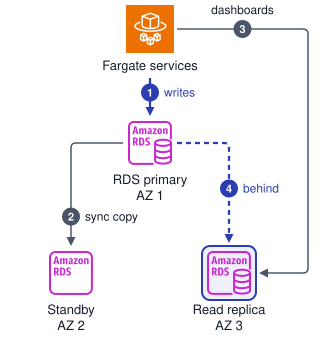

# Amazon Aurora in depth

## How it works (50 min)
<!-- section: role=how; route=full; minutes=50 -->

### An Aurora cluster runs DB instances on one shared cluster volume (3 min)

A classic database keeps all its data on the disk of one machine.

1. **One engine you know.** Amazon Aurora is a [fully managed relational database engine](../facts/aurora.md#aurora-is-managed-relational-engine), [compatible with MySQL and PostgreSQL](../facts/aurora.md#aurora-is-managed-relational-engine).
2. **Compute apart from storage.** A cluster has [one or more DB instances](../facts/aurora.md#aurora-cluster-has-instances-and-volume) and [a cluster volume that manages the data](../facts/aurora.md#aurora-cluster-has-instances-and-volume): the **cluster volume**.
3. **One writer, more readers.** A cluster has [one primary DB instance](../facts/aurora.md#aurora-one-primary-per-cluster), the writer. The others are read-only, [known as Aurora Replicas](../facts/aurora.md#aurora-replicas-read-only-auto-replication).
4. **Add an instance without copying.** You can [add a DB instance quickly](../facts/aurora.md#aurora-add-instance-no-data-copy): it uses the volume that holds the data.

Why keep them apart? An instance joins or leaves without moving data. Even a cluster with [only a single DB instance](../facts/aurora.md#aurora-single-instance-still-a-cluster) is [still a cluster](../facts/aurora.md#aurora-single-instance-still-a-cluster), because its storage spans Availability Zones.

> **Exam signal:** "a MySQL- or PostgreSQL-compatible database with high performance and availability" points to Aurora, a [fully managed relational database service](../facts/aurora.md#aurora-faq-what-is-aurora).

> **Say it:** The short answer is: several DB instances share one volume. The thing to watch is that one instance writes.

**Stop and answer.** A team adds a third DB instance to a cluster that holds 2 TB. Does Aurora copy the 2 TB first?

Answer

No. The new instance uses the shared volume, so you can [add a DB instance quickly](../facts/aurora.md#aurora-add-instance-no-data-copy).

### Every write is stored as six copies across three Availability Zones (4 min)

A disk can fail, and so can a whole Availability Zone (AZ).

1. **Each change goes to storage.** Aurora [synchronously replicates the data across Availability Zones](../facts/aurora.md#aurora-synchronous-replication-to-six-storage-nodes) to [six storage nodes](../facts/aurora.md#aurora-synchronous-replication-to-six-storage-nodes).
2. **Three zones hold the copies.** The volume keeps [six copies](../facts/aurora.md#aurora-storage-six-copies-three-azs) across [three AZs](../facts/aurora.md#aurora-storage-six-copies-three-azs) of a [single AWS Region](../facts/aurora.md#aurora-cluster-volume-three-azs-one-region).
3. **Lost copies are absorbed.** Writes survive the loss of [up to two copies](../facts/aurora.md#aurora-storage-loss-tolerance-write-read), and reads the loss of [up to three copies](../facts/aurora.md#aurora-storage-loss-tolerance-write-read).

Why six copies? Data loss from a disk failure is [greatly minimized](../facts/aurora.md#aurora-three-azs-copies-minimize-disk-loss), and [you only pay for one copy](../facts/aurora.md#aurora-faq-pay-for-one-copy).

> **Exam signal:** "the data must survive the loss of an Availability Zone" points to the cluster volume, which survives it [without any loss of data](../facts/aurora.md#aurora-cmp-ha-az-failure-no-data-loss-brief-interruption).

> **Exam trap:** Many think that six copies make one DB instance highly available. Without an Aurora Replica, Aurora recreates the writer in typically [less than 10 minutes](../facts/aurora.md#aurora-failover-time-without-replica). <!-- trap: aurora-trap-single-instance-is-ha -->

> **Say it:** The short answer is: each write is saved six times in three zones. The thing to watch is the DB instance, which is not copied.

**Stop and answer.** A cluster's only DB instance runs in AZ 1. Two storage nodes in AZ 2 fail. Do writes stop?

Answer

No. Writes survive the loss of [up to two copies](../facts/aurora.md#aurora-storage-loss-tolerance-write-read).

### The cluster volume grows by itself and you pay for used space (3 min)

A database disk has a fixed size. You pay for empty space, and a full disk stops the database.

1. **Nothing to size.** You do not [provision either storage or I/O operations in advance](../facts/aurora.md#aurora-pricing-storage-io-not-provisioned-in-advance).
2. **It grows with the data.** The volume grows as the [amount of data in your database increases](../facts/aurora.md#aurora-cluster-volume-grows-automatically), to a [maximum size of 256 tebibytes (TiB)](../facts/aurora.md#aurora-cluster-volume-max-256-tib-overview) that varies by version. Older questions say [128 TiB](../facts/aurora.md#aurora-change-storage-max-256-tib), the limit before July 2025.
3. **You pay for what is used.** You are [only charged for the space that you use](../facts/aurora.md#aurora-charged-only-for-space-used). After a table drop, [the space allocated for that data is freed](../facts/aurora.md#aurora-volume-shrinks-when-data-removed).

Why only used space? All instances share one [single, virtual volume](../facts/aurora.md#aurora-cluster-volume-ssd-single-virtual), so no instance owns a fixed disk.

> **Exam signal:** "storage growth is unpredictable" points to the cluster volume, which grows by itself.

> **Say it:** The short answer is: storage grows with your data. The thing to watch is the version maximum.

**Stop and answer.** A team wants to allocate 5 TB for a new Aurora cluster that holds 300 GB. What do you tell them?

Answer

Nothing to allocate: you are [only charged for the space that you use](../facts/aurora.md#aurora-charged-only-for-space-used).

### Aurora Replicas read the shared volume so replica lag stays low (4 min)
<!-- section: route=pass -->

An RDS **read replica** (REP-lih-kuh) has its own storage. Amazon RDS takes each update and [copies them asynchronously to the read replica](../facts/rds.md#rds-read-replica-async-read-only), so at peak it falls behind.

1. **Same volume.** Aurora Replicas [connect to the same storage volume](../facts/aurora.md#aurora-adding-replicas-read-same-volume-offload) as the writer and [support read operations only](../facts/aurora.md#aurora-adding-replicas-read-same-volume-offload).
2. **Close behind.** A replica is usually [much less than 100 milliseconds](../facts/aurora.md#aurora-replica-lag-under-100-ms) behind the writer.

**Figure.** An RDS read replica keeps its own copy and receives each change later; an Aurora Replica reads the writer's own volume.

Why so close? Replicas [share the same underlying storage](../facts/aurora.md#aurora-cmp-replicas-share-storage-no-replica-writes), so they write no copy of the change.

> **Exam signal:** "read replicas fall behind at peak" on MySQL or PostgreSQL points to Aurora Replicas.

> **Say it:** The short answer is: Aurora Replicas read the writer's own volume. The thing to watch is delay: low, not zero.

**Stop and answer.** Three RDS for PostgreSQL read replicas fall 30 seconds behind at peak. Will a fourth replica help?

Answer

No. Amazon RDS takes the primary's updates and [copies them asynchronously to the read replica](../facts/rds.md#rds-read-replica-async-read-only). Each replica replays every update, so a fourth replica lags the same.

### The reader endpoint spreads connections not single queries across replicas (4 min)

Instances come and go, so Aurora gives the cluster stable names: endpoints.

1. **Writes: cluster endpoint.** The **cluster endpoint** [connects to the current primary DB instance](../facts/aurora.md#aurora-cluster-endpoint-connects-to-current-primary).
2. **Reads: reader endpoint.** The **reader endpoint** [balances connections to available Aurora Replicas](../facts/aurora.md#aurora-reader-endpoint-balances-connections-not-queries), not single queries.
3. **No replica, no readers.** With [no Aurora Replicas](../facts/aurora.md#aurora-reader-endpoint-no-replica-goes-to-primary-writes-allowed), the [reader endpoint connects to the primary instance](../facts/aurora.md#aurora-reader-endpoint-no-replica-goes-to-primary-writes-allowed).

<!-- table: plain -->
| Endpoint | Use it for |
|---|---|
| Cluster | Writes: [the only one that can perform write operations](../facts/aurora.md#aurora-cluster-endpoint-only-one-for-writes) |
| Custom | [a set of DB instances that you choose](../facts/aurora.md#aurora-custom-endpoint-set-of-chosen-instances), such as large replicas for reports |
| Instance | One instance, to [diagnose capacity or performance issues](../facts/aurora.md#aurora-instance-endpoint-use-diagnose-one-instance) |

Why connections? The replica is chosen when a connection opens. To spread queries, open a new [connection to the reader endpoint for each query](../facts/aurora.md#aurora-reader-endpoint-new-connection-per-query-to-balance). If clients [frequently open and close connections](../facts/aurora.md#aurora-frequent-connections-use-rds-proxy), as Lambda functions do, use **RDS Proxy** (chapter 26).

> **Exam signal:** "send read-only queries to all replicas without changing the application" points to the reader endpoint.

> **Exam trap:** Many think that a connection pool on the reader endpoint spreads each query. A long-lived connection stays on its first replica. Others pick replica instance endpoints in their code. With the reader endpoint, you do not [hardcode all the hostnames](../facts/aurora.md#aurora-endpoint-abstracts-connections-no-hardcode). <!-- trap: aurora-trap-reader-endpoint-balances-queries --> <!-- trap: aurora-trap-instance-endpoints-to-spread-reads -->

> **Say it:** The short answer is: write to the cluster endpoint, and read from the reader endpoint. The thing to watch is connections, not queries.

**Stop and answer.** A job opens one connection to the reader endpoint and runs 5,000 queries. The cluster has three Aurora Replicas. How many replicas serve them?

Answer

One: the endpoint [balances connections to available Aurora Replicas](../facts/aurora.md#aurora-reader-endpoint-balances-connections-not-queries).

### When the writer fails Aurora promotes a replica behind the same endpoint (4 min)
<!-- section: route=pass -->

The writer or its Availability Zone can fail, and the application needs a new writer.

1. **A replica becomes the writer.** Aurora can **fail over** (FAYL OH-ver): it [automatically fails over to an Aurora Replica](../facts/aurora.md#aurora-auto-failover-to-replica).
2. **The endpoint follows.** The cluster endpoint [stays the same even when a failover promotes](../facts/aurora.md#aurora-cluster-endpoint-stays-same-after-failover) a new writer.
3. **A short break.** Service is typically back in [less than 60 seconds](../facts/aurora.md#aurora-failover-time-with-replica-guide).
4. **You set the order.** A [promotion priority tier](../facts/aurora.md#aurora-faq-promotion-highest-priority-first) ranks replicas, [0 for the highest priority to 15 for the lowest priority](../facts/aurora.md#aurora-promotion-priority-range). A tie [promotes the largest one](../facts/aurora.md#aurora-faq-promotion-tie-largest-wins).

<!-- table: plain -->
| Cluster | Recovery |
|---|---|
| A replica in another AZ | Promotion, typically in [less than 60 seconds](../facts/aurora.md#aurora-failover-time-with-replica-guide), often [less than 30 seconds](../facts/aurora.md#aurora-failover-time-with-replica-guide) |
| No replica | The writer is [recreated in the same AZ](../facts/aurora.md#aurora-no-replica-primary-recreated-same-az) |
| All instances in one failed AZ | You [manually create one or more new DB instances](../facts/aurora.md#aurora-single-az-cluster-create-instances-manually) |

Why a replica in another zone? [Promoting an Aurora Replica](../facts/aurora.md#aurora-promoting-replica-faster-than-new-primary) is [much faster than creating a new primary instance](../facts/aurora.md#aurora-promoting-replica-faster-than-new-primary).

> **Exam signal:** "fail over automatically within a minute" points to an Aurora Replica in another AZ.

**Spot the bug.** A team places the writer and both Aurora Replicas in AZ 1 for fast traffic, because "the storage spans three zones". What is wrong?

Answer

If that zone fails, no DB instance is left to promote. Place replicas [in different Availability Zones](../facts/aurora.md#aurora-replica-recommend-same-class-different-az).

> **Say it:** The short answer is: Aurora promotes a replica, and the cluster endpoint follows. The thing to watch is where replicas run.

**Stop and answer.** An application writes through the writer's instance endpoint. After a failover, writes fail. Why?

Answer

An instance endpoint [connects to a specific DB instance](../facts/aurora.md#aurora-instance-endpoint-specific-db-instance). Use the cluster endpoint.

### Aurora Auto Scaling adds and removes Aurora Replicas for read load (3 min)

Read traffic rises every morning and falls at night. A fixed number of replicas wastes capacity at night.

1. **Set a range.** The policy sets the [minimum and maximum number of Aurora Replicas](../facts/aurora.md#aurora-auto-scaling-policy-min-max-replicas), in [0–15](../facts/aurora.md#aurora-autoscaling-replica-count-range).
2. **Track a metric.** Target tracking [creates and manages CloudWatch alarms](../facts/aurora.md#aurora-auto-scaling-target-tracking-cloudwatch) for a metric such as replica CPU.
3. **Scale out and in.** To **scale out** and in, Aurora Auto Scaling [dynamically adjusts the number of Aurora Replicas](../facts/aurora.md#aurora-cmp-aurora-auto-scaling-adjusts-replicas).

Why readers? A cluster has [one primary DB instance](../facts/aurora.md#aurora-one-primary-per-cluster), so more instances add read capacity, not write capacity.

> **Exam signal:** "read traffic varies during the day" with provisioned instances points to Aurora Auto Scaling.

> **Exam trap:** Many think that Aurora Auto Scaling adds write capacity. It helps [only on the reader instances](../facts/aurora.md#aurora-autoscaling-writer-not-scaled). <!-- trap: aurora-trap-auto-scaling-scales-writer -->

> **Say it:** The short answer is: Aurora Auto Scaling adds replicas when reads grow. The thing to watch is the writer.

**Stop and answer.** A team created two Aurora Replicas by hand, and Aurora Auto Scaling added three more at the peak. At night, can it remove the team's two?

Answer

No. It [only removes Aurora Replicas that it created](../facts/aurora.md#aurora-autoscaling-removes-only-own-replicas).

### Aurora Serverless v2 changes capacity with load inside a range you set (4 min)
<!-- section: route=pass -->

A provisioned instance has a fixed size. With unpredictable load, you pay for idle capacity or run short.

1. **Choose db.serverless.** It is a [special DB instance class type](../facts/aurora-serverless.md#aurora-serverless-db-serverless-instance-class-type) in an ordinary cluster: the **serverless** option.
2. **Set a range.** Each **Aurora capacity unit** (ACU) has [approximately 2 gibibytes (GiB) of memory](../facts/aurora-serverless.md#aurora-serverless-acu-about-2-gib-memory). You [specify the minimum and maximum capacity range](../facts/aurora-serverless.md#aurora-serverless-specify-min-max-capacity-range).
3. **Follow the load.** It scales in [increments as small as 0.5 ACUs](../facts/aurora-serverless.md#aurora-serverless-scaling-increments-as-small-as-half-acu), [while database connections are open](../facts/aurora-serverless.md#aurora-serverless-scaling-with-open-connections-no-quiet-point).

<!-- table: plain -->
| Setting | Pause when idle? |
|---|---|
| Minimum zero ACUs, no connections | It can [pause after a period with no user connections](../facts/aurora-serverless.md#aurora-serverless-auto-pause-after-no-connections) |
| Minimum [higher than zero ACUs](../facts/aurora-serverless.md#aurora-serverless-min-capacity-above-zero-no-pause) | No |
| Minimum zero ACUs, RDS Proxy in front | No: the [proxy maintains an open connection](../facts/aurora-serverless.md#aurora-serverless-rds-proxy-blocks-auto-pause) |

Why not a bigger provisioned instance? It risks [higher costs if you overprovision](../facts/aurora-serverless.md#aurora-serverless-overprovision-raises-cost).

> **Exam signal:** "unpredictable or spiky load" points to Aurora Serverless v2, for [variable or "spiky" workloads](../facts/aurora-serverless.md#aurora-serverless-choose-variable-spiky-workloads).

> **Exam trap:** Many think that an idle Aurora Serverless v2 instance costs nothing. It can pause only when you set the minimum [for the cluster to zero ACUs](../facts/aurora-serverless.md#aurora-serverless-auto-pause-min-capacity-zero). Then the [instance charge is zero](../facts/aurora-serverless.md#aurora-serverless-auto-pause-billing-storage-still-charged), but storage is still charged. Others choose it for a steady load, but provisioned clusters are [suitable for steady workloads](../facts/aurora-serverless.md#aurora-serverless-provisioned-suited-to-steady-workloads). <!-- trap: aurora-trap-serverless-pauses-whenever-idle --> <!-- trap: aurora-trap-serverless-for-steady-load -->

> **Say it:** The short answer is: Aurora Serverless v2 resizes the instance with the load. The thing to watch is the minimum.

**Stop and answer.** A team sets the minimum and maximum capacity to 16 ACUs. At a sales peak, queries slow down. Will Aurora add capacity?

Answer

No. With [identical](../facts/aurora-serverless.md#aurora-serverless-identical-min-max-never-scales) minimum and maximum, [the capacity never scales up or down](../facts/aurora-serverless.md#aurora-serverless-identical-min-max-never-scales).

### Aurora Global Database copies the cluster volume to read-only Regions (4 min)
<!-- section: route=pass -->

A whole Region can fail, and users far from it wait longer for every read.

1. **One Region writes.** In **Aurora Global Database**, [only the primary cluster performs write operations](../facts/aurora.md#aurora-global-db-only-primary-writes). With write forwarding, secondaries [forward SQL statements that perform write operations](../facts/aurora.md#aurora-write-forwarding-secondary-forward-sql-writes) to it.
2. **Storage ships the changes.** Replication uses the [cluster storage volume and not the database engine](../facts/aurora.md#aurora-global-db-replication-uses-storage-not-engine), [typically under a second](../facts/aurora.md#aurora-global-replication-latency-under-1-second) behind.
3. **Other Regions read.** Secondary clusters are [made up entirely of Aurora Replicas](../facts/aurora.md#aurora-global-db-secondary-region-readers-only), and local applications [connect to the reader endpoint](../facts/aurora.md#aurora-global-db-scale-reads-connect-to-nearby-reader-endpoint).

Why in storage? Replication has [little performance impact on the primary DB cluster](../facts/aurora.md#aurora-global-db-replication-little-primary-performance-impact).

> **Exam signal:** "low-latency reads for users around the world" points to Aurora Global Database, for [low latency global reads and disaster recovery](../facts/aurora.md#aurora-global-database-multi-region-ha).

> **Exam trap:** Many think that Aurora PostgreSQL can add an Aurora Replica in another Region. It has no [cross-Region Aurora Replicas](../facts/aurora.md#aurora-postgres-no-cross-region-aurora-replicas), so use Aurora Global Database. <!-- trap: aurora-trap-postgres-cross-region-replica -->

> **Say it:** The short answer is: Global Database copies storage to other Regions in about a second. The thing to watch is that one Region writes.

**Stop and answer.** A company runs Aurora PostgreSQL in us-east-1. Its European office needs fast reports, and writes stay in us-east-1. What fits?

Answer

A global database with a secondary cluster in Europe. The office uses that cluster's reader endpoint.

### A secondary Region takes over by failover after an outage by switchover when healthy (4 min)

Two events move the writer to another Region: an outage and a planned move. Each has its own **recovery point objective** (RPO): the data you can lose.

1. **Outage: fail over.** Use failover to [recover from an unplanned outage](../facts/aurora.md#aurora-global-db-failover-use-for-unplanned-outage).
2. **Planned move: switchover.** A **switchover** lets you [relocate the primary cluster](../facts/aurora.md#aurora-global-db-switchover-planned-no-data-loss) [with no data loss](../facts/aurora.md#aurora-global-db-switchover-planned-no-data-loss).
3. **One name for writes.** With the [Aurora Global Database writer endpoint](../facts/aurora.md#aurora-global-db-writer-endpoint-no-app-change-after-switchover), connection settings stay the same.
4. **Cap the loss.** Aurora PostgreSQL can [manage the recovery point objective (RPO)](../facts/aurora.md#aurora-global-db-postgres-rpo-managed-by-parameter). If all secondaries fall behind it, [Aurora pauses transactions on the primary cluster](../facts/aurora.md#aurora-global-db-rpo-blocks-commits-when-all-secondaries-behind).

<!-- table: plain -->
| Question | Failover | Switchover |
|---|---|---|
| When | An outage | [controlled scenarios, such as operational maintenance](../facts/aurora.md#aurora-global-db-switchover-controlled-scenarios) |
| Data loss | Possible | [RPO is 0 (no data loss)](../facts/aurora.md#aurora-global-switchover-rpo-zero) |

> **Try it:** Set an RPO cap in a cluster parameter group, and watch AWS refuse a value that is too low. See [3-do.md](3-do.md). <!-- task: aurora-t02 -->

Why can a failover lose data? The copy is **asynchronous** (ay-SING-kruh-nus): Aurora [asynchronously replicates all data and updates](../facts/aurora.md#aurora-global-database-async-replication-secondary), so the newest writes can be in flight.

> **Exam signal:** "the primary Region is unavailable" points to a managed failover: this [method is recommended for disaster recovery](../facts/aurora.md#aurora-global-db-managed-failover-recommended-for-dr).

> **Exam trap:** Many think that a Global Database failover loses nothing. [Both failover methods can result](../facts/aurora.md#aurora-global-db-failover-can-lose-writes-consistent-state) in the loss of writes that were not yet replicated. Removing a secondary cluster is not a failover either: it [immediately stops the replication](../facts/aurora.md#aurora-global-db-detach-secondary-standalone-readwrite). <!-- trap: aurora-trap-global-failover-no-data-loss --> <!-- trap: aurora-trap-detach-is-managed-failover -->

> **Say it:** The short answer is: fail over after an outage, and run a switchover when all is healthy. The thing to watch is data loss.

**Stop and answer.** A bank accepts 15 minutes of lost data and 1 hour until writes work again. Does Aurora Global Database meet both?

Answer

Yes. The RPO is a [non-zero value measured in seconds](../facts/aurora.md#aurora-global-failover-rpo-nonzero-seconds), and a secondary takes the primary role [within a few minutes](../facts/aurora.md#aurora-global-managed-failover-primary-role-few-minutes).

### Backups are continuous and every restore creates a new cluster (4 min)

A faulty release deletes rows at 14:05. The team needs the data from 14:04.

1. **Backups run all the time.** They are [continuous and incremental](../facts/aurora.md#aurora-backup-continuous-incremental-no-impact) and [always enabled](../facts/aurora.md#aurora-faq-automated-backups-always-on).
2. **You choose how long.** The retention period is [1–35 days](../facts/aurora.md#aurora-backup-retention-period-range-1-35-days).
3. **Restore to a second.** **Point-in-time recovery** reaches [any second during your retention period](../facts/aurora.md#aurora-pitr-any-second-within-retention-period); the newest can be [up to five minutes in the past](../facts/aurora.md#aurora-faq-pitr-latest-five-minutes).
4. **A restore is a new cluster.** It means [creating a new DB cluster](../facts/aurora.md#aurora-pitr-creates-new-cluster).

<!-- table: plain -->
| Need | Tool |
|---|---|
| Data kept for years | A manual snapshot: [Unlike automated backups](../facts/aurora.md#aurora-manual-snapshots-not-subject-to-retention), it ignores the retention period |
| A test copy of production | A clone that [shares the same data pages as the original](../facts/aurora.md#aurora-clone-shares-data-pages-separate-volume) |
| Rewind Aurora MySQL in place | Backtrack: it [rewinds the DB cluster in minutes](../facts/aurora.md#aurora-backtrack-in-minutes-no-new-cluster) |

Why a new cluster? The running cluster stays untouched, and you check the restored data first.

> **Exam signal:** "restore the database to its state of 10 minutes ago" points to point-in-time recovery to a new cluster.

> **Exam trap:** Many think that a point-in-time restore rolls back the running cluster. Backtrack does that, on Aurora MySQL clusters [created with the Backtrack feature enabled](../facts/aurora.md#aurora-backtrack-only-if-enabled-at-creation). <!-- trap: aurora-trap-restore-in-place -->

> **Say it:** The short answer is: Aurora backs up all the time, and a restore gives a new cluster. The thing to watch is the retention period.

**Stop and answer.** A company must keep month-end data for 7 years and sets the highest retention period. Is that enough?

Answer

No. The retention period is [1–35 days](../facts/aurora.md#aurora-backup-retention-period-range-1-35-days). Take a manual snapshot at each month-end.

### Aurora Standard charges for each IO and IO-Optimized includes it (3 min)

Aurora bills instances, storage and, in one configuration, each I/O request.

1. **Standard: pay per request.** **Aurora Standard** charges a [standard rate per 1 million requests for I/O operations](../facts/aurora.md#aurora-standard-pays-per-million-io).
2. **I/O-Optimized: I/O included.** **Aurora I/O-Optimized** has [no additional charges for read and write I/O](../facts/aurora.md#aurora-io-optimized-no-io-charges).
3. **Choose by the I/O share.** I/O-Optimized is the best choice when I/O is [25% or more](../facts/aurora.md#aurora-io-optimized-best-when-io-25-percent-or-more) of your Aurora spending.
4. **Switching has limits.** You can move to I/O-Optimized [once every 30 days](../facts/aurora.md#aurora-io-switch-standard-to-io-optimized-once-every-30-days), and back [at any time](../facts/aurora.md#aurora-io-switch-io-optimized-to-standard-any-time).

Why two models? With light I/O, paying per request costs less in total; heavy I/O gets [improved price performance for I/O-intensive applications](../facts/aurora.md#aurora-faq-io-optimized-fits-io-intensive-workloads).

> **Exam signal:** "I/O-intensive" or "unpredictable I/O costs" points to Aurora I/O-Optimized.

> **Exam trap:** Many think that I/O-Optimized costs less for every cluster. When I/O is [less than 25%](../facts/aurora.md#aurora-standard-best-when-io-under-25-percent) of the spending, Aurora Standard is best. Replicas do not remove I/O charges: I/O is [counted the same way](../facts/aurora.md#aurora-io-counted-same-writer-reader) on writers and readers. Serverless v2 instances also use the [Aurora Standard or Aurora I/O-Optimized configuration](../facts/aurora-serverless.md#aurora-serverless-storage-io-follow-cluster-configuration). <!-- trap: aurora-trap-io-optimized-always-cheaper --> <!-- trap: aurora-trap-replicas-lower-io-bill --> <!-- trap: aurora-trap-serverless-no-io-charges -->

> **Say it:** The short answer is: Standard bills each I/O request, and I/O-Optimized includes them. The thing to watch is your I/O share.

**Stop and answer.** A cluster moved to I/O-Optimized 10 days ago. The team wants Standard for a week, then I/O-Optimized again. Can it?

Answer

It can move back [at any time](../facts/aurora.md#aurora-io-switch-io-optimized-to-standard-any-time), but the return waits: that move is allowed [once every 30 days](../facts/aurora.md#aurora-io-switch-standard-to-io-optimized-once-every-30-days).

### Data moves into Aurora by snapshot by Aurora read replica or by AWS DMS (3 min)

A database on Amazon RDS, on premises or on another engine has to move with little downtime.

1. **From RDS, by snapshot.** You can migrate [from an RDS for PostgreSQL DB snapshot](../facts/aurora.md#aurora-postgres-migrate-snapshot-from-rds).
2. **Short cutover.** Create an **Aurora read replica**, a DB cluster that replicates from the RDS DB instance, for [migration to Aurora PostgreSQL](../facts/aurora.md#aurora-rds-postgres-read-replica-for-migration). It is not an Aurora Replica. It works [within the same AWS Region and account](../facts/aurora.md#aurora-postgres-read-replica-migration-same-region-account).
3. **Cut over.** [Stop all database write workload on the source](../facts/aurora.md#aurora-postgres-promote-stop-write-workload-on-source). Then [you can stop replication](../facts/aurora.md#aurora-postgres-migrate-replica-lag-zero-stop-replication), and the replica becomes a standalone cluster.
4. **Another engine.** From Oracle or SQL Server, use the [AWS Schema Conversion Tool (AWS SCT)](../facts/aurora.md#aurora-migrate-heterogeneous-consider-sct) and [AWS Database Migration Service (AWS DMS)](../facts/aurora.md#aurora-postgres-non-postgres-source-use-dms). <!-- xref: 39 AWS DMS and AWS SCT -->

Why a replica? The source keeps serving during the copy, so the cutover is short: it waits for the last changes.

> **Exam signal:** "migrate RDS for PostgreSQL to Aurora with minimal downtime" points to an Aurora read replica, then promotion.

> **Exam trap:** Many think that every move into Aurora needs AWS SCT. AWS suggests it for a [different underlying engine than Aurora's](../facts/aurora.md#aurora-migrate-heterogeneous-consider-sct). A source that is [not PostgreSQL-compatible](../facts/aurora.md#aurora-postgres-non-postgres-source-use-dms), such as Oracle, moves with AWS DMS. [Babelfish for Aurora PostgreSQL](../facts/aurora.md#aurora-faq-babelfish-sql-server) is for SQL Server applications. <!-- trap: aurora-trap-every-migration-needs-sct --> <!-- trap: aurora-trap-aurora-replica-from-any-source --> <!-- trap: aurora-trap-babelfish-for-any-engine -->

> **Say it:** The short answer is: from RDS, promote an Aurora read replica. The thing to watch is stopping writes before the cutover.

**Stop and answer.** A company wants to move RDS for PostgreSQL into Aurora in another AWS account, with a short cutover. Can it use an Aurora read replica?

Answer

No. It works [within the same AWS Region and account](../facts/aurora.md#aurora-postgres-read-replica-migration-same-region-account). A snapshot is another path.

### Encryption at rest is set at creation and covers the whole cluster (3 min)

A security review asks whether the data is encrypted on disk, in every copy and on the network.

1. **One key.** Aurora [uses an AWS Key Management Service key](../facts/aurora.md#aurora-encryption-uses-aws-kms-key) (AWS KMS key). All DB instances share storage [encrypted with the same KMS key](../facts/aurora.md#aurora-encryption-same-kms-key-all-instances).
2. **New clusters come encrypted.** They are [encrypted by default with an AWS owned key](../facts/aurora.md#aurora-change-default-encryption-new-clusters).
3. **Every copy follows.** The [logs, backups, and snapshots are encrypted](../facts/aurora.md#aurora-encrypted-cluster-all-instances-logs-backups-snapshots) too.
4. **Old unencrypted clusters: restore.** To encrypt one, [restore an unencrypted snapshot](../facts/aurora.md#aurora-encryption-cannot-convert-unencrypted-in-place) and [specify a KMS key when you restore](../facts/aurora.md#aurora-restore-unencrypted-snapshot-specify-kms-key).
5. **On the network.** For data in transit, Aurora PostgreSQL can [require SSL/TLS connections](../facts/aurora.md#aurora-postgres-rds-force-ssl-parameter) (`rds.force_ssl`), and Aurora MySQL can [require that all user connections](../facts/aurora.md#aurora-mysql-require-secure-transport-parameter) use TLS (`require_secure_transport`).

To sign in without a password, AWS Identity and Access Management (IAM) database authentication lets you [use an authentication token](../facts/aurora.md#aurora-iam-db-auth-token-instead-of-password).

> **Try it:** Require TLS in an Aurora MySQL cluster parameter group, and see that the PostgreSQL setting does not exist there. See [3-do.md](3-do.md). <!-- task: aurora-t03 -->

Why no extra work? Clients need no changes to [use encryption](../facts/aurora.md#aurora-encryption-transparent-no-client-changes).

> **Exam signal:** "encrypt an existing unencrypted Aurora cluster" points to a snapshot that you restore with a KMS key.

> **Exam trap:** Many think that an encrypted Aurora Replica, then a failover, encrypts a cluster. All DB instances share storage [encrypted with the same KMS key](../facts/aurora.md#aurora-encryption-same-kms-key-all-instances), so one replica cannot differ. <!-- trap: aurora-trap-encrypted-replica-of-unencrypted-cluster -->

> **Say it:** The short answer is: new clusters come encrypted, and you require TLS. The thing to watch is old clusters: restore to encrypt.

**Stop and answer.** A team created an Aurora cluster in 2024 and did not choose encryption. In 2026, AWS changed the setting for new clusters. Is the old cluster encrypted now?

Answer

No. A cluster where you [did not opt in for encryption](../facts/aurora.md#aurora-change-default-encryption-new-clusters) stays unencrypted. Restore a snapshot with a KMS key.

## Numbers that decide answers (3 min)
<!-- section: role=numbers; route=full; minutes=3 -->

### A-list

<!-- table: numbers -->
| Number | What it is | Why it decides an answer |
|---|---|---|
| [up to 15 Aurora Replicas in addition to the primary DB instance](../facts/aurora.md#aurora-replicas-up-to-15-in-addition-to-primary) | Readers in one cluster | Read scaling in one cluster |
| [six copies](../facts/aurora.md#aurora-storage-six-copies-three-azs) | Copies of the data in [three AZs](../facts/aurora.md#aurora-storage-six-copies-three-azs) | The data survives an AZ failure |
| [less than 60 seconds](../facts/aurora.md#aurora-failover-time-with-replica-guide) | Typical failover to an Aurora Replica | Fast failover needs a replica |
| [less than 10 minutes](../facts/aurora.md#aurora-failover-time-without-replica) | Typical recovery with no Aurora Replica | One instance is not highly available |
| [much less than 100 milliseconds](../facts/aurora.md#aurora-replica-lag-under-100-ms) | Usual delay of an Aurora Replica | Beats a slow RDS read replica |
| [typically under a second](../facts/aurora.md#aurora-global-replication-latency-under-1-second) | Global Database replication | Seconds of data loss across Regions |
| [less than 1 minute](../facts/aurora.md#aurora-global-promote-secondary-under-1-minute) | Secondary Region promotion (FAQ; the user guide says minutes) | Cross-Region RTO under a minute: Global Database |
| [1–35 days](../facts/aurora.md#aurora-backup-retention-period-range-1-35-days) | Backup retention period | Longer keeping needs manual snapshots |

### B-list

<!-- table: numbers -->
| Number | What it is |
|---|---|
| [72 hours](../facts/aurora.md#aurora-backtrack-window-limit-72-hours) | Backtrack window limit |
| [maximum of 256 ACUs](../facts/aurora-serverless.md#aurora-serverless-capacity-range-0-256-acu-half-acu-steps) | Top of the Aurora Serverless v2 range |
| [one day](../facts/aurora.md#aurora-backup-retention-default-1-day) | Default retention period |

## Decision record (3 min)
<!-- section: role=example; route=full; minutes=3 -->

**Context.** Callvale's PostgreSQL database grew from 400 GB to 1.2 TB, and 90% of queries are reads. At peak, the one RDS read replica is 40 seconds behind.

**Figure.** The services write to an RDS primary with a standby, and dashboards read from one read replica that falls behind at peak.

1. The Fargate services send writes and most queries to the RDS primary.
2. The primary keeps a standby in a second Availability Zone.
3. Dashboard queries go to the one read replica.
4. At peak, the read replica falls behind, and dashboards show old data.

**Requirement.** Low-delay replicas behind one endpoint, fast failover and a later second Region, in the MOST scalable way.

**Options.**

- A larger RDS instance with more read replicas.
- **Amazon Aurora PostgreSQL.**
- A cache for all dashboard reads.

**Decision.** Aurora PostgreSQL with one writer and two Aurora Replicas in three Availability Zones. Dev and staging run Aurora Serverless v2.

**Figure.** The services write through the cluster endpoint and read through the reader endpoint of one Aurora cluster that shares one volume.

1. The services send writes to the cluster endpoint, which [connects to the current primary DB instance](../facts/aurora.md#aurora-cluster-endpoint-connects-to-current-primary).
2. Dashboard queries use the reader endpoint, which [balances connections to available Aurora Replicas](../facts/aurora.md#aurora-reader-endpoint-balances-connections-not-queries).
3. The writer and both replicas [connect to the same storage volume](../facts/aurora.md#aurora-adding-replicas-read-same-volume-offload), which keeps [six copies](../facts/aurora.md#aurora-storage-six-copies-three-azs) of the data.
4. If the writer fails, Aurora [automatically fails over to an Aurora Replica](../facts/aurora.md#aurora-auto-failover-to-replica).

**Trade-off.** A migration with a short cutover, and a new cost model to learn.

## FAQ quick-fire (5 min)
<!-- section: role=faq; route=full; minutes=5 -->

**FAQ 1.** Can you turn off automated backups on Aurora?

Answer

No. They are [always enabled](../facts/aurora.md#aurora-faq-automated-backups-always-on).

> "Yes, automated continuous backups are always enabled on Amazon Aurora DB Instances with no database performance impact."
> — [Aurora FAQ: availability](https://docs.aws.amazon.com/rds/latest/auroraextendedcontent/aurora-faq-availability-and-durability.html)

**FAQ 2.** Do your Aurora Reserved Instances still count after a move to I/O-Optimized?

Answer

Yes. I/O-Optimized [works with existing Aurora Reserved Instances](../facts/aurora.md#aurora-faq-io-optimized-works-with-reserved-instances).

> "Yes, Aurora I/O-Optimized works with existing Aurora Reserved Instances."
> — [Aurora FAQ: billing](https://docs.aws.amazon.com/rds/latest/auroraextendedcontent/aurora-faq-billing.html)

**FAQ 3.** Can you restore a snapshot between provisioned and serverless clusters?

Answer

Yes, [in either direction](../facts/aurora-serverless.md#aurora-serverless-faq-snapshot-restore-both-directions).

> "You can also restore snapshots between provisioned and serverless clusters in either direction."
> — [Aurora FAQ: scalability](https://docs.aws.amazon.com/rds/latest/auroraextendedcontent/aurora-faq-scalability.html)

**FAQ 4.** Can you create cross-Region replicas for Aurora?

Answer

Yes, with [either physical or logical replication](../facts/aurora.md#aurora-faq-cross-region-physical-or-logical). Physical means Aurora Global Database.

> "Yes, you can set up cross-Region replicas using either physical or logical replication."
> — [Aurora FAQ: availability](https://docs.aws.amazon.com/rds/latest/auroraextendedcontent/aurora-faq-availability-and-durability.html)

**FAQ 5.** Can an application keep its connection settings when the primary Region fails?

Answer

Yes. The writer endpoint lets you [avoid the need to make application code changes](../facts/aurora.md#aurora-faq-global-db-no-code-change-writer-endpoint).

> "You can also use the Aurora Global Database writer endpoint to avoid the need to make application code changes."
> — [Aurora FAQ: availability](https://docs.aws.amazon.com/rds/latest/auroraextendedcontent/aurora-faq-availability-and-durability.html)

**FAQ 6.** Can you restore a snapshot into the running cluster?

Answer

No. A restore [requires the creation of a new DB Instance](../facts/aurora.md#aurora-faq-snapshot-restore-new-instance).

> "Note that restoring data from  snapshots requires the creation of a new DB Instance."
> — [Aurora FAQ: availability](https://docs.aws.amazon.com/rds/latest/auroraextendedcontent/aurora-faq-availability-and-durability.html)

**FAQ 7.** Do you pay extra for the replication between Availability Zones?

Answer

No. [Aurora replication is bundled into the price](../facts/aurora.md#aurora-faq-replication-not-charged).

> "No, Aurora replication is bundled into the price."
> — [Aurora FAQ: billing](https://docs.aws.amazon.com/rds/latest/auroraextendedcontent/aurora-faq-billing.html)

**FAQ 8.** Can one cluster mix provisioned and Aurora Serverless v2 instances?

Answer

Yes, in [any combination of provisioned and serverless instances](../facts/aurora-serverless.md#aurora-serverless-faq-mixed-cluster-with-provisioned).

> "Yes, you can add Aurora serverless instances to your existing Aurora DB cluster , creating a mixed-configuration cluster with any combination of provisioned and serverless instances."
> — [Aurora FAQ: scalability](https://docs.aws.amazon.com/rds/latest/auroraextendedcontent/aurora-faq-scalability.html)

**FAQ 9.** Can another account in a different Region use your shared snapshot?

Answer

No. Shared snapshots are [accessible only within the same AWS Region](../facts/aurora.md#aurora-faq-shared-snapshot-same-region-only).

> "Shared snapshots are accessible only within the same AWS Region."
> — [Aurora FAQ: availability](https://docs.aws.amazon.com/rds/latest/auroraextendedcontent/aurora-faq-availability-and-durability.html)

**FAQ 10.** Do you need special drivers to connect to Aurora?

Answer

No. It works with [standard MySQL and PostgreSQL database drivers](../facts/aurora.md#aurora-faq-no-special-drivers).

> "Aurora works with standard MySQL and PostgreSQL database drivers."
> — [Aurora FAQ](https://docs.aws.amazon.com/rds/latest/auroraextendedcontent/aurora-faq.html)

