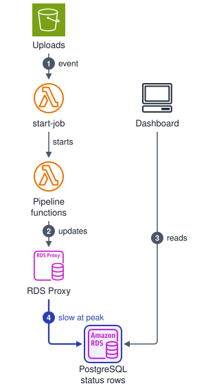

# Amazon DynamoDB in depth

## How it works (55 min)
<!-- section: role=how; route=full; minutes=55 -->

### A table stores items and each item needs only its primary key (3 min)

A relational table fixes its columns first. DynamoDB is **serverless** and fixes the key alone.

1. **Create a table with a key.** When you create a table, [you must specify the primary key](../facts/dynamodb.md#dynamodb-primary-key-required-at-create), and [no two items can have the same key](../facts/dynamodb.md#dynamodb-primary-key-required-at-create).
2. **Choose a key shape.** A **primary key** is a [single-attribute partition key or a composite partition-sort key](../facts/dynamodb.md#dynamodb-faq-primary-key-two-forms): a **partition key**, or that plus a **sort key**.
3. **Leave the rest open.** [Other than the primary key attributes](../facts/dynamodb.md#dynamodb-schemaless-except-primary-key), you define nothing in advance.
4. **Keep items small.** An item holds at most [400 KB](../facts/dynamodb.md#dynamodb-item-size-max). For more, [store the Amazon S3 object identifier](../facts/dynamodb.md#dynamodb-large-items-store-in-s3) in the item.

Why so little schema? You [design your schema specifically](../facts/dynamodb.md#dynamodb-design-schema-for-access-patterns) for known queries.

> **Exam signal:** "session state or shopping carts at any scale" points to DynamoDB, listed for [session stores or shopping carts](../facts/dynamodb.md#dynamodb-decision-guide-key-value-session-store).

> **Say it:** The short answer is: a table needs a key, and items can differ. The thing to watch is the item size.

**Stop and answer.** A product item has 40 attributes and several large photos. Can the photos stay in the item?

Answer

Not past [400 KB](../facts/dynamodb.md#dynamodb-item-size-max). Put them in Amazon S3 and [store the Amazon S3 object identifier](../facts/dynamodb.md#dynamodb-large-items-store-in-s3) in the item.

### A hash of the partition key picks the partition so hot keys throttle (4 min)
<!-- section: route=pass -->

DynamoDB splits a table into partitions, and the partition key decides how evenly work spreads.

1. **Hash the key.** An [internal hash function](../facts/dynamodb.md#dynamodb-partition-key-hash-decides-partition) of the partition key value [determines the partition](../facts/dynamodb.md#dynamodb-partition-key-hash-decides-partition).
2. **Group items.** Items with the [same partition key value](../facts/dynamodb.md#dynamodb-composite-key-same-pk-sorted-together) are stored together: an **item collection**.
3. **Cap each partition.** A partition delivers at most [3,000 read units per second](../facts/dynamodb.md#dynamodb-partition-max-throughput) and [1,000 write units per second](../facts/dynamodb.md#dynamodb-partition-max-throughput).
4. **Throttle the hot key.** Uneven keys create ["hot" partitions that result in throttling](../facts/dynamodb.md#dynamodb-hot-partitions-cause-throttling): **throttling** refuses requests above the limit.

<!-- table: plain -->
| Partition key | Result |
|---|---|
| A [large number of distinct values](../facts/dynamodb.md#dynamodb-uniform-distribution-distinct-keys), such as customer IDs | Even use of capacity |
| A hot key plus a random suffix (**write sharding**) | Writes spread; reads [query the items for all the suffixes](../facts/dynamodb.md#dynamodb-write-sharding-read-merge) |

**Figure.** Requests spread over many key values use every partition, but requests to one hot key meet the ceiling of one partition.

Why one partition? Each item lives in one partition. Adaptive capacity [rebalances your partitions](../facts/dynamodb.md#dynamodb-adaptive-capacity-isolates-hot-items) to split hot items, but one hot item still meets its ceiling.

> **Exam signal:** "throttling on a few keys while the table has spare capacity" points to a hot partition.

> **Say it:** The short answer is: the partition key spreads the work. The thing to watch is one hot key.

**Stop and answer.** Every ticket purchase updates one item that counts the seats left. The table has spare write capacity, yet purchases are throttled. What do you change?

Answer

The key. One item takes at most [1,000 write units per second](../facts/dynamodb.md#dynamodb-partition-max-throughput), so shard the count: [add a random number](../facts/dynamodb.md#dynamodb-write-sharding-random-suffix) to the key.

### Read and write units depend on item size and read consistency (4 min)

DynamoDB counts capacity in units: bigger items and fresher reads cost more.

1. **Count writes.** A **write capacity unit** (WCU) is one write [up to 1 KB](../facts/dynamodb.md#dynamodb-write-unit-1kb), rounded up to the [next 1 KB multiple](../facts/dynamodb.md#dynamodb-write-rounding-1kb).
2. **Count reads.** A **strongly consistent read** needs [one read unit](../facts/dynamodb.md#dynamodb-read-unit-strong-4kb), a **read capacity unit** (RCU), rounded up to the [next 4 KB multiple](../facts/dynamodb.md#dynamodb-read-rounding-4kb).
3. **Default to the cheaper read.** [Eventually consistent is the default](../facts/dynamodb.md#dynamodb-eventually-consistent-default). An **eventually consistent** (ih-VEN-choo-uh-lee) read costs [one-half read unit](../facts/dynamodb.md#dynamodb-read-unit-eventual-4kb) but [might not reflect the results](../facts/dynamodb.md#dynamodb-eventually-consistent-may-lag) of a recent write.

One request can use several units. <!-- trap: dynamodb-trap-one-unit-per-request --> An item that rounds up to [12 KB](../facts/dynamodb.md#dynamodb-getitem-round-10kb-example), three blocks of [4 KB](../facts/dynamodb.md#dynamodb-getitem-round-10kb-example), costs:

<!-- table: plain -->
| Request | Units |
|---|---|
| Eventually consistent read | [1.5 RCUs](../facts/dynamodb.md#dynamodb-pricing-provisioned-10kb-example) |
| Strongly consistent read | [3 RCUs](../facts/dynamodb.md#dynamodb-pricing-provisioned-10kb-example) |

Why double? A strong read uses [twice as many database resources](../facts/dynamodb.md#dynamodb-strong-read-twice-eventual).

> **Exam signal:** "must read the most recent write" points to a strongly consistent read.

> **Exam trap:** A strong read is [only supported on tables and local secondary indexes](../facts/dynamodb.md#dynamodb-strong-reads-only-tables-and-lsi), not on a global secondary index. <!-- trap: dynamodb-trap-gsi-strong-read -->

> **Say it:** The short answer is: size and consistency decide the units. The thing to watch is that strong reads cost double.

**Stop and answer.** An item is 2 KB. How many units does one write use, and one strongly consistent read?

Answer

The write uses [2 write units](../facts/dynamodb.md#dynamodb-write-2kb-example). The read rounds up to the [next 4 KB multiple](../facts/dynamodb.md#dynamodb-read-rounding-4kb): [one read unit](../facts/dynamodb.md#dynamodb-read-unit-strong-4kb).

### On-demand mode bills each request and needs no capacity plan (4 min)
<!-- section: route=pass -->

A new product does not know its traffic, so bought capacity is wasted or short.

1. **Set no numbers.** This is **on-demand capacity mode**: [for on-demand mode tables](../facts/dynamodb.md#dynamodb-on-demand-no-capacity-planning), you state no expected traffic.
2. **Pay per request.** It is [billed per read or write request](../facts/dynamodb.md#dynamodb-ondemand-billed-per-request-zero-traffic-free), and an idle table [scales down to zero](../facts/dynamodb.md#dynamodb-on-demand-scales-to-zero).
3. **Absorb peaks within a limit.** It [instantly accommodates up to double the previous peak](../facts/dynamodb.md#dynamodb-on-demand-previous-peak-double), and it can throttle if you [exceed double your previous peak within 30 minutes](../facts/dynamodb.md#dynamodb-on-demand-throttle-if-double-within-30-min).

Why the default? It needs no forecast, and AWS calls it the [default and recommended throughput option](../facts/dynamodb.md#dynamodb-on-demand-default-recommended) for most workloads.

> **Exam signal:** "unpredictable traffic" points to on-demand: [on-demand capacity mode is the better choice](../facts/dynamodb.md#dynamodb-ondemand-better-for-fluctuating-traffic).

> **Exam trap:** On-demand does not absorb every spike instantly. The **warm throughput** is what a table [can instantaneously support](../facts/dynamodb.md#dynamodb-warm-throughput-definition). Before a launch far above any earlier peak, raise it ([pre-warming](../facts/dynamodb.md#dynamodb-warm-throughput-prewarm-for-peak-events), new on [November 13, 2024](../facts/dynamodb.md#dynamodb-change-warm-throughput-2024-11)). <!-- trap: dynamodb-trap-on-demand-absorbs-any-spike -->

> **Say it:** The short answer is: on-demand bills per request, with no capacity plan. The thing to watch is a record peak.

**Stop and answer.** An on-demand table gets no traffic all weekend. What does that cost for throughput, and is Monday's first request slow?

Answer

Nothing, and no: [you are not charged for any throughput](../facts/dynamodb.md#dynamodb-ondemand-billed-per-request-zero-traffic-free), and [there are no cold starts](../facts/dynamodb.md#dynamodb-on-demand-scales-to-zero).

### Provisioned mode bills the capacity you set and auto scaling follows within minutes (4 min)

A steady, busy workload can buy capacity in advance: **provisioned capacity mode**.

1. **Set the rate.** You [must specify the number of reads and writes](../facts/dynamodb.md#dynamodb-provisioned-must-specify-reads-writes) per second and pay for the [hourly read and write capacity you have provisioned](../facts/dynamodb.md#dynamodb-provisioned-billing-basis).
2. **Throttle above it.** Throttling starts when the [consumption rate exceeds the read or write capacity](../facts/dynamodb.md#dynamodb-provisioned-throttling-when-exceeded).
3. **Scale in minutes.** Auto scaling aims at a [target utilization](../facts/dynamodb.md#dynamodb-autoscaling-target-utilization), the share of capacity in use. It acts when use stays above it for [two consecutive minutes](../facts/dynamodb.md#dynamodb-autoscaling-two-consecutive-minutes) and [takes several minutes to update the provisioned capacity](../facts/dynamodb.md#dynamodb-autoscaling-update-takes-minutes-throttle).

Why choose it? It gives [cost predictability](../facts/dynamodb.md#dynamodb-provisioned-cost-predictability), and **reserved capacity** takes [up to 54% off standard rates for a one-year term](../facts/dynamodb.md#dynamodb-reserved-capacity-terms-and-discount). On-demand is not always cheaper: it costs less at average use [below 35%](../facts/dynamodb.md#dynamodb-ondemand-cheaper-below-35-percent-utilization), and often above when quiet periods mix with peaks. <!-- trap: dynamodb-trap-on-demand-always-cheaper -->

> **Exam signal:** "steady, predictable traffic" points to provisioned capacity with auto scaling.

> **Exam trap:** Auto scaling does not prevent throttling in a sudden spike. [Throttling can occur regardless](../facts/dynamodb.md#dynamodb-throttling-with-autoscaling-possible), because auto scaling [does not respond instantly](../facts/dynamodb.md#dynamodb-throttling-with-autoscaling-possible). <!-- trap: dynamodb-trap-auto-scaling-prevents-throttling -->

> **Say it:** The short answer is: provisioned mode bills the capacity you set. The thing to watch is auto scaling, which takes minutes.

**Stop and answer.** Traffic on a provisioned table with auto scaling jumps fivefold and stays high for ten minutes. What do clients see?

Answer

Throttled requests, after [burst capacity](../facts/dynamodb.md#dynamodb-burst-capacity-handles-spikes) is spent and before auto scaling catches up.

### A Query reads one partition key but a Scan reads every item (4 min)

A read by a known key stays cheap as a table grows.

1. **Name one partition key.** A Query gives the partition key [as an equality condition](../facts/dynamodb.md#dynamodb-query-partition-key-equality-only).
2. **Narrow with the sort key.** You can [optionally provide a second condition](../facts/dynamodb.md#dynamodb-query-optional-sort-key-condition) for [range queries](../facts/dynamodb.md#dynamodb-query-sort-key-range-operators), such as `between`.
3. **Scan reads everything.** A Scan [reads every item in a table](../facts/dynamodb.md#dynamodb-scan-reads-every-item) and slows [as a table or index grows](../facts/dynamodb.md#dynamodb-scan-slows-as-table-grows).
4. **Filter after reading.** A **filter expression** runs after the read, so a Scan [consumes the same amount of read capacity](../facts/dynamodb.md#dynamodb-scan-filter-same-read-capacity).

Fewer returned attributes do not help either: a Scan pays for [the number of items and the size](../facts/dynamodb.md#dynamodb-read-capacity-by-items-read-not-returned) that it reads. <!-- trap: dynamodb-trap-projection-saves-capacity -->

Why so narrow? A NoSQL table is [queried efficiently in a limited number of ways](../facts/dynamodb.md#dynamodb-nosql-queries-efficient-in-limited-ways).

> **Exam signal:** "a Scan with a filter uses too much read capacity" points to a Query on a key or an index.

> **Exam trap:** A filter does not lower a Query's cost either. A Query [consumes the same amount of read capacity](../facts/dynamodb.md#dynamodb-query-filter-same-read-capacity) with or without one. <!-- trap: dynamodb-trap-filter-saves-capacity -->

> **Try it:** Watch a filter leave a Scan's units unchanged; compare ScannedCount with a Query. See [3-do.md](3-do.md). <!-- task: dynamodb-t02 -->

> **Say it:** The short answer is: a Query reads one key's items, and a Scan reads all. The thing to watch is filters.

**Stop and answer.** The partition key is `customer_id` and the sort key is `order_date`. You need one customer's March orders. Which operation, with which conditions?

Answer

A Query: `customer_id` [as an equality condition](../facts/dynamodb.md#dynamodb-query-partition-key-equality-only), plus `between` on `order_date`.

### Secondary indexes give the same items a second key to query (5 min)
<!-- section: route=pass -->

A table answers fast for its own key. A new question needs another key.

1. **Global: any key, any time.** In a **global secondary index** (GSI), the [index key schema can be different](../facts/dynamodb.md#dynamodb-gsi-key-schema-can-differ), and you can [add a new global secondary index](../facts/dynamodb.md#dynamodb-index-online-operations-gsi-vs-lsi) later.
2. **Global copies fall behind.** A GSI is an **asynchronous** (ay-SING-kruh-nus) copy: queries [support eventual consistency only](../facts/dynamodb.md#dynamodb-index-read-consistency-gsi-vs-lsi).
3. **Local: same partition key.** A **local secondary index** (LSI) keeps the [same partition key as the base table](../facts/dynamodb.md#dynamodb-lsi-same-partition-key), [created when the table is created](../facts/dynamodb.md#dynamodb-lsi-created-with-table).
4. **Project what you read.** A GSI query [cannot fetch attributes from the base table](../facts/dynamodb.md#dynamodb-gsi-query-cannot-fetch-from-table): copy them in, the **projection**.

Why two kinds? An LSI keeps an item collection in one partition: [either eventually consistent or strongly consistent reads](../facts/dynamodb.md#dynamodb-lsi-strongly-consistent-allowed) work, but the collection stops at [10 GB](../facts/dynamodb.md#dynamodb-lsi-collection-one-partition).
> **Exam signal:** "query on an attribute that is not the key" points to a GSI.

> **Exam trap:** An existing table gets no new LSI. You [cannot add a local secondary index](../facts/dynamodb.md#dynamodb-index-online-operations-gsi-vs-lsi) to it; add a GSI. <!-- trap: dynamodb-trap-lsi-added-later -->

> **Say it:** The short answer is: an index gives items a second key. The thing to watch is that a global index falls behind.

**Stop and answer.** An `orders` table is keyed on `order_id`. Support needs one email address's orders, newest first. What do you add?

Answer

A GSI on `email` and `order_date`; in the Query, [request descending order](../facts/dynamodb.md#dynamodb-query-ascending-order-default).

### Conditional writes and transactions stop one write from overwriting another (4 min)

Two workers read one item, change it and write it back. The second write erases the first.

1. **Overwrite by default.** `PutItem` and `DeleteItem` are [unconditional](../facts/dynamodb.md#dynamodb-writes-unconditional-by-default): each [overwrites an existing item](../facts/dynamodb.md#dynamodb-writes-unconditional-by-default) with the same key.
2. **Add a condition.** A **conditional write** succeeds if the attributes [meet one or more expected conditions](../facts/dynamodb.md#dynamodb-conditional-write-succeeds-only-if-condition).
3. **Catch a concurrent change.** With **optimistic locking**, a version attribute fails the write if [another process modified the item in the meantime](../facts/dynamodb.md#dynamodb-optimistic-locking-condition-fails-on-concurrent-change).
4. **Change items as one.** A **transaction** makes [all-or-nothing changes to multiple items](../facts/dynamodb.md#dynamodb-transactions-acid-multiple-items-tables) in the [same AWS account and in the same Region](../facts/dynamodb.md#dynamodb-transactwriteitems-same-account-same-region).

Why no locks? Optimistic locking [detects conflicts at write time](../facts/dynamodb.md#dynamodb-optimistic-locking-detects-conflicts-at-write), so no reader waits.

> **Exam signal:** "both updates must succeed or neither" points to `TransactWriteItems`.

> **Exam trap:** `BatchWriteItem` is not a transaction: [only some of the actions](../facts/dynamodb.md#dynamodb-transactwriteitems-vs-batchwriteitem) might succeed, and it [does not support](../facts/dynamodb.md#dynamodb-batchwriteitem-no-updateitem) `UpdateItem` requests. <!-- trap: dynamodb-trap-batch-write-is-atomic -->

> **Try it:** Make a conditional write refuse an overwrite. See [3-do.md](3-do.md). <!-- task: dynamodb-t03 -->

> **Say it:** The short answer is: a condition or a transaction protects a write. The thing to watch is batches, which can half succeed.

**Stop and answer.** A booking needs a new item and a lower seat count in another item: both changes or neither. Which call?

Answer

`TransactWriteItems`: it [either succeeds or fails as a unit](../facts/dynamodb.md#dynamodb-transactwriteitems-succeeds-or-fails-as-unit).

### Time to Live deletes expired items without using write capacity (3 min)

Old items raise the storage bill, and a delete job costs write capacity.

1. **Name an attribute.** For **time to live** (TTL), you [first enable it on a table](../facts/dynamodb.md#dynamodb-ttl-enable-then-define-attribute) and [define a specific attribute](../facts/dynamodb.md#dynamodb-ttl-enable-then-define-attribute).
2. **Store epoch seconds.** The value is a Number in [Unix epoch time format at the seconds granularity](../facts/dynamodb.md#dynamodb-ttl-attribute-number-epoch-seconds).
3. **Delete later, with no write units.** Expired items go [within a few days of their expiration time](../facts/dynamodb.md#dynamodb-ttl-deletes-within-days-no-wcu), [without consuming any write throughput](../facts/dynamodb.md#dynamodb-faq-ttl-no-write-throughput). A global table is [charged for the replicated delete](../facts/dynamodb.md#dynamodb-mrec-ttl-replicated-delete-charged) in other Regions.
4. **Filter until then.** Expired items [continue to show in read and write operations](../facts/dynamodb.md#dynamodb-ttl-expired-items-visible-until-deleted).

For rarely read data, the **table class** DynamoDB Standard-Infrequent Access (Standard-IA) suits tables where [storage is the dominant cost](../facts/dynamodb.md#dynamodb-table-class-standard-ia-lower-storage-cost). Its reads and writes cost more: Standard tables have [lower costs for reads and writes](../facts/dynamodb.md#dynamodb-faq-table-class-cost-tradeoff).

Why days? TTL is a background process, a [cost-effective method for deleting items](../facts/dynamodb.md#dynamodb-ttl-cost-effective-delete).

> **Exam signal:** "delete session data automatically after a period" points to TTL.

**Spot the bug.** TTL is on `expires`, holding text like "2026-10-14". Nothing is deleted. Why?

Answer

The value is [not a Number type](../facts/dynamodb.md#dynamodb-ttl-non-number-attribute-ignored), so it is [ignored by the TTL process](../facts/dynamodb.md#dynamodb-ttl-non-number-attribute-ignored).

> **Say it:** The short answer is: TTL deletes old items without write units. The thing to watch is that expired items linger for days.

**Stop and answer.** Game scores stay a year, are rarely read after a week, and storage is most of the bill. TTL, a table class, or both?

Answer

Both: [Standard-IA tables have lower storage costs](../facts/dynamodb.md#dynamodb-faq-table-class-cost-tradeoff), and TTL deletes old scores without write units.

### DynamoDB Streams records each item change in order for 24 hours (4 min)

Other systems react to item changes. Rereading the table costs reads.

1. **Turn on a stream.** **DynamoDB Streams** is an [optional feature that captures data modification events](../facts/dynamodb.md#dynamodb-streams-optional-feature).
2. **Choose the content.** The **stream view type** ranges from keys only to [both the new and the old images](../facts/dynamodb.md#dynamodb-streams-view-new-and-old-images).
3. **Keep item order.** Each record appears [exactly once in the stream](../facts/dynamodb.md#dynamodb-streams-record-exactly-once), with [ordering at the level of an individual item](../facts/dynamodb.md#dynamodb-streams-order-per-item-not-partition).
4. **Let Lambda read it.** A function reads it through an [event source mapping](../facts/lambda.md#lambda-trigger-dynamodb-esm).
5. **Lose records after a day.** Records have a [lifetime of 24 hours](../facts/dynamodb.md#dynamodb-stream-records-24-hours).

Why a log? Readers get a [time-ordered sequence of every item-level change](../facts/dynamodb.md#dynamodb-streams-time-ordered-changes) without table reads.

> **Exam signal:** "run a function when an item changes" points to DynamoDB Streams with a Lambda trigger.

> **Exam trap:** A stream is not an archive. For a longer replay, Kinesis Data Streams for DynamoDB keeps changes [up to 1 year](../facts/dynamodb.md#dynamodb-streams-vs-kds-retention). <!-- trap: dynamodb-trap-stream-keeps-changes -->

> **Say it:** The short answer is: a stream lists item changes in order, for a day. The thing to watch is the reader count.

**Stop and answer.** Each new order goes to three Lambda functions. Is one DynamoDB stream enough?

Answer

Not safely: you can subscribe [up to two Lambda functions](../facts/dynamodb.md#dynamodb-streams-lambda-two-functions-per-stream). Kinesis Data Streams for DynamoDB serves [5 simultaneous](../facts/dynamodb.md#dynamodb-streams-vs-kds-consumers-per-shard) consumers per shard, or with enhanced fan-out [20 simultaneous consumers per shard](../facts/dynamodb.md#dynamodb-streams-vs-kds-consumers-per-shard).

### DAX answers repeated eventually consistent reads from memory in microseconds (4 min)

A **cache** (KASH) answers hot items from memory. Amazon DynamoDB Accelerator (DAX) is [API-compatible with DynamoDB](../facts/dax.md#dax-api-compatible-minimal-changes).

**Figure.** DAX answers cache hits from memory and sends misses, writes and strongly consistent reads on to the table.

1. The DAX client [directs all of your application's DynamoDB API requests](../facts/dax.md#dax-client-routes-requests-to-cluster) to the DAX cluster.
2. On a cache hit, DAX returns the item [with microsecond latency](../facts/dax.md#dax-eventually-consistent-microsecond-latency).
3. On a cache miss, [DAX sends the request to DynamoDB](../facts/dax.md#dax-cache-miss-reads-dynamodb-and-fills-cache) and keeps the returned item in its [item cache](../facts/dax.md#dax-item-cache-getitem-batchgetitem).
4. A write is [first written to the DynamoDB table](../facts/dax.md#dax-write-through-both-table-and-dax) and then to DAX.
5. [DAX passes strongly consistent read requests to DynamoDB](../facts/dax.md#dax-passes-through-strong-reads-and-transactions) and does not cache the results.

Why a cluster? For fault tolerance, [three nodes are required](../facts/dax.md#dax-production-three-nodes-three-azs).

DAX takes no write load off the table: for a write-heavy application, [DAX benefits might be limited](../facts/dax.md#dax-write-heavy-limited-benefit). <!-- trap: dynamodb-trap-dax-absorbs-writes -->

> **Exam signal:** "microsecond reads with minimal code changes" points to DAX.

> **Say it:** The short answer is: DAX answers repeated reads from memory. The thing to watch is strong reads, which skip the cache.

**Stop and answer.** A leaderboard rereads the same 100 items all day, and every read must show the latest score. Does DAX speed up those reads?

Answer

No. They are strongly consistent reads, and [DAX passes strongly consistent read requests to DynamoDB](../facts/dax.md#dax-passes-through-strong-reads-and-transactions).

### Every restore from a backup or a point in time creates a new table (4 min)

A bad release deletes items, or someone deletes a table.

1. **Back up on demand.** An **on-demand backup** has [zero impact on table performance or availability](../facts/dynamodb.md#dynamodb-backup-restore-zero-performance-impact).
2. **Keep continuous backups.** **Point-in-time recovery** (PITR) keeps [automatic continuous backups](../facts/dynamodb.md#dynamodb-pitr-automatic-continuous-backups); the latest restore point is [five minutes before the current time](../facts/dynamodb.md#dynamodb-pitr-restore-window-five-minutes-to-period).
3. **Restore into a new table.** PITR [always restores to a new table](../facts/dynamodb.md#dynamodb-pitr-restores-to-new-table), and so does a backup: [entire table data to a new table](../facts/dynamodb.md#dynamodb-backup-restore-only-to-new-table).
4. **Copy and lock.** AWS Backup can [copy backups to multiple AWS accounts](../facts/dynamodb.md#dynamodb-aws-backup-copy-multiple-accounts-regions), and its Vault Lock [protects backups from inadvertent or malicious delete operations](../facts/dynamodb.md#dynamodb-aws-backup-vault-lock-worm).

The **recovery point objective** (RPO) is the data you can lose.

<!-- table: plain -->
| Option | RPO |
|---|---|
| PITR | [Minimal RPO (seconds)](../facts/dynamodb.md#dynamodb-dr-pitr-rpo-seconds) |
| Daily on-demand backup | [RPO of 24 hours](../facts/dynamodb.md#dynamodb-dr-daily-on-demand-backup-rpo-24h) |
| AWS Backup, hourly copy to another Region | [RPO of 1 hour](../facts/dynamodb.md#dynamodb-dr-aws-backup-rpo-1-hour) |

Why a new table? The live table stays untouched.

A backup in another Region is not a standby: a restore into a new table comes first. A global table needs no restore: its **recovery time objective** (RTO), the time the application is down, is an [RTO of zero](../facts/dynamodb.md#dynamodb-dr-global-tables-mrec-rto-zero). <!-- trap: dynamodb-trap-backup-is-standby -->

> **Exam signal:** "undo an accidental delete from minutes ago" points to PITR.

> **Exam trap:** A restore does not roll the live table back. You cannot overwrite an existing table [during a restore operation](../facts/dynamodb.md#dynamodb-restore-cannot-overwrite-existing-table). <!-- trap: dynamodb-trap-restore-in-place -->

> **Say it:** The short answer is: every restore builds a new table. The thing to watch is switching your application to it.

**Stop and answer.** A bank wants backups that no administrator can delete, copied to a second account. What do you use?

Answer

AWS Backup, with a copy to that account and Vault Lock in compliance mode: that lock [cannot be altered or deleted by any user](../facts/backup.md#backup-vault-lock-compliance-immutable-by-anyone).

### In a global table every replica accepts reads and writes (5 min)
<!-- section: route=pass -->

Users on two continents need nearby writes.

1. **Add a replica table per Region.** A **global table** has [two or more replica tables](../facts/dynamodb.md#dynamodb-global-table-one-replica-per-region), [only one replica per AWS Region](../facts/dynamodb.md#dynamodb-global-table-one-replica-per-region). Each is a **replica table**.
2. **Write anywhere.** [Any global table replica](../facts/dynamodb.md#dynamodb-global-table-any-replica-serves-reads-writes) can [serve reads and writes](../facts/dynamodb.md#dynamodb-global-table-any-replica-serves-reads-writes).
3. **Replicate eventually.** In **multi-Region eventual consistency** (MREC), the default, writes arrive [typically within a second or less](../facts/dynamodb.md#dynamodb-gt-mrec-default-last-writer-wins), and conflicts end in [last writer wins](../facts/dynamodb.md#dynamodb-gt-mrec-default-last-writer-wins).
4. **Move traffic, not the database.** There is [no primary Region](../facts/dynamodb.md#dynamodb-faq-global-tables-no-failover-needed), so you [shift application traffic to a different Region](../facts/dynamodb.md#dynamodb-global-tables-shift-traffic-on-regional-impairment).

In **multi-Region strong consistency** (MRSC), writes are [synchronously replicated to at least one other Region](../facts/dynamodb.md#dynamodb-gt-mrsc-synchronous-latest-reads): strong reads [always return the latest version of an item](../facts/dynamodb.md#dynamodb-gt-mrsc-synchronous-latest-reads).

<!-- table: plain -->
| Question | MREC | MRSC |
|---|---|---|
| Regions | Two or more | [Exactly three Regions](../facts/dynamodb.md#dynamodb-gt-mrsc-exactly-three-regions): three replicas, or [two replicas and one witness](../facts/dynamodb.md#dynamodb-gt-mrsc-exactly-three-regions) |
| Data lost in a Region failure | [RPO of a few seconds](../facts/dynamodb.md#dynamodb-dr-global-tables-mrec-rto-zero) | [Zero RPO](../facts/dynamodb.md#dynamodb-dr-global-tables-mrsc-rpo-zero) |

> **Exam signal:** "active-active in several Regions" points to a global table.

> **Say it:** The short answer is: every Region reads and writes the table. The thing to watch is conflicts: the last write wins.

**Stop and answer.** Replica tables run in us-east-1 and eu-west-1, and us-east-1 is impaired. What must the team do?

Answer

Route users to eu-west-1. The database needs no failover: there is [no primary Region](../facts/dynamodb.md#dynamodb-faq-global-tables-no-failover-needed).

### IAM controls access and every table is encrypted at rest (3 min)

Personal data needs access control, encryption and a private path.

1. **Use IAM.** DynamoDB has [no user names or passwords](../facts/dynamodb.md#dynamodb-no-passwords-iam-access); IAM policies decide each request. It also [supports resource-based policies for tables and streams](../facts/dynamodb.md#dynamodb-faq-resource-policies-tables-streams).
2. **Narrow to items.** A policy can [restrict access to individual items in a table](../facts/dynamodb.md#dynamodb-fgac-restrict-items-and-attributes) with `dynamodb:LeadingKeys` and the `ForAllValues` modifier, a condition on [the partition key](../facts/dynamodb.md#dynamodb-leadingkeys-condition-key-partition-key).
3. **Encrypt.** [By default, DynamoDB encrypts](../facts/dynamodb.md#dynamodb-encrypt-at-rest-default) all data at rest.
4. **Stay private.** A gateway endpoint lets a VPC reach DynamoDB [without requiring an internet gateway or NAT device](../facts/dynamodb.md#dynamodb-faq-gateway-endpoint-no-igw-nat), at [no additional charge for using gateway endpoints](../facts/vpc-endpoints.md#vpc-endpoints-wp-gateway-endpoint-no-additional-charge). <!-- xref: 10 gateway endpoints and NAT gateways -->

<!-- table: plain -->
| Key | What you can do |
|---|---|
| [AWS owned key (default encryption type)](../facts/dynamodb.md#dynamodb-encryption-key-types) | Nothing: you [cannot view, manage, or use AWS owned keys](../facts/dynamodb.md#dynamodb-aws-owned-key-not-viewable) |
| [AWS managed key](../facts/dynamodb.md#dynamodb-encryption-key-types) | [Audit their use in AWS CloudTrail logs](../facts/dynamodb.md#dynamodb-aws-managed-key-audit-cloudtrail) |
| [Customer managed key](../facts/dynamodb.md#dynamodb-encryption-key-types) | Create, rotate and disable it |

Why IAM? Your code's role carries its permissions, so no password is stored.

> **Exam signal:** "each user reads only items with the user's own ID" points to a condition on [the partition key](../facts/dynamodb.md#dynamodb-leadingkeys-condition-key-partition-key).

> **Say it:** The short answer is: IAM controls access, and every table is encrypted. The thing to watch is the network path.

**Stop and answer.** A team disables a table's customer managed key and forgets it for two weeks. What happens?

Answer

Access stops: the key [prevents all users and the DynamoDB service](../facts/dynamodb.md#dynamodb-customer-managed-key-disabled-blocks-access) from using it. After [longer than seven days](../facts/dynamodb.md#dynamodb-customer-managed-key-inaccessible-archived), [the table is archived](../facts/dynamodb.md#dynamodb-customer-managed-key-inaccessible-archived).

## Numbers that decide answers (3 min)
<!-- section: role=numbers; route=full; minutes=3 -->

### A-list

<!-- table: numbers -->
| Number | What it is | Why it decides an answer |
|---|---|---|
| [400 KB](../facts/dynamodb.md#dynamodb-item-size-max) | Largest item | Larger objects go to Amazon S3 |
| [3,000 read units per second](../facts/dynamodb.md#dynamodb-partition-max-throughput) and [1,000 write units per second](../facts/dynamodb.md#dynamodb-partition-max-throughput) | One partition's ceiling | A hot key throttles alone |
| [next 4 KB multiple](../facts/dynamodb.md#dynamodb-read-rounding-4kb) | Read size rounding | Decides read units |
| [next 1 KB multiple](../facts/dynamodb.md#dynamodb-write-rounding-1kb) | Write size rounding | Decides write units |
| [1 MB per call](../facts/dynamodb.md#dynamodb-query-result-1mb) | One Query or Scan page | Ask for more with `LastEvaluatedKey` |
| [lifetime of 24 hours](../facts/dynamodb.md#dynamodb-stream-records-24-hours) | Stream record life | Longer replay needs Kinesis |
| [up to 5 local secondary indexes](../facts/dynamodb.md#dynamodb-index-limits-20-gsi-5-lsi) | LSIs per table | More keys need GSIs |
| [10 GB](../facts/dynamodb.md#dynamodb-lsi-collection-one-partition) | Item collection with an LSI | Bigger needs a GSI |

### B-list

<!-- table: numbers -->
| Number | What it is |
|---|---|
| [up to 20 global secondary indexes](../facts/dynamodb.md#dynamodb-index-limits-20-gsi-5-lsi) | GSIs per table (default quota) |
| [100 unique items](../facts/dynamodb.md#dynamodb-transaction-max-items) | Items in one transaction, up to [4 MB](../facts/dynamodb.md#dynamodb-transaction-max-data) |
| [between 1 and 35 days](../facts/dynamodb.md#dynamodb-change-pitr-configurable-period-2025-01) | PITR period per table, since [January 7, 2025](../facts/dynamodb.md#dynamodb-change-pitr-configurable-period-2025-01) |
| [99.999%](../facts/dynamodb.md#dynamodb-gt-sla-99999-vs-single-region-9999) | Global table SLA; one Region: [99.99%](../facts/dynamodb.md#dynamodb-gt-sla-99999-vs-single-region-9999) |

## Decision record (3 min)
<!-- section: role=example; route=full; minutes=3 -->

**Context.** On launch day, each call's status row in PostgreSQL was updated 12 times. Row locks and 900 connections stopped the database.

**Figure.** Every pipeline step updates the call's status row in PostgreSQL, and at peak the updates queue behind locks and connections.

1. An upload to Amazon S3 starts the start-job function.
2. Each pipeline step updates the status row of the call in PostgreSQL.
3. The dashboard reads the same status rows to list a customer's jobs.
4. At peak, row locks and connections slow every update.

**Requirement.** Job state needs spiky writes, key lookups and automatic expiry, with the LEAST operational overhead.

**Options.**

- A larger PostgreSQL instance: updates still wait on row locks.
- Amazon DynamoDB with on-demand capacity.
- Amazon ElastiCache: an [ephemeral cache for frequently accessed data](../facts/dynamodb.md#dynamodb-decision-guide-elasticache-caching-layer), not a job record.

**Decision.** A DynamoDB table, jobs, with on-demand capacity and the global secondary index by-customer. Time to live expires each job record 90 days after the call.

**Figure.** Pipeline steps read and write each job by call ID in the jobs table, and the dashboard lists jobs through the index by-customer.

1. The start-job function starts the state machine call-pipeline for each upload.
2. Each step reads and writes the job item by its call ID in the jobs table.
3. The dashboard lists one customer's jobs through the global secondary index by-customer.
4. Time to live deletes old job items [without consuming any write throughput](../facts/dynamodb.md#dynamodb-faq-ttl-no-write-throughput).

**Trade-off.** Access patterns must be known first, and there are no SQL joins.

## FAQ quick-fire (4 min)
<!-- section: role=faq; route=full; minutes=4 -->

**FAQ 1.** Can a global table have two replica tables in one Region?

Answer

No: [one replica table per AWS Region](../facts/dynamodb.md#dynamodb-faq-global-table-one-replica-per-region).

> "A single Amazon DynamoDB global table can only have one replica table per AWS Region."
> — [Amazon DynamoDB FAQs](https://aws.amazon.com/dynamodb/faqs/)

**FAQ 2.** Does a global table need a database failover?

Answer

No: [no primary Region](../facts/dynamodb.md#dynamodb-faq-global-tables-no-failover-needed).

> "A global table has no primary Region, and thus no database failover is required when directing read and write traffic to a different Region."
> — [Amazon DynamoDB FAQs](https://aws.amazon.com/dynamodb/faqs/)

**FAQ 3.** Can one item be larger than 400 KB?

Answer

No: [400 KB](../facts/dynamodb.md#dynamodb-faq-max-item-size-400-kb) is the maximum.

> "The maximum size of an item that can be stored in a DynamoDB table is 400 KB."
> — [Amazon DynamoDB FAQs](https://aws.amazon.com/dynamodb/faqs/)

**FAQ 4.** Does a time to live (TTL) delete use write capacity?

Answer

No: [without consuming any write throughput](../facts/dynamodb.md#dynamodb-faq-ttl-no-write-throughput).

> "With TTL, you can define a per-item timestamp to determine when an item is no longer needed, and DynamoDB automatically deletes the item from your table without consuming any write throughput."
> — [Amazon DynamoDB FAQs](https://aws.amazon.com/dynamodb/faqs/)

**FAQ 5.** Does DynamoDB delete old data by itself?

Answer

No. Data will [remain in the table indefinitely](../facts/dynamodb.md#dynamodb-faq-data-retention-indefinite) unless deleted.

> "There is no set expiration or deletion time for data stored in an Amazon DynamoDB table by default."
> — [Amazon DynamoDB FAQs](https://aws.amazon.com/dynamodb/faqs/)

**FAQ 6.** Can you query on attributes outside the primary key?

Answer

Yes, with [global secondary indexes and local secondary indexes](../facts/dynamodb.md#dynamodb-faq-query-nonkey-via-gsi-lsi).

> "DynamoDB also provides flexible querying by letting you query on nonprimary key attributes using global secondary indexes and local secondary indexes."
> — [Amazon DynamoDB FAQs](https://aws.amazon.com/dynamodb/faqs/)

**FAQ 7.** Does Kinesis Data Streams for DynamoDB keep order and remove duplicates?

Answer

No. It [does not provide record ordering nor deduplication guarantees](../facts/dynamodb.md#dynamodb-faq-kinesis-no-ordering-dedup).

> "Unlike DynamoDB Streams, Kinesis Data Streams for DynamoDB does not provide record ordering nor deduplication guarantees."
> — [Amazon DynamoDB FAQs](https://aws.amazon.com/dynamodb/faqs/)

**FAQ 8.** Can a VPC reach DynamoDB without a NAT device?

Answer

Yes, through a gateway endpoint, [without requiring an internet gateway or NAT device](../facts/dynamodb.md#dynamodb-faq-gateway-endpoint-no-igw-nat).

> "With a gateway endpoint, you can access DynamoDB from your VPC, without requiring an internet gateway or NAT device for your VPC."
> — [Amazon DynamoDB FAQs](https://aws.amazon.com/dynamodb/faqs/)

**FAQ 9.** Can on-premises servers use a DynamoDB gateway endpoint?

Answer

No: [you must use AWS PrivateLink](../facts/dynamodb.md#dynamodb-faq-gateway-endpoint-limits-use-privatelink).

> "However, gateway endpoints do not allow access from on-premises networks, from peered VPCs in other AWS Regions, or through a transit gateway."
> — [Amazon DynamoDB FAQs](https://aws.amazon.com/dynamodb/faqs/)

**FAQ 10.** Can a table switch between the Standard and Standard-IA table classes?

Answer

Yes, [twice in a 30-day period](../facts/dynamodb.md#dynamodb-faq-table-class-switch-twice-30-days).

> "You can switch between these table classes twice in a 30-day period without downtime, allowing you to optimize your costs based on your table's usage patterns."
> — [Amazon DynamoDB FAQs](https://aws.amazon.com/dynamodb/faqs/)

