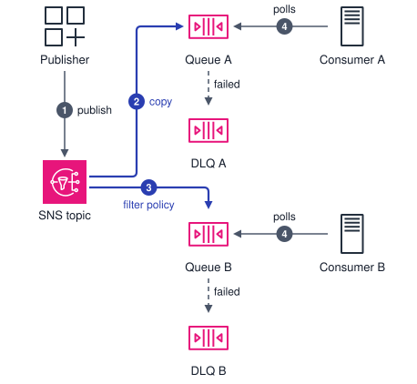
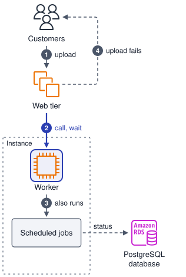

# SQS, SNS and EventBridge in depth

## How it works (51 min)
<!-- section: role=how; route=full; minutes=51 -->

Follow one message into a **queue** (KYOO) and out, then to many receivers, AWS events and access.

### SQS stores each message in several Availability Zones before the sender moves on (3 min)

With a queue, the **producer** can finish before the **consumer** starts.

1. **Send.** SQS [stores the message in multiple availability zones](../facts/sqs.md#sqs-send-stored-multi-az-before-ack) before it acknowledges the send.
2. **Wait.** The number of messages a queue [can store is unlimited](../facts/sqs.md#sqs-queue-backlog-unlimited), so a burst makes the queue longer.
3. **Expire.** The **retention period** is [4 days](../facts/sqs.md#sqs-message-retention-default) by default, at most [14 days](../facts/sqs.md#sqs-message-retention-range). Then SQS [automatically deletes messages](../facts/sqs.md#sqs-auto-deletes-after-retention-period).

<!-- table: plain -->
| Receiver | Direct call | Through a queue |
|---|---|---|
| Down | The request fails | The message waits [until successfully processed or expired](../facts/sqs.md#sqs-decision-keeps-until-processed) |
| Overloaded | Requests fail | Consumers keep their pace |

Why a queue? It is [an intermediate durable storage layer](../facts/sqs.md#sqs-wa-loose-coupling-via-intermediate-durable-layer), so neither side has to wait for the other.

> **Exam signal:** "decouple the tiers" points to a queue between them, for [buffering requests](../facts/sqs.md#sqs-decision-typical-use).

> **Say it:** The short answer is: the queue holds the message. The thing to watch is the retention period.

**Stop and answer.** All consumers stop for six days, and the queue keeps its defaults. Are the first day's messages still there?

Answer

No. The default is [4 days](../facts/sqs.md#sqs-message-retention-default); up to [14 days](../facts/sqs.md#sqs-message-retention-range) would have kept them.

### Consumers poll the queue and long polling waits for messages to arrive (3 min)

SQS uses a [pull-based model](../facts/sqs.md#sqs-decision-pull-model): consumers ask for messages, with **short polling** or **long polling**.

1. **Ask a few servers.** [Short polling (default)](../facts/sqs.md#sqs-short-polling-is-default-immediate-response) [samples a subset of its servers](../facts/sqs.md#sqs-short-polling-samples-subset-of-servers), so a call [might not return all of your messages](../facts/sqs.md#sqs-short-polling-request-may-miss-messages).
2. **Wait for a message.** With a wait time [greater than 0, long polling is in effect](../facts/sqs.md#sqs-long-polling-wait-greater-than-zero). The call [queries all servers for messages](../facts/sqs.md#sqs-long-polling-queries-all-servers) for up to [20 seconds](../facts/sqs.md#sqs-long-polling-max-wait).

<!-- table: plain -->
| Question | Short polling | Long polling |
|---|---|---|
| Empty queue | It [returns immediately](../facts/sqs.md#sqs-faq-long-polling-waits-for-message) | It waits [until a message arrives in the message queue](../facts/sqs.md#sqs-faq-long-polling-waits-for-message) |
Why wait? Waiting lets SQS ask every server.

> **Exam signal:** "reduce the number of empty receives" points to long polling, which can [reduce the number of empty receives](../facts/sqs.md#sqs-faq-long-polling-fewer-empty-receives-lower-cost).

> **Say it:** The short answer is: use long polling. The thing to watch is the limit on each wait.

**Stop and answer.** A consumer polls an often-empty queue in a tight loop and pays for millions of empty receives. What do you change?

Answer

Set the receive message wait time above zero: [any non-zero value sets long polling](../facts/sqs.md#sqs-console-receive-wait-time-default). Each call is [billed exactly the same](../facts/sqs.md#sqs-faq-long-polling-no-extra-charge).

### A received message stays hidden until it is deleted or the timeout ends (4 min)
<!-- section: route=pass -->

Receiving a message does not remove it: SQS hides it during the work.

1. **Hide.** After a receive, [it remains in the queue](../facts/sqs.md#sqs-receive-keeps-message-hidden) but is [temporarily invisible to other consumers](../facts/sqs.md#sqs-receive-keeps-message-hidden): an **in-flight message**.
2. **Time.** The **visibility timeout** is [30 seconds](../facts/sqs.md#sqs-visibility-timeout-default) by default, at most [12 hours](../facts/sqs.md#sqs-visibility-timeout-range).
3. **Delete or return.** [You explicitly delete messages](../facts/sqs.md#sqs-manual-delete-after-processing) with the **receipt handle**. Without a delete, the message [becomes visible again in the queue](../facts/sqs.md#sqs-undeleted-message-visible-again).

Why a timer? SQS has no way to tell a crashed consumer from a slow one.

> **Exam signal:** "some messages are processed twice" with long processing points to a visibility timeout that is too short.

> **Exam trap:** A short visibility timeout is not the safe choice. If it ends during the work, [a duplicate message is received by another consumer](../facts/sqs.md#sqs-visibility-timeout-too-short-gives-duplicate). A long one does not stop a message that fails every time. It only makes you [wait for a relatively long time](../facts/sqs.md#sqs-visibility-timeout-too-long-delays-retry) before the next try. <!-- trap: messaging-trap-short-visibility-safer --> <!-- trap: messaging-trap-longer-timeout-stops-retries -->

> **Try it:** Watch a message that you do not delete come back. See [3-do.md](3-do.md). <!-- task: messaging-t02 -->

> **Say it:** The short answer is: receiving hides a message, deleting removes it. The thing to watch is the timeout.

**Stop and answer.** A worker's instance is terminated before DeleteMessage. When can another consumer get the message?

Answer

When that receive's visibility timeout ends: it [becomes visible again in the queue](../facts/sqs.md#sqs-undeleted-message-visible-again).

### A standard queue can deliver a message twice so consumers must be idempotent (3 min)

A **standard queue** can deliver a copy of a message again.

1. **Miss a delete.** If a server with a copy is down at delete time, [you might get that message copy again](../facts/sqs.md#sqs-copies-on-multiple-servers-cause-duplicates).
2. **Deliver again.** This is **at-least-once delivery**, with a [best-effort attempt to maintain the order](../facts/sqs.md#sqs-standard-best-effort-ordering).
3. **Skip repeats.** [Design your applications to be idempotent](../facts/sqs.md#sqs-copies-on-multiple-servers-cause-duplicates): an **idempotent** (eye-dem-POH-tent) operation has the same effect [as making a single request](../facts/sqs.md#sqs-idempotent-service-same-effect-as-single-request).

<!-- table: plain -->
| Consumer action | Not idempotent | Idempotent |
|---|---|---|
| Add a credit | The balance is wrong | It skips an idempotency token, such as the order ID, that it has seen |
| Set a status to done | Same result | Same result |

Why copies? SQS keeps copies on several servers for redundancy and high availability.

> **Exam signal:** "nearly unlimited throughput" and "order does not matter" point to a standard queue.

> **Say it:** The short answer is: a standard queue can repeat a message. The thing to watch is double charges.

**Stop and answer.** One message produced two credits on an account. Is the queue broken?

Answer

No: [at-least-once message delivery](../facts/sqs.md#sqs-standard-at-least-once-duplicates). Consumers [keep track of each token received](../facts/sqs.md#sqs-consumers-keep-idempotency-tokens-ignore-duplicates) and skip repeats.

### A FIFO queue keeps order inside each message group and drops duplicates (4 min)
<!-- section: route=pass -->

A **FIFO queue** (FY-foh) keeps order and drops duplicates per group, at a lower rate.

1. **Group.** You [associate a message group ID with each message](../facts/sqs.md#sqs-fifo-message-group-id-required): the **message group ID**.
2. **Order.** [Within a message group ID](../facts/sqs.md#sqs-fifo-order-strict-within-group), messages are [sent and received in strict order](../facts/sqs.md#sqs-fifo-order-strict-within-group). Groups get [parallel processing of messages](../facts/sqs.md#sqs-fifo-groups-processed-in-parallel).
3. **Deduplicate.** A message with the same **message deduplication ID** inside the [5 minute deduplication interval](../facts/sqs.md#sqs-fifo-deduplication-interval-5-minutes) is dropped: [only one copy is delivered](../facts/sqs.md#sqs-fifo-deduplication-interval-5-minutes). **Content-based deduplication** can make this ID [by hashing the message body](../facts/sqs.md#sqs-fifo-generated-dedup-id-from-body-hash).
4. **Rate.** By default, [300 messages per second](../facts/sqs.md#sqs-faq-fifo-default-throughput-3000-with-batching-300-without), or [3,000 messages per second with batching](../facts/sqs.md#sqs-faq-fifo-default-throughput-3000-with-batching-300-without). High throughput mode allows more: in three Regions, up to [70,000 transactions per second](../facts/sqs.md#sqs-fifo-ht-top-regions-70000-tps).

<!-- table: plain -->
| Group ID | Order | Parallel work |
|---|---|---|
| One ID for all | One order | One consumer at a time |
| Customer ID | Per customer | Many customers in parallel |

Why per group? Order needs one consumer per group: no group goes to [more than one consumer at a time](../facts/sqs.md#sqs-faq-fifo-same-group-one-consumer-at-a-time).

> **Exam signal:** "in the order they were sent" with "exactly once" points to a FIFO queue.

> **Exam trap:** A FIFO queue does not keep one order across groups. [Messages with different message group IDs](../facts/sqs.md#sqs-fifo-no-order-across-groups) can arrive out of order. It also drops a repeat only inside the [5 minute deduplication interval](../facts/sqs.md#sqs-fifo-deduplication-interval-5-minutes). A later repeat needs an idempotent consumer. <!-- trap: messaging-trap-fifo-global-order --> <!-- trap: messaging-trap-fifo-dedup-forever -->

Go deeper: fair queues in a standard queue

From [July 21, 2025](../facts/sqs.md#sqs-change-fair-queues-standard-2025), fairness is [applied automatically in all Amazon SQS standard queues](../facts/sqs.md#sqs-fair-queues-automatic-no-consumer-change) to messages with a group ID. There the group ID [does not enforce message ordering](../facts/sqs.md#sqs-fair-queues-groupid-is-tenant-id-no-ordering).

> **Say it:** The short answer is: FIFO keeps order per group. The thing to watch is the group ID.

**Stop and answer.** A payments FIFO queue groups by payment type, so one slow card payment blocks the rest. Which group ID is better?

Answer

The customer ID: order per customer, and customers run in parallel.

### After too many failed receives SQS moves a message to a dead-letter queue (4 min)

A **poison-pill message** fails every time. A **dead-letter queue** takes it aside.

1. **Count.** A **redrive policy** sets `maxReceiveCount`, the [number of times a consumer can receive](../facts/sqs.md#sqs-dlq-max-receive-count-meaning) a message [before it is moved to a dead-letter queue](../facts/sqs.md#sqs-dlq-max-receive-count-meaning).
2. **Match.** A FIFO queue's dead-letter queue [must also be a FIFO queue](../facts/sqs.md#sqs-dlq-type-must-match-source-queue-type), in the [same AWS account and Region](../facts/sqs.md#sqs-dlq-same-account-and-region).
3. **Redrive.** After the fix, [redrive the messages from your dead-letter queue](../facts/sqs.md#sqs-faq-dlq-redrive-back-to-source-queue) [to the source queue](../facts/sqs.md#sqs-faq-dlq-redrive-back-to-source-queue).

<!-- table: plain -->
| Setting | Effect |
|---|---|
| A few receives | Short failures retry; a message that fails every time leaves soon |
| A queue that Lambda reads | AWS advises [at least 5](../facts/lambda.md#lambda-sqs-dlq-maxreceivecount-5) |

Why set failures aside? The queue keeps moving.

> **Exam signal:** "isolate messages that cannot be processed" points to a dead-letter queue.

> **Exam trap:** Without a redrive policy, a failing message [becomes visible again in the queue](../facts/sqs.md#sqs-undeleted-message-visible-again) after each timeout. In a standard queue, [the enqueue timestamp is unchanged](../facts/sqs.md#sqs-dlq-standard-enqueue-timestamp-unchanged), so with equal retention a moved message can expire soon after the move. Set the dead-letter queue's retention [longer than the retention period](../facts/sqs.md#sqs-dlq-retention-longer-than-source-queue) of the source. <!-- trap: messaging-trap-dlq-fresh-retention --> <!-- trap: messaging-trap-dlq-without-redrive-policy -->

> **Say it:** The short answer is: failed messages move aside. The thing to watch is the dead-letter queue's retention.

**Stop and answer.** A redrive policy on orders.fifo points to a standard queue. Will SQS accept it?

Answer

No: the dead-letter queue [must also be a FIFO queue](../facts/sqs.md#sqs-dlq-type-must-match-source-queue-type).

### Workers scale on the backlog per instance and not on queue length (4 min)

Workers behind a queue should grow when messages wait and shrink when it drains.

1. **Read the backlog.** [ApproximateNumberOfMessagesVisible](../facts/sqs.md#sqs-metric-visible-messages-is-backlog) counts messages [available for retrieval and processing](../facts/sqs.md#sqs-metric-visible-messages-is-backlog).
2. **Divide.** The queue length [might not change proportionally](../facts/ec2-auto-scaling.md#ec2-auto-scaling-sqs-queue-length-not-proportional) to the group. So use the **backlog per instance**: visible messages divided by [GroupInServiceInstances](../facts/ec2-auto-scaling.md#ec2-auto-scaling-sqs-backlog-per-instance-metric-math).
3. **Target.** Track the [acceptable backlog per instance](../facts/ec2-auto-scaling.md#ec2-auto-scaling-sqs-backlog-per-instance): the acceptable wait divided by the time per message.
4. **Protect.** For long jobs, [use instance scale-in protection](../facts/ec2-auto-scaling.md#ec2-auto-scaling-sqs-unprocessed-messages-return).

<!-- table: plain -->
| Metric | Result |
|---|---|
| Average processor use | For batch work [100% CPU utilization is expected and should not be your primary metric](../facts/ec2-auto-scaling.md#ec2-auto-scaling-wa-queue-depth-metric-for-batch-work) |
| Backlog per instance | It moves with the group size |

Why divide? Each worker's share of the backlog falls when the group grows.

> **Exam signal:** "scale the workers on the number of messages in the queue" points to the backlog per instance.

> **Exam trap:** [ApproximateNumberOfMessagesNotVisible](../facts/sqs.md#sqs-metric-not-visible-messages-is-in-flight) is not the backlog. It counts messages [received but not yet deleted or expired](../facts/sqs.md#sqs-metric-not-visible-messages-is-in-flight). [ApproximateAgeOfOldestMessage](../facts/sqs.md#sqs-metric-age-of-oldest-message-measures-lag) gives the age of the [oldest unprocessed message in the queue](../facts/sqs.md#sqs-metric-age-of-oldest-message-measures-lag). <!-- trap: messaging-trap-in-flight-is-backlog -->

> **Say it:** The short answer is: scale on messages per worker. The thing to watch is long jobs at scale-in.

**Stop and answer.** Four workers face two thousand visible messages, with a target of one hundred per instance. Will workers be added?

Answer

Yes. Visible messages divided by [GroupInServiceInstances](../facts/ec2-auto-scaling.md#ec2-auto-scaling-sqs-backlog-per-instance-metric-math) is five times the target.

### Lambda polls the queue for you and the queue decides the retries (4 min)

With Lambda as the consumer, you write no polling code, but the queue owns the retry rules.

1. **Poll.** An **event source mapping** connects queue and function: [Lambda handles the polling](../facts/lambda.md#lambda-esm-lambda-polls-source).
2. **Fail through the queue.** The queue's [visibility timeout and redrive policy](../facts/lambda.md#lambda-queue-esm-retry-set-on-queue) decide what happens to a failed batch.
3. **Size the timeout.** Set the visibility timeout to [at least six times](../facts/lambda.md#lambda-sqs-visibility-six-times-timeout) the function timeout.

Why the queue? It already hides, counts and sets aside messages.

> **Exam signal:** "process queue messages without managing servers" points to an SQS event source mapping.

> **Exam trap:** One failed message does not mean one retried message. Without a **partial batch response** ([ReportBatchItemFailures](../facts/lambda.md#lambda-sqs-partial-batch-response)), the whole batch returns. With it, Lambda can [make only the failed messages visible again](../facts/lambda.md#lambda-sqs-partial-batch-response). <!-- trap: messaging-trap-lambda-retries-failed-only -->

> **Say it:** The short answer is: Lambda polls, the queue retries. The thing to watch is the visibility timeout.

**Stop and answer.** A function timeout is longer than its queue's visibility timeout. What happens when you create the mapping?

Answer

Lambda [returns an error](../facts/lambda.md#lambda-sqs-timeout-not-above-visibility): the function timeout [must be less than or equal to](../facts/lambda.md#lambda-sqs-timeout-not-above-visibility) the visibility timeout.

### An SNS topic pushes each published message to all its subscribers (3 min)

A **topic** pushes a copy to each **subscription**: this is **publish/subscribe**.

1. **Store.** SNS keeps copies in [multiple Availability Zones before acknowledging receipt](../facts/sns.md#sns-faq-durable-storage-multiple-copies-multiple-azs).
2. **Push.** SNS delivers to [all applicable subscribers](../facts/sns.md#sns-faq-publish-triggers-delivery-to-all-subscribers), such as [delivery streams, Lambda functions, Amazon SQS queues](../facts/sns.md#sns-a2a-subscriber-types) and [mobile applications, mobile phone numbers, and email addresses](../facts/sns.md#sns-a2p-subscriber-types).
3. **Forget.** In a standard topic, [messages are not persisted](../facts/sns.md#sns-decision-no-persistence), and a sent message [cannot be recalled](../facts/sns.md#sns-faq-published-message-cannot-be-recalled). The copies serve delivery and retries, not later reads.

<!-- table: plain -->
| Question | SQS queue | SNS topic |
|---|---|---|
| Who gets it | One consumer | Every subscriber |
| Receiver offline | The message waits | Retries, then it is gone |

Why push? It removes polling and keeps delivery fast: SNS [typical latency](../facts/sns.md#sns-faq-sns-typical-latency-under-30-milliseconds) is [under 30 milliseconds](../facts/sns.md#sns-faq-sns-typical-latency-under-30-milliseconds).

> **Exam signal:** "notify several systems at the same time" points to an SNS topic, used for [fanout notifications](../facts/sns.md#sns-decision-typical-use).

> **Say it:** The short answer is: a topic pushes to every subscriber. The thing to watch is an offline subscriber.

**Stop and answer.** A topic's Lambda subscriber is deleted and created again a week later. Did it miss that week's messages?

Answer

Yes. The delivery [fails because of a client-side error](../facts/sns.md#sns-client-side-error-not-retried), which SNS does not retry, so the retries [over 23 days](../facts/sns.md#sns-retry-aws-managed-total-attempts) do not apply.

### Queues subscribed to a topic give each consumer its own durable copy (4 min)
<!-- section: route=pass -->

**Fan-out** to queues gives each consumer its own copy, which waits during an outage. If you subscribe a queue that you do not own, you [must confirm the subscription](../facts/sns.md#sns-cross-account-non-owner-must-confirm-subscription).

**Figure.** An SNS topic sends a copy of each message to every subscribed queue, and each queue keeps its copy for its own consumer.

1. The publisher sends one message to the topic.
2. SNS [sends the message to each subscribed queue](../facts/sns.md#sns-publish-sends-message-to-each-subscribed-queue).
3. A subscription with a filter policy gets a message only when the message attributes or the message body [satisfy the conditions specified in the filter policy](../facts/sns.md#sns-filter-nonmatching-message-not-sent).
4. Each consumer polls its own queue, where the messages [persist in an Amazon SQS queue](../facts/sns.md#sns-sqs-together-instant-notice-and-later-processing) until it reads them.

<!-- table: plain -->
| Need | Topic | Queues |
|---|---|---|
| Any order | Standard topic | Standard queues |
| Ordered fan-out | FIFO topic | FIFO queues |

Why a queue per consumer? A slow indexer then does not slow the webhooks.

> **Exam signal:** "every service must get every message, even while it is down" points to SNS fan-out to SQS queues.

> **Exam trap:** A subscription alone does not let SNS write to the queue. You must [set a policy on the Amazon SQS queue](../facts/sns.md#sns-sqs-queue-needs-policy-allowing-topic) that allows the topic. <!-- trap: messaging-trap-subscribe-without-queue-policy -->

> **Try it:** Send a message from a topic to a queue, and see how a missing queue policy stops it. See [3-do.md](3-do.md). <!-- task: messaging-t03 -->

> **Say it:** The short answer is: one topic, one queue per consumer. The thing to watch is each queue's policy.

**Stop and answer.** A new audit service subscribes its own queue and is down on its first day. Are that day's orders lost?

Answer

No. Messages [persist in an Amazon SQS queue](../facts/sns.md#sns-sqs-together-instant-notice-and-later-processing) until the service reads them.

### A filter policy decides which messages reach each subscription (3 min)

Not every subscriber needs every message, and discarding them costs work.

1. **Filter.** A **filter policy** lists conditions. You [assign a filter policy to the topic subscription](../facts/sns.md#sns-filter-default-every-message).
2. **Match.** SNS sends a message when it can [satisfy the conditions specified in the filter policy](../facts/sns.md#sns-filter-nonmatching-message-not-sent). It reads the attributes by default ([MessageAttributes](../facts/sns.md#sns-change-payload-based-filtering-2022)), or the message body.
3. **Wait.** A change needs [up to 15 minutes](../facts/sns.md#sns-filter-policy-change-up-to-15-minutes) to take full effect.

<!-- table: plain -->
| Option | Cost |
|---|---|
| Filter on attributes | [Attribute-based message filtering is free](../facts/sns.md#sns-pricing-attribute-filtering-free) |
| Function between topic and queue | Code to write and run |

Why at the subscription? Publishers publish one time, and each subscription states what it wants.

> **Exam signal:** "each subscriber should receive only the messages it needs" points to filter policies.

> **Exam trap:** You need no function, no second topic and no EventBridge rule to filter a topic's messages. The subscriber can [assign a filter policy to the topic subscription](../facts/sns.md#sns-filter-default-every-message). <!-- trap: messaging-trap-filter-needs-function --> <!-- trap: messaging-trap-topic-cannot-filter -->

> **Say it:** The short answer is: each subscription filters its own messages. The thing to watch is the delay after a change.

**Stop and answer.** A minute after a new filter policy, unwanted orders still arrive. Is the policy wrong?

Answer

Not yet: a change needs [up to 15 minutes](../facts/sns.md#sns-filter-policy-change-up-to-15-minutes).

### An EventBridge rule matches event content and sends each match to its targets (4 min)
<!-- section: route=pass -->

Events from AWS services and software as a service (SaaS) partners need routing by content. They land on an **event bus**. An **EventBridge rule** on the bus holds an **event pattern** that events must match, and at most [5](../facts/eventbridge.md#eventbridge-quota-targets-per-rule) targets. A pattern can match the source, such as `aws.ec2`, and [event metadata, and/or event detail values](../facts/eventbridge.md#eventbridge-pattern-matches-metadata-data-content).

**Figure.** Events from AWS services, your applications and SaaS partners land on event buses, and rules send matching events to their targets.

1. When an AWS service sends an event, [it goes to your account's default event bus](../facts/eventbridge.md#eventbridge-aws-service-events-go-to-default-bus).
2. Your applications can send custom events, and SaaS partners send events to [partner event buses](../facts/eventbridge.md#eventbridge-partner-bus-receives-saas-events).
3. Each rule [matches incoming events for a given event bus](../facts/eventbridge.md#eventbridge-faq-rule-matches-events-on-a-bus-and-routes-to-targets).
4. A matching event goes to every target of the rule, [processed in parallel](../facts/eventbridge.md#eventbridge-faq-single-rule-routes-to-multiple-targets-in-parallel).
5. If an event matches no rule, [EventBridge takes no action](../facts/eventbridge.md#eventbridge-event-can-match-several-rules-or-none).

<!-- table: plain -->
| Question | SNS topic | EventBridge rule |
|---|---|---|
| Sources | Your publishers | Also [SaaS applications, and AWS services](../facts/eventbridge.md#eventbridge-faq-eventbridge-recommended-for-app-saas-aws-events) |
| Receivers | [Thousands or millions of endpoints](../facts/sns.md#sns-faq-sns-recommended-for-high-fan-out-thousands-or-millions) | [5](../facts/eventbridge.md#eventbridge-quota-targets-per-rule) targets per rule |

Why route by content? Producers stay unaware of consumers.

> **Exam signal:** "react to events from a SaaS partner" points to EventBridge, the [only event-based service](../facts/eventbridge.md#eventbridge-faq-eventbridge-only-service-integrating-directly-with-saas-partners) for SaaS partners.

> **Say it:** The short answer is: a rule routes events by content. The thing to watch is the target limit.

**Stop and answer.** When any EC2 instance stops, a function must run and a topic must be notified. Is a poller needed?

Answer

No. AWS events reach the [default event bus](../facts/eventbridge.md#eventbridge-default-bus-receives-aws-service-events), and one rule can [route to multiple targets](../facts/eventbridge.md#eventbridge-faq-single-rule-routes-to-multiple-targets-in-parallel).

### Failed deliveries are retried and then dropped unless a dead-letter queue catches them (4 min)

SNS and EventBridge push, so each retries a failed delivery and then drops it.

1. **SNS retries.** To SQS and Lambda, SNS retries [over 23 days](../facts/sns.md#sns-retry-aws-managed-total-attempts); to email and text message (SMS), [over 6 hours](../facts/sns.md#sns-retry-customer-managed-total-attempts); to HTTP/S, at most [3,600 seconds](../facts/sns.md#sns-retry-http-total-retry-time-max).
2. **EventBridge retries.** By default for [24 hours](../facts/eventbridge.md#eventbridge-retry-default-24h-185-attempts), [up to 185 times](../facts/eventbridge.md#eventbridge-retry-default-24h-185-attempts).
3. **Both drop.** SNS [stops retrying the delivery and discards the message](../facts/sns.md#sns-retry-exhausted-discards-unless-dlq), and in EventBridge [the event is dropped](../facts/eventbridge.md#eventbridge-retry-exhausted-event-dropped), unless a dead-letter queue catches it.

<!-- table: plain -->
| Error | Retries |
|---|---|
| EventBridge: target unavailable | Yes, for [24 hours](../facts/eventbridge.md#eventbridge-retry-default-24h-185-attempts) by default |
| EventBridge: missing permission or deleted target | No: [without any retry attempts](../facts/eventbridge.md#eventbridge-some-errors-skip-retries) |
| SNS: deleted endpoint | No: it [fails because of a client-side error](../facts/sns.md#sns-client-side-error-not-retried) |

Why drop? A push service has no store where a consumer can read later.

> **Exam signal:** "keep the messages that could not be delivered" points to a dead-letter queue.

> **Exam trap:** An SNS dead-letter queue does not go on the topic. It is [attached to an Amazon SNS subscription](../facts/sns.md#sns-dlq-attached-to-subscription-not-topic). EventBridge dead-letter queues are [standard Amazon SQS queues](../facts/eventbridge.md#eventbridge-dlq-is-standard-sqs-queue) that keep events that could not be delivered, not events that a target processed wrongly. To run those again, use an archive and a replay. <!-- trap: messaging-trap-dlq-on-topic --> <!-- trap: messaging-trap-target-dlq-keeps-processed-events -->

Go deeper: archive and replay

A Classic bus keeps nothing: [Not retained. To keep events, add an archive.](../facts/eventbridge.md#eventbridge-classic-bus-does-not-retain-events) An **event replay** can [reprocess past events](../facts/eventbridge.md#eventbridge-faq-event-replay-reprocesses-past-events-to-bus-or-rule).

A new Custom event bus of [2026-09-24](../facts/eventbridge.md#eventbridge-change-custom-event-bus-classic-rename-2026) keeps events for [1 to 365 days](../facts/eventbridge.md#eventbridge-change-custom-event-bus-classic-rename-2026). It is not examinable yet.

> **Say it:** The short answer is: push services retry, then drop. The thing to watch is where the dead-letter queue goes.

**Stop and answer.** A rule's Lambda target was deleted by mistake. How many retries happen before its dead-letter queue?

Answer

None: EventBridge [sends these events directly to the target DLQ](../facts/eventbridge.md#eventbridge-some-errors-skip-retries).

### Resource-based policies decide which accounts and services may send to a queue (4 min)

A queue, a topic or a bus belongs to one account, and its own policy decides who can send.

1. **Start private.** A new queue [allows only the queue owner](../facts/sqs.md#sqs-default-access-policy-owner-only); a new topic is [created with no permissions](../facts/sns.md#sns-topic-private-by-default).
2. **Open it.** Write a **resource-based policy**: [configure the queue's access policy](../facts/sqs.md#sqs-cross-account-needs-queue-access-policy), or [edit the permissions on the event bus](../facts/eventbridge.md#eventbridge-cross-account-receiver-edits-bus-permissions).
3. **Allow services.** For S3 event notifications, a topic policy has to [grant the Amazon S3 service (s3.amazonaws.com)](../facts/sns.md#sns-s3-publish-needs-topic-policy-for-s3-principal).

<!-- table: plain -->
| Sender | Queue policy allows |
|---|---|
| A role in another account | The role; its own policy allows the call too |
| An SNS topic | The topic, with the [aws:SourceArn condition](../facts/sns.md#sns-queue-policy-sourcearn-limits-to-one-topic) |

Why the resource's policy? For a call from another account, AWS [allows the request only if both evaluations return Allow](../facts/iam.md#iam-eval-cross-account-needs-both-policies): the caller's policy and the queue's policy.

> **Exam signal:** "an application in another AWS account must send messages to the queue" points to the queue's access policy.

> **Exam trap:** A policy in the sender's account is not enough for another account's queue. You also [configure the queue's access policy](../facts/sqs.md#sqs-cross-account-needs-queue-access-policy). <!-- trap: messaging-trap-iam-policy-enough-cross-account -->

**Spot the bug.** Callvale encrypts the `uploads` queue with the AWS managed key for Amazon SQS. Then S3 event notifications stop arriving. What is wrong?

Answer

S3 needs [permissions in the key policy](../facts/sqs.md#sqs-kms-service-senders-need-customer-managed-key), and you [cannot modify the key policy](../facts/sqs.md#sqs-kms-aws-managed-key-policy-not-modifiable) of the AWS managed key. You must [create a customer managed KMS key](../facts/sqs.md#sqs-kms-service-senders-need-customer-managed-key) in AWS Key Management Service.

> **Say it:** The short answer is: the queue's own policy lets the sender in. The thing to watch is encryption.

**Stop and answer.** An SNS topic in account A delivers to a queue in account B. Which policy in account B changes?

Answer

The queue policy: you must [set a policy on the Amazon SQS queue](../facts/sns.md#sns-sqs-queue-needs-policy-allowing-topic) for the topic.

## Numbers that decide answers (3 min)
<!-- section: role=numbers; route=full; minutes=3 -->

### A-list

<!-- table: numbers -->
| Number | What it is | Why it decides an answer |
|---|---|---|
| [4 days](../facts/sqs.md#sqs-message-retention-default) | Default retention period | Older messages are deleted unread |
| [14 days](../facts/sqs.md#sqs-message-retention-range) | Longest retention period | Longer: copy to Amazon S3 |
| [30 seconds](../facts/sqs.md#sqs-visibility-timeout-default) | Default visibility timeout | Longer work gives duplicates |
| [12 hours](../facts/sqs.md#sqs-visibility-timeout-range) | Longest visibility timeout | Longer jobs need another design |
| [20 seconds](../facts/sqs.md#sqs-long-polling-max-wait) | Longest long-polling wait | Fewer empty receives |
| [15 minutes](../facts/sqs.md#sqs-delay-queue-range) | Longest delay of a delay queue | Later starts need Amazon EventBridge Scheduler |
| [300 messages per second](../facts/sqs.md#sqs-faq-fifo-default-throughput-3000-with-batching-300-without), [3,000 messages per second with batching](../facts/sqs.md#sqs-faq-fifo-default-throughput-3000-with-batching-300-without) | Default FIFO queue throughput | More: high throughput mode |
| [5](../facts/eventbridge.md#eventbridge-quota-targets-per-rule) targets | Targets of one EventBridge rule | More needs another rule or a topic |

### B-list

<!-- table: numbers -->
| Number | What it is |
|---|---|
| [1 MiB](../facts/sqs.md#sqs-message-size-range) | Largest SQS message (changed in 2025) |
| [2 GB](../facts/sqs.md#sqs-extended-client-max-payload) | Payload in Amazon S3 with the Extended Client Library |
| [10 messages](../facts/sqs.md#sqs-batch-max-messages) | Messages in one batch request |
| [5 minute deduplication interval](../facts/sqs.md#sqs-fifo-deduplication-interval-5-minutes) | FIFO deduplication window |
| [256 KiB](../facts/sns.md#sns-message-size-default-256kib) | Default SNS message size |
| [100 per topic](../facts/sns.md#sns-quota-subscriptions-per-topic) | Subscriptions of a FIFO topic |

> **Changed recently:** (2026-09-18) Largest SNS message, as an opt-in for each topic. 
> **Old:** [256 KiB](../facts/sns.md#sns-change-max-message-size-1mib-opt-in-2026). 
> **Now:** [1 MiB](../facts/sns.md#sns-change-max-message-size-1mib-opt-in-2026) for a topic that opts in. 
> **The exam probably expects:** the old value, if any. Do not let this number decide an answer. 
> **Status:** not examinable yet.

## Decision record (3 min)
<!-- section: role=example; route=full; minutes=3 -->

**Context.** Launch day, month 12. Each upload waited for the one worker, and 1,900 uploads failed in 47 minutes.

**Figure.** The web application calls the one worker and waits, so when the worker is busy, the upload fails.

1. A customer uploads a recording to the web application.
2. The web application calls the worker and waits for it to finish.
3. Scheduled jobs on the same worker save results and send notifications.
4. When the worker is overloaded, the upload request fails.

**Requirement.** No upload can be lost, one failure must not block others, and several systems need each transcript. Which design is the MOST resilient?

**Options.**

- More and larger workers behind an internal load balancer.
- **Amazon SQS queues, with an Amazon SNS topic for results.**
- One stream for all events.

**Decision.** Queues between the stages, and a topic that fans out results. The `convert` queue moves a message to `convert-dlq` after 3 failed receives.

**Figure.** Uploads wait in queues between the steps, and the transcript-ready topic sends each finished transcript to two queues.

1. An upload to Amazon S3 sends an event to the uploads queue.
2. The start-job function reads the uploads queue and sends conversion work to the convert queue.
3. Conversion workers scale on the convert backlog and process each message.
4. The save-results function publishes to the transcript-ready topic, which [sends the message to each subscribed queue](../facts/sns.md#sns-publish-sends-message-to-each-subscribed-queue).
5. A consumer can receive a message a set number of times [before it is moved to a dead-letter queue](../facts/sqs.md#sqs-dlq-max-receive-count-meaning).

**Trade-off.** Processing is asynchronous, and workers must handle a repeated message without harm.

## FAQ quick-fire (4 min)
<!-- section: role=faq; route=full; minutes=4 -->

**FAQ 1.** Can you convert an existing standard queue to a FIFO queue?

Answer

No: [choose the queue type when you create it](../facts/sqs.md#sqs-faq-cannot-convert-standard-to-fifo).

> "No. You must choose the queue type when you create it."
> — [Amazon SQS FAQs](https://aws.amazon.com/sqs/faqs/)

**FAQ 2.** Does a long-polling ReceiveMessage call cost more than a short-polling one?

Answer

No: [billed exactly the same](../facts/sqs.md#sqs-faq-long-polling-no-extra-charge).

> "Long-polling ReceiveMessage calls are billed exactly the same as short-polling ReceiveMessage calls."
> — [Amazon SQS FAQs](https://aws.amazon.com/sqs/faqs/)

**FAQ 3.** Can a deleted message come back from a standard queue?

Answer

Yes, rarely: you might receive a [previously-deleted message a second time](../facts/sqs.md#sqs-faq-deleted-message-standard-may-repeat-fifo-never).

> "For standard queues, under rare circumstances, you might receive a previously-deleted message a second time."
> — [Amazon SQS FAQs](https://aws.amazon.com/sqs/faqs/)

**FAQ 4.** Can a queue share its messages with a queue in another Region?

Answer

No: [independent within each region](../facts/sqs.md#sqs-faq-queues-are-independent-per-region).

> "Each Amazon SQS message queue is independent within each region."
> — [Amazon SQS FAQs](https://aws.amazon.com/sqs/faqs/)

**FAQ 5.** Can a FIFO queue use a standard queue as its dead-letter queue?

Answer

No: you [must use a FIFO dead letter queue](../facts/sqs.md#sqs-faq-dlq-fifo-needs-fifo-standard-needs-standard).

> "However, you must use a FIFO dead letter queue with a FIFO queue."
> — [Amazon SQS FAQs](https://aws.amazon.com/sqs/faqs/)

**FAQ 6.** Can you recall a message after you publish it to a topic?

Answer

No: it [cannot be recalled](../facts/sns.md#sns-faq-published-message-cannot-be-recalled).

> "No, once a message has been successfully published to a topic, it cannot be recalled."
> — [Amazon SNS FAQs](https://aws.amazon.com/sns/faqs/)

**FAQ 7.** Can any AWS account publish to your topic by default?

Answer

No: [only topic owners have permissions to publish](../facts/sns.md#sns-faq-default-only-topic-owner-can-publish).

> "By default, only topic owners have permissions to publish to a topic."
> — [Amazon SNS FAQs](https://aws.amazon.com/sns/faqs/)

**FAQ 8.** Does a standard SNS topic deliver messages in the order they were published?

Answer

Not in every case: [out-of-order messages at the subscriber end](../facts/sns.md#sns-faq-order-attempted-but-network-issues-can-reorder) can occur.

> "However, network issues could potentially result in out-of-order messages at the subscriber end."
> — [Amazon SNS FAQs](https://aws.amazon.com/sns/faqs/)

**FAQ 9.** Can EventBridge Scheduler call a third-party HTTPS endpoint directly?

Answer

No: it [does not support non-AWS targets directly](../facts/eventbridge.md#eventbridge-faq-scheduler-no-direct-non-aws-targets).

> "EventBridge Scheduler does not support non-AWS targets directly."
> — [Amazon EventBridge FAQs](https://aws.amazon.com/eventbridge/faqs/)

**FAQ 10.** Can one EventBridge rule send an event to several targets?

Answer

Yes: it can [route to multiple targets](../facts/eventbridge.md#eventbridge-faq-single-rule-routes-to-multiple-targets-in-parallel).

> "A single rule can route to multiple targets, all of which are processed in parallel."
> — [Amazon EventBridge FAQs](https://aws.amazon.com/eventbridge/faqs/)

