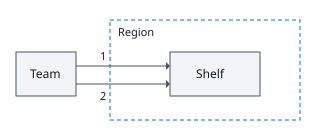

# Amazon Widget Store

## Predict (1 min)
<!-- section: role=predict; route=fast; minutes=1 -->

Guess before you read. The answers are in the Check section.

**Predict 1.** A team in Frankfurt and a team in Tokyo want to use the same shelf. Does a shelf belong to every Region? <!-- gist-trap -->

**Predict 2.** A team has 600 widgets. Do the widgets fit on one shelf?

## Look first (3 min)
<!-- section: role=task; route=fast; minutes=3 -->

Find one shelf in the Widget Store console and read the Region next to its name. Ask yourself why a shelf shows a Region.

<!-- task:start id=sample-t01 -->
<!-- task:end -->

## In one breath (3 min)
<!-- section: role=breath; route=fast; minutes=3 -->

> **Say it:** Amazon Widget Store keeps widgets on shelves. A shelf stores widgets in [one AWS Region](../facts/widget.md#widget-shelf-scope).

**The problem it solves.** A team that keeps its own widget list often counts widgets wrongly. Widget Store gives the team one place for widgets and one way to count them.

**Predict the picture.** Where does a shelf sit: inside a Region, or outside all Regions?

Show the picture

**Figure.** A shelf sits inside one Region, and the team reaches the shelf from outside.

1. The team creates a shelf in a Region.
2. The team puts widgets on the shelf.

> **Startup example:** Callvale keeps 300 demo widgets for its customers in Germany. Ben wants one place for them. You create one shelf in Frankfurt, because every widget must stay in Germany.

## Words that go together (2 min)
<!-- section: role=words; route=fast; minutes=2 -->

<!-- table: words -->
| Term | Words that go with it | Plain meaning | Do not confuse with |
|---|---|---|---|
| shelf | **create** a shelf in a Region | The place that stores widgets | crate |
| crate (KRAYT) | **ship** a crate between Regions | A container for widgets that travel | shelf |
| idempotent (eye-dem-POH-tent) | an idempotent **request** | The same request twice gives the same result | a retry |

## Choose it or not (2 min)
<!-- section: role=choose; route=fast; minutes=2 -->

### Shelf or crate

<!-- table: compare -->
| Question | Shelf | Crate |
|---|---|---|
| How many widgets fit? | [500 widgets](../facts/widget.md#widget-shelf-max-widgets) | [50 widgets](../facts/widget.md#widget-crate-capacity) |
| Where does it live? | In [one AWS Region](../facts/widget.md#widget-shelf-scope) | It travels between Regions |
| Can it change Region? | No: you [cannot move a shelf](../facts/widget.md#widget-shelf-move) | Yes |

**Deciding question:** Do the widgets stay in one Region, or do they travel to another Region?

## Signals and traps (2 min)
<!-- section: role=signals; route=fast; minutes=2 -->

<!-- table: signals -->
| The stem says | Think | Because | But not if |
|---|---|---|---|
| "widgets must stay in one Region" | shelf | a shelf stores widgets in [one AWS Region](../facts/widget.md#widget-shelf-scope) | the stem has more than [500 widgets](../facts/widget.md#widget-shelf-max-widgets): use two shelves |
| "send widgets to another Region" | crate | you [cannot move a shelf](../facts/widget.md#widget-shelf-move) | the stem asks for a second shelf: [copy the shelf](../facts/widget.md#widget-shelf-move) |

### Traps

- **Wrong belief:** A shelf is global, so every Region sees it. **Truth:** A shelf stores widgets in [one AWS Region](../facts/widget.md#widget-shelf-scope). <!-- trap: sample-trap-shelf-global -->
- **Wrong belief:** You can always move a shelf when your team moves. **Truth:** You [cannot move a shelf](../facts/widget.md#widget-shelf-move) to another Region. Copy the shelf. <!-- trap: sample-trap-shelf-move -->
- **Wrong belief:** A shelf grows without a limit. **Truth:** A shelf holds [up to 500 widgets](../facts/widget.md#widget-shelf-max-widgets). <!-- trap: sample-trap-shelf-unlimited -->

## Changed recently (1 min)
<!-- section: role=changed; route=fast; minutes=1 -->

> **Changed recently:** (2025-11-19) Maximum number of widgets on a shelf. 
> **Old:** [200 widgets](../facts/widget.md#widget-shelf-max-widgets). 
> **Now:** [500 widgets](../facts/widget.md#widget-shelf-max-widgets). 
> **The exam probably expects:** the new value. Prefer an option that is right under both values. 
> **Status:** examinable.

## Check (1 min)
<!-- section: role=check; route=fast; minutes=1 -->

**Check 1.** Callvale creates a shelf in Frankfurt. Does the Tokyo Region hold a copy of that shelf?

Answer

No. A shelf stores widgets in [one AWS Region](../facts/widget.md#widget-shelf-scope). For Tokyo, the team can [copy the shelf](../facts/widget.md#widget-shelf-move).

**Check 2.** A customer brings 520 widgets. Do the widgets fit on one shelf?

Answer

No. A shelf holds [up to 500 widgets](../facts/widget.md#widget-shelf-max-widgets). The customer needs a second shelf.

## Recap from memory (1 min)
<!-- section: role=recap; route=fast; minutes=1 -->

**Recap 1.** What is the one-breath definition of Amazon Widget Store?

Answer

Amazon Widget Store keeps widgets on shelves. A shelf stores widgets in [one AWS Region](../facts/widget.md#widget-shelf-scope).

**Recap 2.** Which resource carries widgets between Regions, and how many widgets does it hold?

Answer

A crate. A crate holds [50 widgets](../facts/widget.md#widget-crate-capacity).

